# Mojaloop Architecture: Discovery and Diagrams

> Architecture v1.0 · 2026-11-04 · Analysed repository: `mojaloop/ml-core-test-harness` v2.15.1 (image versions pinned in [`.env`](../../.env))
> Audience: learners new to Mojaloop, solution architects, technical leads and engineering managers.
> Companion material: the hands-on [learning guide](../learning-guide/00-README.md), whose labs verified much of what is shown here.

---

## 1. Read this first: what this repository is

This repository is the **Mojaloop core test harness**. It runs a complete Mojaloop switch on one machine with Docker Compose, together with simulated banks, test suites, optional monitoring and a back-office portal. It does **not** contain the source code of the switch services (they are pulled as pre-built images), Helm charts or production infrastructure.

So every diagram answers one of two questions, and they are **never mixed**:

| Perspective | Question | Diagrams |
| --- | --- | --- |
| **As-Is** (blue banner) | What does this repository actually provide, configure, or show evidence of? | 01, 02, 03a, 04a, 05a, 06a, 07, 08, 09, 10 |
| **Target** (purple banner) | How would you deploy and harden it for a financial institution or a national switch? | 03b, 04b, 05b, 06b |

Where an As-Is diagram shows something that is *missing*, it is drawn as a grey **NOT PRESENT** box: absence is a finding, not a design.

### Status labels

Every component in the diagrams and the [evidence register](analysis/architecture-evidence-register.md) carries one of these labels:

| Label | Meaning |
| --- | --- |
| **IMPLEMENTED** | Verified in source code: this repository's own tooling, or the upstream service source at the exact pinned image tag. Many were also observed at runtime in the 2026-11-04 labs. |
| **CONFIGURED** | Present in deployment or configuration files here (compose files, config overrides, env files, Kubernetes patches) |
| **EXTERNAL** | Depends on a system outside this repository |
| **OPTIONAL** | Supported but not enabled by default (a separate profile or a switched-off setting) |
| **PROPOSED** | Recommended design; not present in the repository |
| **UNVERIFIED** | Insufficient evidence |

---

## 2. How to read the diagrams

All diagrams use the same visual language. Open the `.svg` files directly (or click them below) to view them at full size: they are drawn for 1800–2000 px width, with text no smaller than 10.5 px at 100 % zoom, and scale cleanly.

| Visual | Meaning |
| --- | --- |
| Blue box | Mojaloop core service |
| Green box | FSP-side Mojaloop component (SDK Scheme Adapter) |
| Grey box | External system or participant |
| Amber box / cylinder | Database or data store |
| Light-green box with bars | Message broker (Kafka) |
| Teal box | Operations and observability |
| Yellow box | Test tooling (Testing Toolkit) or a note |
| Purple outline | Infrastructure or platform |
| Rose box | Identity / IAM |
| Red box or red dashed outline | Security control or security boundary |
| Dashed outline | Optional component |
| Solid arrow | Synchronous call (HTTP request/response) |
| Dashed arrow | Asynchronous (Kafka message or FSPIOP callback) |
| Teal dash-dot arrow | External integration / out-of-band process |
| Amber arrow | Data access |
| Numbered circle | Step or connection number, cross-referenced to a table |

---

## 3. Diagram catalogue

| # | Diagram | What it shows | Analysis |
| --- | --- | --- | --- |
| 01 | [High-level enterprise architecture](diagrams/01-high-level-enterprise-architecture.svg) | Participants, the hub and its services, data stores, Kafka, operations, test tooling, runtime platform, security perimeter | [component-inventory](analysis/component-inventory.md) |
| 02 | [Detailed microservices architecture](diagrams/02-detailed-microservices-architecture.svg) | Every service and handler by domain, with inputs, outputs, ports and stores | [component-inventory](analysis/component-inventory.md), [technology-stack](analysis/technology-stack.md) |
| 03a | [Infrastructure: As-Is](diagrams/03a-infrastructure-as-is.svg) | Docker Compose on one host; Kubernetes evidence from the perf-tuning patches | [infrastructure-inventory](analysis/infrastructure-inventory.md) |
| 03b | [Kubernetes infrastructure: Target](diagrams/03b-kubernetes-infrastructure-target.svg) | Proposed 3-zone cluster, namespaces, workloads, scaling, external dependencies | [infrastructure-inventory](analysis/infrastructure-inventory.md) |
| 04a | [Resilience and recovery: As-Is](diagrams/04a-resilience-as-is.svg) | Single points of failure, built-in protocol resilience, failure scenarios here | [high-availability-analysis](analysis/high-availability-analysis.md) |
| 04b | [HA, BC and DR: Target](diagrams/04b-high-availability-disaster-recovery-target.svg) | Active primary + warm-standby DR, replication, backups, 7 scenarios, RPO/RTO as decisions | [disaster-recovery-analysis](analysis/disaster-recovery-analysis.md) |
| 05a | [Security: As-Is](diagrams/05a-security-as-is.svg) | Exposure map and 12 control layers with their status | [identity-and-security-analysis](analysis/identity-and-security-analysis.md) |
| 05b | [Security: Target](diagrams/05b-security-target.svg) | Defence in depth: gateway, mesh, data zone, operator access, keys, monitoring | [identity-and-security-analysis](analysis/identity-and-security-analysis.md) |
| 06a | [Identity and RBAC: As-Is](diagrams/06a-identity-rbac-as-is.svg) | Who reaches what with which authentication and authorisation; dormant hooks; ledger roles | [rbac-and-permissions](analysis/rbac-and-permissions.md) |
| 06b | [RBAC and roles: Target](diagrams/06b-identity-rbac-target.svg) | 11 proposed roles and a role-permission matrix | [rbac-and-permissions](analysis/rbac-and-permissions.md) |
| 07 | [End-to-end payment flow](diagrams/07-end-to-end-payment-flow.svg) | Sequence of a P2P transfer through every service, topic and state; error scenarios | [payment-processing-flows](analysis/payment-processing-flows.md) |
| 08 | [Component interaction](diagrams/08-component-interaction-architecture.svg) | 26 numbered connections with protocol, format, pattern, authentication, failure handling | [architecture-evidence-register](analysis/architecture-evidence-register.md) |
| 09 | [Data architecture](diagrams/09-data-architecture.svg) | Stores, ownership, entities, data movement, consistency rules | [data-architecture](analysis/data-architecture.md) |
| 10 | [Observability and operations](diagrams/10-observability-operations-architecture.svg) | Metrics, audit, health and log paths; verified behaviour; gaps | [component-inventory §15](analysis/component-inventory.md#15-monitoring-stack) |

**How the diagrams relate.** Start with **01** for the big picture. Zoom in to services with **02**, follow one payment through them with **07**, and see every wire between them in **08**; **09** shows where the data ends up. **03a / 04a / 05a / 06a / 10** describe how the repository runs and protects all this today. **03b / 04b / 05b / 06b** are the matching target designs. Read each As-Is diagram next to its Target partner: the difference is the work an implementation team must do.

---

## 4. How Mojaloop is structured

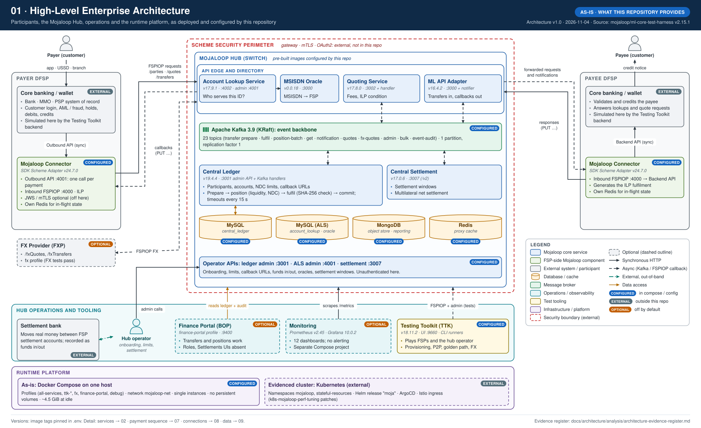

A Mojaloop scheme connects **FSPs** (banks, mobile money operators, PSPs) through a central **hub**. Each FSP runs a **Mojaloop Connector** (the SDK Scheme Adapter) next to its own core system. The hub has three participant-facing services and a back end:

- **Account Lookup Service (ALS)** with **oracles**: finds which FSP serves an identifier (e.g. a phone number).
- **Quoting Service**: carries the payee FSP's terms (amount, fees, expiry, cryptographic condition) to the payer FSP.
- **ML API Adapter**: accepts transfers and delivers results back to FSPs.
- **Central Ledger**: the clearing ledger. It holds participants, accounts, limits and positions, and processes transfers through Kafka handlers (prepare, position, fulfil, timeout).
- **Central Settlement**: closes settlement windows and computes net positions.
- **Kafka** connects the API services to the handlers; **MySQL** is the system of record; **MongoDB** and **Redis** hold documents and caches.

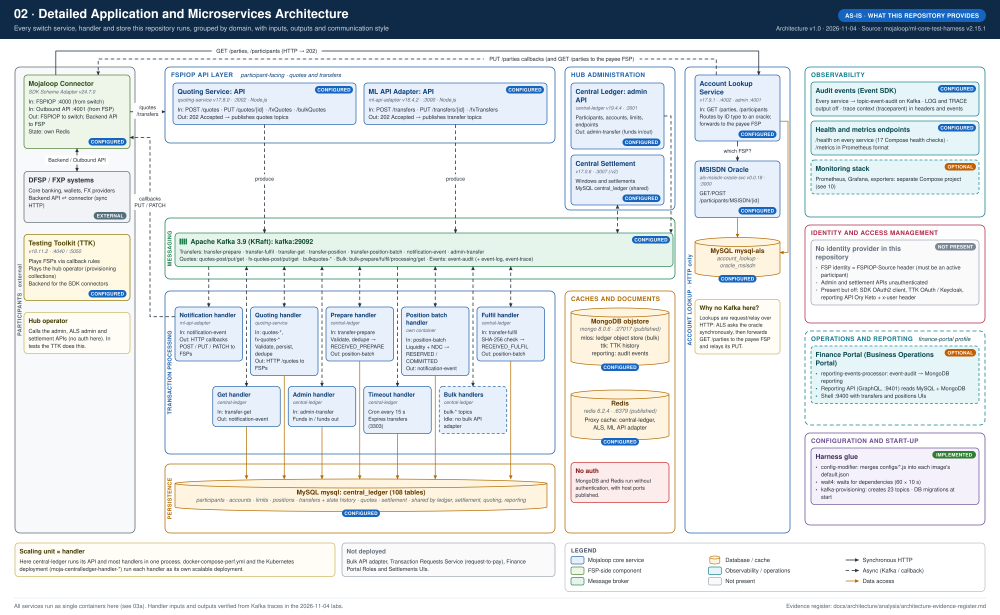

In this repository the central ledger runs its API and most handlers in **one process**. The perf compose file and the Kubernetes deployment it targets split **every handler into its own scalable deployment**, which is the real unit of scaling.

---

## 5. How the payment switch works

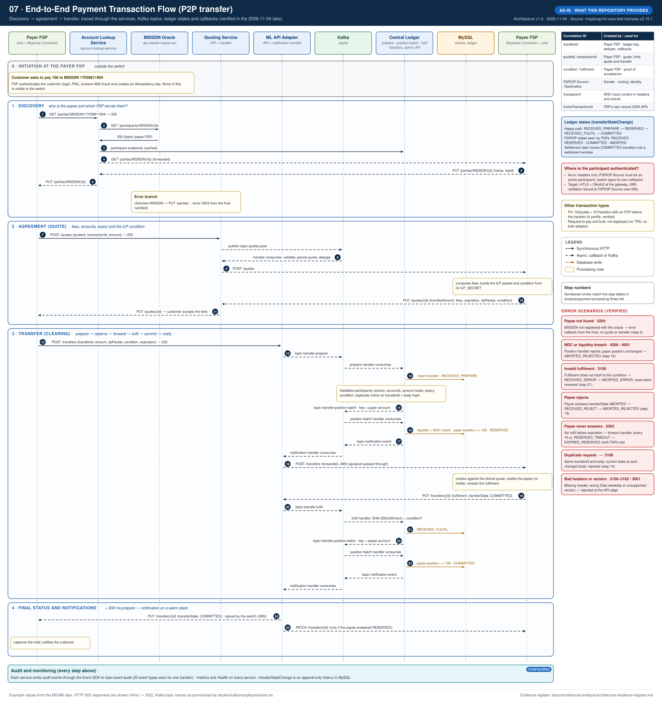

A P2P transfer has three phases, all **asynchronous**: each request is answered at once with `202 Accepted`, and the result arrives later as a callback.

1. **Discovery.** The payer FSP asks ALS who owns the number. ALS asks the oracle, then forwards the lookup to the payee FSP and relays the answer (the payee's name) back.
2. **Agreement.** The payer FSP requests a quote. The payee FSP answers with amounts, fees, an expiry and an **ILP condition**: a hash only the payee can later "unlock".
3. **Transfer.** The payer FSP sends the transfer. The hub validates it, checks for duplicates, checks **liquidity and the Net Debit Cap**, and reserves the funds (`RESERVED`). Then it forwards the transfer to the payee FSP, which credits its customer and returns the **fulfilment**. The hub checks `SHA-256(fulfilment) = condition`, commits (`COMMITTED`), updates both positions and notifies both FSPs.

On a warm stack the whole transfer phase took about **830 ms**. Errors are explicit and recoverable: an unknown payee (3204), a limit breach (4200 / 4001), an invalid fulfilment (3100), an expired transfer (3303), a modified duplicate (3106). Every one of them was reproduced in the labs. Later, **settlement** nets the committed transfers of a window, and the settlement bank moves the real money.

---

## 6. How components communicate

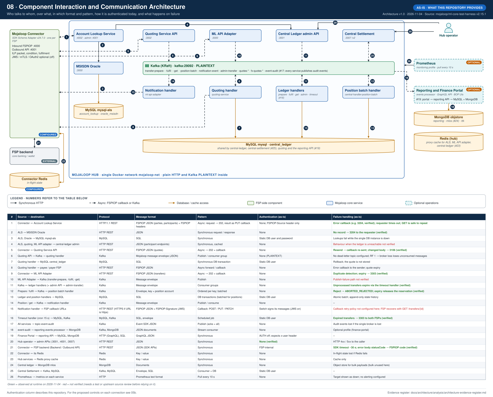

Three patterns cover almost everything:

| Pattern | Where | Example |
| --- | --- | --- |
| Asynchronous request + callback (HTTP) | FSP ↔ hub | `POST /transfers` → 202, later `PUT /transfers/{id}` |
| Event-driven (Kafka) | Inside the hub | `topic-transfer-prepare` → prepare handler → `topic-transfer-position-batch` → … |
| Synchronous request/response (HTTP) | Lookups and administration | ALS → oracle; operator → admin API; FSP core ↔ SDK |

Diagram 08 lists all 26 connections with their protocol, format, authentication and failure handling, marking in green what was observed at runtime and in red what is still unverified.

---

## 7. How Kubernetes clustering works

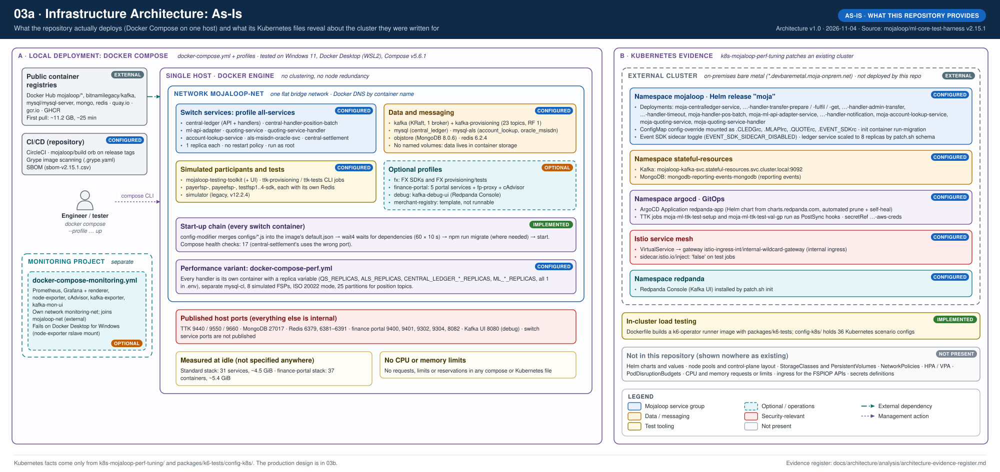

**As-is:** the repository runs everything on **one Docker host**: single instances, no restart policy, no persistent volumes, about 4.5 GiB of memory at idle. Its Kubernetes files only *patch* an existing cluster for performance tests. They still reveal that cluster's shape: namespaces `mojaloop` (Helm release `moja`, one deployment per handler) and `stateful-resources` (Kafka, MongoDB), plus ArgoCD for GitOps and an Istio internal gateway.

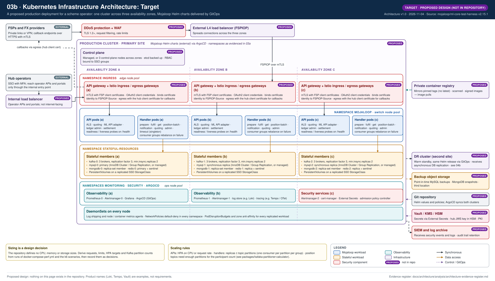

**Target:** one production cluster across **three availability zones**. Namespaces become bands spread over the zones: ingress (API gateway, Istio ingress and egress), `mojaloop` (API and handler pods with HPA), `stateful-resources` (3 Kafka brokers with RF 3, a 3-node MySQL cluster, MongoDB and Redis replica sets on replicated storage), and the platform (monitoring, security services, GitOps). Handler replicas are bounded by Kafka partitions. **Sizing is a design decision** to be derived from the repository's own performance harness.

---

## 8. How security and identity are managed

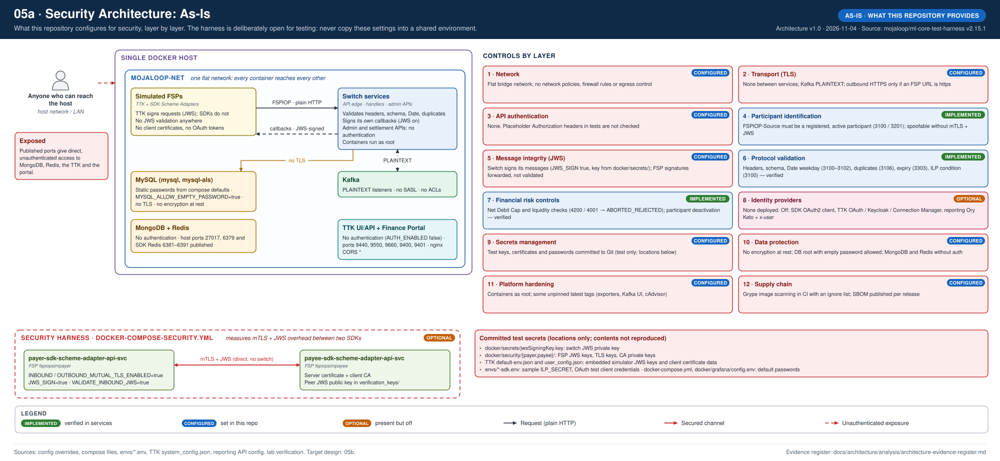

**As-is:** the services implement strong **protocol** controls: header and schema validation, duplicate detection, expiry, the ILP hash-lock, JWS signing of hub messages, and financial limits. **Who** is calling is not authenticated: no TLS inside, no API authentication, no FSP signature validation, open admin APIs, test secrets committed for convenience. That is acceptable for a laptop harness only.

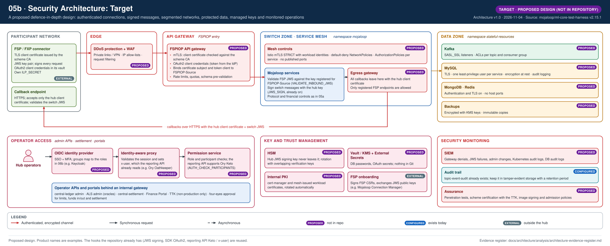

**Target:** FSP traffic passes **edge protection** and an **API gateway** that enforces **mTLS and OAuth2** and binds both to `FSPIOP-Source`. Inside, a **service mesh** runs with strict mTLS and default-deny network policies, the services **validate FSP JWS**, and the **data zone** has TLS, authentication and encryption at rest. Operators sign in through **SSO with MFA** and an **identity-aware proxy**, with permission checks behind it. **Keys** live in an HSM and vault, and security events go to a **SIEM**. Several hooks for this already exist and are reused: SDK OAuth2, the reporting API's Ory Keto support and its `x-user` header.

---

## 9. How RBAC and operational responsibilities are organised

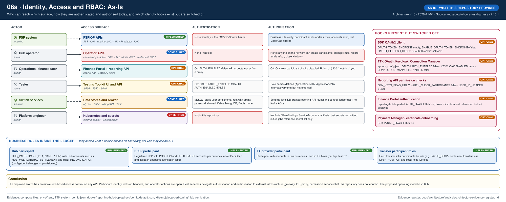

**As-is:** the deployed switch has **no native RBAC** on any API. The roles it does have live in the **ledger**: Hub, DFSP and FXP participants, account types and transfer participant roles. Those decide what a participant can do financially, not who may call an API. Real schemes delegate authorisation to external infrastructure.

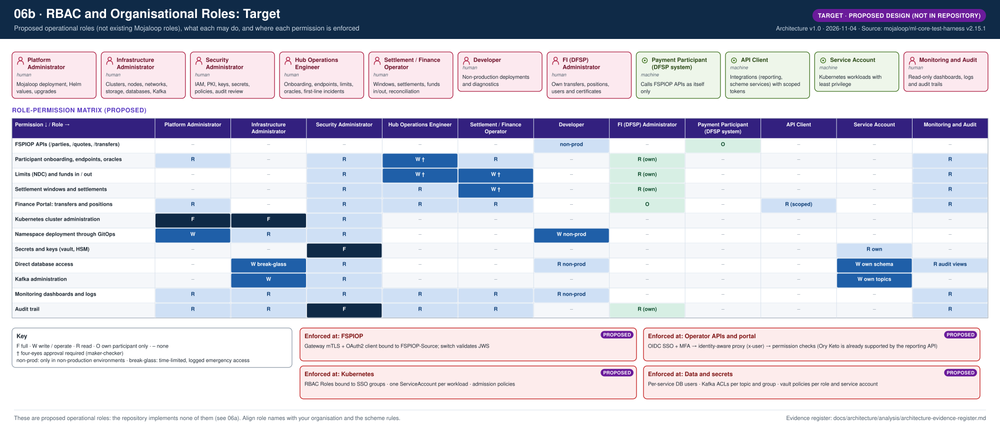

**Target:** eleven **proposed operational roles** (seven human, four machine) and a role-permission matrix. Changes to limits, funds and settlement need **four-eyes** approval, and each permission is enforced at a stated layer (gateway, proxy and permission service, Kubernetes RBAC, DB users and Kafka ACLs, vault policies).

---

## 10. How high availability is achieved, and how to design BC/DR

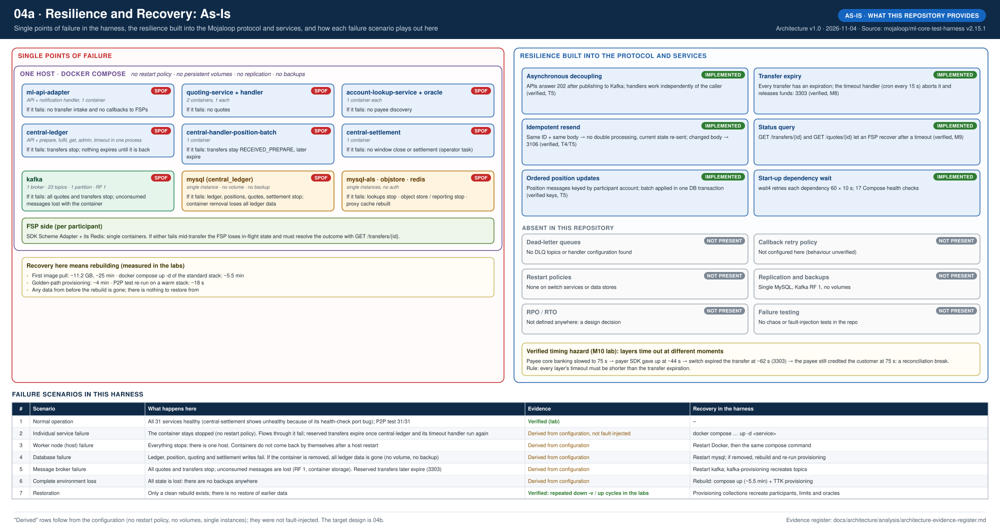

**As-is:** every component is a **single point of failure**, and there are no backups. What the protocol itself contributes is valuable, though, and was verified: asynchronous decoupling, transfer **expiry**, **idempotent** resends and **status queries** let FSPs recover from timeouts. The labs also exposed a real hazard: when layers time out at different moments, an FSP can credit a payment the hub has already expired.

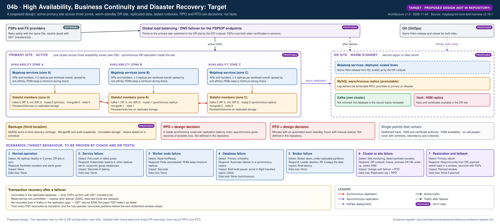

**Target:** an **active primary site** across three zones, with synchronous database replication, plus a **warm-standby DR site** fed by asynchronous replication, GitOps and replicated keys. Backups go to a third location. The **database is the record**; Kafka is transport, and lost in-flight messages resolve through expiry and status queries. **RPO and RTO are not defined anywhere**; they are shown as decisions the scheme must make. Seven scenario cards describe detection, response, impact and data loss.

---

## 11. Data and observability

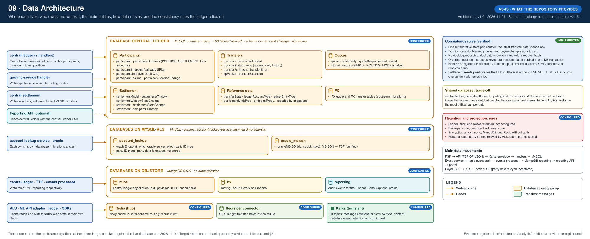

`central_ledger` (108 tables) is shared by central-ledger, central-settlement, quoting and the reporting API. That keeps the ledger consistent, but makes it the most critical component. Consistency rests on an append-only state history, double-entry positions, duplicate checks and per-account ordering.

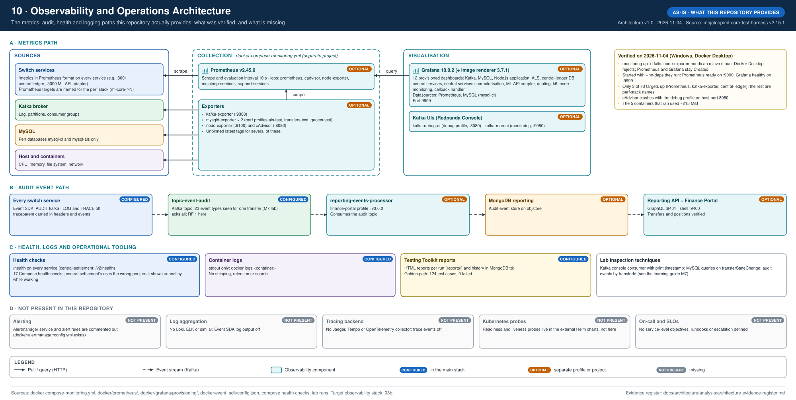

Metrics go to Prometheus and Grafana (12 dashboards), audit events go to Kafka and on to the portal, and there are health checks and Testing Toolkit reports. **Alerting, log aggregation, a tracing backend and Kubernetes probes are not in the repository.** The monitoring stack also needs workarounds on Windows.

---

## 12. Implemented versus recommended

| Area | In the repository (As-Is) | Recommended (Target) |
| --- | --- | --- |
| Services | All core switch services, configured and verified end to end | Same services, deployed with Helm and scaled per handler |
| Deployment | Docker Compose, one host | Kubernetes across 3 zones + DR site, GitOps |
| Data | Single MySQL / Kafka / MongoDB / Redis, no volumes, no backups | Replicated clusters, PITR backups, encryption at rest |
| Resilience | Protocol-level (expiry, idempotency, status query) | Plus replicas, PDBs, failover, tested DR, defined RPO/RTO |
| Security | Protocol controls; open transport and APIs | mTLS, OAuth2, JWS validation, mesh, segmentation, HSM, SIEM |
| Identity | None; hooks switched off | OIDC SSO + MFA, identity-aware proxy, permission service |
| RBAC | Ledger business roles only | 11 operational roles with enforced permissions |
| Observability | Metrics and dashboards (optional), audit stream | Plus alerting, logs, tracing, SLOs, on-call |

The full traceability, item by item, is in the [architecture evidence register](analysis/architecture-evidence-register.md).

---

## 13. Areas that need further investigation

| Topic | Why it is open | How to close it |
| --- | --- | --- |
| Callback retry behaviour of the notification handler | Not configured here; not tested | Upstream source review at ml-api-adapter v16.4.2 + a test with an unreachable FSP endpoint |
| Behaviour when central-ledger is unreachable for endpoint lookups | Cache path not exercised | Fault-injection test |
| ML API adapter behaviour when publishing to Kafka fails | Not exercised | Stop Kafka during a transfer and observe |
| Running more than one timeout handler | Safety of multiple replicas not confirmed | Upstream source review; a test with 2 replicas |
| Dead-letter / error topics in newer upstream versions | None found here | Check upstream releases and Helm values |
| Kubernetes resources, probes and replica defaults | Live in the external Helm charts | Review `mojaloop/helm` at the matching release |
| Inter-scheme proxy (Redis proxy cache, forwarded states) | Configured but not exercised | Dedicated proxy scenario |
| FX state handling details | Verified by tests, internals not traced | Trace an FX transfer as in lab M7 |
| ISO 20022 mode | Present only in perf settings; not run | Run the perf stack with `API_TYPE=iso20022` |
| Finance Portal roles, settlements UIs and Ory integration | UIs not deployed here | Upstream reporting-hub-bop repositories |
| Security harness (mTLS + JWS between SDKs) | Not run in the labs | Run `docker-compose-security.yml` |
| Production sizing | No sizes anywhere in the repository | Perf runs with k6 and the Grafana dashboards |

---

## 14. Folder structure and validation

```text
docs/architecture/
├── README.md                         this file
├── diagrams/                         14 standalone SVG files (primary deliverable)
├── analysis/
│   ├── component-inventory.md        every component with 13 attributes
│   ├── technology-stack.md
│   ├── infrastructure-inventory.md   As-Is (Part A) and Target (Part B)
│   ├── identity-and-security-analysis.md
│   ├── rbac-and-permissions.md       incl. the role-permission matrix
│   ├── payment-processing-flows.md   step tables matching diagram 07
│   ├── data-architecture.md
│   ├── high-availability-analysis.md
│   ├── disaster-recovery-analysis.md
│   └── architecture-evidence-register.md
└── glossary/
    └── architecture-terminology.md
```

Diagram 03 is split into 03a (As-Is) and 03b (Target), and diagrams 04, 05 and 06 are split the same way, to keep what exists apart from what is proposed.

**Validation performed (2026-11-04):**

- All 14 SVG files parse as valid XML and are self-contained: no scripts, external images or remote fonts.
- During generation, an automated layout check confirmed no overlapping components, no labels colliding with components or each other, no connectors crossing unrelated components, and all content within the canvas.
- Each diagram was opened in Chrome and every text element measured against its container, with Segoe UI (Windows) and with Arial (Helvetica metrics, macOS). No text overflowed in either font.
- PNG previews were rendered (resvg) and visually reviewed for every diagram, including zoomed crops of dense areas.
- Facts were cross-checked against the repository files listed in the evidence register and against the lab runs. No secret values are reproduced.
- Official Mojaloop logos are **not** used: the repository contains no logo assets, and recreating the branding would risk inaccuracy. Components are named in plain text with official Mojaloop terminology.
