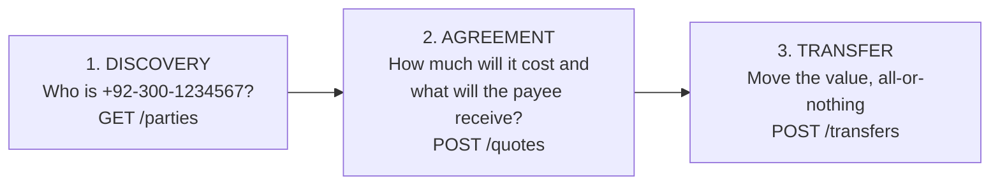
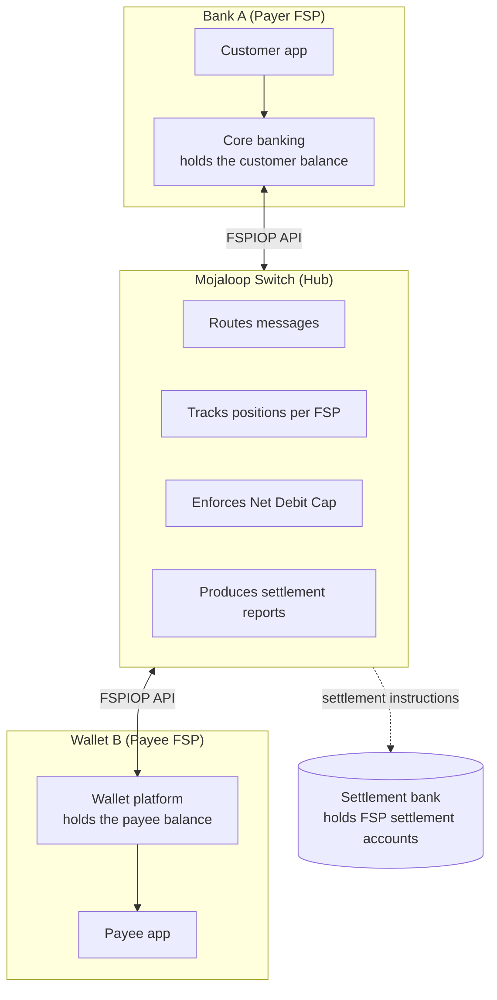

# 01 – Mojaloop Fundamentals

> Goal: understand the business problem before looking at any code.
> Most of this document is **[UPSTREAM-DOC]** domain knowledge. Where the repository confirms a concept, the file is cited.

---

## 1. What is Mojaloop?

**Mojaloop** is open-source software for running the **central hub of a real-time, interoperable payment system**. The Mojaloop Foundation maintains it under the Apache-2.0 licence (see [LICENSE.md](../../LICENSE.md)).

In plain words: imagine a country where Bank A, Bank B, Wallet X and Wallet Y each run their own systems. A customer of Wallet X wants to send PKR 5,000 to a friend who banks with Bank B. Without a shared hub, Wallet X would need a separate technical and legal integration with Bank B, and with every other provider. Mojaloop is the shared hub. Every provider connects **once**, and can then pay every other connected provider in real time.

Mojaloop provides:

- **A common language.** The *FSPIOP API* (Financial Service Provider Interoperability Protocol), a REST/JSON API with an ISO 20022 variant, that every participant speaks.
- **Payee discovery.** It finds which provider holds the account for a phone number, account ID or other identifier.
- **Agreement before money moves.** The payer's and payee's providers agree on amount and fees (a *quote*) and a cryptographic *condition* before the transfer.
- **A clearing ledger.** It records what each provider owes the others, enforces risk limits, and guarantees a single agreed outcome (committed or aborted).
- **Settlement support.** It calculates net positions so that real money can later move between the providers' accounts at a settlement bank.

## 2. Why the Mojaloop Foundation created it

**[UPSTREAM-DOC]** Mojaloop began as the *Level One Project* reference implementation, sponsored by the Bill & Melinda Gates Foundation. The Mojaloop Foundation now stewards it. Its purpose is **financial inclusion**: making it cheap and simple for low-income people to send and receive digital money, regardless of which provider they use.

The business problems it targets:

| Problem | What it looks like in practice | How Mojaloop helps |
| --- | --- | --- |
| **Closed loops** | A mobile-wallet customer can only pay other customers of the same wallet. | One hub connects all providers ("any-to-any"). |
| **Bilateral integration explosion** | N providers need N×(N−1)/2 integrations. 10 providers means 45 integrations. | Each provider integrates once with the hub. |
| **Settlement and credit risk** | Provider A sends a credit before being sure Provider B will accept, or before it has funds. | Positions are reserved against a **Net Debit Cap** before a transfer can proceed, and both sides cryptographically agree on completion. |
| **High cost per transaction** | Card networks and legacy switches are expensive for small-value payments. | Open source, no licence fees, designed for low-value, high-volume payments. |
| **Opaque fees** | Payers do not know the final cost or what the payee will receive. | The **quote** phase tells the payer exactly what will be debited and received *before* they confirm. |
| **Errors and disputes** | "Money left my account but never arrived." | Two-phase commit with a condition and fulfilment means both sides end with the same final state. |

## 3. What is a payment switch?

A **payment switch** is a central system that:

1. **Routes** a payment instruction from the sending institution to the receiving institution.
2. **Validates** that both are allowed to transact (registered, active, within limits).
3. **Clears** the payment: it records who owes whom and makes sure both sides agree on the final result.
4. **Supports settlement**: at intervals it produces net amounts so that real central-bank or settlement-bank money moves between institutions.

> **Analogy:** a switch is like the air-traffic-control tower of a payment scheme. Planes (payments) belong to airlines (banks and wallets), and money physically sits in the airlines' accounts. The tower makes sure every plane takes off and lands safely, in order, and keeps the records.

**Key point for Mojaloop:** the switch does **not** hold customer accounts. Customer balances stay at the banks and wallets. The switch keeps **positions**: how much each *institution* owes or is owed across all its customers' payments.

## 4. What does interoperability mean?

**Interoperability** in digital financial services means that a customer of any connected provider can pay a customer of any other connected provider, as easily as paying someone at the same provider. It has three layers:

| Layer | Meaning | Mojaloop component |
| --- | --- | --- |
| **Technical** | Systems can exchange messages. | FSPIOP API (REST/JSON or ISO 20022 JSON) |
| **Business and scheme rules** | Everyone follows the same rules for fees, liability, disputes and timeouts. | Scheme rulebook (written by the scheme operator, **not** software) |
| **Financial** | Money actually moves between institutions. | Positions, Net Debit Cap, settlement windows, settlement bank |

## 5. Mojaloop compared with other switches

| Aspect | Traditional banking switch (e.g. ACH or RTGS) | Card payment switch | Mojaloop |
| --- | --- | --- | --- |
| Primary users | Banks only | Card issuers and acquirers | Banks, mobile-money operators, MFIs, PSPs and others |
| Identifier for the payee | Bank code plus account number | Card number (PAN) | Any alias: MSISDN (phone), email, account ID, IBAN, business ID… |
| Timing | Often batch (hours or days); RTGS is real-time but high-value | Authorisation real-time, clearing batch | Real-time clearing for low-value payments |
| Fees known up front | Rarely | No (merchant discount hidden) | Yes: the quote phase |
| Push or pull | Mostly push credits | Pull (merchant pulls from card) | Push, and payee-initiated "request to pay" (still payer-approved) |
| Guaranteed final state | Varies | Chargeback-driven | Condition and fulfilment (ILP-style hash-lock) |
| Licence | Proprietary | Proprietary networks | Open source (Apache-2.0) |
| Settlement | Gross (RTGS) or net batches | Net, via card scheme | Configurable models: deferred net, immediate gross |

## 6. How Mojaloop lets providers communicate: the three phases

Every Mojaloop payment follows three phases:

These phases are visible directly in this repository. The Docker Compose **profiles** are named `discovery`, `agreement` and `transfer` ([docker-compose.yml](../../docker-compose.yml), [README.md](../../README.md) "Profiles available"):

| Phase | Compose profile | Services started for that phase |
| --- | --- | --- |
| Discovery | `discovery` | account-lookup-service, als-msisdn-oracle-svc, mysql-als, simulator, central-ledger (participant data) |
| Agreement | `agreement` | quoting-service, quoting-service-handler, central-ledger |
| Transfer | `transfer` | ml-api-adapter, central-ledger, Kafka, MySQL |

All FSPIOP calls are **asynchronous**. A request such as `GET /parties/MSISDN/123` gets an immediate HTTP `202 Accepted`. The real answer arrives later as a **callback**: a `PUT /parties/MSISDN/123` sent to the requester's registered callback URL. This is the single most important technical idea in Mojaloop, and it is covered in depth in [08](08-fspiop-protocol-and-apis.md).

## 7. Financial inclusion and real-time payments

**[UPSTREAM-DOC]** Mojaloop is designed for:

- **Low-value, high-volume** payments: airtime-sized amounts must be economical.
- **Feature phones and agents.** Identifiers like phone numbers (MSISDN) are first-class. Cash-in and cash-out at agents is a core use case.
- **Instant confirmation** to both payer and payee.
- **Inclusive schemes** that national switches, central banks or industry consortia can run at low cost.

---

## 8. Business actors and participants

### 8.1 Roles

| Participant | Business responsibility | Mojaloop interaction | Example |
| --- | --- | --- | --- |
| **Payer** | The person or business sending money. Authorises the payment and sees fees first. | None directly. Uses their provider's app, USSD or agent. | Ayesha sends PKR 5,000 from her bank app. |
| **Payee** | The person or business receiving money. | None directly. Is identified by an alias (phone, account, merchant ID). | Bilal receives PKR 5,000 in his wallet. |
| **Payer FSP** (Financial Service Provider) | Holds the payer's account. Authenticates the payer, checks balance, debits the payer, initiates the Mojaloop calls. | Sends `GET /parties`, `POST /quotes` and `POST /transfers`; receives callbacks. | Bank A |
| **Payee FSP** | Holds the payee's account. Confirms the payee exists, quotes fees, credits the payee, produces the **fulfilment**. | Answers `PUT /parties`, `PUT /quotes` and `PUT /transfers`; registers payees in oracles. | Wallet B |
| **Hub / Switch operator** | Runs the Mojaloop switch. Onboards participants, sets limits, operates settlement and monitoring, enforces the rulebook. | Uses admin APIs (`central-ledger` admin, ALS admin, settlement API). | National switch, central bank, industry company |
| **Mobile Money Operator (MMO)** | An FSP offering e-money wallets, often via mobile network operators. | Same as any FSP. | A telco wallet |
| **Bank** | An FSP offering deposit accounts. | Same as any FSP. Usually integrates through a connector. | Commercial bank |
| **Payment Service Provider (PSP)** | Offers payment services such as merchant acquiring and payment initiation. May or may not hold funds. | Participant FSP, or a third-party initiator (PISP) in the upstream "third-party API". | Merchant acquirer |
| **Foreign Exchange Provider (FXP)** | Converts currency for cross-currency payments. | Answers `POST /fxQuotes` and `POST /fxTransfers` (FSPIOP v2.0). | `perffxp` (standard onboarding) and `testfxp1` (FX tests) in this repo |
| **Liquidity provider** | Funds an FSP's settlement account so it can send more payments. | Indirect. Shows up as **funds-in** (`recordFundsIn`) on the FSP's settlement account. | A bank lending intraday liquidity |
| **Settlement bank / institution** | Holds each FSP's settlement account and actually moves central-bank or commercial money at settlement time. | Indirect. The hub operator uses the Settlement API to mark settlements as reserved, committed and settled. | Central bank RTGS, or a commercial settlement bank |
| **Oracle** | A directory that maps an identifier (e.g. MSISDN) to the FSP that owns it. | ALS calls oracles over HTTP (`/participants/{Type}/{ID}`). | `als-msisdn-oracle-svc` in this repo |
| **Regulator** | Licenses providers, sets rules (AML/KYC, consumer protection, data protection), supervises the scheme. | None in software. Consumes reports. | Central bank payments department |
| **Agent** | Gives cash-in and cash-out services on behalf of an FSP. | Through the FSP's system (transaction scenarios `DEPOSIT` / `WITHDRAWAL`). | Corner shop agent |

### 8.2 The switch versus the participants

| The switch **does** | The switch **does not** |
| --- | --- |
| Route requests and callbacks between FSPs | Hold customer accounts or balances |
| Validate participants, currencies, headers, amounts, expiry | Authenticate end customers |
| Reserve and commit **positions** (inter-FSP obligations) | Debit the payer or credit the payee (the FSPs do that) |
| Enforce Net Debit Cap limits | Perform KYC or AML screening of customers |
| Keep an immutable record of transfer state changes | Move real money (the settlement bank does) |
| Compute net settlement amounts per window | Decide fees (FSPs quote fees; the scheme sets rules) |

---

## 9. Positions, liquidity and settlement in one picture

This is where many newcomers get confused. Use this mental model throughout the guide:

1. **Funds-in (prefunding).** Bank A deposits money into its **settlement account** at the settlement bank. The hub records it as a balance on Bank A's `SETTLEMENT` ledger account. This repo does exactly this during provisioning ("sender fundsin", `action: recordFundsIn` in [participant_sender.json](../../docker/ml-testing-toolkit/test-cases/collections/provisioning/participant_sender.json)).
2. **Net Debit Cap (NDC).** The hub sets a limit on how much Bank A may owe the system, usually tied to its prefunded liquidity. Provisioning here sets `NET_DEBIT_CAP` = 1,000,000 with initial position 0.
3. **Position.** Each committed outgoing payment increases Bank A's **position** (what it owes). Incoming payments decrease it. A new payment is **rejected** if it would push the position past the NDC (error 4001 / 4200, tested in [block_transfer.json](../../docker/ml-testing-toolkit/test-cases/collections/tests/golden_path/feature_tests/block_transfer.json)).
4. **Settlement window.** Committed payments are grouped into an open window. The hub operator closes the window, creates a **settlement**, and the net amounts are settled through the settlement bank (`PENDING_SETTLEMENT → PS_TRANSFERS_RECORDED → PS_TRANSFERS_RESERVED → PS_TRANSFERS_COMMITTED → SETTLED`, tested in [settlement_management](../../docker/ml-testing-toolkit/test-cases/collections/tests/golden_path/settlement_management/)).
5. **Reconciliation.** Each FSP compares its own records (customer debits and credits) with the hub's records (transfers, positions, settlement reports).

Full worked example with numbers: [07 §6](07-payment-transaction-lifecycle.md#6-worked-financial-example-pkr-5000-from-bank-a-to-wallet-b).

---

## 10. Where to go next

- See which business use cases exist and which ones run here: [04-business-use-cases.md](04-business-use-cases.md)
- See how this repository is laid out: [02-repository-structure.md](02-repository-structure.md)
- Look up any unfamiliar word: [16-glossary.md](16-glossary.md)
