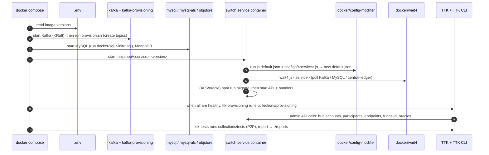

# 02 – Repository Structure

> Every directory of `ml-core-test-harness` at commit `2187520` (package version `2.15.1`), what it contains, and how it fits into the whole.

---

## 1. Version, branch and provenance

| Item | Value | How to verify |
| --- | --- | --- |
| Package name | `@mojaloop/ml-core-test-harness` | [package.json](../../package.json) |
| Version | `2.15.1` (released 2026-02-03, see [CHANGELOG.md](../../CHANGELOG.md)) | `git describe --tags` → `v2.15.1-3-g2187520` |
| Base branch | `main` | `git branch -a` |
| Commit analysed | `2187520` – merge of PR #145 (TTK UI image fix) | `git log -1` |
| Release tooling | `standard-version` (conventional commits) | [package.json](../../package.json) `scripts.release` |
| CI | CircleCI using the shared `mojaloop/build@1.1.10` orb | [.circleci/config.yml](../../.circleci/config.yml) |
| SBOM | `sbom-v2.15.1.csv` (software bill of materials) | [sbom-v2.15.1.csv](../../sbom-v2.15.1.csv) |
| Licence | Apache-2.0 | [LICENSE.md](../../LICENSE.md) |

**Important:** the `package.json` test scripts (`test:unit`, `test:integration`, `test:functional`, `lint` …) are all `"true"`, which means no-ops. The repository has **no unit tests of its own**. Its "tests" are the Testing Toolkit collections and k6 scripts, which test the *switch*.

---

## 2. Directory tree (annotated)

```text
ml-core-test-harness/
├── .circleci/config.yml            CI: Mojaloop shared build orb (release, image publish, scans)
├── .env                            Image version pins + replica counts (read by every compose file)
├── .grype.yaml                     Vulnerability-scanner ignore list (CVE ids)
├── .nvmrc                          Node.js 22.22.0 (only for repo tooling like standard-version)
├── Dockerfile                      Builds a k6-operator runner image containing packages/k6-tests
├── docker-compose.yml              MAIN harness: switch + TTK + SDKs + optional portals (31 services in std profiles)
├── docker-compose-perf.yml         Performance harness: split handlers, replicas, 8 simulated DFSPs
├── docker-compose-monitoring.yml   Prometheus, Grafana, exporters, cAdvisor, Kafka console
├── docker-compose-load.yml         k6 load generator container
├── docker-compose-security.yml     Two SDK adapters talking over mTLS + JWS
├── perf.env / perf.override.sample.env   Env for perf/load stacks (override file must be created)
├── automate_perf.sh / automate_perf_sample.env   Run k6 scenario and capture Grafana PNGs
├── perf-test.sh                    Shortcut wrapper (t discovery, t transfers, t e2e ...)
├── wait-for-container.sh           CI helper: wait for a container to exit, propagate exit code
├── docker-clean-all.sh             DANGER: removes ALL containers and volumes on the host
├── lei-ml-core-test-harness.md     Notes for the experimental merchant-registry (LEI) profile
├── README.md / CHANGELOG.md / LICENSE.md / sbom-v2.15.1.csv
├── docker/                         Mounted config, scripts and test assets for containers
│   ├── config-modifier/            Script + per-service JSON overrides merged into each image's default.json
│   ├── wait4/                      "wait for dependency" script used before services start
│   ├── kafka/scripts/provision.sh  Creates the 23 Kafka topics
│   ├── sql-init/                   MySQL init for central_ledger DB (main compose)
│   ├── sql-cl-init/                MySQL init for central_ledger DB (perf compose, + exporter user)
│   ├── sql-als-init/               MySQL init for account_lookup DB + oracle_msisdn DB
│   ├── event_sdk/config.json       Event SDK config (audit events -> Kafka) mounted as .EVENT_SDKrc
│   ├── secrets/jwsSigningKey.key   TEST private key the ML API Adapter uses to sign switch messages
│   ├── security/payer|payee/       TEST TLS CA/certs/keys + JWS keys for the security harness
│   ├── ml-testing-toolkit/
│   │   ├── spec_files/             TTK config, 16 API definitions, mock rules, report templates
│   │   └── test-cases/
│   │       ├── collections/        Provisioning (onboarding) + tests (P2P, golden path, FX, LEI)
│   │       └── environments/       Input variables (FSP ids, MSISDNs, URLs, currencies)
│   ├── prometheus/ alertmanager/ grafana/ renderer/   Monitoring stack configuration and dashboards
│   ├── fp-proxy/nginx.conf         Reverse proxy for the Finance Portal UIs
│   └── reporting-hub-bop-api-svc/config/   Finance Portal reporting API config
├── envs/                           .env files for SDK scheme adapters and callback simulators
├── packages/
│   ├── k6-tests/                   k6 load-test framework (scripts, scenarios, configs)
│   └── kafaka-partitioner-calculator/   Small Node tool: Kafka partition spread per FSP (murmur2)
├── k8s-mojaloop-perf-tuning/       kubectl patches for an EXISTING Mojaloop-on-Kubernetes (perf experiments)
└── docker_arm_rebuild/             Script to rebuild Mojaloop images natively for ARM64 (Apple Silicon)
```

Generated at runtime (git-ignored): `reports/` (TTK HTML reports), `results/` (automate_perf output), `perf.override.env`, `automate_perf.env`.

---

## 3. Directory-by-directory explanation

Legend for the last two columns:
- **Required to run?** Is it needed for the standard local run (`all-services` + `ttk-provisioning` + `ttk-tests`)?
- **Core vs supporting.** *Core* means it defines or configures the payment switch itself. *Supporting* means test, observability or tooling.

| Path | Purpose | What it contains | Interacts with | Required to run? | Core / Supporting |
| --- | --- | --- | --- | --- | --- |
| `docker-compose.yml` | Defines the local Mojaloop switch and its test environment | 54 services across profiles: switch services, Kafka, MySQL, MongoDB, Redis, TTK, SDK adapters, finance portal, merchant registry | `.env`, `docker/**`, `envs/*.env`, `reports/` | **Yes** | Core |
| `.env` | Single source of truth for **image versions** and **replica counts** | `CENTRAL_LEDGER_VERSION=v19.4.4` etc. | All compose files (automatic `.env` loading) | **Yes** | Core |
| `docker/config-modifier/` | Adapts each upstream image's built-in `config/default.json` to the harness's hostnames | `run.js` (deep merge) + `configs/*.js` (one per service and variant) | Mounted into every switch container; run as the first command | **Yes** | Core |
| `docker/wait4/` | Makes services wait for dependencies (Kafka, MySQL, central-ledger) | `wait4.js`, `wait4.config*.js` | Mounted into central-ledger, ALS, oracle, ML adapter, settlement | **Yes** | Core |
| `docker/kafka/scripts/` | Creates Kafka topics before services start | `provision.sh` (23 topics, 1 partition each) | `kafka-provisioning` container | **Yes** | Core |
| `docker/sql-init/`, `sql-als-init/`, `sql-cl-init/` | Prepares MySQL users and databases (schemas come from service migrations) | Small `.sql` files | `mysql`, `mysql-als`, `mysql-cl` init | **Yes** (`sql-cl-init` perf only) | Core |
| `docker/event_sdk/config.json` | Configures the Mojaloop Event SDK in each service: audit → Kafka, log and trace off | JSON | Mounted as `/opt/app/.EVENT_SDKrc` | **Yes** | Core (observability) |
| `docker/secrets/` | Test JWS signing key for the switch | 1 private key (test only) | `ml-api-adapter` | **Yes** (JWS signing is on) | Core (security) |
| `docker/ml-testing-toolkit/spec_files/` | Configures the **Mojaloop Testing Toolkit**: which APIs it understands and how it simulates FSPs | `system_config.json`, `user_config.json`, `api_definitions/` (16 API specs), `rules_callback/response/validation/forward` | `mojaloop-testing-toolkit` container | **Yes** | Supporting (test) |
| `docker/ml-testing-toolkit/test-cases/` | **Onboarding scripts and functional tests**, in TTK collection JSON format | `collections/provisioning/**`, `collections/tests/**` (131 test cases), `environments/*.json` | TTK CLI containers (`ttk-provisioning*`, `ttk-tests*`) | **Yes** | Supporting (test), but provisioning *configures* the switch |
| `envs/` | Environment files for SDK Scheme Adapters (DFSP connectors) and the callback-handler simulators | `payerfsp-sdk.env`, `testfsp1-4-sdk.env`, FX SDK envs, perf FSP envs, security envs | `*-sdk` services and `sim-*` services | **Yes** (SDK containers start in `all-services`) | Supporting (simulated FSPs) |
| `docker/prometheus`, `docker/grafana`, `docker/alertmanager`, `docker/renderer` | Monitoring configuration | Scrape targets, 12 Grafana dashboards, empty alert rules | `docker-compose-monitoring.yml` | No | Supporting |
| `docker/fp-proxy/`, `docker/reporting-hub-bop-api-svc/` | Finance Portal (back-office UI) wiring | nginx config, reporting API config | `finance-portal` profile | No | Supporting (operations UI) |
| `docker/security/` | Test PKI for the security harness | CA, server and client certs, JWS key pairs, generation scripts | `docker-compose-security.yml` | No | Supporting (security test) |
| `docker-compose-perf.yml`, `perf.env` | Performance-characterisation stack | Same switch, but every central-ledger handler is a separate scalable container; 8 simulated FSPs | `.env` replicas, `perf.override.env` | No | Supporting (perf) |
| `docker-compose-monitoring.yml` | Observability stack | Prometheus, Grafana, exporters, cAdvisor, Redpanda console | `mojaloop-net` (must exist) | No | Supporting |
| `docker-compose-load.yml`, `packages/k6-tests/` | Load generation with k6 | Scripts for discovery, quotes, transfers, FX and SDK journeys | `mojaloop-net`, `monitoring-net`, `perf.env` | No | Supporting (perf) |
| `docker-compose-security.yml` | SDK-to-SDK mTLS + JWS overhead test | 2 SDK adapters, 1 simulator, Redis | `docker/security/**` | No | Supporting (security) |
| `packages/kafaka-partitioner-calculator/` | Helps choose Kafka partition counts so that FSP position messages spread evenly | Node script using `murmurhash` | Manual use | No | Supporting (perf tuning) |
| `k8s-mojaloop-perf-tuning/` | Patch an existing Kubernetes Mojaloop install (namespace `mojaloop`, Helm release `moja`) for perf experiments | `patch.sh`, deployment patch YAMLs, RedPanda manifests | `kubectl` | No | Supporting (perf on K8s) |
| `docker_arm_rebuild/` | Rebuild amd64-only Mojaloop images for arm64 | `rebuild.sh`, README | Docker, git | No (Apple Silicon users may want it) | Supporting |
| `.circleci/` | Release automation | Orb reference | CircleCI | No | Supporting (CI/CD) |
| `Dockerfile` | Packages `packages/k6-tests` into a `k6-operator` runner image (for k6 on Kubernetes) | 6 lines | k6-operator | No | Supporting (perf) |

---

## 4. Main services in `docker-compose.yml`

`docker compose --profile all-services --profile ttk-provisioning --profile ttk-tests config --services` resolves to **31 services** (verified during this analysis):

| Group | Services |
| --- | --- |
| **Switch core** | `central-ledger`, `central-handler-position-batch`, `ml-api-adapter`, `quoting-service`, `quoting-service-handler`, `account-lookup-service`, `als-msisdn-oracle-svc`, `central-settlement` |
| **Infrastructure** | `kafka`, `kafka-provisioning`, `mysql`, `mysql-als`, `objstore` (MongoDB), `redis` |
| **Simulated FSPs** | `payerfsp-sdk`, `payeefsp-sdk`, `testfsp1-sdk` … `testfsp4-sdk` (SDK Scheme Adapters), each with its own Redis (`*-redis`), plus the legacy `simulator` |
| **Testing Toolkit** | `mojaloop-testing-toolkit`, `mojaloop-testing-toolkit-ui`, `ttk-provisioning`, `ttk-tests` |

Optional profiles add `kafka-debug-ui` (`debug`), the Finance Portal (`finance-portal`), FX SDKs (`fx-sdk`), golden-path and FX test runners, and the merchant registry (`merchant-registry`).

---

## 5. How the directories interact at start-up



**Why the config-modifier pattern exists.** Each upstream image ships a `config/default.json` that assumes hostnames like `localhost`. Instead of building custom images, the harness mounts `docker/config-modifier` and, at container start, deep-merges an override (for example `configs/central-ledger.js` sets `DATABASE.HOST = "mysql"` and every Kafka `metadata.broker.list = "kafka:29092"`) into `default.json`. You can see this in every service's `command:` in [docker-compose.yml](../../docker-compose.yml), e.g. line 12 for central-ledger.

---

## 6. Test-asset inventory (Testing Toolkit)

| Folder | Files | Content |
| --- | --- | --- |
| `collections/provisioning/` (labels `std`) | `hub_setup.json`, `hub_setup_prod.json`, `participant_sender.json`, `participant_receiver.json`, `fxp.json` | Hub accounts, settlement models, oracle registration, two FSPs (`testingtoolkitdfsp`, `payeefsp`), one FXP |
| `collections/provisioning/for_golden_path/` (label `std-gp`) | 20 files | Full golden-path onboarding: `payerfsp`, `payeefsp`, `testfsp1-4`, `noresponsepayeefsp`, `ttkpayeefsp`, FX participants |
| `collections/provisioning/participants_perf/`, `participants_fx/`, `participants_fx_sdk/` | 18 files | Perf FSPs `perffsp-1..8`, FX and SDK FX participants |
| `collections/tests/p2p.json` (label `std`) | 1 | The default end-to-end P2P payment (4 requests, 31 assertions) |
| `collections/tests/golden_path/` (label `std-gp`) | 67 files (55 test files + 12 `master.json` ordering files) | Feature, negative, duplicate, timeout, settlement, admin API, bug-fix regression tests |
| `collections/tests/fx/` (label `fx`) | 3 | FX quote, FX transfer and full FX payment |
| `collections/tests/lei/` | 3 | LEI merchant payments (needs the external merchant-registry services) |
| `environments/` | 4 | `default-env.json` (main), `default-env-simple.json`, `perf-e2e-env.json`, `remote-k8s-env.json` |

Labels are defined in `master.json` files and selected by the TTK CLI flag `--labels` (see the `ttk-*` service commands in [docker-compose.yml](../../docker-compose.yml)).

---

## 7. What is *not* in the repository

| Missing item | Consequence | Where to find it [EXTERNAL] |
| --- | --- | --- |
| Source code of switch services | You cannot debug service internals here | `github.com/mojaloop/central-ledger`, `ml-api-adapter`, `account-lookup-service`, `quoting-service`, `central-settlement`, `sdk-scheme-adapter`, … (use the tags pinned in `.env`) |
| Helm charts and production manifests | No production deployment path from this repo | `github.com/mojaloop/helm` and Mojaloop's IaC projects |
| Transaction Requests Service, Bulk API Adapter, third-party (PISP) services, central-event-processor | Request-to-pay, bulk transfers and PISP flows cannot run end-to-end here | Respective upstream repos |
| A `docs/` folder (before this guide) | – | Official docs at `docs.mojaloop.io` |
| Merchant-registry source | `merchant-registry` profile cannot build until you clone it and fix the placeholder paths | Upstream merchant registry project (see [lei-ml-core-test-harness.md](../../lei-ml-core-test-harness.md)) |

Next: [03-technology-stack.md](03-technology-stack.md).
