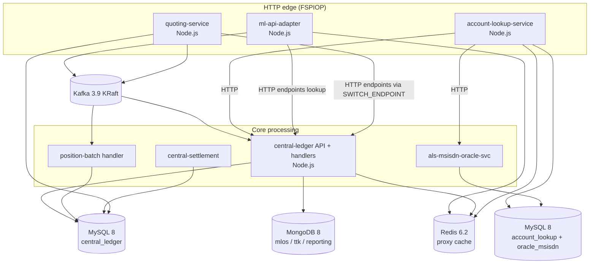

# 03 – Technology Stack

> Every significant technology found in this repository, verified from files, not assumed.
> "Mandatory" means mandatory for the **standard local run** (`all-services` + `ttk-provisioning` + `ttk-tests`).

---

## 1. Summary table

| Category | Technologies found | Evidence |
| --- | --- | --- |
| Programming languages | **JavaScript (Node.js)**: all switch services (inside images), config-modifier, wait4, k6 scripts, partition calculator. **Bash**: helper scripts. **SQL**: DB init. **YAML/JSON**: config. | `docker/config-modifier/run.js`, `packages/**`, `*.sh`, `docker/sql-*` |
| Backend frameworks | Node.js services built on **Hapi** (Mojaloop's standard) **[UPSTREAM-DOC]**. The SDK Scheme Adapter runs as an **Nx** monorepo (`yarn nx run modules-api-svc:start`). | Compose `command:` lines; image names |
| Frontend | TTK UI, Finance Portal micro-frontends (`reporting-hub-bop-shell`, `-trx-ui`, `-positions-ui`), merchant-registry frontend (Vite). All are **pre-built images**; no frontend source here. | `docker-compose.yml` finance-portal and merchant-registry sections |
| Databases | **MySQL 8.0** (switch system of record), **MongoDB 8.0.6** (object store, TTK DB, reporting events), **Redis 6.2.4** (caches, SDK state) | `.env`, `docker-compose.yml` |
| Messaging | **Apache Kafka 3.9.0** (KRaft mode, Bitnami legacy image). RabbitMQ 3.12 only in the experimental merchant-registry profile. | `docker-compose.yml:129-170` |
| API technologies | **REST/JSON**, **OpenAPI 3.0** specs, **GraphQL** (reporting API), **WebSockets** (TTK, callback simulators, k6) | `docker/ml-testing-toolkit/spec_files/api_definitions/**` |
| Payment protocols | **FSPIOP API v1.0, v1.1, v2.0**, **FSPIOP v2.0 ISO 20022 variant**, **FX API v2.0**, **ILP** packet / condition / fulfilment | `api_definitions/fspiop_*`, `fx-api_2.0`, `default-env.json` (`ilpPacket`, `condition`) |
| Infrastructure | **Docker**, **Docker Compose** (profiles), **Kubernetes** (patches only), **k6-operator** | compose files, `Dockerfile`, `k8s-mojaloop-perf-tuning/` |
| Monitoring | **Prometheus 2.45**, **Grafana 10.0.2** (+ image renderer), node-exporter, cAdvisor, mysqld-exporter, kafka-exporter, Redpanda Console | `docker-compose-monitoring.yml`, `docker/grafana/**` |
| Security | **JWS** (FSPIOP-Signature), **mutual TLS** (security harness), OpenSSL-generated test PKI, Grype vulnerability scanning | `docker/secrets`, `docker/security/**`, `.grype.yaml` |
| Testing | **Mojaloop Testing Toolkit** (server, UI, CLI), legacy **Mojaloop Simulator**, **callback-handler simulator**, **k6** | `docker-compose*.yml`, `packages/k6-tests` |
| Dev tools | npm, `standard-version`, nvm (`.nvmrc` 22.22.0), git, CircleCI orb, `jq`/`curl` (in `automate_perf.sh`), `kubectl`, `envsubst` | root files |

---

## 2. Detailed inventory

For each technology: **what it is → why Mojaloop uses it → where in this repo → who depends on it → mandatory? → contribution.**

### 2.1 Languages and runtimes

| Technology | What it is | Why used | Where | Depends on it | Mandatory? | Contribution |
| --- | --- | --- | --- | --- | --- | --- |
| **Node.js** | JavaScript runtime | Mojaloop services are Node.js: good for I/O-heavy, asynchronous HTTP and Kafka work **[UPSTREAM-DOC]** | Inside every `mojaloop/*` image. Repo scripts `docker/config-modifier/run.js` and `docker/wait4/wait4.js` run with the image's Node. | All switch services | Yes (inside images; you don't install it) | Executes the whole switch |
| Node 22.22.0 on the host | Version pinned in `.nvmrc` | Only for `npm run release` (standard-version) | [.nvmrc](../../.nvmrc) | Maintainers | **No** (not needed to run the harness) | Release tooling |
| **Bash / sh** | Shell scripting | Glue: topic provisioning, waiting, perf automation | `docker/kafka/scripts/provision.sh`, `perf-test.sh`, `automate_perf.sh`, `wait-for-container.sh` | Kafka provisioning; perf workflow | Provisioning: yes (runs in container). Others: no. | Automation |
| **SQL** | Database DDL | Create users and DBs before services migrate their schema | `docker/sql-init/01_permissions.sql`, `sql-als-init/*.sql`, `sql-cl-init/*.sql` | `mysql`, `mysql-als`, `mysql-cl` | Yes | DB bootstrap |
| **k6 JavaScript** | Load-test scripting (ES modules for the k6 engine) | Performance characterisation | `packages/k6-tests/**` | `docker-compose-load.yml` | No | Throughput and latency testing |

### 2.2 Switch services (pre-built images)

| Image (version from `.env`) | What it is | Mandatory? |
| --- | --- | --- |
| `mojaloop/central-ledger:v19.4.4` | Ledger, participant admin API, transfer and position handlers | Yes |
| `mojaloop/ml-api-adapter:v16.4.2` | FSPIOP entry point for `/transfers`, `/fxTransfers`; notification handler | Yes |
| `mojaloop/account-lookup-service:v17.9.1` | Discovery: `/parties`, `/participants`; oracle routing | Yes |
| `mojaloop/als-msisdn-oracle-svc:v0.0.18` | Oracle that maps MSISDN → FSP | Yes (for MSISDN lookup) |
| `mojaloop/quoting-service:v17.8.0` | Agreement: `/quotes`, `/fxQuotes`, `/bulkQuotes` | Yes |
| `mojaloop/central-settlement:v17.0.6` | Settlement windows and settlements API | In `all-services`; needed only for settlement tests |
| `mojaloop/sdk-scheme-adapter:v24.7.0` | **Mojaloop Connector**: turns FSPIOP's async API into a simple synchronous API for FSP back-ends | Started in `all-services` (golden-path FSPs) |

Details: [06-microservices-deep-dive.md](06-microservices-deep-dive.md).

### 2.3 Databases and caches

| Technology | What it is | Why Mojaloop uses it | Where configured | Who depends on it | Mandatory? | Contribution |
| --- | --- | --- | --- | --- | --- | --- |
| **MySQL 8.0** (`mysql/mysql-server`) | Relational database | ACID guarantees for money-related state: transfers, state changes, positions, participants, settlement | `mysql` (DB `central_ledger`), `mysql-als` (DBs `account_lookup`, `oracle_msisdn`); perf uses `mysql-cl` | central-ledger, quoting-service, central-settlement, ALS, MSISDN oracle | **Yes** | System of record |
| **MongoDB 8.0.6** (`objstore`) | Document database | Object store for large payloads (central-ledger `MONGODB` config, DB `mlos`); TTK's own database (`ttk`); reporting events (`reporting`) | `docker-compose.yml:86`, `configs/central-ledger.js` (`MONGODB.DISABLED=false`), `spec_files/system_config.json` (`DB.HOST=objstore`) | central-ledger, TTK, reporting-events-processor | **Yes** (central-ledger waits for its health) | Payload storage, test history |
| **Redis 6.2.4** | In-memory key-value store | (1) `PROXY_CACHE` for inter-scheme proxy routing in central-ledger, ML API adapter and ALS; (2) per-FSP state cache for each SDK Scheme Adapter | `redis` (6379) + `payerfsp-redis` … `testfsp4-redis` (6381–6391) | central-ledger, ml-api-adapter, ALS, SDK adapters | **Yes** | Caching and correlation |

### 2.4 Messaging

| Technology | What it is | Why Mojaloop uses it | Where | Mandatory? |
| --- | --- | --- | --- | --- |
| **Apache Kafka 3.9.0** (KRaft, no ZooKeeper) | Distributed, durable, ordered log | Decouples the HTTP edge from processing. Allows scaling handlers independently. Keeps per-participant ordering for position calculations. Carries audit events. | `kafka` service; topics in [provision.sh](../../docker/kafka/scripts/provision.sh); broker address `kafka:29092` injected by every config override | **Yes** |
| Redpanda Console | Web UI for Kafka | Inspect topics and messages while learning or debugging | `kafka-debug-ui` (profile `debug`, port 8080); `kafka-mon-ui` in monitoring (9080) | No |
| RabbitMQ 3.12 | AMQP broker | Only for the experimental merchant registry (acquirer ↔ registry oracle) | `merchant-registry` profile | No |

Kafka topics created by the harness (23):

| Domain | Topics |
| --- | --- |
| Transfers | `topic-transfer-prepare`, `topic-transfer-position`, `topic-transfer-position-batch`, `topic-transfer-fulfil`, `topic-transfer-get`, `topic-notification-event`, `topic-admin-transfer` |
| Bulk transfers | `topic-bulk-prepare`, `topic-bulk-fulfil`, `topic-bulk-processing`, `topic-bulk-get` |
| Quotes | `topic-quotes-post`, `topic-quotes-put`, `topic-quotes-get`, `topic-fx-quotes-post`, `topic-fx-quotes-put`, `topic-fx-quotes-get`, `topic-bulkquotes-post`, `topic-bulkquotes-put`, `topic-bulkquotes-get` |
| Events | `topic-event-audit`, `topic-event-log`, `topic-event-trace` |

### 2.5 APIs and protocols

| Technology | What it is | Why | Where | Mandatory? |
| --- | --- | --- | --- | --- |
| **FSPIOP API** (v1.0, 1.1, 2.0) | Mojaloop's asynchronous REST API between FSPs and the switch | The common language of the scheme | `api_definitions/fspiop_1.0`, `fspiop_1.1`, `fspiop_2.0` (OpenAPI 3.0.2) | Yes |
| **FSPIOP v2.0 ISO 20022** | Same resources, with ISO 20022-shaped JSON bodies (`GrpHdr`, `CdtTrfTxInf` …) | Alignment with the global ISO 20022 standard | `api_definitions/fspiop_2.0_iso20022`; perf stack sets `API_TYPE=iso20022` in [perf.env](../../perf.env) | No (main harness uses `fspiop`) |
| **FX API v2.0** | `/fxQuotes`, `/fxTransfers`, `/services/FXP` | Cross-currency payments through a foreign-exchange provider | `api_definitions/fx-api_2.0` | Only for FX profiles |
| **Central Ledger Admin API** | Participant, account, limit, endpoint and settlement-model management | Onboarding and operations | `api_definitions/central_admin_1.0` | Yes (provisioning uses it) |
| **ALS Admin API** | Oracle registration | Tell ALS which oracle serves which ID type | `api_definitions/als_admin_1.1` | Yes |
| **Settlement API** v1, v2 | Settlement windows and settlements | Net settlement operations | `api_definitions/settlements_*` | For settlement tests |
| **SDK Scheme Adapter APIs** | Outbound (FSP → connector) and Backend (connector → FSP core) synchronous APIs | Simplify FSP integration | `api_definitions/sdk-scheme-adapter-*`, `mojaloop_sdk_outbound_scheme_adapter_1.0` | For SDK-based FSPs |
| **ILP (Interledger) conditions** | `ilpPacket`, `condition` = SHA-256(`fulfilment`), base64url | Cryptographic proof that the payee accepted, so both sides end with the same final state | Quote and transfer bodies in every test collection | Yes (conceptually) |
| **OpenAPI 3.0** | API description format | TTK validates requests and responses against it and generates mocks | All `api_spec.yaml` | Yes (TTK) |
| **GraphQL** | Query API | Finance Portal's transfers UI reads reporting data | `reporting-hub-bop-api-svc` | No |
| **WebSocket** | Bidirectional channel | TTK pushes live results to its UI and the mobile simulator; k6 waits for callbacks through callback-handler simulators (`ws://sim-perffsp-1:3002`) | TTK, `perf.env` FSP pool | No |
| **W3C Trace Context** (`traceparent`) | Distributed-tracing header | Correlate a payment across services and in k6 metrics | `packages/k6-tests/common/trace.js` | No |

### 2.6 Infrastructure

| Technology | Why | Where | Mandatory? |
| --- | --- | --- | --- |
| **Docker Engine** | Runs every component as a container | All compose files | **Yes** |
| **Docker Compose v2** with **profiles** | Start subsets of the switch (`discovery`, `transfer`, …) | `docker-compose*.yml` | **Yes** |
| Docker networks | `mojaloop-net` (switch), `monitoring-net`, `load-net` | Compose `networks:` | Yes (`mojaloop-net`) |
| **Kubernetes** + `kubectl` | Production-like runtime; this repo only *patches* an existing cluster | `k8s-mojaloop-perf-tuning/` | No |
| **Helm** | Not used in this repo. Upstream Mojaloop deploys with Helm charts **[EXTERNAL]** | – | No |
| **k6-operator** | Run k6 tests as Kubernetes jobs | [Dockerfile](../../Dockerfile) (`ghcr.io/grafana/k6-operator:runner-v1.2.0`) | No |
| nginx | Reverse proxy for the Finance Portal | `fp-proxy`, `docker/fp-proxy/nginx.conf` | No |
| MinIO | S3-compatible object storage (merchant documents) | `merchant-registry` profile | No |

### 2.7 Monitoring and observability

| Technology | What / why | Where | Mandatory? |
| --- | --- | --- | --- |
| **Prometheus v2.45.0** | Time-series metrics; scrapes `/metrics` on services; receives k6 metrics through remote-write | `docker/prometheus/prometheus.yml` | No |
| **Grafana 10.0.2** | Dashboards: ALS, central-ledger DB, central services, ML adapter, quoting service, Node.js runtime, Kafka, MySQL, Docker, k6, callback handler | `docker/grafana/provisioning/**` (12 dashboards), UI on `localhost:9999` | No |
| Grafana Image Renderer 3.7.1 | Render dashboards to PNG for `automate_perf.sh` | `renderer` | No |
| node-exporter, cAdvisor | Host and container metrics | monitoring compose | No |
| mysqld-exporter v0.15.0 | MySQL metrics (uses the `exporter` DB user from `sql-cl-init` / `sql-als-init`) | monitoring compose, profiles `als-test` / `transfers-test` | No |
| kafka-exporter | Kafka consumer-lag metrics | monitoring compose | No |
| Alertmanager | Present as config only; `alert.rules` has empty rules, and the service is commented out | `docker/alertmanager/config.yml` | No |
| **Mojaloop Event SDK** | Library inside services that emits audit, log and trace events | `docker/event_sdk/config.json`: `AUDIT: kafka`, `LOG: off`, `TRACE: off` | Yes (config) |

ELK/EFK (Elasticsearch) is **not** present. The only reference is a placeholder `SERVER_LOGS.ADAPTER.TYPE: ELASTICSEARCH` in TTK's `system_config.json`, pointing to `http://test-url/`.

### 2.8 Security

| Technology | What / why | Where | Mandatory? |
| --- | --- | --- | --- |
| **JWS** (JSON Web Signature) | The `FSPIOP-Signature` header proves which FSP sent a message and that it wasn't altered | ML API Adapter `ENDPOINT_SECURITY.JWS.JWS_SIGN: true` with a test key ([configs/ml-api-adapter.js](../../docker/config-modifier/configs/ml-api-adapter.js)); TTK `ENABLE_JWS_SIGNING: true`; SDK `JWS_SIGN` flags in `envs/*.env` | Signing on; validation off in the main harness |
| **mTLS** | Both client and server present certificates | Off in the main harness (`INBOUND/OUTBOUND_MUTUAL_TLS_ENABLED=false`); **on** in `docker-compose-security.yml` | No |
| OpenSSL | Generate CA, CSRs, certificates, JWS key pairs | `docker/security/**/createSecrets.sh`, `keygen.sh` | No |
| OAuth2 / WSO2 settings | SDK can fetch bearer tokens from an API gateway; TTK can enable OAuth | `envs/*-sdk.env` (`OAUTH_*`, empty), `system_config.json` (`AUTH_ENABLED: false`) | No (disabled) |
| Keycloak | Optional TTK identity provider | `system_config.json` (`KEYCLOAK.ENABLED: false`) | No |
| **Grype** | Container vulnerability scanning in CI | [.grype.yaml](../../.grype.yaml) | No |
| reCAPTCHA, SendGrid, GLEIF API | Merchant-registry integrations (placeholders) | `merchant-registry` profile | No |

Full analysis: [09-security-and-controls.md](09-security-and-controls.md).

### 2.9 Testing

| Technology | What / why | Where | Mandatory? |
| --- | --- | --- | --- |
| **Mojaloop Testing Toolkit (TTK)** v18.11.2 | Simulates FSPs and the hub. Runs request collections with assertions. Provides a UI, a mobile simulator and reports. | `mojaloop-testing-toolkit` (ports 9440→4040 FSPIOP, 9550→5050 control API) | **Yes** |
| TTK UI v16.2.0 | Web UI: test runner, collection manager, mobile simulator | `http://localhost:9660` | Recommended |
| TTK client-lib (CLI) v1.9.1 | Runs collections headlessly (`npm run cli -- -u … -i collections/… --labels std`) | `ttk-provisioning`, `ttk-tests` | **Yes** |
| Mojaloop Simulator v12.2.4 (legacy) | Simple payer/payee/oracle simulator | `simulator` (8444) | Yes (ALS waits for it) |
| callback-handler-simulator-svc v0.1.5 | High-performance FSP simulator for perf tests; notifies k6 through WebSocket | `sim-perffsp-*`, `sim-fspiop` | Perf only |
| **k6** 1.0.0 | Load generator | `docker-compose-load.yml` | No |

Jest, Mocha, Postman and Cypress are **not** used in this repository. Upstream services use their own unit-test frameworks inside their repos **[EXTERNAL]**.

### 2.10 Development and release tools

| Tool | Use | Where |
| --- | --- | --- |
| npm + `standard-version` | Versioning and changelog | [package.json](../../package.json) |
| git + conventional commits | Release notes | [CHANGELOG.md](../../CHANGELOG.md) |
| CircleCI + `mojaloop/build` orb | Build, scan, release on tags `vX.Y.Z` | [.circleci/config.yml](../../.circleci/config.yml) |
| `jq`, `curl` | Dashboard capture | [automate_perf.sh](../../automate_perf.sh) |
| `envsubst`, `kubectl` | Kubernetes patching | [k8s-mojaloop-perf-tuning/patch.sh](../../k8s-mojaloop-perf-tuning/patch.sh) |
| Make, yarn (on host) | Not used on the host. yarn runs *inside* the SDK image. | – |

---

## 3. Technology dependency map

Next: [04-business-use-cases.md](04-business-use-cases.md).
