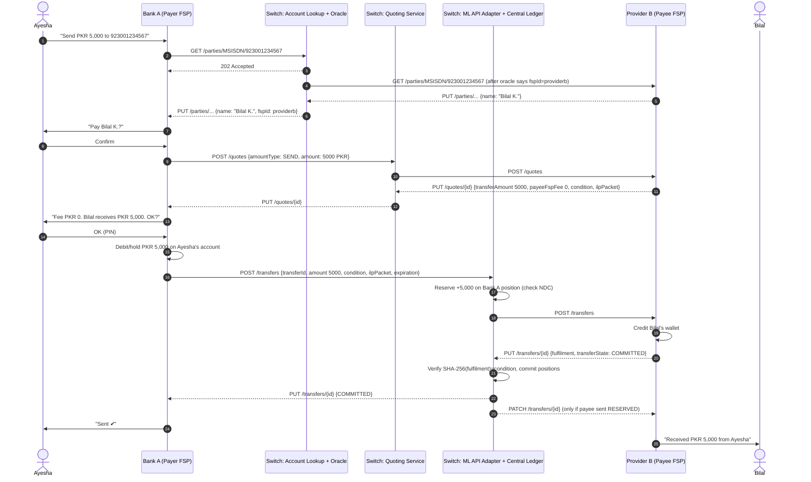
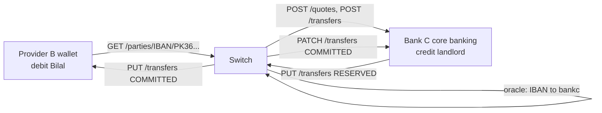
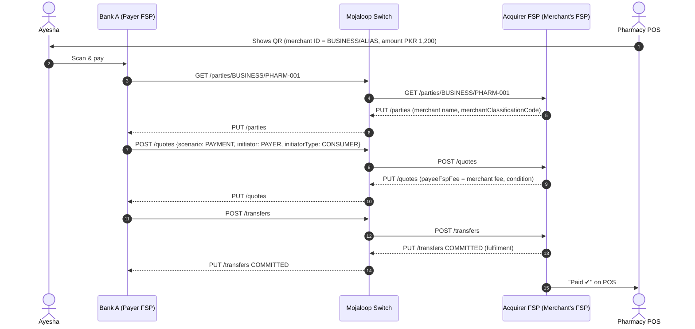

# 04 – Business Use Cases and Scenarios

> Which payment use cases Mojaloop supports in general **[UPSTREAM-DOC]**, and which ones this harness actually runs and tests **[IMPLEMENTED]**.

---

## 1. One idea that simplifies everything

The Mojaloop switch is **agnostic about what kind of institution an FSP is.** A bank, a mobile wallet and a microfinance institution all connect the same way and speak the same FSPIOP API. So "bank-to-wallet", "wallet-to-bank", "wallet-to-wallet" and "bank-to-bank" are the **same technical flow**: Discovery → Agreement → Transfer. Only three things change:

1. **The identifier used to find the payee**: `MSISDN`, `ACCOUNT_ID`, `IBAN`, `EMAIL`, `BUSINESS`, `ALIAS`, … (the `PartyIdType` enum in [fspiop_2.0/api_spec.yaml](../../docker/ml-testing-toolkit/spec_files/api_definitions/fspiop_2.0/api_spec.yaml)).
2. **The business meaning of the payment**: `transactionType.scenario` = `TRANSFER`, `PAYMENT`, `DEPOSIT`, `WITHDRAWAL`, `REFUND`, plus `initiator` (`PAYER`/`PAYEE`) and `initiatorType` (`CONSUMER`, `AGENT`, `BUSINESS`, `DEVICE`).
3. **What each FSP does internally**: debit or credit a bank account versus a wallet.

---

## 2. Status of every use case

Status legend: **[IMPLEMENTED]** runs and is tested here · **[PARTIAL]** some parts present · **[CONFIG]** switched by configuration · **[NOT IN HARNESS]** Mojaloop supports it but a required service is missing here.

| # | Use case | Status in this harness | Evidence / reason |
| --- | --- | --- | --- |
| 1 | Person-to-Person (P2P) | **[IMPLEMENTED]** | [tests/p2p.json](../../docker/ml-testing-toolkit/test-cases/collections/tests/p2p.json); 7 golden-path files in `feature_tests/p2p_money_transfer/` |
| 2 | Person-to-Merchant (P2M), payer-initiated | **[PARTIAL]** | Same flow with `scenario: PAYMENT`. The LEI merchant tests in `tests/lei/` need the external merchant-registry services. |
| 3 | Merchant-to-Person (payouts, refunds) | **[PARTIAL]** | API supports `initiatorType: BUSINESS` and `scenario: REFUND`; no dedicated test here |
| 4 | Account-to-Account | **[IMPLEMENTED]** (flow) / **[PARTIAL]** (ACCOUNT_ID oracle) | Flow identical to P2P. The `ACCOUNT_ID` oracle is registered to `http://moja-simulator/oracle`, which is **not** a compose service. |
| 5 | Wallet-to-Wallet | **[IMPLEMENTED]** | P2P flow using `MSISDN` (default in tests) |
| 6 | Bank-to-Wallet | **[IMPLEMENTED]** | P2P flow; payer FSP happens to be a bank |
| 7 | Wallet-to-Bank | **[IMPLEMENTED]** (MSISDN) / **[CONFIG]** (IBAN/ACCOUNT_ID needs an oracle) | Needs an oracle for the bank identifier type |
| 8 | Bank-to-Bank | **[IMPLEMENTED]** (flow) / **[CONFIG]** (oracle) | Same as 7 |
| 9 | Account lookup / payee discovery | **[IMPLEMENTED]** | ALS + MSISDN oracle; `tests_by_folder/parties`, `negative_scenarios/parties_negative.json` |
| 10 | Transaction quotation | **[IMPLEMENTED]** | quoting-service; `quoting_service/`, `tests_by_folder/quotes`, `negative_scenarios/quotes_negative.json` |
| 11 | Payment authorisation | **[CONFIG]** payer consent in FSP · **[NOT IN HARNESS]** FSPIOP `/authorizations` (OTP) | SDK `AUTO_ACCEPT_QUOTES`/`AUTO_ACCEPT_PARTY`. `/authorizations` is served by the transaction-requests-service, which is not in compose. |
| 12 | Transaction fulfilment | **[IMPLEMENTED]** | Every P2P test; `PUT /transfers/{ID}` with `fulfilment`, state `COMMITTED` |
| 13 | Transaction rejection | **[IMPLEMENTED]** | `transfer_negative_scenarios/payee_abort_v1.1.json`, `payee_invalid_fulfillment.json`, `duplicate_handling/transfers/fulfill_reject.json` |
| 14 | Transaction cancellation | **[IMPLEMENTED]** as *abort/expiry*; there is no "cancel" API | `payer_transfer_timeout.json` (error 3303); funds-out `recordFundsOutAbort` |
| 15 | Transaction reversal | **[NOT IN HARNESS]** as a feature | Mojaloop transfers are final once committed. A reversal is a *new* transfer back (scenario `REFUND`). |
| 16 | Transaction status inquiry | **[IMPLEMENTED]** | `GET /transfers/{ID}` in `feature_tests/get_transfers.json` (error 3208 for unknown ID), `GET /quotes/{ID}` |
| 17 | Bulk payments | **[PARTIAL]** | Bulk Kafka topics are provisioned; central-ledger registers bulk handlers; quoting-service has bulk-quote topics. **No bulk-api-adapter**; README says "Bulk – TODO". |
| 18 | Disbursements (G2P, salaries) | **[PARTIAL]** | Would use bulk or SDK `bulkTransactions` (in the SDK outbound spec); not runnable end-to-end here |
| 19 | Collections / request-to-pay | **[NOT IN HARNESS]** | Needs transaction-requests-service (`/transactionRequests`); referenced by the simulator and golden-path tests but not defined in compose |
| 20 | Cross-border / cross-currency | **[IMPLEMENTED]** (FX via an FXP) / **[PARTIAL]** (inter-scheme proxy) | `tests/fx/**`, `provisioning/fxp.json`, `participants_fx*`; proxy cache config + TTK proxy rules, but no proxy adapter service |
| 21 | Liquidity management | **[IMPLEMENTED]** | NDC limits, initial positions, funds-in, funds-out (`feature_tests/funds_in`, `funds_out`), `block_transfer.json` |
| 22 | Settlement and reconciliation | **[IMPLEMENTED]** | central-settlement + `settlement_management/*.json` (label `std-gp`) |
| + | Cash-in / cash-out at agents | **[PARTIAL]** | `scenario: DEPOSIT` / `WITHDRAWAL` supported by API; no dedicated test |
| + | On-us transfers (payer and payee at the same FSP) | **[CONFIG]** | Upstream `ENABLE_ON_US_TRANSFERS=false`; test `p2p_on_us_transfers/` |
| + | Participant activation and deactivation | **[IMPLEMENTED]** | `feature_tests/Active_Inactive_participants/` |

---

## 3. Use-case details

Each subsection follows the same template: **objective · participants · initiator · flow · services · APIs · lifecycle · success · failure · states · status**.

### 3.1 P2P transfer (also covers Wallet↔Wallet, Bank↔Wallet, Bank↔Bank)

| Item | Detail |
| --- | --- |
| Business objective | A person sends money to another person who may be at a different provider. |
| Participating entities | Payer, Payer FSP, Switch (ALS, oracle, quoting-service, ML API adapter, central-ledger), Payee FSP, Payee |
| Initiating participant | Payer (via Payer FSP) |
| Expected flow | Payer enters the payee's phone number → Payer FSP: `GET /parties` → ALS asks the oracle → Payee FSP returns the payee's name → payer confirms → `POST /quotes` → Payee FSP returns amount, fees and condition → payer accepts → Payer FSP debits the payer (or reserves funds) → `POST /transfers` → switch reserves the payer FSP's position → Payee FSP credits the payee and returns the fulfilment → switch commits → both FSPs get the final state |
| Relevant services | `account-lookup-service`, `als-msisdn-oracle-svc`, `quoting-service`(+handler), `ml-api-adapter`, `central-ledger`, `central-handler-position-batch` |
| Relevant APIs | `GET /parties/{Type}/{ID}` → `PUT /parties/...`; `POST /quotes` → `PUT /quotes/{ID}`; `POST /transfers` → `PUT /transfers/{ID}` (and optional `PATCH /transfers/{ID}` to the payee) |
| Request/response lifecycle | Every request gets **HTTP 202 Accepted** synchronously; the real result is a callback (see [08](08-fspiop-protocol-and-apis.md)). |
| Success | Callback `PUT /transfers/{ID}` with `transferState: COMMITTED` to both FSPs (the payee receives it if `SEND_TRANSFER_CONFIRMATION_TO_PAYEE` is on) |
| Failure | Party not found (3204), payee FSP rejects the quote (5101), payer FSP lacks liquidity (4001) or hits its limit (4200), payee rejects the transfer (`PUT /transfers/{ID}/error`), invalid fulfilment, transfer expired (3303), validation errors (3100–3107) |
| States | Transfer: `RECEIVED → RESERVED → COMMITTED` or `→ ABORTED` (internal states in [07](07-payment-transaction-lifecycle.md#4-transaction-state-management)) |
| Status | **[IMPLEMENTED]** |

### 3.2 Person-to-Merchant (P2M)

- **Objective:** a consumer pays a shop or online merchant.
- **Initiator:** the payer (push payment) using a merchant ID, till number, QR code or LEI. Alternatively the merchant (pull) through a **request-to-pay** that the payer approves.
- **Flow (payer-initiated):** identical to P2P, but `transactionType.scenario = PAYMENT` and the payee identifier is usually `BUSINESS` or `ALIAS`. The payee FSP (the merchant's acquirer) may quote a merchant fee.
- **Flow (merchant-initiated):** `POST /transactionRequests` from the payee FSP → payer FSP asks the payer to approve (optionally `GET /authorizations` for an OTP) → payer FSP then runs the normal quote + transfer. **Needs the transaction-requests-service → [NOT IN HARNESS].**
- **Repository evidence:** [tests/lei/lei_merchant_payment_parties.json](../../docker/ml-testing-toolkit/test-cases/collections/tests/lei/lei_merchant_payment_parties.json) looks up merchants by `ALIAS` = LEI (Legal Entity Identifier) through a *registry oracle*, then quotes with `scenario: PAYMENT, initiatorType: BUSINESS` and transfers. It relies on the `merchant-registry` profile, whose services build from external source → **[PARTIAL]**.

### 3.3 Merchant-to-Person (payouts, refunds)

- **Objective:** a business pays an individual: a refund, cash-back, insurance claim or gig-worker payout.
- **Flow:** P2P flow with `initiatorType: BUSINESS`. Use `scenario: REFUND` with a `refundInfo.originalTransactionId` for refunds **[UPSTREAM-DOC]**. Large batches use bulk ([§3.10](#310-bulk-payments-and-disbursements)).
- **Status:** **[PARTIAL]**: API-supported, no dedicated test.

### 3.4 Account lookup and payee discovery

| Item | Detail |
| --- | --- |
| Objective | Find which FSP owns an identifier and get the payee's verified name (to avoid paying the wrong person) |
| Initiator | Payer FSP |
| Flow | (a) **Registration** (done once by the payee FSP): `POST /participants/{Type}/{ID}` → ALS → oracle stores ID → FSP. (b) **Lookup**: `GET /parties/{Type}/{ID}` → ALS → oracle returns the FSP id → ALS forwards `GET /parties` to the payee FSP → payee FSP sends `PUT /parties/{Type}/{ID}` → ALS forwards it to the payer FSP. |
| Services | `account-lookup-service` (FSPIOP API port 4002, admin port 4001), `als-msisdn-oracle-svc` (3000), central-ledger (participant endpoint lookup) |
| Success | Callback with `party.partyIdInfo.fspId` and the payee's name |
| Failure | Unknown identifier → `PUT /parties/.../error` with **3204 "Party not found"** (asserted in [parties_negative.json](../../docker/ml-testing-toolkit/test-cases/collections/tests/golden_path/negative_scenarios/parties_negative.json)); no oracle for the ID type; payee FSP timeout |
| Status | **[IMPLEMENTED]** for `MSISDN` |

### 3.5 Transaction quotation

| Item | Detail |
| --- | --- |
| Objective | Agree on the exact amounts, fees, expiry and a cryptographic condition before moving money |
| Initiator | Payer FSP |
| Flow | `POST /quotes` (with `amountType` `SEND` or `RECEIVE`) → quoting-service validates, persists and forwards it to the payee FSP → payee FSP calculates `transferAmount`, `payeeReceiveAmount`, `payeeFspFee` and builds the `ilpPacket` + `condition` → `PUT /quotes/{ID}` → back to the payer FSP |
| Services | `quoting-service` (HTTP 3002), `quoting-service-handler` (Kafka consumers `topic-quotes-*`), MySQL (`central_ledger` DB), central-ledger (endpoint lookup via `SWITCH_ENDPOINT`) |
| Failure | Payee FSP rejects (`PUT /quotes/{ID}/error`, e.g. 5101), validation errors (3100–3102 in `quotes_negative.json`), duplicate with different content (3106) |
| Status | **[IMPLEMENTED]** (`SIMPLE_ROUTING_MODE: false` in [configs/quoting-service.js](../../docker/config-modifier/configs/quoting-service.js), so quotes are validated and persisted) |

### 3.6 Fulfilment, rejection and "cancellation"

- **Fulfilment.** The payee FSP proves acceptance by revealing the `fulfilment`, whose SHA-256 hash equals the `condition`. The switch verifies it and commits.
- **Rejection.** The payee FSP sends `PUT /transfers/{ID}/error`, or `PUT /transfers/{ID}` with `transferState: ABORTED` (v1.1+). The switch aborts and releases the payer FSP's reserved position.
- **Invalid fulfilment.** The switch aborts, notifies the payer FSP with an error, and sends the payee FSP a `PATCH /transfers/{ID}` with state `ABORTED` (tested in [patch_notification.json](../../docker/ml-testing-toolkit/test-cases/collections/tests/golden_path/feature_tests/patch_notifications/patch_notification.json)).
- **Cancellation.** FSPIOP has no "cancel" call. A transfer that is not fulfilled before its `expiration` is **expired by the timeout handler** and aborted (error **3303 "Transfer expired"**, [payer_transfer_timeout.json](../../docker/ml-testing-toolkit/test-cases/collections/tests/golden_path/feature_tests/transfer_negative_scenarios/payer_transfer_timeout.json)).

### 3.7 Reversal

**[UPSTREAM-DOC]** Mojaloop transfers are **irrevocable once COMMITTED**, by design, because the payee may already have spent the money. A correction is a **new transfer in the opposite direction** (scenario `REFUND`), agreed bilaterally or under scheme dispute rules. This harness has no reversal feature or test.

### 3.8 Status inquiry

`GET /transfers/{ID}` (also `GET /quotes/{ID}`, `GET /parties/...`). The switch answers asynchronously with `PUT /transfers/{ID}` carrying the **current** state. An unknown ID returns error **3208 "Transfer ID not found"** ([get_transfers.json](../../docker/ml-testing-toolkit/test-cases/collections/tests/golden_path/feature_tests/get_transfers.json)). This is how an FSP recovers after a lost callback or a crash. **[IMPLEMENTED]**

### 3.9 Cross-border and cross-currency (FX)

| Item | Detail |
| --- | --- |
| Objective | Payer pays in currency A; payee receives currency B; a **Foreign Exchange Provider (FXP)** converts |
| Participants | Payer FSP, FXP (`perffxp` in the standard onboarding; `testfxp1` in the FX test profiles), Payee FSP, switch |
| Flow (verified in [fx_tests.json](../../docker/ml-testing-toolkit/test-cases/collections/tests/fx/golden_path/feature_tests/happy_path/fx_tests.json)) | `GET /parties` → `GET /services/FXP` (find FXPs) → `POST /fxQuotes` (rate) → `POST /quotes` (payee's quote in target currency) → `POST /fxTransfers` (FXP reserves the conversion; `conversionState: RESERVED`) → `POST /transfers` (main transfer; `COMMITTED`, which also commits the dependent FX transfer) |
| Currencies in tests | Source `XXX` → target `XTS` (ISO 4217 test codes) |
| Status | **[IMPLEMENTED]** in profiles `fx` + `ttk-provisioning-fx` + `ttk-fx-tests` |
| Inter-scheme (cross-network) | Mojaloop also supports connecting *schemes* through proxies. Here only `PROXY_CACHE` (Redis) config and TTK proxy rules exist → **[PARTIAL]** |

### 3.10 Bulk payments and disbursements

**[UPSTREAM-DOC]** Bulk lets a payer FSP send many transfers (for example 10,000 salary payments) as one `POST /bulkQuotes` and one `POST /bulkTransfers`. The switch splits them into individual transfers internally. Evidence here: bulk topics in [provision.sh](../../docker/kafka/scripts/provision.sh), bulk Kafka config in [configs/central-ledger.js](../../docker/config-modifier/configs/central-ledger.js), `BULK_QUOTE` consumers in `configs/quoting-service.js`, bulk endpoints in the SDK outbound spec. **Missing:** the `bulk-api-adapter` HTTP service (`HOST_BULK_ADAPTER` points to `http://bulk-api-adapter-service`, which is not defined). **[PARTIAL]**

### 3.11 Collections (request-to-pay)

A biller or merchant requests payment, the payer approves, then the payer FSP pushes the money. FSPIOP resources: `/transactionRequests`, `/authorizations`. The golden-path folder `transaction_request_service/` contains tests, but the service is not in compose → **[NOT IN HARNESS]**.

### 3.12 Liquidity management

| Operation | API (central-ledger admin) | Evidence |
| --- | --- | --- |
| Set limit (Net Debit Cap) | `POST /participants/{name}/initialPositionAndLimits`, `PUT /participants/{name}/limits` | `participant_sender.json`, `CGS_Specific/adjust-participants-limits.json` |
| Funds in (prefund) | `POST /participants/{name}/accounts/{id}` `action: recordFundsIn` | `participant_sender.json` "sender fundsin" |
| Funds out (withdraw liquidity) | `action: recordFundsOutPrepareReserve`, then `PUT /participants/{name}/accounts/{id}/transfers/{transferId}` with `recordFundsOutCommit` / `recordFundsOutAbort` | `feature_tests/funds_out/**` |
| View positions | `GET /participants/{name}/positions`, `GET /participants/{name}/accounts` | Many tests |
| Block on breach | Automatic: prepare rejected with 4001 / 4200 | `block_transfer.json` |

**[IMPLEMENTED]**

### 3.13 Settlement and reconciliation

Deferred multilateral net settlement: close window → create settlement → `PS_TRANSFERS_RECORDED` → `PS_TRANSFERS_RESERVED` → `PS_TRANSFERS_COMMITTED` → `SETTLED`. Fully tested in [Settlement-management-primary-currency-test.json](../../docker/ml-testing-toolkit/test-cases/collections/tests/golden_path/settlement_management/Settlement-management-primary-currency-test.json) (19 test cases). Details: [07 §7](07-payment-transaction-lifecycle.md#7-settlement-and-reconciliation). **[IMPLEMENTED]**

---

## 4. Real-world business scenarios

The examples use PKR to make them concrete. This harness's test data uses the ISO 4217 test codes `XXX`, `XTS` and `XDR`. To try PKR you would onboard participants with currency `PKR` (see [13](13-customization-and-extension.md#3-add-a-new-currency)).

### Scenario 1: Bank-to-Wallet (Ayesha at Bank A pays Bilal's wallet at Provider B)

**Context:** Ayesha has a current account at **Bank A**. Bilal has a mobile wallet at **Provider B**, registered with his phone number `+92 300 1234567` (`MSISDN 923001234567`). She sends PKR 5,000.

**What happens at Bank A:** authenticate Ayesha (app login, PIN), check balance and limits, run AML screening, create a local transaction record with its own reference (`homeTransactionId`), call the switch, and **hold** the funds before sending `POST /transfers`. Release the hold on abort, or finalise it on commit.

**How the request reaches Mojaloop:** Bank A's connector calls the switch's FSPIOP endpoints (ALS for `/parties`, quoting-service for `/quotes`, ML API adapter for `/transfers`). In production these are behind an API gateway with mTLS. Every request carries `FSPIOP-Source: banka`.

**How the destination is identified:** the ALS asks the oracle registered for `MSISDN` (here `als-msisdn-oracle-svc`), which maps `923001234567 → providerb`. Provider B previously registered the number with `POST /participants/MSISDN/923001234567`.

**How the payment is processed:** quote → transfer prepare → position reservation against Bank A's Net Debit Cap → forward to Provider B → fulfil → commit.

**How both institutions are notified:** Bank A receives `PUT /transfers/{id}` (COMMITTED). Provider B already knows, because it produced the fulfilment. If it answered with `RESERVED` (asking for confirmation before releasing funds), it receives `PATCH /transfers/{id}` with the final state.

**How it reaches a final state:** `COMMITTED` once the fulfilment is valid and positions are committed. `ABORTED` on rejection, invalid fulfilment or expiry. There is no intermediate final state.

### Scenario 2: Wallet-to-Bank (Bilal pays his landlord's bank account)

**Differences from Scenario 1:**

- **Identifier:** usually `ACCOUNT_ID` or `IBAN`, sometimes `MSISDN` if the bank registers customers' phone numbers.
- **Oracle:** the scheme must run an oracle for that identifier type, or banks must register `ACCOUNT_ID`s in a shared oracle. In this harness only the MSISDN oracle works out of the box ([13 §5](13-customization-and-extension.md#5-add-an-oracle-for-a-new-identifier-type)).
- **Payee FSP behaviour:** Bank C credits a deposit account in its core banking system. Banks often answer `PUT /transfers` with `RESERVED` and wait for the switch's `PATCH` confirmation before making funds available, to avoid crediting money that the switch later aborts.
- **Name check:** the bank returns the account holder's name in `PUT /parties`, so Bilal can verify it before paying.

### Scenario 3: Wallet-to-Wallet (Provider B to Provider D)

This is exactly what [tests/p2p.json](../../docker/ml-testing-toolkit/test-cases/collections/tests/p2p.json) does: `MSISDN` lookup, `RECEIVE` quote (the payer specifies what the payee should receive), transfer, `COMMITTED`. Both FSPs are wallets with real-time ledgers, so they usually answer immediately with `COMMITTED`. Agent cash-in or cash-out on either side uses scenario `DEPOSIT` or `WITHDRAWAL` instead of `TRANSFER`.

### Scenario 4: Bank-to-Bank (Bank A to Bank C, A2A)

The same flow with `ACCOUNT_ID`/`IBAN`. Business considerations:

- Banks often need **limits per customer** and **sanctions screening**. These happen inside each bank before `POST /transfers` (payer side) and before fulfilling (payee side).
- Settlement between two banks is **net** across all their payments in the window, not per payment ([07 §7](07-payment-transaction-lifecycle.md#7-settlement-and-reconciliation)).

### Scenario 5: Merchant payment (Ayesha pays a pharmacy with a QR code)

Merchant-initiated variant: the POS asks the acquirer to send `POST /transactionRequests` to Bank A, and Ayesha approves on her phone. This needs the transaction-requests-service → **[NOT IN HARNESS]**.

### Scenario 6: Cross-currency remittance (PKR to an AED wallet through an FXP)

Payer FSP holds PKR, payee FSP holds AED. The payer FSP asks `GET /services/FXP` for providers, gets a rate with `POST /fxQuotes`, gets the payee's quote in AED, then `POST /fxTransfers` (conversion reserved), then `POST /transfers` (commits both). The FXP has positions in **both** currencies at the hub. Runnable here with `XXX → XTS` ([10 §9.3](10-local-setup-and-execution.md#93-fx-cross-currency-tests)).

---

## 5. Who initiates what (cheat sheet)

| Phase / action | Initiator | Receiver | Switch service |
| --- | --- | --- | --- |
| Register party | Payee FSP | Switch → oracle | ALS |
| Look up party | Payer FSP | Payee FSP (via switch) | ALS |
| Quote | Payer FSP | Payee FSP | Quoting service |
| FX quote / transfer | Payer FSP | FXP | Quoting service / ML API adapter |
| Transfer prepare | Payer FSP | Payee FSP | ML API adapter + central-ledger |
| Fulfil / reject | Payee FSP | Payer FSP (via switch) | ML API adapter + central-ledger |
| Commit notification (PATCH) | Switch | Payee FSP | ML API adapter (notification) |
| Request to pay | Payee FSP | Payer FSP | Transaction-requests-service *(not here)* |
| Funds in / out, limits | Hub operator | – | central-ledger admin API |
| Settlement | Hub operator | Settlement bank (offline) | central-settlement |

Next: [05-system-architecture.md](05-system-architecture.md).
