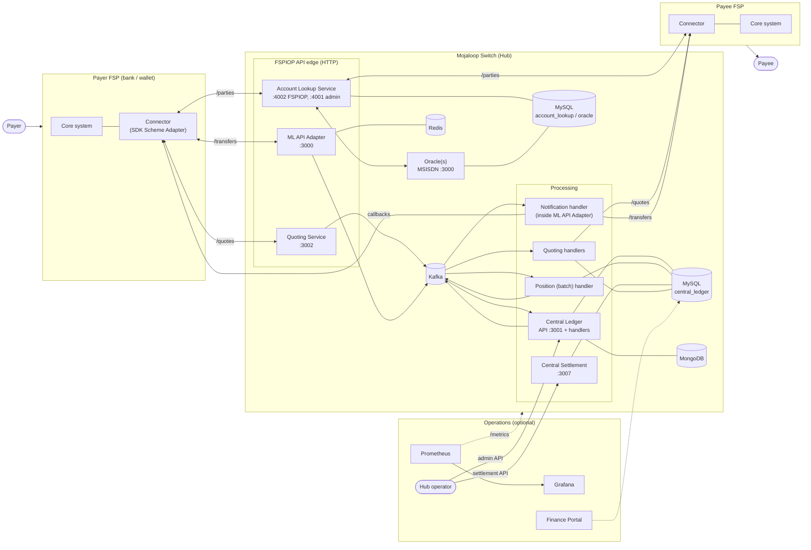
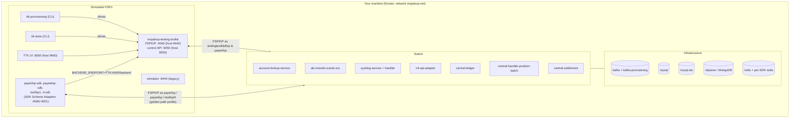
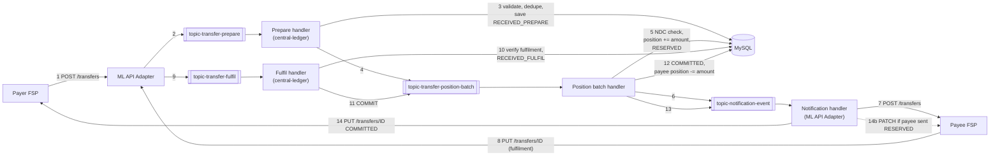

# 05 – System Architecture

> How the Mojaloop switch is put together, and how this harness surrounds it with simulated FSPs, test tools and monitoring.
> Service internals (handler names, Kafka routing) come from the upstream service code at the pinned tags **[UPSTREAM-DOC]**. Wiring, ports, topics and configuration come from this repository **[IMPLEMENTED]**.

---

## 1. High-level architecture

A standalone copy is in [diagrams/high-level-architecture.mmd](diagrams/high-level-architecture.mmd).

**Communication paths, in words:**

1. **FSP → switch:** every FSP calls three HTTP entry points: ALS (`/parties`, `/participants`), quoting-service (`/quotes`, `/fxQuotes`, `/bulkQuotes`) and ML API Adapter (`/transfers`, `/fxTransfers`).
2. **Inside the switch:** quotes and transfers go through **Kafka** topics to **handlers**. The ledger state lives in **MySQL**.
3. **Switch → FSP:** the switch calls the *other* FSP's registered **callback URL** (stored in central-ledger as participant *endpoints*) to deliver requests and results.
4. **Operator → switch:** the hub operator uses central-ledger's admin API and central-settlement's API.

---

## 2. The harness topology (what actually runs on your laptop)

In the standard run, **no real bank exists**. The **Mojaloop Testing Toolkit (TTK)** plays the FSPs:

| Role in the standard `std` tests | Played by | Evidence |
| --- | --- | --- |
| Payer FSP `testingtoolkitdfsp` | TTK (sends requests, receives callbacks at `http://mojaloop-testing-toolkit:4040`) | `default-env.json`: `payerfsp: testingtoolkitdfsp`, `CALLBACK_ENDPOINT_BASE_URL` |
| Payee FSP `payeefsp` | TTK (its **callback rules** auto-answer `/parties`, `/quotes`, `/transfers`) | `participant_receiver.json` registers TTK as callback URL; `spec_files/rules_callback/default.json` |
| Hub operator | TTK CLI provisioning collection | `provisioning/hub_setup*.json` |

In the **golden-path** profile (`std-gp`), FSPs such as `payerfsp`, `payeefsp` and `testfsp1..4` are onboarded with callback URLs pointing to their **SDK Scheme Adapter** containers (`PAYEEFSP_CALLBACK_URL=http://payeefsp-sdk:4000`). Each SDK then calls the TTK as its "core banking backend" (`BACKEND_ENDPOINT=mojaloop-testing-toolkit:4040/backend` in [envs/payerfsp-sdk.env](../../envs/payerfsp-sdk.env)). This is the architecture a real bank would use: **switch ↔ connector ↔ core system**.

---

## 3. Component responsibilities

| Component (container) | Business responsibility | Technical responsibility | Talks to |
| --- | --- | --- | --- |
| `account-lookup-service` | "Who owns this phone, account or ID?" | Hosts FSPIOP `/parties` and `/participants` (port 4002) and the admin `/oracles` API (4001). Routes lookups to oracles and forwards to payee FSPs. | Oracles (HTTP), central-ledger (participant endpoints), Redis, MySQL `account_lookup` |
| `als-msisdn-oracle-svc` | Directory of MSISDN → FSP | HTTP oracle API `/participants/{Type}/{ID}` on port 3000 | MySQL `oracle_msisdn` |
| `quoting-service` | Agree on amounts and fees | HTTP API for `/quotes`, `/fxQuotes`, `/bulkQuotes` (3002); publishes to Kafka | Kafka, MySQL, central-ledger |
| `quoting-service-handler` | Same | Kafka consumers for `topic-*quotes-*`; validates, persists, forwards over HTTP (monitoring port 3003) | Kafka, MySQL, FSP callback URLs |
| `ml-api-adapter` | Transfer front door and callback delivery | HTTP `/transfers`, `/fxTransfers` (3000) → Kafka. Its **notification handler** consumes `topic-notification-event` and calls FSPs. Signs outgoing switch messages with JWS. | Kafka, central-ledger (endpoint cache), Redis, FSPs |
| `central-ledger` | The clearing ledger and participant registry | Admin API (3001): participants, accounts, limits, endpoints, settlement models. **Handlers**: prepare, fulfil, get, admin, timeout, bulk. Runs DB migrations. | Kafka, MySQL, MongoDB, Redis |
| `central-handler-position-batch` | Risk control | Consumes `topic-transfer-position-batch`; reserves, commits and aborts positions in batches; enforces Net Debit Cap | Kafka, MySQL |
| `central-settlement` | Net settlement | Settlement windows and settlements API (3007) | MySQL, Kafka |
| `simulator` (legacy) | Test payer/payee/oracle | Simple simulator (8444) | ALS, ML API adapter |
| SDK Scheme Adapter (`*-sdk`) | FSP connector | Inbound FSPIOP server (4000), outbound simplified API (4001), test API (4002) | Switch, FSP backend, Redis |
| `mojaloop-testing-toolkit` | Test FSPs and hub operator | Rule-based mock and test runner | Everything |
| `kafka` / `kafka-provisioning` | Messaging backbone | KRaft broker; topic creation | All handlers |
| `mysql`, `mysql-als` | System of record | Transactions, positions, participants, quotes, oracle data | Services above |
| `objstore` | Document store | MongoDB for central-ledger object store, TTK DB, reporting | central-ledger, TTK, reporting |
| `redis` | Cache | Proxy cache for inter-scheme routing | central-ledger, ALS, ML API adapter |

Full per-service attributes (technology, APIs, config, deployment): [06-microservices-deep-dive.md](06-microservices-deep-dive.md).

---

## 4. Communication patterns

| Pattern | Where it is used | Example |
| --- | --- | --- |
| **Synchronous request/response** (HTTP, immediate result) | Admin APIs, health checks, oracle calls, SDK outbound API (from the FSP's view) | `POST /participants` on central-ledger returns 201; ALS calls `GET /participants/MSISDN/123` on the oracle and gets the FSP in the HTTP response |
| **Asynchronous request + callback** (FSPIOP) | All FSP ↔ switch interactions | `POST /transfers` → `202 Accepted` now → `PUT /transfers/{ID}` later to the callback URL |
| **Event-driven / message broker** | Inside quoting-service and central-ledger | `topic-transfer-prepare` → prepare handler → `topic-transfer-position-batch` → position handler → `topic-notification-event` |
| **Callback mechanism** | Switch → FSP delivery | Callback URLs registered per FSP and per resource (`FSPIOP_CALLBACK_URL_TRANSFER_PUT`, …) via `POST /participants/{name}/endpoints` |
| **Notifications** | Switch → payee FSP after commit | `PATCH /transfers/{ID}` (payee answered `RESERVED`); `PUT` notification controlled by `TRANSFERS.SEND_TRANSFER_CONFIRMATION_TO_PAYEE` |
| **Audit event stream** | All services | Event SDK → `topic-event-audit` (consumed by reporting-events-processor in the Finance Portal profile) |
| **Scheduled job** | Central-ledger timeout handler | Cron `*/15 * * * * *` (every 15 seconds) expires transfers past `expiration` |
| **WebSocket push** | Test tooling only | TTK → UI; callback-handler simulator → k6 |

### Why asynchronous?

**[UPSTREAM-DOC]** In a multi-party payment the payee FSP may be slow, offline, or need a human or core-banking step. Holding an HTTP connection open across three organisations would be fragile and would not scale. FSPIOP therefore acknowledges quickly (202) and delivers the outcome later. That is also why every resource has a client-generated **ID** (`quoteId`, `transferId`). It correlates the callback with the request and makes retries safe (idempotency, see [07 §5](07-payment-transaction-lifecycle.md#5-duplicates-idempotency-and-retries)).

---

## 5. Component interaction for a transfer (Kafka view)

**Why all position actions go to `topic-transfer-position-batch` here:** the harness overrides `KAFKA.EVENT_TYPE_ACTION_TOPIC_MAP.POSITION.*` (PREPARE, COMMIT, RESERVE, ABORT, TIMEOUT_RESERVED and the FX variants) to `topic-transfer-position-batch` in [configs/central-ledger.js](../../docker/config-modifier/configs/central-ledger.js). The dedicated `central-handler-position-batch` container (`node src/handlers/index.js handler --positionbatch`) consumes it. Batching processes many position changes per database transaction, which raises throughput. Kafka keys messages by participant, so ordering per FSP is preserved.

---

## 6. Data stores and what they hold

| Store | Database / keyspace | Main contents | Written by |
| --- | --- | --- | --- |
| MySQL `mysql` | `central_ledger` | participants, participantCurrency (accounts), participantLimit, participantPosition, transfer, transferStateChange, ilpPacket, transferFulfilment, settlement windows and settlements, quotes tables | central-ledger, central-settlement, quoting-service |
| MySQL `mysql-als` | `account_lookup` | oracle registry (`oracleEndpoint`), party/participant mappings for ALS | ALS |
| MySQL `mysql-als` | `oracle_msisdn` | MSISDN → FSP records | als-msisdn-oracle-svc |
| MongoDB `objstore` | `mlos`, `ttk`, `reporting` | central-ledger object store (bulk payloads); TTK history and reports; audit events (Finance Portal) | central-ledger, TTK, reporting-events-processor |
| Redis `redis` | proxy cache | inter-scheme proxy routing info | central-ledger, ALS, ML API adapter |
| Redis `*-redis` | per SDK | in-flight transfer state for each connector | SDK Scheme Adapters |

The table names above are **[UPSTREAM-DOC]** (central-ledger migrations). The schemas are created at runtime by the services' own `npm run migrate` steps.

---

## 7. Deployment-unit view of this harness

| Profile combination | What you get | Typical use |
| --- | --- | --- |
| `all-services` | Full switch + TTK + SDKs (no tests) | Exploring manually |
| `all-services ttk-provisioning ttk-tests` | Plus onboarding and the P2P test | **First run** |
| `all-services ttk-provisioning-gp ttk-tests-gp` | Plus the full golden-path regression | Deep testing |
| `testing-toolkit fx ttk-provisioning-fx ttk-fx-tests` | Switch + FX participants and tests | FX learning |
| `+ finance-portal` | Back-office UIs on `localhost:9400` | Operations view |
| `+ debug` | Redpanda Kafka console on `localhost:8080` | Watching topics |
| `docker-compose-perf.yml` profiles | Handlers split into scalable containers | Performance work |

Next: [06-microservices-deep-dive.md](06-microservices-deep-dive.md).
