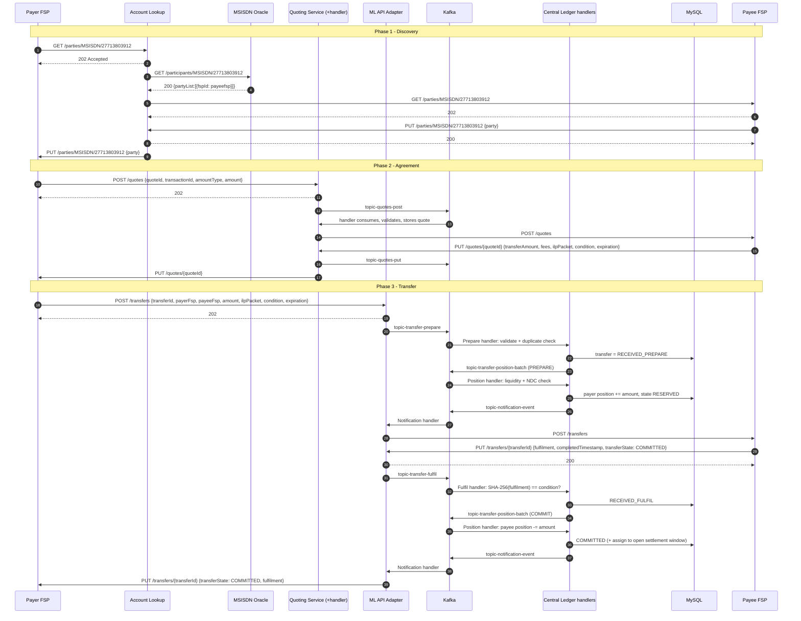
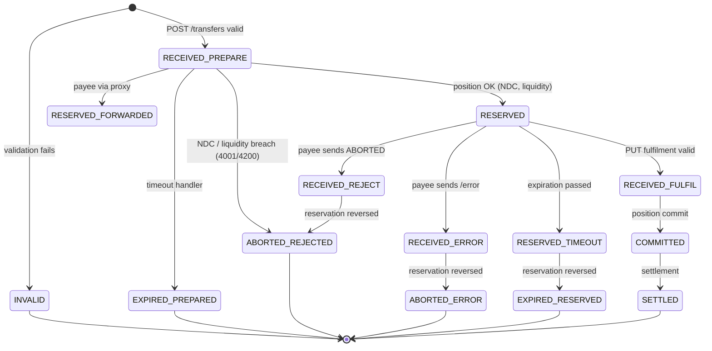
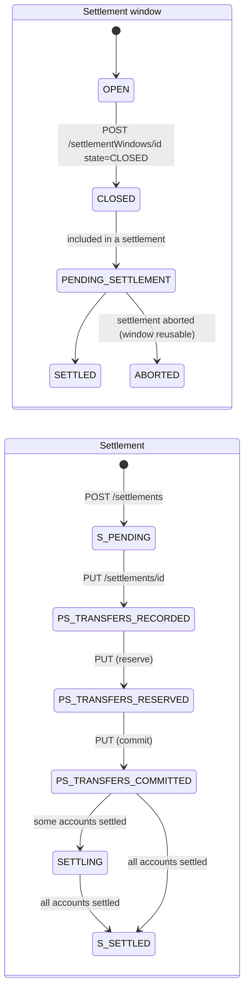

# 07 – Payment Transaction Lifecycle

> A complete Mojaloop payment, step by step: who calls whom, what is sent, what can go wrong, and how money really moves.
> The sequence is verified against the harness's own P2P test ([tests/p2p.json](../../docker/ml-testing-toolkit/test-cases/collections/tests/p2p.json)) and golden-path negative tests. Internal ledger states are verified against upstream `central-ledger` **v19.4.4** `seeds/transferState.js` **[UPSTREAM-DOC]**.

---

## 1. The lifecycle at a glance

| # | Step | Initiator | Switch service | API | Sync / async |
| --- | --- | --- | --- | --- | --- |
| 0 | *(once)* Register payee identifier | Payee FSP | ALS → oracle | `POST /participants/{Type}/{ID}` → `PUT /participants/{Type}/{ID}` | Async |
| 1 | Initiate payment | Payer (in FSP app) | – | (FSP-internal) | – |
| 2–3 | Resolve the payee / account lookup | Payer FSP | ALS + oracle | `GET /parties/{Type}/{ID}` → `PUT /parties/{Type}/{ID}` | Async |
| 4–5 | Request and receive quote | Payer FSP → Payee FSP | Quoting service | `POST /quotes` → `PUT /quotes/{ID}` | Async |
| 6 | Initiate transfer | Payer FSP | ML API adapter | `POST /transfers` | Async (202) |
| 7–8 | Process transfer, reserve funds | Switch | central-ledger prepare + position handlers | Kafka internal | Event-driven |
| 9 | Fulfil | Payee FSP | ML API adapter → fulfil handler | `PUT /transfers/{ID}` (with `fulfilment`) | Async |
| 10 | Complete | Switch | Position handler commit | Kafka internal | Event-driven |
| 11 | Notify | Switch | Notification handler | `PUT /transfers/{ID}` → payer; `PATCH /transfers/{ID}` → payee (if requested) | Async |
| 12 | Update records | Both FSPs + switch | central-ledger (MySQL) | – | – |
| 13 | Settle and reconcile | Hub operator, settlement bank | central-settlement | Settlement API | Sync (admin) |

---

## 2. End-to-end sequence (with switch internals)

Standalone copy: [diagrams/p2p-transfer-sequence.mmd](diagrams/p2p-transfer-sequence.mmd). Kafka routing details: [05 §5](05-system-architecture.md#5-component-interaction-for-a-transfer-kafka-view).

---

## 3. Every step in detail

### Step 0 – Register the payee (one-time)

- **Initiator:** payee FSP, when a customer opens an account or wallet.
- **API:** `POST /participants/MSISDN/27713803912` with body `{"fspId":"payeefsp","currency":"XXX"}` and header `FSPIOP-Source: payeefsp` (first request in [p2p.json](../../docker/ml-testing-toolkit/test-cases/collections/tests/p2p.json)).
- **Response:** `202`, then callback `PUT /participants/MSISDN/27713803912` confirming `fspId`.
- **Failure:** error callback `PUT /participants/.../error` (for example, no oracle for the type).

### Step 1 – Initiate payment

Inside the payer FSP: authenticate the customer, capture payee identifier and amount, check balance, limits and fraud rules, and create an internal transaction record. **Mojaloop is not involved yet.**

### Steps 2–3 – Resolve the payee (account lookup)

| Item | Detail |
| --- | --- |
| Initiator / handler | Payer FSP / `account-lookup-service` (port 4002) |
| Request | `GET /parties/{Type}/{ID}`, headers `FSPIOP-Source`, `Date`, `Accept`, `Content-Type` (+ `FSPIOP-Signature`) |
| Immediate response | `202 Accepted` (no body) |
| Callback | `PUT /parties/{Type}/{ID}` with `party.partyIdInfo` (`partyIdType`, `partyIdentifier`, `fspId`), `name`, `personalInfo` |
| Timeout | The switch does not time out lookups for you. The payer FSP must apply its own timeout (the SDK uses `REQUEST_PROCESSING_TIMEOUT_SECONDS=30` in [envs/payerfsp-sdk.env](../../envs/payerfsp-sdk.env)). |
| Rejection | `PUT /parties/{Type}/{ID}/error` (e.g. **3204 Party not found**) |
| Participant unavailable | If the oracle or payee FSP endpoint cannot be reached, ALS returns an error callback to the payer FSP. If the payee FSP never answers, nothing arrives, and the payer FSP's timeout applies. |

### Steps 4–5 – Request and receive the quote

| Item | Detail |
| --- | --- |
| Initiator / handler | Payer FSP / `quoting-service` → `quoting-service-handler` |
| Request | `POST /quotes`: `quoteId` (UUID), `transactionId` (UUID; becomes the `transferId`), `payer`, `payee`, `amountType` (`SEND` or `RECEIVE`), `amount`, `transactionType {scenario, initiator, initiatorType}`, optional `fees`, `note`, `expiration` |
| Callback | `PUT /quotes/{quoteId}`: `transferAmount`, `payeeReceiveAmount`, `payeeFspFee`, `payeeFspCommission`, `expiration`, `ilpPacket`, `condition` |
| What the condition is | The payee FSP generates a secret **fulfilment** and sends only its SHA-256 hash, the **condition**. Revealing the fulfilment later proves the payee accepted the transfer. |
| Timeout | Quotes have an `expiration`. The SDK sets `EXPIRY_SECONDS=60`. The payer FSP must stop waiting for the callback after its own timeout. |
| Rejection | `PUT /quotes/{ID}/error` (e.g. 5101 payee rejected quote, 3100 validation) |
| Participant unavailable | No callback → payer FSP timeout. The payer FSP may retry with `GET /quotes/{ID}`. |

### Step 6 – Initiate transfer

| Item | Detail |
| --- | --- |
| Initiator / handler | Payer FSP / `ml-api-adapter` |
| Precondition at the payer FSP | **Reserve or debit the payer's funds first.** Once the switch commits, the payer FSP owes the money. |
| Request | `POST /transfers`: `transferId` (= quote's `transactionId`), `payerFsp`, `payeeFsp`, `amount` (= quote `transferAmount`), `ilpPacket`, `condition`, `expiration` |
| Response | `202 Accepted` (synchronous validation of headers and schema only) |
| Failure (sync) | `400` with `errorInformation` for malformed requests (3100–3107) |

### Steps 7–8 – Process the transfer and reserve funds (inside the switch)

1. **Prepare handler.** Checks that both FSPs exist and are active and hold accounts in the currency, that the amount scale is valid (`AMOUNT.SCALE = 4`), that expiration is in the future and the condition is well formed, and that the request is not a duplicate. It stores the transfer as **`RECEIVED_PREPARE`** (external state `RECEIVED`).
2. **Position handler.** Checks that the payer FSP's **position + amount ≤ Net Debit Cap** and that liquidity covers it. It then increases the payer FSP's position and sets **`RESERVED`**.
   - Failure: abort with **4001 Payer FSP insufficient liquidity** or **4200 Payer limit error** (both asserted in [block_transfer.json](../../docker/ml-testing-toolkit/test-cases/collections/tests/golden_path/feature_tests/block_transfer.json)). Positions stay unchanged.
3. **Notification handler.** Forwards `POST /transfers` to the payee FSP's `FSPIOP_CALLBACK_URL_TRANSFER_POST` endpoint.

> **Reserve ≠ move money.** "Reserving" increases a *number* (the payer FSP's position) in the hub's ledger. No bank balance changes at this point.

### Step 9 – Fulfil

| Item | Detail |
| --- | --- |
| Initiator | Payee FSP, after it has verified the ILP packet and is ready to credit the payee |
| Request | `PUT /transfers/{transferId}`: `{ fulfilment, completedTimestamp, transferState }`. `transferState` = `COMMITTED` (payee has already credited) or `RESERVED` (payee wants the switch's final confirmation before crediting) |
| Switch action | Fulfil handler verifies `base64url(SHA-256(fulfilment)) == condition` and that the transfer hasn't expired → **`RECEIVED_FULFIL`** |
| Rejection path | Payee sends `PUT /transfers/{ID}/error` (→ `RECEIVED_ERROR` → `ABORTED_ERROR`) or `transferState: ABORTED` (→ `RECEIVED_REJECT` → `ABORTED_REJECTED`) |
| Invalid fulfilment | Switch aborts. The payer gets an error callback; the payee gets `PATCH /transfers/{ID}` with `ABORTED` ([patch_notification.json](../../docker/ml-testing-toolkit/test-cases/collections/tests/golden_path/feature_tests/patch_notifications/patch_notification.json)) |
| Late fulfil (after expiry) | Rejected with **3303 Transfer expired** |

### Step 10 – Complete

The position handler commits: it **decreases the payee FSP's position** by the amount and sets **`COMMITTED`**. The transfer is assigned to the currently **OPEN settlement window**. From here the transfer is **final and irrevocable**.

### Step 11 – Notify

- Payer FSP: `PUT /transfers/{ID}` with `transferState: COMMITTED`, `fulfilment` and `completedTimestamp`. On abort: `PUT /transfers/{ID}/error` with `errorInformation`.
- Payee FSP: `PATCH /transfers/{ID}` with the final state **only if** it replied `RESERVED`. A `PUT` confirmation may also be sent, depending on `TRANSFERS.SEND_TRANSFER_CONFIRMATION_TO_PAYEE` (upstream default `true`).
- Switch-originated callbacks carry `FSPIOP-Source` = the hub's name and are **JWS-signed** with the switch key ([configs/ml-api-adapter.js](../../docker/config-modifier/configs/ml-api-adapter.js)).

### Step 12 – Update transaction records

- **Payer FSP:** convert the hold on the payer's account into a final debit (on COMMITTED) or release it (on ABORTED). Show the receipt.
- **Payee FSP:** make the credit final (if it waited for confirmation). Notify the payee.
- **Switch:** `transfer`, `transferStateChange`, `transferFulfilment` and `participantPosition` rows in MySQL. Audit events go to `topic-event-audit`.

### Step 13 – Settlement and reconciliation

See [§7](#7-settlement-and-reconciliation).

---

## 4. Transaction state management

### 4.1 Two levels of state

FSPIOP exposes **four external states** (`TransferState` enum in [fspiop_2.0/api_spec.yaml](../../docker/ml-testing-toolkit/spec_files/api_definitions/fspiop_2.0/api_spec.yaml)): `RECEIVED`, `RESERVED`, `COMMITTED`, `ABORTED`. Central-ledger tracks **finer internal states**, each mapped to one external state (upstream `seeds/transferState.js` at v19.4.4):

| Internal state (`transferStateId`) | External (`enumeration`) | Meaning | Set by | Trigger |
| --- | --- | --- | --- | --- |
| `RECEIVED_PREPARE` | RECEIVED | Switch has received the transfer | Prepare handler | `POST /transfers` validated |
| `RESERVED` | RESERVED | Payer FSP position reserved | Position handler | NDC / liquidity check passed |
| `RECEIVED_FULFIL` | RESERVED | Valid fulfilment received; awaiting commit | Fulfil handler | `PUT /transfers/{ID}` |
| `RECEIVED_FULFIL_DEPENDENT` | RESERVED | Fulfilment received for an FX transfer that depends on the main transfer | Fulfil handler (FX) | `PUT /fxTransfers/{ID}` |
| `COMMITTED` | COMMITTED | Transfer complete | Position handler | Commit processed |
| `RECEIVED_REJECT` | RESERVED | Payee rejected | Fulfil handler | `transferState: ABORTED` from payee |
| `ABORTED_REJECTED` | ABORTED | Aborted: payee rejection, **or** the position check failed (NDC / liquidity) | Position handler | Reservation reversed, or reservation refused with 4001 / 4200 (upstream `src/domain/position/prepare.js`) |
| `RECEIVED_ERROR` | RESERVED | Payee sent error callback | Fulfil handler | `PUT /transfers/{ID}/error` |
| `ABORTED_ERROR` | ABORTED | Aborted after error | Position handler | Reservation reversed |
| `EXPIRED_PREPARED` | ABORTED | Expired before reservation | Timeout handler | `expiration` passed while `RECEIVED_PREPARE` |
| `RESERVED_TIMEOUT` | RESERVED | Expiring a reserved transfer | Timeout handler | `expiration` passed while `RESERVED` |
| `EXPIRED_RESERVED` | ABORTED | Expired after reservation; funds returned | Position handler | Reversal of timeout |
| `INVALID` | ABORTED | Failed validation | Prepare handler | e.g. inactive participant, invalid expiry or condition |
| `FAILED` | ABORTED | Failed to perform | Handlers | Internal failure |
| `SETTLED` | SETTLED | Settled | Settlement | Settlement process |
| `RESERVED_FORWARDED` | RESERVED | Forwarded to a proxy participant | Prepare handler | Inter-scheme proxy |

### 4.2 State diagram

Standalone copy: [diagrams/transfer-state-machine.mmd](diagrams/transfer-state-machine.mmd).

Note: an *invalid fulfilment* also ends in an aborted state, with a `PATCH` to the payee. The exact internal state path for that case is an upstream implementation detail; check `src/handlers/transfers/handler.js` at the pinned tag if you need it.

### 4.3 How failed transactions are handled

| Failure | Detected by | Result | Money effect |
| --- | --- | --- | --- |
| Schema or header error | ML API adapter (sync) | HTTP 400 + `errorInformation` | None |
| Unknown or inactive FSP, wrong currency | Prepare handler | Error callback to payer (3100 / 3201 asserted in `Active_Inactive_participants`) | None |
| NDC / liquidity breach | Position handler | State `ABORTED_REJECTED`; error callback 4001 / 4200 | None (position unchanged) |
| Payee rejects | Fulfil handler | Payer gets error; positions reversed | Reservation released |
| Invalid fulfilment | Fulfil handler | Payer gets error; payee gets PATCH `ABORTED` | Reservation released |
| No response from payee | Timeout handler | Payer **and** payee get 3303 ([payer_transfer_timeout.json](../../docker/ml-testing-toolkit/test-cases/collections/tests/golden_path/feature_tests/transfer_negative_scenarios/payer_transfer_timeout.json) asserts both and checks that positions are restored) | Reservation released |

---

## 5. Duplicates, idempotency and retries

Mojaloop's idempotency key is the **client-generated resource ID** (`transferId`, `quoteId`) together with a **hash of the request body**. The prepare logic below is from upstream `central-ledger` v19.4.4 `src/handlers/transfers/prepare.js` (`processDuplication`):

| Situation | Switch behaviour | Evidence in this repo |
| --- | --- | --- |
| Same `transferId`, **identical** body, original still `RECEIVED` | Ignored (no new processing, no callback) | `duplicate_handling/transfers/` |
| Same `transferId`, identical body, original `RESERVED`, `COMMITTED` or `ABORTED` | Switch **re-sends a callback** with the current state | [original_transfer_at_committed.json](../../docker/ml-testing-toolkit/test-cases/collections/tests/golden_path/feature_tests/duplicate_handling/transfers/original_transfer_at_committed.json) |
| Same `transferId`, **different** body | Error **3106 "Modified request"** | [fulfill_commit.json](../../docker/ml-testing-toolkit/test-cases/collections/tests/golden_path/feature_tests/duplicate_handling/transfers/fulfill_commit.json) (negative), `Tests for Bugfix #990 and #1016 - Quotes.json` |
| Duplicate **fulfil** (same body) | Callback with `COMMITTED` again | `fulfill_commit.json` (positive): "Duplicate Fulfill Callback Body – transferState is COMMITTED" |
| Lost callback | FSP calls `GET /transfers/{ID}`; switch answers with the current state | [get_transfers.json](../../docker/ml-testing-toolkit/test-cases/collections/tests/golden_path/feature_tests/get_transfers.json) |

**Rules for FSP developers [RECOMMENDATION]:**
1. Generate the `transferId` **once** and store it **before** sending. On retry, reuse it with an identical body.
2. Never send a new `transferId` for the same customer intent after a timeout. Ask `GET /transfers/{ID}` first.
3. Make your callback endpoints idempotent too. The switch may deliver the same callback more than once.

---

## 6. Worked financial example: PKR 5,000 from Bank A to Wallet B

**Setup (by the hub operator):**

| FSP | Settlement account (prefunded at settlement bank) | Net Debit Cap | Opening position |
| --- | --- | --- | --- |
| Bank A | PKR 1,000,000 | PKR 1,000,000 | 0 |
| Wallet B | PKR 500,000 | PKR 500,000 | 0 |

(The harness does the same with `NET_DEBIT_CAP` 1,000,000, `initialPosition` 0 and a `recordFundsIn` deposit, in [participant_sender.json](../../docker/ml-testing-toolkit/test-cases/collections/provisioning/participant_sender.json).)

**Customer Ayesha (Bank A) pays Bilal (Wallet B) PKR 5,000, fee 0.**

| Moment | Ayesha's account (Bank A's books) | Bilal's wallet (Wallet B's books) | Bank A position (hub) | Wallet B position (hub) | Settlement accounts |
| --- | --- | --- | --- | --- | --- |
| Before | 20,000 | 1,000 | 0 | 0 | A: 1,000,000 · B: 500,000 |
| After `POST /transfers` (Bank A holds funds) | 20,000 (5,000 on hold) | 1,000 | 0 | 0 | unchanged |
| After switch **reserve** | 20,000 (hold) | 1,000 | **+5,000** (reserved) | 0 | unchanged |
| Wallet B credits Bilal, sends fulfilment | 20,000 (hold) | **6,000** | +5,000 | 0 | unchanged |
| After switch **commit** | **15,000** (hold → debit) | 6,000 | +5,000 | **−5,000** | unchanged |
| End of window (many payments) | – | – | net e.g. +120,000 | net e.g. −120,000 | unchanged |
| After **settlement** | – | – | reset toward 0 | reset toward 0 | A: **880,000** · B: **620,000** |

The "Settlement accounts" column shows the **real** balances at the settlement bank. In the hub ledger, the settlement process only resets **positions** (via MLNS transfers against `HUB_MULTILATERAL_SETTLEMENT`); FSP `SETTLEMENT` accounts change only when the hub operator records funds-in/out to mirror the bank movement. This was verified in the harness (see [SA project T8](sa-learning-project/16-topic-08-settlement.md#3-effect-on-the-ledger-deferred-net-autopositionreset)).

Read the table carefully:

- **Payment processing** is the message flow (discovery, quote, transfer) that ends in COMMITTED. **No real money has moved between banks yet.**
- **Ledger entries:** the hub's ledger records an *obligation*: Bank A owes the scheme 5,000 and Wallet B is owed 5,000 (positions). Each FSP's own ledger records the customer debit and credit.
- **Liquidity management:** Bank A can keep paying only while its position stays within the NDC, which is backed by its prefunded settlement account. If its position reaches 1,000,000, the next prepare is rejected (4001/4200) until it adds funds (`recordFundsIn`) or settlement resets the position.
- **Settlement:** at window close the hub computes **net** amounts across *all* payments. The settlement bank moves real money: debits Bank A's settlement account and credits Wallet B's. This happens once per window, not once per payment.
- **Reconciliation:** each FSP matches its internal transactions (by `transferId` / `homeTransactionId`) against the hub's committed transfers and the settlement report. Differences are investigated through `GET /transfers/{ID}`, the Finance Portal and reports.

> **Do not confuse orchestration with funds movement.** The switch orchestrates and records. FSPs move customer money within their own books. The settlement bank moves inter-institution money. Committing a transfer creates a binding obligation; settlement discharges it.

---

## 7. Settlement and reconciliation

### 7.1 Settlement model used in the harness

`hub_setup.json` creates `DEFERREDNET<currency>` and `DEFAULTDEFERREDNET`: `settlementGranularity: NET`, `settlementInterchange: MULTILATERAL`, `settlementDelay: DEFERRED`, `requireLiquidityCheck: true`, `ledgerAccountType: POSITION`, `settlementAccountType: SETTLEMENT`, `autoPositionReset: true`. This is **Deferred Multilateral Net Settlement (DNS)**.

### 7.2 Settlement lifecycle (verified in the golden-path settlement tests)

(`S_PENDING` = `PENDING_SETTLEMENT` and `S_SETTLED` = `SETTLED` for the settlement object; renamed in the diagram to avoid a name clash. Window states also include `PROCESSING` and `FAILED` during closing, per upstream `seeds/settlementWindowState.js`.)

| Step | API call (from [Settlement-management-primary-currency-test.json](../../docker/ml-testing-toolkit/test-cases/collections/tests/golden_path/settlement_management/Settlement-management-primary-currency-test.json)) | Meaning |
| --- | --- | --- |
| Close window | `POST /settlementWindows/{id}` `{"state":"CLOSED","reason":"..."}` | Stop adding transfers; a new window opens |
| Create settlement | `POST /settlements` `{"settlementModel":"DEFERREDNETXXX","reason":"...","settlementWindows":[{"id":...}]}` | Compute net positions → `PENDING_SETTLEMENT` |
| Record | `PUT /settlements/{id}` with participant accounts | `PS_TRANSFERS_RECORDED` (MLNS transfers recorded) |
| Reserve | `PUT /settlements/{id}` | `PS_TRANSFERS_RESERVED` (debits reserved) |
| Commit | `PUT /settlements/{id}` | `PS_TRANSFERS_COMMITTED` (credits committed) |
| Settle | `PUT /settlements/{id}` | `SETTLED` once the settlement bank confirms every account |

The hub ledger also has `HUB_MULTILATERAL_SETTLEMENT` and `HUB_RECONCILIATION` accounts per currency (created in `hub_setup.json`). These are the hub's counter-accounts for settlement and funds-in/out entries.

### 7.3 Reconciliation checklist [RECOMMENDATION]

1. Daily: export your FSP's transactions and match on `transferId` against the hub's committed transfers for the window (Finance Portal or reporting API).
2. Compare your computed net position with the settlement report per window.
3. Compare settlement-bank statements with `SETTLEMENT` account movements (`GET /participants/{name}/accounts`).
4. Investigate breaks: transfers you consider failed but the hub committed (often a lost callback, so call `GET /transfers/{ID}`), and vice versa.

---

## 8. Timeouts at a glance

| Timer | Owner | Default / source | On expiry |
| --- | --- | --- | --- |
| Transfer `expiration` | Set by payer FSP in `POST /transfers`; enforced by the switch | Upstream timeout cron every 15 s (`HANDLERS.TIMEOUT.TIMEXP`) | Abort, reverse position, error **3303** to payer and payee |
| Quote `expiration` | Payee FSP (in `PUT /quotes`) | SDK `EXPIRY_SECONDS=60` | Payer FSP must not transfer on an expired quote (`REJECT_TRANSFERS_ON_EXPIRED_QUOTES` in SDK) |
| FSP request wait | Each FSP | SDK `REQUEST_PROCESSING_TIMEOUT_SECONDS=30` | FSP-side error; retry with GET |
| TTK callback wait | TTK | `CALLBACK_TIMEOUT: 15000` ms in `user_config.json` | Test assertion fails |
| Max fulfil timeout | Switch | `MAX_FULFIL_TIMEOUT_DURATION_SECONDS` (upstream config key) | Validation of `expiration` values |

Next: [08-fspiop-protocol-and-apis.md](08-fspiop-protocol-and-apis.md).
