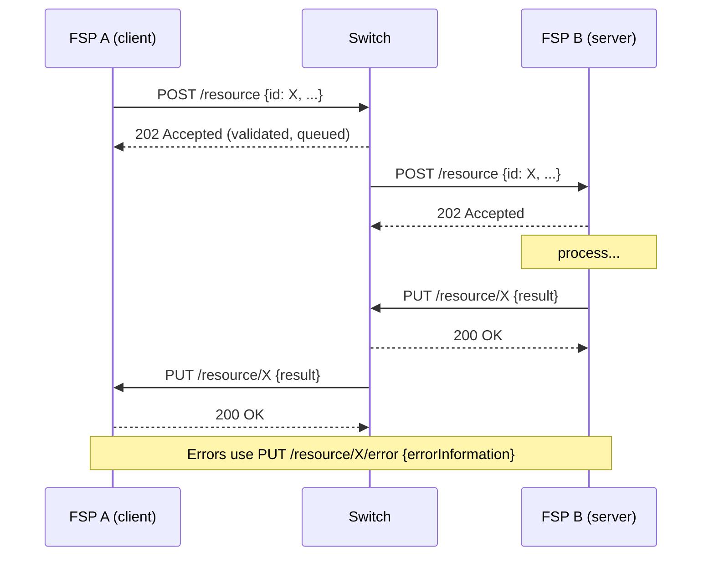

# 08 – FSPIOP Protocol and APIs

> The language every Mojaloop participant speaks. The API definitions here are the OpenAPI files shipped with the Testing Toolkit in [docker/ml-testing-toolkit/spec_files/api_definitions/](../../docker/ml-testing-toolkit/spec_files/api_definitions/). Examples are taken from this repo's test collections, with placeholder values where needed.

---

## 1. What is FSPIOP?

**FSPIOP** (*Financial Service Provider Interoperability Protocol*, also called the "Mojaloop FSPIOP API") is an **asynchronous REST/JSON API** that defines how FSPs and the switch exchange:

- party lookups (`/participants`, `/parties`),
- quotes (`/quotes`, `/bulkQuotes`, `/fxQuotes`),
- transfers (`/transfers`, `/bulkTransfers`, `/fxTransfers`),
- payee-initiated requests (`/transactionRequests`, `/authorizations`),
- transaction details (`/transactions`),
- FX provider discovery (`/services/FXP`).

**Why Mojaloop uses it [UPSTREAM-DOC]:** a single open, versioned contract lets any FSP connect once. The asynchronous design tolerates slow or offline participants. Client-generated IDs make retries safe. Cryptographic conditions (ILP) let both sides end with the same final state.

### Versions present in this repository

| Folder | Version | Notes |
| --- | --- | --- |
| `fspiop_1.0` | 1.0 | Original API |
| `fspiop_1.1` | 1.1 | Adds `PATCH /transfers/{ID}` notifications, `ABORTED` state in `PUT /transfers` from the payee. Most golden-path tests use 1.1. |
| `fspiop_2.0` | 2.0 | Adds FX resources (`/fxQuotes`, `/fxTransfers`, `/services/FXP`). The default env uses `version=2.0` for parties, quotes and transfers. |
| `fspiop_2.0_iso20022` | v2.0-iso20022-draft | Same resources, ISO 20022 message structures in JSON. Used by the perf stack (`API_TYPE=iso20022` in [perf.env](../../perf.env)). |
| `fx-api_2.0` | 2.0 | Standalone FX API definition |

---

## 2. Communication patterns



| Pattern | Verb / path | Meaning |
| --- | --- | --- |
| **Create** | `POST /resource` | Ask for something new (quote, transfer). Body includes the client-generated ID. |
| **Lookup** | `GET /resource/{ID}` | Ask for information or status. The answer comes later as `PUT`. |
| **Callback (response)** | `PUT /resource/{ID}` | The asynchronous answer to a POST or GET |
| **Error callback** | `PUT /resource/{ID}/error` | The asynchronous error answer |
| **Notification** | `PATCH /transfers/{ID}` | Switch → payee: final state after the payee replied `RESERVED` |
| **Immediate HTTP status** | `202` for POST/GET; `200` for PUT callbacks; `400`/`404`/`405`/`406`/`500`/`501`/`503` with `errorInformation` for synchronous rejections | Transport-level acknowledgement only |

**Key rule:** an HTTP `202` does **not** mean success. It means "I received it and will answer asynchronously".

---

## 3. Headers

From the `parameters` section of [fspiop_2.0/api_spec.yaml](../../docker/ml-testing-toolkit/spec_files/api_definitions/fspiop_2.0/api_spec.yaml):

| Header | Required | Purpose | Example |
| --- | --- | --- | --- |
| `Content-Type` | Yes | Resource type and API version of the body | `application/vnd.interoperability.transfers+json;version=2.0` |
| `Accept` | Yes (requests) | Which versions the sender accepts (omitted in callbacks) | `application/vnd.interoperability.transfers+json;version=2.0` |
| `Date` | Yes | RFC 7231 date; the switch rejects stale or invalid dates | `Wed, 04 Nov 2026 10:15:30 GMT` |
| `FSPIOP-Source` | Yes | **Who sent this.** The FSP id as registered in central-ledger | `testingtoolkitdfsp` |
| `FSPIOP-Destination` | Optional | **Who should receive it.** Needed when the switch cannot infer it (e.g. `POST /quotes`); set by the switch on callbacks | `payeefsp` |
| `FSPIOP-Signature` | Optional (scheme may require) | JWS signature over headers and body: proves origin and integrity | `{"signature":"…","protectedHeader":"…"}` |
| `FSPIOP-URI` | Optional | The URI that was signed (part of the JWS protected header) | `/transfers` |
| `FSPIOP-HTTP-Method` | Optional | The method that was signed | `POST` |
| `FSPIOP-Encryption` | Optional | Field-level encryption details (rarely used) | – |
| `X-Forwarded-For` | Optional | Proxy chain | – |
| `Content-Length` | Optional | Body size | – |
| `traceparent` / `tracestate` | Not FSPIOP; widely used | W3C trace context for observability | Generated by k6 in [common/trace.js](../../packages/k6-tests/common/trace.js) |
| `Authorization` | Not FSPIOP; added by API gateways | Bearer token when the scheme uses an OAuth gateway | `Bearer <token>` (placeholders `TTK_BEARER_TOKEN`/`PAYEE_BEARER_TOKEN` in tests) |

**What tests assert about headers on switch callbacks** (from [block_transfer.json](../../docker/ml-testing-toolkit/test-cases/collections/tests/golden_path/feature_tests/block_transfer.json) and others):
- `fspiop-source` should be the **switch's name** on switch-generated error callbacks.
- `fspiop-destination` should equal the original requester.
- `accept` should be **empty** on callbacks.
- `fspiop-signature` should be present (the switch signs).
- When forwarding an FSP's message, the switch preserves `fspiop-source`, `fspiop-signature`, `accept`, `content-type`, `fspiop-uri` and `fspiop-http-method`.

---

## 4. Identifiers and correlation

| Identifier | Generated by | Purpose | Format |
| --- | --- | --- | --- |
| `quoteId` | Payer FSP | Correlates `POST /quotes` with `PUT /quotes/{quoteId}` | UUID (TTK uses `generateUUID`) |
| `transactionId` | Payer FSP | Business transaction id shared by quote and transfer. **The `transferId` must equal the quote's `transactionId`** (asserted in p2p.json: "Request transferId same as quote request transferId"). | UUID |
| `transferId` | Payer FSP | Primary key of the transfer; idempotency key | UUID or ULID (k6 uses `ulid()`) |
| `transactionRequestId` | Payee FSP | Request-to-pay correlation | UUID |
| `conversionRequestId` | Payer FSP | FX quote id (`POST /fxQuotes`) | UUID |
| `conversionId` / `commitRequestId` | Payer FSP | FX transfer id (`POST /fxTransfers`); `commitRequestId` = quote's `conversionId` in [fx_tests.json](../../docker/ml-testing-toolkit/test-cases/collections/tests/fx/golden_path/feature_tests/happy_path/fx_tests.json) | UUID |
| `determiningTransferId` | Payer FSP | Links an FX transfer to the main transfer that it depends on | UUID |
| `partyIdType` / `partyIdentifier` / `partySubIdOrType` | – | The party's alias: type (`MSISDN`, `EMAIL`, `PERSONAL_ID`, `BUSINESS`, `DEVICE`, `ACCOUNT_ID`, `IBAN`, `ALIAS`), value, optional sub-ID | e.g. `MSISDN` / `27713803912` |
| `homeTransactionId` | FSP back-end (SDK API only) | The FSP's own reference. Not sent over FSPIOP; the SDK echoes it back. | free text |

---

## 5. Error handling

Every error, synchronous or callback, uses:

```json
{
  "errorInformation": {
    "errorCode": "3204",
    "errorDescription": "Party not found",
    "extensionList": { "extension": [ { "key": "cause", "value": "..." } ] }
  }
}
```

**Error code families [UPSTREAM-DOC]** (FSPIOP spec). The ✔ marks codes asserted by tests in this repo:

| Range | Category | Examples |
| --- | --- | --- |
| 1xxx | Communication | 1000 Communication error, 1001 Destination communication error |
| 2xxx | Server | 2000 Generic server error, 2001 Internal server error, 2003 Service currently unavailable, 2004 Server timeout |
| 30xx | Client: generic | **3000** ✔ Generic client error, **3001** ✔ Unacceptable version, **3002** ✔ Unknown URI, **3003** ✔ Add party information error |
| 31xx | Client: validation | **3100** ✔ Generic validation error, **3101** ✔ Malformed syntax, **3102** ✔ Missing mandatory element, 3103 Too many elements, 3104 Too large payload, 3105 Invalid signature, **3106** ✔ Modified request (duplicate ID, different body), 3107 Missing mandatory extension |
| 32xx | Client: ID not found | **3200** ✔ Generic ID not found, **3201** ✔ Destination FSP error, 3202 Payer FSP ID not found, 3203 Payee FSP ID not found, **3204** ✔ Party not found, 3205 Quote ID not found, **3208** ✔ Transfer ID not found |
| 33xx | Client: expired | 3300 Generic expired, 3301 Transaction request expired, 3302 Quote expired, **3303** ✔ Transfer expired |
| 4xxx | Payer | 4000 Generic payer error, **4001** ✔ Payer FSP insufficient liquidity, 4100 Generic payer rejection, **4200** ✔ Payer limit error, 4300 Payer permission error, 4400 Payer blocked |
| 5xxx | Payee | 5000 Generic payee error, **5100** ✔ Generic payee rejection, **5101** ✔ Payee rejected quote, 5103 Payee FSP rejected quote, 5105 Payee FSP rejected transaction, 5200 Payee limit error |

Counts of codes asserted in `tests/golden_path` (from this analysis): 3100 ×44, 3001 ×30, 3102 ×29, 3101 ×14, 5100 ×7, 3201 ×7, 5101 ×5, 3303 ×4, 3200 ×4, 3106 ×3, 3000 ×3, 3204 ×2, 3002 ×2, 4001, 4200, 3208, 3003 ×1.

---

## 6. Versioning and compatibility

- The version is negotiated through `Accept` and `Content-Type`, as `…+json;version=MAJOR.MINOR`.
- A request with an unsupported version gets **3001 Unacceptable version** (environment values like `acceptTransfersNotSupported = …version=9.0` exist to test this; see [fspiop_protocol_validation.json](../../docker/ml-testing-toolkit/test-cases/collections/tests/golden_path/feature_tests/backward_compatibility/fspiop_protocol_validation.json)).
- The switch forwards a request using the version the sender used. Each FSP must support the versions the scheme mandates. The SDK declares its per-resource versions with `RESOURCE_VERSIONS="transfers=2.0,quotes=2.0,participants=1.1,parties=2.0,transactionRequests=1.1"` ([envs/payerfsp-sdk.env](../../envs/payerfsp-sdk.env)).
- TTK supports multiple versions simultaneously (`VERSIONING_SUPPORT_ENABLE: true` in [user_config.json](../../docker/ml-testing-toolkit/spec_files/user_config.json)).

---

## 7. API catalogue

### 7.1 FSPIOP (FSP ↔ switch)

| API | Method | Endpoint | Business purpose | Caller → receiver | Request (key fields) | Response / callback | Errors | Switch service |
| --- | --- | --- | --- | --- | --- | --- | --- | --- |
| Register party | POST | `/participants/{Type}/{ID}[/{SubId}]` | Payee FSP registers that it owns an ID | Payee FSP → ALS → oracle | `fspId`, `currency` | 202; `PUT /participants/{Type}/{ID}` | `/error` | ALS |
| Bulk register | POST | `/participants` | Register many IDs | FSP → ALS | `requestId`, `partyList[]` | `PUT /participants/{ID}` | `/error` | ALS |
| Find owner | GET | `/participants/{Type}/{ID}` | Which FSP owns the ID | FSP → ALS | – | `PUT /participants/{Type}/{ID}` `{fspId}` | `/error` | ALS |
| Deregister | DELETE | `/participants/{Type}/{ID}` | Remove an ID | Payee FSP → ALS | – | `PUT` | `/error` | ALS |
| Party lookup | GET | `/parties/{Type}/{ID}[/{SubId}]` | Get the payee's details | Payer FSP → payee FSP | – | `PUT /parties/{Type}/{ID}` `{party}` | 3204 etc. | ALS |
| Quote | POST | `/quotes` | Agree amounts and fees, get condition | Payer FSP → payee FSP | `quoteId`, `transactionId`, `payer`, `payee`, `amountType`, `amount`, `transactionType` | `PUT /quotes/{ID}` `{transferAmount, payeeReceiveAmount, payeeFspFee, ilpPacket, condition, expiration}` | 3100, 5101 … | quoting-service |
| Quote status | GET | `/quotes/{ID}` | Re-fetch a quote | Payer FSP | – | `PUT /quotes/{ID}` | 3205 | quoting-service |
| Transfer | POST | `/transfers` | Execute the payment | Payer FSP → payee FSP | `transferId`, `payerFsp`, `payeeFsp`, `amount`, `ilpPacket`, `condition`, `expiration` | `PUT /transfers/{ID}` `{fulfilment, completedTimestamp, transferState}` | 4001, 4200, 3303 … | ml-api-adapter + central-ledger |
| Fulfil / reject | PUT | `/transfers/{ID}` | Payee confirms (or aborts) | Payee FSP → switch → payer FSP | `fulfilment`, `completedTimestamp`, `transferState` | 200 | 3100, 3303 | ml-api-adapter |
| Transfer error | PUT | `/transfers/{ID}/error` | Payee reports failure | Payee FSP → switch | `errorInformation` | 200 | – | ml-api-adapter |
| Transfer status | GET | `/transfers/{ID}` | Ask current state | FSP → switch | – | `PUT /transfers/{ID}` | 3208 | ml-api-adapter → get handler |
| Commit notification | PATCH | `/transfers/{ID}` | Final state to payee | Switch → payee FSP | `transferState`, `completedTimestamp` | 200 | – | ml-api-adapter (notification) |
| FX provider discovery | GET | `/services/FXP[/{Source}/{Target}]` | Which FXPs exist | Payer FSP → switch | – | `PUT /services/FXP` `{providers}` | – | ALS (v2.0) **[UPSTREAM-DOC]** |
| FX quote | POST | `/fxQuotes` | Get a conversion rate | Payer FSP → FXP | `conversionRequestId`, `conversionTerms{…}` | `PUT /fxQuotes/{ID}` `{conversionTerms, condition}` | – | quoting-service |
| FX transfer | POST | `/fxTransfers` | Reserve the conversion | Payer FSP → FXP | `commitRequestId`, `determiningTransferId`, `initiatingFsp`, `counterPartyFsp`, `sourceAmount`, `targetAmount`, `condition`, `expiration` | `PUT /fxTransfers/{ID}` `{conversionState, fulfilment}` | – | ml-api-adapter + central-ledger |
| Transaction request | POST | `/transactionRequests` | Payee asks payer to pay | Payee FSP → payer FSP | `transactionRequestId`, `payee`, `payer`, `amount`, `transactionType` | `PUT /transactionRequests/{ID}` `{transactionRequestState}` | – | transaction-requests-service *(not in harness)* |
| Authorization | GET | `/authorizations/{ID}` | Ask the payer for an OTP | Payer FSP → payee FSP | query params | `PUT /authorizations/{ID}` | – | transaction-requests-service *(not in harness)* |
| Bulk quote / transfer | POST | `/bulkQuotes`, `/bulkTransfers` | Many payments in one | Payer FSP → payee FSP | lists of individual quotes or transfers | `PUT /bulk…/{ID}` | – | quoting-service / bulk-api-adapter *(not in harness)* |

**Authentication:** FSPIOP itself defines no login. Participant identity is established by **mTLS** (transport) plus **JWS** (`FSPIOP-Signature`), with the `FSPIOP-Source` header checked against both. API gateways often add OAuth2. See [09](09-security-and-controls.md).

### 7.2 Hub operator APIs

| API | Base (harness) | Key endpoints | Used for |
| --- | --- | --- | --- |
| Central Ledger Admin | `http://central-ledger:3001` | `POST /participants`, `POST /participants/{name}/initialPositionAndLimits`, `POST/GET /participants/{name}/endpoints`, `GET/POST /participants/{name}/accounts`, `POST/PUT /participants/{name}/accounts/{id}[/transfers/{transferId}]`, `GET/PUT /participants/{name}/limits`, `GET /participants/{name}/positions`, `PUT /participants/{name}` (`isActive`), `GET/POST /settlementModels`, `GET /enums`, `GET /health` | Onboarding, liquidity, operations |
| ALS Admin | `http://account-lookup-service:4001` | `GET/POST /oracles`, `PUT/DELETE /oracles/{ID}`, `GET /health` | Oracle registry |
| Settlement | `http://central-settlement:3007/v2` | `GET /settlementWindows`, `POST /settlementWindows/{id}`, `POST/GET /settlements`, `PUT /settlements/{id}` | Settlement |
| Oracle API | `http://als-msisdn-oracle-svc:3000` | `/participants/{Type}/{ID}` | Called by ALS |

### 7.3 Connector APIs (SDK Scheme Adapter)

| API | Port | Key endpoints | Who calls it |
| --- | --- | --- | --- |
| **Outbound** (v2.1) | 4001 | `POST /transfers`, `PUT /transfers/{transferId}` (`acceptParty` / `acceptQuote` / `acceptConversion`), `GET /transfers/{transferId}`, `GET /parties/{Type}/{ID}`, `POST /quotes`, `POST /fxQuotes`, `POST /fxTransfers`, `POST /bulkTransactions`, `POST /requestToPay`, `POST /accounts` | FSP core system → SDK |
| **Backend** (v2.1) | (implemented by the FSP) | `GET /parties/{idType}/{idValue}`, `POST /quoterequests`, `POST /transfers`, `GET/PUT /transfers/{transferId}`, `POST /fxQuotes`, `POST /fxTransfers`, `POST /transactionrequests`, `GET /otp/{id}` | SDK → FSP core system |
| Inbound FSPIOP | 4000 | Full FSPIOP server | Switch → SDK |

Outbound `transferStatus` values: `WAITING_FOR_PARTY_ACCEPTANCE`, `WAITING_FOR_QUOTE_ACCEPTANCE`, `WAITING_FOR_CONVERSION_ACCEPTANCE`, `COMPLETED`, `ERROR_OCCURRED` ([outbound spec](../../docker/ml-testing-toolkit/spec_files/api_definitions/sdk-scheme-adapter-outbound-v2_1_0-openapi3-snippets_2.1/api_spec.yaml)).

---

## 8. Annotated request and response examples

Values follow the harness test data ([default-env.json](../../docker/ml-testing-toolkit/test-cases/environments/default-env.json)): payer FSP `testingtoolkitdfsp`, payee FSP `payeefsp`, payee MSISDN `27713803912`, currency `XXX`.

### 8.1 Account lookup

**Request** (payer FSP → ALS, port 4002):

```http
GET /parties/MSISDN/27713803912 HTTP/1.1
Accept: application/vnd.interoperability.parties+json;version=2.0
Content-Type: application/vnd.interoperability.parties+json;version=2.0
Date: Wed, 04 Nov 2026 10:15:30 GMT
FSPIOP-Source: testingtoolkitdfsp
```

→ `202 Accepted`

**Callback** (switch → payer FSP's `FSPIOP_CALLBACK_URL_PARTIES_PUT`):

```http
PUT /parties/MSISDN/27713803912 HTTP/1.1
Content-Type: application/vnd.interoperability.parties+json;version=2.0
FSPIOP-Source: payeefsp
FSPIOP-Destination: testingtoolkitdfsp
```

```json
{
  "party": {
    "partyIdInfo": { "partyIdType": "MSISDN", "partyIdentifier": "27713803912", "fspId": "payeefsp" },
    "name": "Bilal Khan",
    "personalInfo": { "complexName": { "firstName": "Bilal", "lastName": "Khan" }, "dateOfBirth": "1990-01-01" }
  }
}
```

| Field | Meaning |
| --- | --- |
| `partyIdInfo.fspId` | **The answer to "who owns this number"**: the payee FSP to use in the quote |
| `name` / `personalInfo` | Shown to the payer to confirm the right recipient (anti-misdirection) |

### 8.2 Quotation

**Request** (from [p2p.json](../../docker/ml-testing-toolkit/test-cases/collections/tests/p2p.json), values filled in):

```http
POST /quotes HTTP/1.1
Accept: application/vnd.interoperability.quotes+json;version=2.0
Content-Type: application/vnd.interoperability.quotes+json;version=2.0
Date: Wed, 04 Nov 2026 10:15:35 GMT
FSPIOP-Source: testingtoolkitdfsp
FSPIOP-Destination: payeefsp
```

```json
{
  "quoteId": "7c23e80c-d078-4077-8263-2c047876fcf6",
  "transactionId": "85feac2f-39b2-491b-817e-4a03203d4f14",
  "transactionRequestId": "a8323bc6-c228-4df2-ae82-e5a997baf898",
  "payer": {
    "partyIdInfo": { "partyIdType": "MSISDN", "partyIdentifier": "44123456789", "fspId": "testingtoolkitdfsp" },
    "personalInfo": { "complexName": { "firstName": "Firstname-Test", "lastName": "Lastname-Test" }, "dateOfBirth": "1984-01-01" }
  },
  "payee": {
    "partyIdInfo": { "partyIdType": "MSISDN", "partyIdentifier": "27713803912", "fspId": "payeefsp" }
  },
  "amountType": "RECEIVE",
  "amount": { "amount": "100", "currency": "XXX" },
  "transactionType": { "scenario": "TRANSFER", "initiator": "PAYER", "initiatorType": "CONSUMER" },
  "note": "test"
}
```

| Field | Meaning |
| --- | --- |
| `amountType` | `SEND`: the payer sends exactly this (fees reduce what the payee gets). `RECEIVE`: the payee gets exactly this (fees added on top for the payer). |
| `transactionType.scenario` | Business type: `TRANSFER` (P2P), `PAYMENT` (merchant), `DEPOSIT`/`WITHDRAWAL` (cash-in/out), `REFUND` |
| `initiator` / `initiatorType` | Who started it (`PAYER`/`PAYEE`) and what kind of party (`CONSUMER`, `AGENT`, `BUSINESS`, `DEVICE`) |

**Callback** (payee FSP → switch → payer FSP):

```json
{
  "transferAmount": { "amount": "100", "currency": "XXX" },
  "payeeReceiveAmount": { "amount": "100", "currency": "XXX" },
  "payeeFspFee": { "amount": "0", "currency": "XXX" },
  "payeeFspCommission": { "amount": "0", "currency": "XXX" },
  "expiration": "2026-11-04T10:16:35.000Z",
  "ilpPacket": "<base64url ILP packet (contains amount, payee address and the quote/transaction data)>",
  "condition": "GRzLaTP7DJ9t4P-a_BA0WA9wzzlsugf00-Tn6kESAfM"
}
```

| Field | Meaning |
| --- | --- |
| `transferAmount` | What the payer FSP must put in `POST /transfers` |
| `payeeReceiveAmount` | What the payee will get |
| `payeeFspFee` / `payeeFspCommission` | Fee charged by, or commission paid to, the payee FSP |
| `ilpPacket` | Signed-by-hash description of the deal (amount, ILP address, transaction) |
| `condition` | `base64url(SHA-256(fulfilment))`. The payee keeps the fulfilment secret until it accepts the transfer. |

> **Verify it yourself.** The test environment contains `validFulfillment = UNlJ98hZTY_dsw0cAqw4i_UN3v4utt7CZFB4yfLbVFA`. In Node: `crypto.createHash('sha256').update(Buffer.from(f,'base64url')).digest('base64url')` returns `GRzLaTP7DJ9t4P-a_BA0WA9wzzlsugf00-Tn6kESAfM`, which is `validCondition`. This was checked during this analysis.

### 8.3 Transfer initiation (prepare)

```http
POST /transfers HTTP/1.1
Accept: application/vnd.interoperability.transfers+json;version=2.0
Content-Type: application/vnd.interoperability.transfers+json;version=2.0
Date: Wed, 04 Nov 2026 10:15:40 GMT
FSPIOP-Source: testingtoolkitdfsp
```

```json
{
  "transferId": "85feac2f-39b2-491b-817e-4a03203d4f14",
  "payerFsp": "testingtoolkitdfsp",
  "payeeFsp": "payeefsp",
  "amount": { "amount": "100", "currency": "XXX" },
  "expiration": "2026-11-04T10:16:35.000Z",
  "ilpPacket": "<from quote callback>",
  "condition": "GRzLaTP7DJ9t4P-a_BA0WA9wzzlsugf00-Tn6kESAfM"
}
```

| Field | Meaning |
| --- | --- |
| `transferId` | Equals the quote's `transactionId`; also the idempotency key |
| `amount` | Must equal the quote's `transferAmount` (asserted in p2p.json) |
| `expiration` | Deadline. After this the switch aborts with 3303. |
| `ilpPacket`, `condition` | Copied from the quote callback |

### 8.4 Transfer fulfilment

Payee FSP → switch (`PUT /transfers/85feac2f-…`):

```json
{
  "fulfilment": "UNlJ98hZTY_dsw0cAqw4i_UN3v4utt7CZFB4yfLbVFA",
  "completedTimestamp": "2026-11-04T10:15:41.250Z",
  "transferState": "COMMITTED"
}
```

Switch → payer FSP: the same body (`transferState: COMMITTED`), with `FSPIOP-Destination: testingtoolkitdfsp`.

Set `transferState: "RESERVED"` instead if the payee FSP wants the switch's final confirmation (`PATCH`) before releasing funds to the payee.

### 8.5 Transfer rejection

Payee FSP → switch (`PUT /transfers/{ID}/error`):

```json
{
  "errorInformation": {
    "errorCode": "5105",
    "errorDescription": "Payee FSP rejected transaction"
  }
}
```

The switch aborts (`RECEIVED_ERROR → ABORTED_ERROR`), reverses the reservation, and forwards the error to the payer FSP. An alternative is `PUT /transfers/{ID}` with `"transferState": "ABORTED"` (v1.1+), tested in [payee_abort_v1.1.json](../../docker/ml-testing-toolkit/test-cases/collections/tests/golden_path/feature_tests/transfer_negative_scenarios/payee_abort_v1.1.json).

Switch-originated example (NDC breach, sent to the payer FSP):

```json
{ "errorInformation": { "errorCode": "4001", "errorDescription": "Payer FSP insufficient liquidity" } }
```

### 8.6 Transfer status inquiry

```http
GET /transfers/85feac2f-39b2-491b-817e-4a03203d4f14 HTTP/1.1
Accept: application/vnd.interoperability.transfers+json;version=2.0
FSPIOP-Source: testingtoolkitdfsp
Date: ...
```

→ `202`, then `PUT /transfers/{ID}` with the current `transferState` (and `fulfilment` if committed). Unknown ID → `PUT /transfers/{ID}/error` with **3208**.

### 8.7 Transfer cancellation

**There is no cancel endpoint in FSPIOP.** To "cancel":
- **Before fulfilment:** the payee FSP may reject (§8.5). Otherwise the transfer expires at `expiration` and the switch aborts it (3303), notifying both sides.
- **After commit:** impossible by design. Use a new transfer with `scenario: REFUND`.
- **Funds-out (hub operation, not a payment):** `PUT /participants/{name}/accounts/{id}/transfers/{transferId}` with `{"action":"recordFundsOutAbort"}` cancels a reserved withdrawal of liquidity ([funds_out_abort.json](../../docker/ml-testing-toolkit/test-cases/collections/tests/golden_path/feature_tests/funds_out/Reserve&Abort/funds_out_abort.json)).

---

## 9. ISO 20022 mode (brief)

With `API_TYPE=iso20022` (perf stack), the same endpoints carry ISO 20022-shaped JSON. For example, a transfer prepare body contains `GrpHdr { MsgId, CreDtTm, NbOfTxs, SttlmInf }` and `CdtTrfTxInf { PmtId.TxId, IntrBkSttlmAmt, Cdtr, Dbtr, … }` (see [packages/k6-tests/scripts/postTransfers.js](../../packages/k6-tests/scripts/postTransfers.js)). The content type changes to `application/vnd.interoperability.iso20022.<resource>+json`. TTK callback rules detect it with `headers.Accept includesString "application/vnd.interoperability.iso20022"` ([rules_callback/default.json](../../docker/ml-testing-toolkit/spec_files/rules_callback/default.json)). The business flow is unchanged.

Next: [09-security-and-controls.md](09-security-and-controls.md).
