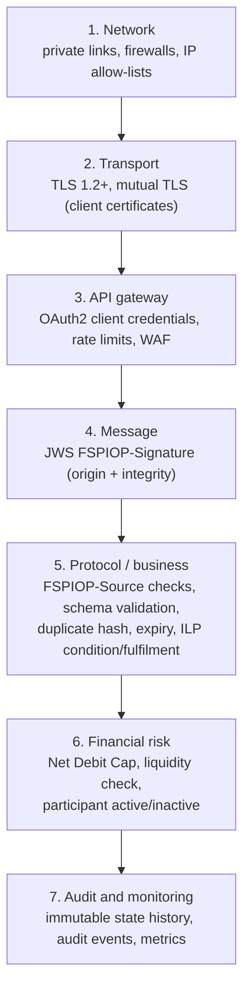
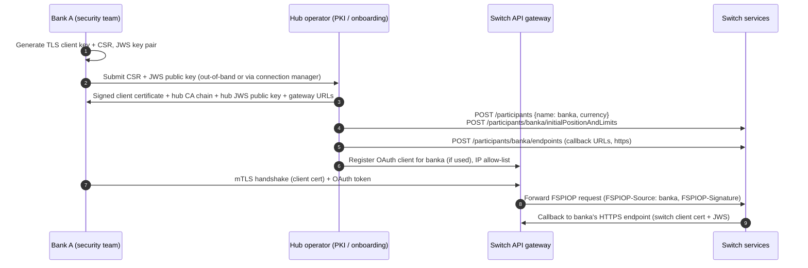

# 09 – Security and Financial Controls

> What this repository actually configures for security, what Mojaloop provides in general, and what each participating FSP must build itself.
> **This harness is deliberately insecure for convenience.** Never copy its settings, keys or passwords into a real environment.

---

## 1. Security layers in a Mojaloop scheme



Layers 1–3 are mostly **[EXTERNAL]**: provided by the scheme's infrastructure, not by the Node.js services. Layers 4–7 are partly inside Mojaloop services, and this harness configures some of them.

---

## 2. Control-by-control assessment of this repository

| Control | Status in harness | Evidence | Notes |
| --- | --- | --- | --- |
| **Authentication of FSPs (transport)** | Off in main harness | No TLS between services; all HTTP on `mojaloop-net` | Real schemes use **mTLS** at the gateway |
| **Mutual TLS** | **[IMPLEMENTED]** in the *security harness* only | `docker-compose-security.yml`, `envs/payer-sdk-scheme-adapter-api-svc.env` (`INBOUND_MUTUAL_TLS_ENABLED=true`, `OUTBOUND_MUTUAL_TLS_ENABLED=true`), certs in `docker/security/{payer,payee}/tls/` | Two SDK adapters talk directly (no switch) to measure mTLS + JWS overhead |
| **JWS signing by the switch** | **[CONFIG]** On | [configs/ml-api-adapter.js](../../docker/config-modifier/configs/ml-api-adapter.js): `JWS_SIGN: true`, key `secrets/jwsSigningKey.key` (mounted from `docker/secrets/`) | Switch-originated callbacks carry `FSPIOP-Signature`; tests assert it is present |
| **JWS signing by FSPs** | **[CONFIG]** TTK on, SDKs off | `default-env.json`: `ENABLE_JWS_SIGNING: true`; SDK envs: `JWS_SIGN=false` | |
| **JWS validation** | Off | TTK `ENABLE_JWS_VALIDATION: false`, `VALIDATE_INBOUND_JWS: false`; SDK `VALIDATE_INBOUND_JWS=false` | Enabled in the security harness (`VALIDATE_INBOUND_JWS=true`) |
| **OAuth2 / API gateway** | Off | SDK `OAUTH_TOKEN_ENDPOINT=` (empty), `ENABLE_OAUTH_TOKEN_ENDPOINT=false`; TTK `OAUTH.AUTH_ENABLED: false`; TTK UI `AUTH_ENABLED=FALSE` | Tests send placeholder `Authorization` headers that nothing checks |
| **Participant identification** | **[IMPLEMENTED]** (header-based) | `FSPIOP-Source` must be a registered, active participant (`Active_Inactive_participants` tests: 3100 / 3201) | Without mTLS + JWS validation, `FSPIOP-Source` can be spoofed |
| **Request validation** | **[IMPLEMENTED]** | Negative tests: missing headers, invalid header values, missing body fields (3100/3101/3102) in `negative_scenarios/`, `fspiop_protocol_validation.json` | OpenAPI-based validation at ALS, quoting-service and ML API adapter **[UPSTREAM-DOC]** |
| **Message integrity** | **[IMPLEMENTED]** (ILP) / **[CONFIG]** (JWS) | Condition/fulfilment check (invalid fulfilment → abort); JWS when enabled | |
| **Digital signatures** | JWS RS256 keys **[UPSTREAM-DOC]**; test keys in repo | `docker/security/*/jws/privatekey.pem`, `publickey.cer`, `verification_keys/` | |
| **Duplicate / replay protection** | **[IMPLEMENTED]** | ID + body-hash duplicate check (3106) | Plus `Date` header validation **[UPSTREAM-DOC]** |
| **Expiry enforcement** | **[IMPLEMENTED]** | Timeout handler, 3303 | |
| **Secrets management** | **None (test keys committed)** | `docker/secrets/jwsSigningKey.key`, `docker/security/**` (private keys, CA keys), passwords in compose and `envs/*.env`, JWS private keys embedded in `default-env.json` (`SIM1_JWS_KEY`, …) | **All test-only.** See §7. |
| **Audit logging** | **[IMPLEMENTED]** | Event SDK `AUDIT: kafka` → `topic-event-audit` ([event_sdk/config.json](../../docker/event_sdk/config.json)); immutable `transferStateChange` history in MySQL **[UPSTREAM-DOC]** | `LOG` and `TRACE` are off |
| **Financial risk controls** | **[IMPLEMENTED]** | NDC limits, liquidity check (4001/4200), participant deactivation, funds-out two-step | |
| **Fraud prevention** | **Not present** | – | FSP and scheme responsibility (§6) |
| **Vulnerability scanning** | **[IMPLEMENTED]** in CI | [.grype.yaml](../../.grype.yaml) (ignore list), CircleCI orb | |

---

## 3. How a bank securely connects to Mojaloop

**[UPSTREAM-DOC]** + **[RECOMMENDATION]**. The typical onboarding sequence:



Key points:

1. **Two key pairs per FSP:** a TLS key (proves the *connection*) and a JWS key (proves the *message*). Keep them separate.
2. **Callback endpoints must be HTTPS**, reachable from the switch, and authenticate the switch's client certificate.
3. **Bind identity to `FSPIOP-Source`.** The gateway or receiving FSP must check that the certificate or JWS key belongs to the FSP named in `FSPIOP-Source`.
4. Mojaloop's connector tooling (**Mojaloop Connection Manager**, **Payment Manager for Mojaloop**) automates the certificate exchange **[EXTERNAL]**. The SDK has a `PM4ML_ENABLED` flag for this (false here).

### How the security harness demonstrates it

[docker-compose-security.yml](../../docker-compose-security.yml) runs `payer-sdk-scheme-adapter-api-svc` (FSP `fspiopsimpayer`) and `payee-sdk-scheme-adapter-api-svc`, which talk **directly** to each other (`PEER_ENDPOINT=payee-sdk-scheme-adapter-api-svc:4000`) with:

| Setting | File role |
| --- | --- |
| `JWS_SIGNING_KEY_PATH=./secrets/jws/privatekey.pem` | This FSP's JWS private key |
| `verification_keys/fspiopsimpayee.pem` | Peer's JWS public key (file name = peer FSP id) |
| `IN_SERVER_CERT_PATH` / `IN_SERVER_KEY_PATH` | Server certificate for inbound TLS |
| `IN_CA_CERT_PATH=dfsp_client_cacert.pem` | CA that signed the *clients* allowed to call in |
| `OUT_CLIENT_CERT_PATH` / `OUT_CLIENT_KEY_PATH` | Client certificate presented when calling the peer |
| `OUT_CA_CERT_PATH=payee_server_cacert.pem` | CA that signed the peer's *server* cert |

The [README](../../README.md) ("SDK Security Overhead Testing") shows how the keys were generated with `keygen.sh`, `createSecrets.sh` and `openssl ca`, and how they were cross-signed and exchanged. It recommends **not** regenerating them unless needed.

---

## 4. JWS (FSPIOP-Signature) in detail

**[UPSTREAM-DOC]** The `FSPIOP-Signature` header is JSON:

```json
{
  "signature": "<base64url RS256 signature>",
  "protectedHeader": "<base64url of {\"alg\":\"RS256\",\"FSPIOP-URI\":\"/transfers\",\"FSPIOP-HTTP-Method\":\"POST\",\"FSPIOP-Source\":\"banka\",\"FSPIOP-Destination\":\"walletb\",\"Date\":\"...\"}>"
}
```

- The signature covers the **protected header** (selected HTTP headers) plus the **body**.
- The receiver looks up the sender's public key by `FSPIOP-Source` and verifies it.
- The switch **forwards FSP signatures unchanged** (tests assert the forwarded `fspiop-signature` equals the original). It **signs its own** messages (errors, notifications) with its key. This gives end-to-end non-repudiation between FSPs.
- SDK flags: `JWS_SIGN`, `JWS_SIGN_PUT_PARTIES`, `VALIDATE_INBOUND_JWS`, `VALIDATE_INBOUND_PUT_PARTIES_JWS`, `JWS_VERIFICATION_KEYS_DIRECTORY`.

## 5. The ILP condition as a financial control

The condition/fulfilment pair ([08 §8.2](08-fspiop-protocol-and-apis.md#82-quotation)) is a **hash-lock**:

- The payer FSP commits funds against a condition it cannot satisfy itself.
- Only the payee FSP knows the fulfilment, and reveals it only once it accepts the transfer.
- The switch commits only if `SHA-256(fulfilment) == condition`.
- So **no party can claim completion without the payee's cryptographic acceptance**, and both FSPs end with the same final state.
- The SDK derives conditions from `ILP_SECRET`. **Each FSP must use its own strong, secret value.** The sample value in `envs/*.env` is public.

---

## 6. Switch vs FSP responsibilities

| Control | Mojaloop switch | Participating FSP |
| --- | --- | --- |
| Customer authentication (login, PIN, biometrics) | – | **Yes** |
| Customer authorisation of each payment | – (quote gives the info) | **Yes** (show fees, get consent) |
| KYC / AML / sanctions screening | – | **Yes** (both payer and payee side) |
| Fraud detection (velocity, device, behaviour) | – | **Yes** |
| Customer balance check and debit/credit | – | **Yes** |
| Customer limits | – | **Yes** |
| Inter-FSP risk limit (Net Debit Cap) | **Yes** | Manage liquidity to stay within it |
| Participant identity verification | Gateway mTLS + JWS **[EXTERNAL]** | Hold keys, sign requests, validate switch signatures |
| Message schema and header validation | **Yes** | Validate inbound callbacks too |
| Duplicate detection | **Yes** (per ID + hash) | Generate unique IDs, idempotent handlers |
| Expiry enforcement | **Yes** | Set sensible `expiration`; respect it |
| Non-repudiation | Signs its own messages, forwards FSP signatures | Sign outgoing, verify incoming |
| Audit trail | Transfer state history, audit events | Own transaction logs, matched by `transferId` |
| Data protection (party names, DOB) | Transport only; minimal storage | Lawful processing; only return needed data |
| Secrets (keys, ILP secret) | Hub keys, DB credentials | FSP keys, ILP secret, OAuth secrets |

---

## 7. Secrets found in the repository (handle with care)

These files exist for **testing only**. Their contents are not reproduced in this guide:

| Location | What it is |
| --- | --- |
| `docker/secrets/jwsSigningKey.key` | Switch JWS private key (test) |
| `docker/security/{payer,payee}/jws/privatekey.pem` | FSP JWS private keys (test) |
| `docker/security/{payer,payee}/tls/*_key.key`, `*_cakey.pem` | TLS private keys and **CA private keys** (test) |
| `docker/ml-testing-toolkit/test-cases/environments/default-env.json` | Embedded JWS private keys for simulated FSPs (`SIM1_JWS_KEY`, `SIM2_JWS_KEY`, …) |
| `docker/ml-testing-toolkit/spec_files/user_config.json` | Embedded client TLS certificate data |
| `envs/*-sdk.env` | `ILP_SECRET`, sample `WSO2_BEARER_TOKEN`, OAuth test client credentials |
| `docker-compose.yml` | DB passwords (`DBPASS` default), MinIO/RabbitMQ defaults (`TODO: change this in production`) |
| `docker/grafana/config.env` | Grafana admin password |

**Recommendations for real environments [RECOMMENDATION]:**
- Generate new keys per environment. Store them in a secrets manager (HashiCorp Vault, cloud KMS, Kubernetes Secrets with encryption at rest) or an **HSM** for signing keys.
- Rotate keys, and support multiple verification keys during rotation.
- Never commit keys. Add pre-commit secret scanning.
- Use separate DB users with least privilege. Remove `MYSQL_ALLOW_EMPTY_PASSWORD=true` (present in compose for `mysql`/`mysql-als`).

## 8. Hardening gaps in the harness (do not replicate)

| Gap | Where |
| --- | --- |
| Containers run as `user: root` | Most services in compose |
| Kafka uses PLAINTEXT listeners, no SASL/ACLs | `KAFKA_CFG_LISTENER_SECURITY_PROTOCOL_MAP` |
| MySQL empty root password allowed; static user passwords | `mysql`, `mysql-als` |
| MongoDB and Redis without auth, ports published to the host (27017, 6379, 6381–6391) | compose |
| TTK and TTK UI without authentication; Finance Portal `AUTH_ENABLED=false` | compose |
| nginx proxy with `Access-Control-Allow-Origin: *` | [fp-proxy/nginx.conf](../../docker/fp-proxy/nginx.conf) |
| `latest` image tags for some dependencies (Redpanda console, exporters, cAdvisor) | [.env](../../.env) |
| Grype ignore list for known CVEs | [.grype.yaml](../../.grype.yaml) |

Next: [10-local-setup-and-execution.md](10-local-setup-and-execution.md).
