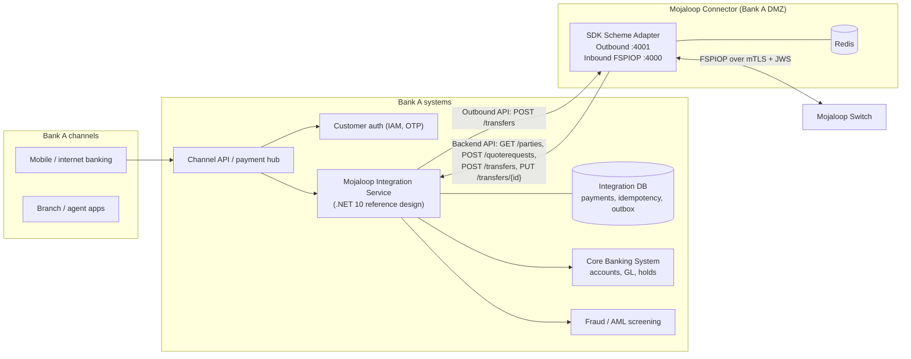
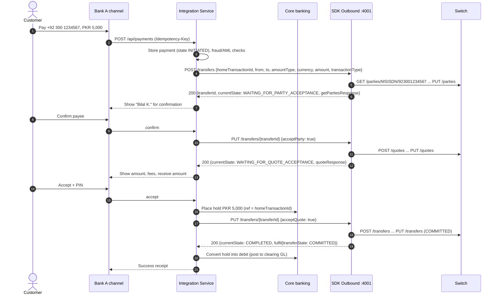

# 11 – Building a Participating FSP Integration

> How **Bank A** connects its banking application to a Mojaloop switch, from both sides: sending payments (payer) and receiving them (payee).
> Mojaloop API contracts are taken from this repo's OpenAPI files (FSPIOP and SDK Scheme Adapter v2.1). The bank-side architecture and .NET code are a **[RECOMMENDATION]** reference design, presented as a **separate application**. Nothing in this repository is modified.

---

## 1. Integration options

| Option | What Bank A builds | Pros | Cons | Evidence |
| --- | --- | --- | --- | --- |
| **A. Use the SDK Scheme Adapter (Mojaloop Connector)**, recommended | A small **Integration Service** that (1) calls the SDK's synchronous **Outbound API** and (2) implements the SDK's **Backend API** | No callback plumbing, ILP or JWS code; SDK maintained by Mojaloop | One more component to run (plus Redis) | SDK containers and env files in this repo; API specs in `api_definitions/sdk-scheme-adapter-*` |
| B. Implement FSPIOP directly | Full async FSPIOP client and server, callback correlation, ILP condition/fulfilment, JWS, mTLS | Full control | Large, error-prone effort | The TTK does this in the harness (as a simulator) |
| C. Payment Manager for Mojaloop (PM4ML) | Configure a packaged product (connector + portal + certificate management) | Fastest for some FSPs | Separate product | `PM4ML_ENABLED=false` flag only **[EXTERNAL]** |

The rest of this document uses **Option A**.

---

## 2. Bank A target architecture



---

## 3. What Mojaloop provides vs what Bank A must build

| Capability | Provided by Mojaloop (switch + SDK) | Built by Bank A |
| --- | --- | --- |
| Customer authentication | – | ✔ IAM, PIN/OTP, device binding |
| Account management | – | ✔ Accounts, balances, holds in the CBS |
| Alias registration (MSISDN/ACCOUNT_ID → Bank A) | ✔ ALS + oracle; SDK `POST /accounts` helper | ✔ Decide which aliases to publish; call registration when customers enrol or close |
| Account lookup (outgoing) | ✔ SDK + ALS | ✔ Show the payee name; get confirmation |
| Account lookup (incoming) | ✔ SDK receives `GET /parties` | ✔ Backend `GET /parties/{idType}/{idValue}`: find the customer, return the name |
| Payment initiation | ✔ SDK `POST /transfers` orchestrates discovery → quote → transfer | ✔ Validate, screen, place a hold, call the SDK |
| Quote handling (outgoing) | ✔ SDK sends `POST /quotes` | ✔ Show fees and amounts; capture consent (`acceptQuote`) |
| Quote handling (incoming) | ✔ SDK receives `POST /quotes`, builds ILP packet and condition | ✔ Backend `POST /quoterequests`: decide fees, limits, accept or reject |
| Transfer execution | ✔ Switch reserves and commits positions; SDK generates and validates the fulfilment | ✔ Debit (payer) / credit (payee) in the CBS |
| Fulfilment callbacks | ✔ SDK handles `PUT /transfers` | ✔ Backend `POST /transfers` (credit and confirm) and `PUT /transfers/{id}` (final notification) |
| Transaction status | ✔ `GET /transfers/{ID}`; SDK `GET /transfers/{transferId}` | ✔ Own state machine, customer notifications |
| Ledger integration | Hub positions only | ✔ GL postings, suspense accounts, settlement account |
| Error handling | ✔ FSPIOP error codes | ✔ Map to customer messages, reverse holds |
| Reconciliation | ✔ Settlement reports, transfer records | ✔ Daily matching, break handling |
| Security | ✔ Gateway mTLS, JWS support in SDK | ✔ Keys, certificates, secret storage, hardening |

---

## 4. Bank A as **payer** (outgoing payment)

### 4.1 Flow with the SDK Outbound API

With `AUTO_ACCEPT_PARTY=false` and `AUTO_ACCEPT_QUOTES=false` (recommended for real customers; the harness uses `true` for automation):



### 4.2 Outbound request (shape from [sdkSendE2E.js](../../packages/k6-tests/scripts/sdkSendE2E.js) and the outbound spec)

```json
{
  "homeTransactionId": "BANKA-2026-000123",
  "from": {
    "type": "CONSUMER",
    "idType": "MSISDN",
    "idValue": "923331112222",
    "displayName": "Ayesha R.",
    "firstName": "Ayesha",
    "lastName": "Rahman",
    "fspId": "banka"
  },
  "to": { "type": "CONSUMER", "idType": "MSISDN", "idValue": "923001234567" },
  "amountType": "SEND",
  "currency": "PKR",
  "amount": "5000",
  "transactionType": "TRANSFER",
  "note": "Rent share"
}
```

The response carries `transferId` (generated by the SDK), `currentState` (`WAITING_FOR_PARTY_ACCEPTANCE` | `WAITING_FOR_QUOTE_ACCEPTANCE` | `WAITING_FOR_CONVERSION_ACCEPTANCE` | `COMPLETED` | `ERROR_OCCURRED`), `getPartiesResponse`, `quoteResponse`, `fulfil` and `lastError`.

**Error responses have a different shape** (verified against SDK v24.7.0 in this harness). When the transfer fails, the SDK answers **HTTP 500** with `{"message": "...", "transferState": { ... }}`. The fields listed above are **nested inside `transferState`**, not at the top level. Read `json.transferState ?? json`, never assume the top level. To decide whether the failure is final:

| What the error body shows | Meaning | Bank A action |
| --- | --- | --- |
| No `transferState.prepare` (failed during lookup or quote) | Nothing was sent to the switch | Release the hold → `FAILED` |
| `transferState.lastError.mojaloopError` present (e.g. 4200, 5xxx, 3303) | The scheme answered with an FSPIOP error | Release the hold → `FAILED` |
| Prepare sent, no `mojaloopError` (timeout, connection error) | Outcome unknown | Keep the hold → `UNKNOWN`; resolve with `GET /transfers/{transferId}` |

The worked .NET example with this rule is in [SA M9](sa-learning-project/14-milestone-09-build-fsp-integration.md).

### 4.3 Points that matter

1. **Customer authentication** happens in Bank A before calling the SDK. Mojaloop never sees the PIN.
2. **Hold before `acceptQuote`.** Once the transfer is sent, the switch can commit. Bank A must be sure it can debit.
3. **Timeouts.** If the SDK call times out, **do not resend a new payment**. Query `GET /transfers/{transferId}` on the SDK (or FSPIOP `GET /transfers/{ID}`) and act on the actual state.
4. **Release the hold** on `ERROR_OCCURRED` or an aborted state. Debit only on `COMMITTED`.

---

## 5. Bank A as **payee** (incoming payment)

The SDK receives FSPIOP requests from the switch and calls Bank A's **Backend API** (spec: [sdk-scheme-adapter-backend-v2_1_0…/api_spec.yaml](../../docker/ml-testing-toolkit/spec_files/api_definitions/sdk-scheme-adapter-backend-v2_1_0-openapi3-snippets_2.1/api_spec.yaml)). In the harness, the TTK implements this API at `mojaloop-testing-toolkit:4040/backend` (`BACKEND_ENDPOINT` in `envs/*-sdk.env`).

| Backend endpoint | Called when | Bank A must | Response (required fields) |
| --- | --- | --- | --- |
| `GET /parties/{idType}/{idValue}` | Someone looks up a Bank A customer | Find the active account; apply privacy rules | `transferParty` (`idType`, `idValue`, plus `displayName`/`firstName`/`lastName`, `fspId`, `supportedCurrencies`…) or 404 |
| `POST /quoterequests` | A payer FSP requests a quote | Check that the account can receive (status, limits, currency); compute fees | `quoteResponse`: `quoteId`, `transactionId`, `transferAmount`, `transferAmountCurrency` (+ optional `payeeReceiveAmount`, `payeeFspFeeAmount`, `expiration`) |
| `POST /transfers` | Switch forwarded a prepared transfer | Validate it against the stored quote; **credit** (or provisionally credit) the customer; return your reference | `transferResponse`: `homeTransactionId` (required), optional `transferState`, `fulfilment`, `completedTimestamp` |
| `PUT /transfers/{transferId}` | Final notification (e.g. after `PATCH` from the switch) | Finalise or reverse a provisional credit | 200 |
| `GET /transfers/{transferId}` | Status queries | Return transfer details | `transferDetailsResponse` |

**Request example the SDK sends to `POST /quoterequests`** (required: `quoteId`, `transactionId`, `to`, `from`, `amountType`, `amount`, `currency`, `transactionType`, `initiator`, `initiatorType`):

```json
{
  "quoteId": "7c23e80c-d078-4077-8263-2c047876fcf6",
  "transactionId": "85feac2f-39b2-491b-817e-4a03203d4f14",
  "to":   { "idType": "MSISDN", "idValue": "923001234567" },
  "from": { "idType": "MSISDN", "idValue": "923331112222", "fspId": "walletb", "displayName": "Ayesha R." },
  "amountType": "SEND",
  "amount": "5000",
  "currency": "PKR",
  "transactionType": "TRANSFER",
  "initiator": "PAYER",
  "initiatorType": "CONSUMER",
  "expiration": "2026-11-04T10:16:35.000Z"
}
```

**Return an FSPIOP error code in the body when you reject.** The SDK reads `statusCode` from your error response. Verified: when the backend answered `GET /parties` with an empty 404, the paying bank received the generic **2001**. With `404 {"statusCode": "3204", "message": "Party not found"}`, it received **3204**, which its app can explain to the customer.

**Credit-timing decision.** If your core banking can roll back reliably, credit immediately and let the SDK answer `COMMITTED`. If not, credit **provisionally** (or answer `RESERVED`) and finalise only on the `PUT /transfers/{transferId}` notification. **[RECOMMENDATION]**

### 5.1 Publishing customers to the directory (account lookup integration)

When a customer enrols an alias (e.g. their mobile number), register it so that others can find Bank A:
- FSPIOP: `POST /participants/{Type}/{ID}` with `{"fspId":"banka","currency":"PKR"}`, or
- SDK outbound helper: `POST /accounts` with `[{"idType":"MSISDN","idValue":"923001234567","currency":"PKR"}]`. The k6 `setup()` in [sdkSendE2E.js](../../packages/k6-tests/scripts/sdkSendE2E.js) uses this to provision parties.

Deregister on closure (`DELETE /participants/{Type}/{ID}`). Never register an alias without the customer's consent.

---

## 6. Ledger integration, status management and error handling

### 6.1 Suggested GL design [RECOMMENDATION]

| Account | Purpose |
| --- | --- |
| Customer accounts | Debited (outgoing) / credited (incoming) |
| **Mojaloop Outgoing Clearing** (liability) | Holds outgoing amounts between customer debit and settlement |
| **Mojaloop Incoming Clearing** (asset) | Receivable from the scheme for incoming credits |
| **Settlement account at settlement bank** (nostro) | Real money; prefunded for the NDC |
| Fee income | Payee-side fees (from quotes) |

Postings for PKR 5,000 outgoing:

| Event | Debit | Credit |
| --- | --- | --- |
| Customer accepts quote (hold) | – (hold only) | – |
| Transfer COMMITTED | Customer account 5,000 | Mojaloop Outgoing Clearing 5,000 |
| Settlement (net, per window) | Mojaloop Outgoing Clearing (net) | Settlement account (net) |

### 6.2 Transaction status mapping

| Bank A internal state | Trigger | SDK `currentState` / FSPIOP state |
| --- | --- | --- |
| `INITIATED` | Channel request accepted | – |
| `PAYEE_CONFIRMATION_PENDING` | Party found | `WAITING_FOR_PARTY_ACCEPTANCE` |
| `QUOTE_ACCEPTANCE_PENDING` | Quote received | `WAITING_FOR_QUOTE_ACCEPTANCE` |
| `FUNDS_HELD` / `SENT` | `acceptQuote` sent | (transfer `RECEIVED`/`RESERVED` at the switch) |
| `COMPLETED` | Success | `COMPLETED` / `COMMITTED` |
| `FAILED` | Error | `ERROR_OCCURRED` / `ABORTED` |
| `UNKNOWN` (investigate) | Timeout without a final answer | Query `GET /transfers/{id}` until final |

### 6.3 Error translation

| FSPIOP code | Meaning | Customer message | Bank action |
| --- | --- | --- | --- |
| 3204 | Party not found | "We couldn't find an account for this number." | No hold placed |
| 5100–5106 | Payee side rejected | "The recipient's provider declined this payment." | Release hold |
| 4001 / 4200 | Bank A liquidity / limit at the hub | "Service temporarily unavailable, try later." | Release hold; **alert treasury** to fund the settlement account |
| 3303 | Transfer expired | "Payment timed out and was not completed." | Release hold |
| 3106 | Modified duplicate | (internal bug) | Investigate: ID reused with different content |
| 2xxx / 1xxx | Switch or communication error | "Try again later." | Check state with GET before any retry |

---

## 7. Reconciliation and operations

1. Store `transferId`, `homeTransactionId`, `quoteId`, amounts, fees, timestamps and final state for every payment.
2. Each settlement window: compare the sum of your COMMITTED outgoing minus incoming with the hub's net position (settlement report / Finance Portal).
3. Investigate any transfer that is in your DB but not COMMITTED at the hub, or vice versa (lost callbacks).
4. Monitor your hub **position vs NDC**. Top up the settlement account (the hub records `recordFundsIn`) before reaching the cap.

---

## 8. Reference application: Bank A → Integration Service → Mojaloop → Bank B

> A separate, beginner-friendly **.NET 10 / C#** solution. It is **not** part of this repository and was not compiled here. Treat the code as an illustrative design that follows the real API contracts.

### 8.1 Solution structure

```text
BankA.MojaloopIntegration/                  (separate repository)
├── src/
│   ├── BankA.Integration.Api/              ASP.NET Core 10 minimal API host
│   │   ├── Program.cs
│   │   ├── Endpoints/
│   │   │   ├── PaymentEndpoints.cs         Channel-facing: POST/GET /api/payments
│   │   │   └── SdkBackendEndpoints.cs      SDK Backend API: /parties, /quoterequests, /transfers
│   │   └── appsettings.json
│   ├── BankA.Integration.Application/
│   │   ├── Payments/OutboundPaymentService.cs
│   │   ├── Payments/InboundTransferService.cs
│   │   └── Abstractions/ICoreBanking.cs, IPaymentRepository.cs
│   ├── BankA.Integration.Infrastructure/
│   │   ├── Mojaloop/SdkOutboundClient.cs   Typed HttpClient → SDK :4001
│   │   ├── Mojaloop/Dtos/*.cs              Records mirroring SDK v2.1 schemas
│   │   ├── CoreBanking/CoreBankingClient.cs
│   │   └── Persistence/PaymentDbContext.cs EF Core, unique index on IdempotencyKey
│   └── BankA.Integration.Domain/
│       └── Payment.cs, PaymentState.cs
└── tests/
    ├── BankA.Integration.UnitTests/
    └── BankA.Integration.HarnessTests/     Runs against ml-core-test-harness
```

### 8.2 Required services

| Service | Purpose |
| --- | --- |
| Integration API (this app) | Channel API + SDK backend |
| SQL database (SQL Server or PostgreSQL) | Payments, idempotency keys, outbox |
| SDK Scheme Adapter + Redis | Mojaloop connector (`DFSP_ID=banka`) |
| Core banking (or a mock) | Accounts, holds, postings |

### 8.3 DTOs (match SDK Outbound v2.1)

```csharp
namespace BankA.Integration.Infrastructure.Mojaloop.Dtos;

public sealed record TransferParty(
    string IdType, string IdValue, string? Type = "CONSUMER",
    string? DisplayName = null, string? FirstName = null, string? LastName = null,
    string? FspId = null);

public sealed record OutboundTransferRequest(
    string HomeTransactionId, TransferParty From, TransferParty To,
    string AmountType, string Currency, string Amount,
    string TransactionType, string? Note = null);

public sealed record MojaloopError(string ErrorCode, string ErrorDescription);

public sealed record OutboundTransferResponse(
    string TransferId, string HomeTransactionId, string CurrentState,
    System.Text.Json.JsonElement? GetPartiesResponse,
    System.Text.Json.JsonElement? QuoteResponse,
    System.Text.Json.JsonElement? Fulfil,
    System.Text.Json.JsonElement? LastError);

public sealed record AcceptParty(bool AcceptParty);
public sealed record AcceptQuote(bool AcceptQuote);

// Backend API (SDK → Bank A)
public sealed record QuoteRequest(
    string QuoteId, string TransactionId, TransferParty To, TransferParty From,
    string AmountType, string Amount, string Currency, string TransactionType,
    string Initiator, string InitiatorType, string? Expiration, string? Note);

public sealed record QuoteResponse(
    string QuoteId, string TransactionId,
    string TransferAmount, string TransferAmountCurrency,
    string? PayeeReceiveAmount = null, string? PayeeReceiveAmountCurrency = null,
    string? PayeeFspFeeAmount = null, string? PayeeFspFeeAmountCurrency = null,
    string? Expiration = null);

public sealed record BackendTransferRequest(
    string TransferId, System.Text.Json.JsonElement Quote, TransferParty From, TransferParty To,
    string AmountType, string Currency, string Amount, string TransactionType, string IlpPacket,
    string? Note = null);

public sealed record BackendTransferResponse(
    string HomeTransactionId, string? TransferState = null);
```

### 8.4 API client (typed `HttpClient`)

```csharp
public sealed class SdkOutboundClient(HttpClient http, ILogger<SdkOutboundClient> log)
{
    public async Task<OutboundTransferResponse> StartTransferAsync(
        OutboundTransferRequest req, CancellationToken ct)
    {
        using var resp = await http.PostAsJsonAsync("transfers", req, ct);
        return await ReadAsync(resp, req.HomeTransactionId, ct);
    }

    public async Task<OutboundTransferResponse> AcceptPartyAsync(string transferId, CancellationToken ct)
        => await ReadAsync(await http.PutAsJsonAsync($"transfers/{transferId}", new AcceptParty(true), ct), transferId, ct);

    public async Task<OutboundTransferResponse> AcceptQuoteAsync(string transferId, CancellationToken ct)
        => await ReadAsync(await http.PutAsJsonAsync($"transfers/{transferId}", new AcceptQuote(true), ct), transferId, ct);

    public async Task<OutboundTransferResponse?> GetTransferAsync(string transferId, CancellationToken ct)
        => await http.GetFromJsonAsync<OutboundTransferResponse>($"transfers/{transferId}", ct);

    private async Task<OutboundTransferResponse> ReadAsync(HttpResponseMessage resp, string correlation, CancellationToken ct)
    {
        var body = await resp.Content.ReadAsStringAsync(ct);
        // Log status and correlation only. Full bodies can carry personal data and echoed request headers.
        log.LogInformation("SDK {Status} for {Correlation}", (int)resp.StatusCode, correlation);
        // Normal progress is 200. On errors the SDK returns HTTP 500 with {"message": ..., "transferState": {...}}:
        // the transfer fields sit one level down (verified, SDK v24.7.0). Unwrap them, and never throw on the
        // status code alone.
        var json = System.Text.Json.Nodes.JsonNode.Parse(body)
                   ?? throw new InvalidOperationException("Empty SDK response");
        var state = json["transferState"] ?? json;
        return state.Deserialize<OutboundTransferResponse>(JsonSerializerOptions.Web)
               ?? throw new InvalidOperationException("Unreadable SDK response");
    }
}
```

### 8.5 Service layer with idempotency

```csharp
public sealed class OutboundPaymentService(
    IPaymentRepository repo, ICoreBanking cbs, SdkOutboundClient sdk, ILogger<OutboundPaymentService> log)
{
    // Called by POST /api/payments with an Idempotency-Key header from the channel.
    public async Task<Payment> InitiateAsync(InitiatePayment cmd, string idempotencyKey, CancellationToken ct)
    {
        // 1. Idempotency: the same key returns the same payment (DB unique index on IdempotencyKey).
        var existing = await repo.FindByIdempotencyKeyAsync(idempotencyKey, ct);
        if (existing is not null) return existing;

        var payment = Payment.New(cmd, idempotencyKey);           // HomeTransactionId generated once
        await repo.AddAsync(payment, ct);                          // persist BEFORE calling out

        var res = await sdk.StartTransferAsync(new OutboundTransferRequest(
            payment.HomeTransactionId,
            new TransferParty("MSISDN", cmd.PayerMsisdn, FspId: "banka", DisplayName: cmd.PayerName),
            new TransferParty("MSISDN", cmd.PayeeMsisdn),
            "SEND", cmd.Currency, cmd.Amount.ToString("0.####"), "TRANSFER", cmd.Note), ct);

        payment.Apply(res);                                        // stores TransferId + state
        await repo.SaveAsync(payment, ct);
        return payment;                                            // UI shows payee name for confirmation
    }

    public async Task<Payment> ConfirmPayeeAsync(Guid paymentId, CancellationToken ct)
    {
        var p = await repo.GetAsync(paymentId, ct);
        p.Apply(await sdk.AcceptPartyAsync(p.TransferId!, ct));    // returns quote for customer approval
        await repo.SaveAsync(p, ct);
        return p;
    }

    public async Task<Payment> AcceptQuoteAsync(Guid paymentId, CancellationToken ct)
    {
        var p = await repo.GetAsync(paymentId, ct);
        await cbs.PlaceHoldAsync(p.PayerAccount, p.TotalDebit, p.HomeTransactionId, ct);
        try
        {
            p.Apply(await sdk.AcceptQuoteAsync(p.TransferId!, ct));
        }
        catch (Exception ex) when (ex is HttpRequestException or TaskCanceledException)
        {
            log.LogWarning(ex, "Unknown outcome for {TransferId}; will poll", p.TransferId);
            p.MarkUnknown();                                       // a background job polls GetTransferAsync
        }

        if (p.State == PaymentState.Completed) await cbs.DebitHoldAsync(p.HomeTransactionId, ct);
        if (p.State == PaymentState.Failed)    await cbs.ReleaseHoldAsync(p.HomeTransactionId, ct);
        await repo.SaveAsync(p, ct);
        return p;
    }
}
```

### 8.6 Callback (Backend API) endpoints

```csharp
public static class SdkBackendEndpoints
{
    public static void MapSdkBackend(this IEndpointRouteBuilder app)
    {
        var g = app.MapGroup("/");   // the SDK's BACKEND_ENDPOINT points at this host

        g.MapGet("parties/{idType}/{idValue}", async (string idType, string idValue, ICoreBanking cbs, CancellationToken ct) =>
        {
            var c = await cbs.FindCustomerByAliasAsync(idType, idValue, ct);
            return c is null
                ? Results.NotFound(new { statusCode = "3204", message = "Party not found" })  // empty 404 → payer sees 2001
                : Results.Ok(new TransferParty(idType, idValue, "CONSUMER", c.DisplayName, c.FirstName, c.LastName, "banka"));
        });

        g.MapPost("quoterequests", async (QuoteRequest q, InboundTransferService svc, CancellationToken ct) =>
            Results.Ok(await svc.QuoteAsync(q, ct)));          // persists quote; returns fees/amounts

        g.MapPost("transfers", async (BackendTransferRequest t, InboundTransferService svc, CancellationToken ct) =>
            Results.Ok(await svc.CreditAsync(t, ct)));         // idempotent on TransferId

        g.MapPut("transfers/{transferId}", async (string transferId, JsonElement notification,
                 InboundTransferService svc, CancellationToken ct) =>
        {
            await svc.FinaliseAsync(transferId, notification, ct);   // COMMITTED → finalise, ABORTED → reverse
            return Results.Ok();
        });
    }
}
```

`InboundTransferService.CreditAsync` must be **idempotent**. Use a unique index on `TransferId` so that a repeated `POST /transfers` returns the original `homeTransactionId` instead of crediting twice. It must also check that `Amount` and `Currency` match the stored quote for `t.Quote.quoteId`.

### 8.7 Configuration (`appsettings.json`)

```json
{
  "Mojaloop": {
    "FspId": "banka",
    "SdkOutboundBaseUrl": "http://localhost:4101/",
    "RequestTimeoutSeconds": 35
  },
  "CoreBanking": { "BaseUrl": "https://cbs.internal.banka/api/" },
  "ConnectionStrings": { "Payments": "Server=<db-host>;Database=banka_mojaloop;User Id=<user>;Password=<secret>" },
  "Logging": { "LogLevel": { "Default": "Information" } }
}
```

```csharp
builder.Services.AddHttpClient<SdkOutboundClient>(c =>
{
    c.BaseAddress = new Uri(builder.Configuration["Mojaloop:SdkOutboundBaseUrl"]!);
    c.Timeout = TimeSpan.FromSeconds(builder.Configuration.GetValue<int>("Mojaloop:RequestTimeoutSeconds"));
}).AddStandardResilienceHandler(o => o.Retry.DisableForUnsafeHttpMethods()); // never auto-retry POST/PUT
```

Set the HTTP timeout slightly above the SDK's `REQUEST_PROCESSING_TIMEOUT_SECONDS` (30 in the harness env files).

### 8.8 Logging, errors and idempotency checklist

- Log `transferId`, `homeTransactionId`, `quoteId` and `traceparent` on every line (structured logging, e.g. Serilog → OpenTelemetry).
- Never log PINs, full party personal data or keys.
- Map `lastError.mojaloopError.errorInformation.errorCode` to the customer messages in §6.3. On SDK errors, `lastError` is inside `transferState` (see §4.2).
- `Payment.Apply` should mark a payment `FAILED` only when the failure is definitive (nothing sent to the switch, or an FSPIOP error in `lastError.mojaloopError`). Otherwise mark it `UNKNOWN` and keep the hold.
- Idempotency: channel `Idempotency-Key` → payment row; `homeTransactionId` generated once; inbound `transferId` unique; poll instead of re-posting.
- Use an **outbox** for customer notifications so that a crash after commit doesn't lose the receipt.

### 8.9 Testing the reference app against this harness [RECOMMENDATION]

Use the golden-path onboarding. There, `testfsp1` and `testfsp2` are real participants whose callbacks go to their own SDK containers. Let your app play **testfsp1** (Bank A), while testfsp2's backend stays the TTK (Bank B). Create a **new** override file. Do not edit `docker-compose.yml`:

```yaml
# docker-compose.banka.yml  (new file, local only)
services:
  testfsp1-sdk:
    ports:
      - "4101:4001"            # SDK outbound API reachable from your host
    environment:
      - BACKEND_ENDPOINT=host.docker.internal:5080   # your Integration API
      - AUTO_ACCEPT_PARTY=false
      - AUTO_ACCEPT_QUOTES=false
    extra_hosts:
      - "host.docker.internal:host-gateway"
```

```bash
docker compose -f docker-compose.yml -f docker-compose.banka.yml --profile all-services --profile ttk-provisioning-gp up -d
```

Then call your app to pay testfsp2's MSISDN `17039811904` (`testfsp2MSISDN` in `default-env.json`) from testfsp1. This exercise was designed from the provisioning collections and was not executed during this analysis. If a step fails, check the `ttk-provisioning-gp` report for what was actually onboarded (participants, MSISDN registrations, funds-in). Watch the switch with `--profile debug` (Kafka UI), and check the TTK UI for testfsp2's backend calls.

Next: [12-adapter-development.md](12-adapter-development.md).
