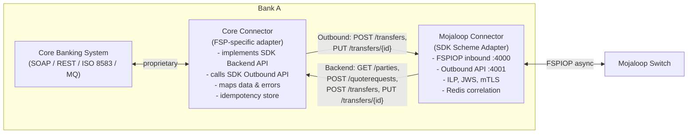
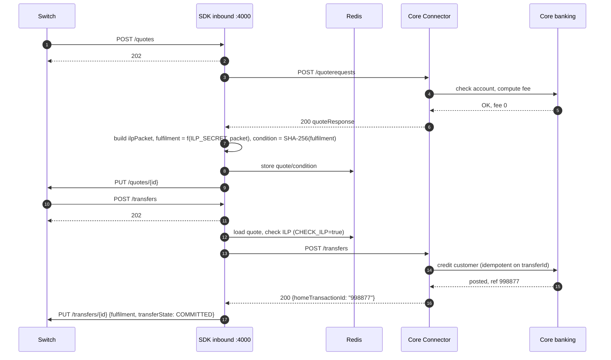

# 12 – FSP Adapter Development

> What an FSPIOP adapter is, what this repository provides, and how to design one that translates between a core banking system and Mojaloop.

---

## 1. What is an FSPIOP adapter and why is it needed?

A core banking system (CBS) or wallet platform usually speaks **synchronous**, **proprietary** APIs: "debit account X, return OK/ERROR". Mojaloop speaks **asynchronous FSPIOP**: send a request, get `202`, receive the result later on a callback URL, sign messages, prove acceptance with an ILP fulfilment.

An **adapter** bridges the two worlds:

| Problem | What the adapter does |
| --- | --- |
| Async ↔ sync | Waits for the FSPIOP callback and returns a single synchronous answer to the CBS (or vice versa) |
| Correlation | Matches callbacks to waiting requests by `transferId`, `quoteId`, party type and ID |
| Protocol details | Builds headers (`FSPIOP-Source`, `Date`, versioned `Content-Type`), validates inbound messages |
| Cryptography | Creates the ILP packet, **condition** and **fulfilment**; JWS signing and verification; mTLS |
| Data mapping | FSPIOP ↔ CBS formats (amounts, currencies, IDs, names, error codes) |
| Reliability | Timeouts, retries via `GET`, idempotency, state persistence |
| Version negotiation | Supports the resource versions the scheme requires |

---

## 2. Does this repository include an adapter?

| Item | What it is | Source code here? |
| --- | --- | --- |
| **SDK Scheme Adapter** (`mojaloop/sdk-scheme-adapter:v24.7.0`) | Mojaloop's official adapter, the "Mojaloop Connector" | **No**. It runs as an image, configured by [envs/*-sdk.env](../../envs/). Source: `github.com/mojaloop/sdk-scheme-adapter` **[EXTERNAL]**. |
| TTK backend simulation | The TTK implements the SDK **Backend API** (prefix `/backend`, `system_config.json` `API_DEFINITIONS`), acting as a mock CBS behind the SDKs | Rules and config only |
| TTK as FSP | The TTK itself speaks raw FSPIOP as `testingtoolkitdfsp` and `payeefsp` | Rules and config only |
| Callback-handler simulator | High-speed FSPIOP responder for load tests | Image only |
| Security harness | Two SDK adapters with mTLS + JWS | Config and test keys |

So the repository gives you a **working, configurable reference adapter** (the SDK) plus a **mock core-banking backend** (the TTK). It does not give you adapter source code.

---

## 3. Conceptual architecture

The community pattern **[UPSTREAM-DOC]** separates a generic **Mojaloop Connector** (the SDK) from an FSP-specific **Core Connector** that talks to the CBS:

Standalone copy: [diagrams/fsp-adapter-architecture.mmd](diagrams/fsp-adapter-architecture.mmd).

### Inbound sequence inside the adapter (payee side)

---

## 4. Communicating with the core banking system

| CBS interface style | Adapter approach |
| --- | --- |
| REST/JSON | Typed HTTP client, timeouts, circuit breaker |
| SOAP | Generated client; map faults to error codes |
| ISO 8583 | Message builder; map processing and response codes (e.g. `00` approved, `51` insufficient funds) |
| ISO 20022 (pacs.008 / pacs.002) | Natural fit with FSPIOP's ISO 20022 variant |
| Message queue (MQ, Kafka) | Request/reply with correlation IDs; persistent state |
| Batch-only CBS | Use provisional credits and a suspense GL, or answer `RESERVED` and finalise later |

**Rules [RECOMMENDATION]:** every CBS call must carry an idempotency reference (the `transferId`). Never return success to the SDK until the CBS confirmed the posting. Apply a timeout shorter than the transfer `expiration`.

---

## 5. Request transformation (FSPIOP / SDK → CBS)

| FSPIOP / SDK field | Typical CBS field | Notes |
| --- | --- | --- |
| `to.idType` + `to.idValue` (`MSISDN` / `ACCOUNT_ID` / `IBAN`) | Customer lookup key / account number | Normalise MSISDN (country code, no `+`) |
| `amount` (string) + `currency` | Amount (decimal, minor units) + ISO currency | Central-ledger allows **4 decimal places** (`AMOUNT.SCALE: 4` upstream); bug-fix test "4 decimal points #949" exists. Convert with decimal types, never floats. |
| `transactionType` / `initiatorType` / `scenario` | Transaction code (P2P, merchant, cash-in…) | Drives fees and limits |
| `transferId` | External reference / idempotency key | Store a unique constraint |
| `from.displayName`, `from.fspId` | Narrative ("From Ayesha R. via walletb") | For the customer statement |
| `expiration` | CBS timeout budget | Stop processing after it |
| `note` | Payment narrative | Sanitise; length limits |

## 6. Response mapping (CBS → FSPIOP)

| CBS result | Adapter response to SDK | FSPIOP outcome |
| --- | --- | --- |
| Customer found | `200 transferParty` | `PUT /parties` |
| Customer not found / closed | `404 {"statusCode": "3204", "message": "..."}` | Error callback **3204** (verified; an empty 404 became the generic **2001**) |
| Account can't receive (dormant, blocked) | Error | **5100**-family payee rejection (e.g. 5400 blocked) |
| Fee calculated | `quoteResponse` with `payeeFspFeeAmount` | `PUT /quotes` |
| Currency not supported | Error | **5106** Payee unsupported currency |
| Credit posted | `200 {homeTransactionId}` | `PUT /transfers` `COMMITTED` |
| Credit failed / limit exceeded | Error | `PUT /transfers/{id}/error` (e.g. 5105, 5200) |
| CBS timeout | Error (do **not** guess success) | Transfer aborted or expired. Reconcile any late CBS posting by reversal. |

**"Error" means an error body with the FSPIOP code in `statusCode`.** The Backend API's `errorResponse` schema has `statusCode` and `message`. The SDK uses `statusCode` to pick the FSPIOP error, and falls back to a generic error when it is missing or not a valid code ([backend api_spec.yaml](../../docker/ml-testing-toolkit/spec_files/api_definitions/sdk-scheme-adapter-backend-v2_1_0-openapi3-snippets_2.1/api_spec.yaml), `errorResponse`). **[IMPLEMENTED in spec]**; only the 3204 case was exercised in the labs.

---

## 7. Callback handling

If you use the SDK, it receives all switch callbacks. If you build your own FSPIOP adapter, you must expose an HTTPS endpoint for **every callback type** registered during onboarding. The harness registers these per participant ([participant_sender.json](../../docker/ml-testing-toolkit/test-cases/collections/provisioning/participant_sender.json)):

| Endpoint type | URL template (harness) |
| --- | --- |
| `FSPIOP_CALLBACK_URL_PARTIES_GET` / `_PUT` / `_PUT_ERROR` | `{base}/parties/{{partyIdType}}/{{partyIdentifier}}[/error]` |
| `FSPIOP_CALLBACK_URL_PARTIES_SUB_ID_GET` / `_PUT` / `_PUT_ERROR` | `{base}/parties/{{partyIdType}}/{{partyIdentifier}}/{{partySubIdOrType}}[/error]` |
| `FSPIOP_CALLBACK_URL_PARTICIPANT_PUT` / `_PUT_ERROR` | `{base}/participants/{{partyIdType}}/{{partyIdentifier}}[/error]` |
| `FSPIOP_CALLBACK_URL_PARTICIPANT_SUB_ID_PUT` / `_PUT_ERROR` / `_DELETE` | `{base}/participants/{{partyIdType}}/{{partyIdentifier}}/{{partySubIdOrType}}[/error]` |
| `FSPIOP_CALLBACK_URL_PARTICIPANT_BATCH_PUT` / `_ERROR` | `{base}/participants/{{requestId}}[/error]` |
| `FSPIOP_CALLBACK_URL_QUOTES` | `{base}` (paths appended by the switch) |
| `FSPIOP_CALLBACK_URL_TRANSFER_POST` / `_PUT` / `_ERROR` | `{base}/transfers`, `{base}/transfers/{{transferId}}[/error]` |
| `FSPIOP_CALLBACK_URL_FX_QUOTES` | `{base}` |
| `FSPIOP_CALLBACK_URL_FX_TRANSFER_POST` / `_PUT` / `_ERROR` | `{base}/fxTransfers`, `{base}/fxTransfers/{{commitRequestId}}[/error]` |
| `FSPIOP_CALLBACK_URL_BULK_TRANSFER_POST` / `_PUT` / `_ERROR` | `{base}/bulkTransfers`, `{base}/bulkTransfers/{{id}}[/error]` |
| `FSPIOP_CALLBACK_URL_TRX_REQ_SERVICE` | `{base}` |
| Emails: `NET_DEBIT_CAP_ADJUSTMENT_EMAIL`, `SETTLEMENT_TRANSFER_POSITION_CHANGE_EMAIL`, `NET_DEBIT_CAP_THRESHOLD_BREACH_EMAIL` | email address |

**Callback handler design [RECOMMENDATION]:**
1. Validate the headers and JWS, then return `200` **quickly**. Process asynchronously.
2. Correlate by the resource ID in the path. Wake up the waiting request (the SDK uses Redis pub/sub keyed by ID **[UPSTREAM-DOC]**).
3. Be idempotent: the same callback may arrive twice.
4. If no request is waiting (late callback), still persist the final state and reconcile.

---

## 8. Maintaining transaction identifiers

| ID | Created by | Stored in adapter | Used for |
| --- | --- | --- | --- |
| `homeTransactionId` | Bank A (CBS / channel) | Yes (primary business key) | Customer statement, reconciliation |
| `transferId` | Payer adapter / SDK (= quote `transactionId`) | Yes, **unique** | Switch correlation, idempotency, `GET /transfers` |
| `quoteId` | Payer adapter / SDK | Yes | Linking quote → transfer, quote expiry checks |
| `transactionRequestId` | Payee (request-to-pay) | If used | R2P correlation |
| `conversionRequestId`, `commitRequestId`, `determiningTransferId` | Payer (FX) | If FX used | FX correlation |
| CBS posting reference | CBS | Yes | Reversal, audit |
| `traceparent` | Any | Logged | Cross-system tracing |

Persist the mapping **before** sending any request. That lets the adapter resume after a crash.

---

## 9. ILP packet, condition and fulfilment (if you build your own)

**[UPSTREAM-DOC]** The SDK's approach, which you should copy if you build your own:

1. The payee side builds an **ILP packet** (amount, ILP address such as `g.<fspId>.<idType>.<idValue>`, and base64url transaction data).
2. `fulfilment = HMAC-SHA256(ILP_SECRET, ilpPacket)`, encoded base64url. This makes the fulfilment reproducible from the packet without storing it.
3. `condition = base64url(SHA-256(fulfilment))`, sent in the quote callback.
4. At transfer time, recompute the fulfilment from the received packet, check it hashes to the condition (`CHECK_ILP=true`), and return it in `PUT /transfers`.

Verify the hash relation with the harness's own test vector ([08 §8.2](08-fspiop-protocol-and-apis.md#82-quotation)).

---

## 10. Error translation (both directions)

| Direction | Example |
| --- | --- |
| Switch → bank customer | `4001` → "Temporarily unavailable" + alert treasury; `3204` → "Number not registered" |
| Bank → switch | CBS "account frozen" → `5400` (generic payee blocked); CBS "daily limit" → `5200` payee limit; CBS internal error → `2001` |
| Unknown | Treat as **unknown outcome**: query status, never auto-retry a POST with a new ID |

Keep the mapping table in configuration so that operations can tune it without a redeploy.

---

## 11. Testing an adapter

| Level | Tool in this repo | How |
| --- | --- | --- |
| Contract | OpenAPI specs in `docker/ml-testing-toolkit/spec_files/api_definitions/` | Generate clients and servers; validate payloads in unit tests |
| Simulated switch | TTK (can act as hub or peer) | Point your adapter's peer endpoint at `http://localhost:9440` and drive the TTK from its UI |
| Real switch, local | This harness | [11 §8.9](11-fsp-integration-guide.md#89-testing-the-reference-app-against-this-harness-recommendation): take over `testfsp1-sdk`'s backend |
| Regression | Golden-path collections | Run selected folders against your participant (change env inputs) |
| Load | k6 `inboundSDK*` / `outboundSDK*` scenarios | [14 §4](14-testing-and-troubleshooting.md#4-performance-and-load-testing) |
| Security | `docker-compose-security.yml` | mTLS + JWS between two SDKs |

### Adapter readiness checklist

- [ ] All callback endpoints implemented and idempotent
- [ ] `transferId` unique constraint; no new IDs on retry
- [ ] Hold before transfer (payer); credit only on valid transfer (payee)
- [ ] Timeouts < transfer expiration; status polling for unknown outcomes
- [ ] JWS signing and verification; mTLS with your own certificates
- [ ] Error mapping table, both directions
- [ ] Amount precision (≤ 4 decimals), currency per participant account
- [ ] Structured logs with IDs; no personal data or keys in logs
- [ ] Daily reconciliation job against hub reports

Next: [13-customization-and-extension.md](13-customization-and-extension.md).
