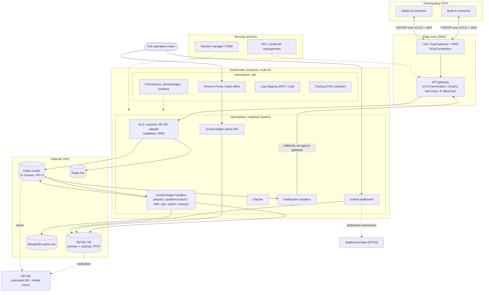

# 15 – Production Deployment Architecture

> **Scope warning:** this repository is a **local test harness**. It contains **no** production deployment assets: no Helm charts, Terraform or production manifests. This document separates:
> - **[REPO]** what the repository shows or implies about production-like operation,
> - **[UPSTREAM-DOC] / [EXTERNAL]** what Mojaloop provides elsewhere,
> - **[RECOMMENDATION]** general good practice from this guide's author. These are *not* requirements defined by Mojaloop or by this repo.
>
> No production sizing is defined in the repository. Do not treat any number here as a requirement.

---

## 1. What the repository tells us about production-like deployment [REPO]

| Evidence | What it shows |
| --- | --- |
| [k8s-mojaloop-perf-tuning/patch.sh](../../k8s-mojaloop-perf-tuning/patch.sh) | Mojaloop on Kubernetes runs in namespace **`mojaloop`**, with deployments named like `moja-centralledger-service`, `moja-centralledger-handler-transfer-prepare`, `-transfer-fulfil`, `-transfer-get`, `-admin-transfer`, `-timeout`, `moja-handler-pos-batch`, `moja-ml-api-adapter-service`, `moja-ml-api-adapter-handler-notification`, `moja-account-lookup-service`, `moja-quoting-service`, `moja-quoting-service-handler`. That is a Helm release named `moja`, with **every handler as its own deployment**. |
| [docker-compose-perf.yml](../../docker-compose-perf.yml) | The same split locally: separate prepare, position, position-batch, fulfil, get and admin handler containers; a one-off `central-ledger-migrator`; API containers with handlers disabled; replicas controlled from `.env` |
| [perf.env](../../perf.env) | Kafka partition counts (`KAFKA_POSITION_PARTITIONS_NUM=25`, general 4), consumer `partition.assignment.strategy=cooperative-sticky`, cache settings, ISO 20022 mode |
| [packages/kafaka-partitioner-calculator](../../packages/kafaka-partitioner-calculator/) | Position messages are keyed by participant account and spread over partitions with murmur2. Uneven spread limits throughput, hence the calculator. |
| `k8s-mojaloop-perf-tuning/redpanda-*.yaml`, `patch.sh init` | Redpanda was evaluated as a Kafka-compatible broker |
| `config-override.yaml` (ConfigMap), `.EVENT_SDKrc` / `.CLEDGrc` mounts | Production-style config injection via ConfigMaps and rc files |
| [Dockerfile](../../Dockerfile) | k6 tests packaged for **k6-operator** (load testing inside Kubernetes) |

---

## 2. Official deployment tooling [EXTERNAL]

| Tool | Purpose |
| --- | --- |
| **Mojaloop Helm charts** (`github.com/mojaloop/helm`) | Kubernetes deployment of the switch services (umbrella `mojaloop` chart with sub-charts per service) and supporting dependencies |
| **Mojaloop IaC** projects | Infrastructure-as-code for building complete environments (clusters, networking, gateways, CI/CD) |
| **Payment Manager for Mojaloop (PM4ML)** | Packaged FSP-side connector |
| **Mojaloop Testing Toolkit** | Certification and regression (what this repo uses) |

Consult the upstream repositories and `docs.mojaloop.io` for supported versions, values files and prerequisites. Match the chart release to the service versions you have tested, for example with this harness and the tags pinned in `.env`.

---

## 3. Reference production architecture [RECOMMENDATION]

Standalone copy: [diagrams/production-deployment.mmd](diagrams/production-deployment.mmd).

---

## 4. Platform components

| Topic | Harness today [REPO] | Production [RECOMMENDATION] |
| --- | --- | --- |
| **Containers** | Public images pinned by tag in `.env`; some `latest` tags for tools | Pin by digest; mirror to a private registry; scan (Grype is already in CI); non-root users; read-only root FS |
| **Kubernetes** | Not used (except perf patches) | Upstream Helm charts; one Deployment per handler; PodDisruptionBudgets; resource requests and limits; anti-affinity across zones |
| **Helm** | Not present | Version-controlled values per environment (GitOps, e.g. Argo CD) |
| **Ingress** | Host ports published directly | Ingress controller behind the gateway; no switch service exposed directly |
| **API gateway** | None | mTLS client authentication, OAuth2 client credentials, per-FSP rate limits, request size limits, JWS passthrough |
| **Load balancing** | Docker DNS | Cloud or hardware LB with health checks on `/health` |
| **Egress** | Direct container-to-container | Egress gateway with the switch client cert for callbacks; outbound allow-list of FSP callback hosts |

---

## 5. High availability and horizontal scaling

| Component | Scaling model | Notes |
| --- | --- | --- |
| ALS, quoting-service API, ML API adapter API | Stateless: scale horizontally (HPA on CPU or RPS) | Replicas `ALS_REPLICAS`, `QS_REPLICAS`, `ML_API_ADAPTER_REPLICAS` in `.env` (perf) |
| Kafka handlers (prepare, fulfil, get, notification, quoting) | Scale up to the **number of partitions** of the consumed topic | One consumer per partition per group |
| Position / position-batch handler | Partitioned by **participant account**; batching increases throughput | `KAFKA_POSITION_PARTITIONS_NUM`, partition calculator, `CENTRAL_LEDGER_POSITION_BATCH_REPLICAS` |
| Timeout handler | Typically a single active instance (cron) **[UPSTREAM-DOC]** | Avoid duplicate expiry processing |
| central-ledger admin API, settlement | Low traffic; 2+ replicas for availability | |
| MySQL | **The main bottleneck and single source of truth** | Strong HA, fast storage, connection pooling |

The harness uses **1 partition and replication factor 1** for every topic ([provision.sh](../../docker/kafka/scripts/provision.sh)). That is fine for learning and **unsuitable for production**.

---

## 6. Data, messaging, backup and disaster recovery [RECOMMENDATION]

| Concern | Recommendation |
| --- | --- |
| **MySQL availability** | Managed HA MySQL or a MySQL InnoDB Cluster/Group Replication; synchronous or semi-sync replication within the region; read replicas for reporting (never report from the primary) |
| **Binary logs** | Keep binlogs **enabled** for point-in-time recovery. The perf compose disables them (`--disable-log-bin` on `mysql-cl`) for speed. Do not copy that. |
| **Kafka availability** | ≥3 brokers across AZs, `replication.factor=3`, `min.insync.replicas=2`, producers with `acks=all` (the harness configs already use `request.required.acks: all`) |
| **MongoDB / Redis** | Replica set / Sentinel or cluster |
| **Backups** | Nightly full + continuous binlog backup of `central_ledger` and `account_lookup`; encrypted, off-site; **tested restores** |
| **DR** | Warm standby region with DB replication and Kafka mirroring. Define RPO/RTO with the regulator. Rehearse failover. In-flight transfers resolve through expiry and `GET /transfers` reconciliation. |
| **Data retention** | Archive old transfers and state changes per regulation; partition large tables |

---

## 7. Observability

| Pillar | Harness [REPO] | Production [RECOMMENDATION] |
| --- | --- | --- |
| Metrics | Prometheus + Grafana with Mojaloop dashboards (`docker/grafana/provisioning/dashboards/mojaloop/*`) | Same dashboards plus SLO dashboards (success rate, p95 end-to-end latency, timeouts) |
| Logs | Container stdout only; Event SDK `LOG: off` | Centralised logging (EFK or Loki), JSON logs, retention, PII masking |
| Tracing | Event SDK `TRACE: off`; k6 `traceparent` | OpenTelemetry collector; propagate `traceparent` across gateway, switch and connectors |
| Audit | Event SDK `AUDIT: kafka` → `topic-event-audit` | Long-term immutable storage of audit events |
| Alerting | `alert.rules` is empty; Alertmanager commented out | Alerts for: NDC utilisation > 80% per FSP; callback delivery failures; Kafka consumer lag; transfer timeout rate; DB replication lag; settlement window not closed on schedule; certificate expiry |

---

## 8. Security hardening

| Area | Recommendation |
| --- | --- |
| Secrets | Vault or cloud KMS; signing keys in an HSM; no keys in images or git; rotate |
| Network segmentation | DMZ (gateway) / app (switch) / data (DB, Kafka) tiers; Kubernetes NetworkPolicies; no direct FSP access to Kafka or DB |
| Identity | mTLS for every FSP; JWS signing **and validation** on; bind certificates to `FSPIOP-Source` |
| Data in transit | TLS everywhere, including Kafka (SASL_SSL) and DB connections |
| Data at rest | Encrypted volumes and backups |
| Admin APIs | Never exposed to FSPs. Behind SSO with RBAC and four-eyes approval for limits, funds-out and settlement. |
| Supply chain | Signed images, SBOM (the repo publishes `sbom-v*.csv`), vulnerability gates |
| Harness defaults | Remove every default password and the `root` user; see [09 §8](09-security-and-controls.md#8-hardening-gaps-in-the-harness-do-not-replicate) |

---

## 9. Team responsibilities

| Team | Responsibilities |
| --- | --- |
| **Development team** | Service configuration, upstream upgrades, custom oracles and adapters, TTK test collections, contribution of fixes upstream |
| **DevOps / SRE** | Kubernetes, Helm values, CI/CD, scaling, observability stack, incident response, capacity tests with the perf harness |
| **Database administrators** | MySQL HA, backups, PITR, performance tuning (indexes, partitions), archiving, DR replication |
| **Security team** | PKI and certificate lifecycle, key management and HSM, gateway policies, penetration testing, vulnerability management, security monitoring |
| **Payment operations (hub operator)** | Participant onboarding, limits and NDC, funds-in/out approval, settlement window close and settlement execution, reconciliation, disputes, scheme reporting |
| **FI integration team** | Guide FSPs through connectivity, certification with the TTK (golden path), go-live and changes; maintain the integration documentation |

---

## 10. What it takes to run your own interoperable ecosystem

| Building block | Why it is needed | Software or organisational |
| --- | --- | --- |
| **Scheme operator and governance** | Someone must own the hub, the rules and change control | Organisational |
| **Scheme rulebook** | Fees, liability, timeouts, dispute resolution, participation criteria, data protection | Legal / business |
| **Regulatory approval** | Licence for operating a payment system | Legal |
| **Settlement arrangement** | A settlement bank (often the central bank RTGS), settlement accounts for each FSP, a settlement schedule | Financial + Mojaloop central-settlement |
| **Liquidity model** | Prefunding versus collateral, NDC policy, intraday liquidity | Financial + central-ledger limits |
| **The switch** | Mojaloop services on production infrastructure (§3–§8) | Software (Mojaloop) |
| **Identifier directories** | Oracles for MSISDN, account/IBAN, merchant IDs | Software (oracles) + data governance |
| **FSP connectivity** | Connectors (SDK / PM4ML), PKI, onboarding process | Software + process |
| **Certification** | Test each FSP before go-live (TTK collections, like this repo's golden path) | Process + TTK |
| **Operations** | 24×7 monitoring, incident management, back-office portal, reconciliation | People + tools (Finance Portal) |
| **Security** | PKI, HSM, gateway, SOC | People + tools |
| **Customer protection** | Dispute and complaint handling, fraud intelligence sharing between FSPs | Process |

---

## 11. Go-live checklist [RECOMMENDATION]

- [ ] Service versions frozen and regression-tested (provisioning + golden path in this harness)
- [ ] Performance characterised for target TPS with the perf harness and in a production-like environment
- [ ] HA failover tested (pod, node, zone, DB primary, Kafka broker)
- [ ] Backup restore tested; DR rehearsal done
- [ ] mTLS + JWS enforced for all FSPs; admin APIs isolated
- [ ] Dashboards and alerts live; on-call rota defined
- [ ] Settlement process rehearsed end-to-end with the settlement bank
- [ ] Every FSP certified; NDC limits and funds-in confirmed
- [ ] Runbooks: stuck transfers, timeouts, FSP outage, settlement failure, key rotation

Next: [16-glossary.md](16-glossary.md).
