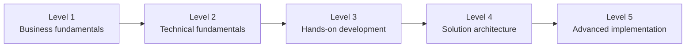

# 17 – Learning Roadmap

> A five-level plan from "what is a payment switch?" to "I can design, customise and operate a Mojaloop-based scheme". Each level has objectives, reading, repository areas, exercises, expected outcomes and completion criteria.
> Suggested pace: Level 1–2 in week 1, Level 3 in weeks 2–3, Level 4 in weeks 4–5, Level 5 ongoing. Adjust freely.

---

## Level 1 – Business fundamentals

**Learning objectives**
- Explain what a payment switch does and why interoperability matters.
- Name the actors (payer, payee, payer FSP, payee FSP, hub, settlement bank, FXP, oracle, regulator) and their responsibilities.
- Describe Discovery → Agreement → Transfer, and why the quote comes before the transfer.
- Distinguish payment processing, positions, liquidity, settlement and reconciliation.

**Read:** [01](01-mojaloop-fundamentals.md), [04](04-business-use-cases.md), [16](16-glossary.md).

**Repository areas:** [README.md](../../README.md) (profiles `discovery`, `agreement`, `transfer`); [provisioning/hub_setup.json](../../docker/ml-testing-toolkit/test-cases/collections/provisioning/hub_setup.json) (settlement models), [participant_sender.json](../../docker/ml-testing-toolkit/test-cases/collections/provisioning/participant_sender.json) (NDC, funds-in).

**Exercises**
1. **1.1** Draw Scenario 1 (Bank-to-Wallet, [04 §4](04-business-use-cases.md#4-real-world-business-scenarios)) from memory, including who holds the money at each step.
2. **1.2** Using the table in [07 §6](07-payment-transaction-lifecycle.md#6-worked-financial-example-pkr-5000-from-bank-a-to-wallet-b), calculate positions after three payments: A→B 5,000, B→A 2,000, A→B 1,000. What does each FSP owe at settlement?
3. **1.3** For each of the 22 use cases in [04 §2](04-business-use-cases.md#2-status-of-every-use-case), say whether it runs in this harness and why.

**Expected outcome:** you can explain Mojaloop to a non-technical banker in five minutes.

**Completion criteria:** answer correctly: "Does the switch hold customer money?" (no); "What stops an FSP sending unlimited payments?" (Net Debit Cap backed by prefunding); "When does real money move between banks?" (at settlement).

---

## Level 2 – Technical fundamentals

**Learning objectives**
- Describe the microservices and their responsibilities.
- Explain FSPIOP's asynchronous request/callback pattern, headers and IDs.
- Trace a transfer through Kafka topics and handlers.
- Read the transfer state machine; explain idempotency and timeouts.

**Read:** [05](05-system-architecture.md), [06](06-microservices-deep-dive.md), [07](07-payment-transaction-lifecycle.md), [08](08-fspiop-protocol-and-apis.md), [03](03-technology-stack.md).

**Repository areas:** [docker-compose.yml](../../docker-compose.yml), [docker/config-modifier/configs/](../../docker/config-modifier/configs/), [docker/kafka/scripts/provision.sh](../../docker/kafka/scripts/provision.sh), [api_definitions/fspiop_2.0/api_spec.yaml](../../docker/ml-testing-toolkit/spec_files/api_definitions/fspiop_2.0/api_spec.yaml), [tests/p2p.json](../../docker/ml-testing-toolkit/test-cases/collections/tests/p2p.json).

**Exercises**
1. **2.1** In `fspiop_2.0/api_spec.yaml`, find the `TransferState`, `PartyIdType` and `AmountType` enums and the `FSPIOP-Source` header definition.
2. **2.2** Read `tests/p2p.json` and write down each request, its expected callback and the assertions (4 requests, 31 assertions).
3. **2.3** Verify the condition/fulfilment pair from [08 §8.2](08-fspiop-protocol-and-apis.md#82-quotation) with a few lines of code (Node, Python or C#).
4. **2.4** From `configs/central-ledger.js`, explain why all position actions go to `topic-transfer-position-batch`, and which container consumes it.

**Expected outcome:** you can draw the end-to-end sequence diagram with services, topics and callbacks.

**Completion criteria:** explain what happens on (a) a duplicate `POST /transfers` with the same body, (b) the same ID with a different body, (c) no fulfil before expiry. Answers in [07 §5](07-payment-transaction-lifecycle.md#5-duplicates-idempotency-and-retries) and [07 §8](07-payment-transaction-lifecycle.md#8-timeouts-at-a-glance).

---

## Level 3 – Hands-on development

**Learning objectives**
- Run the switch locally, onboard FSPs and execute payments.
- Use the TTK UI, mobile simulator, Kafka console and logs.
- Run negative scenarios and read reports.
- Navigate the upstream source code of a service at the pinned tag.

**Read:** [10](10-local-setup-and-execution.md), [14](14-testing-and-troubleshooting.md).

**Repository areas:** compose files, `reports/`, `docker/ml-testing-toolkit/**`, `envs/`.

**Exercises**
1. **3.1 First run (recommended first hands-on exercise).**
   - `docker compose --profile all-services --profile ttk-provisioning --profile ttk-tests up -d`
   - Wait for `ttk-tests` to exit and check that it shows 31/31 passed (`docker compose logs ttk-tests`). If the first run shows 27/31 with transfer-callback timeouts, that is a cold-start effect: re-run with `docker compose --profile all-services --profile ttk-provisioning --profile ttk-tests run --rm --no-deps ttk-tests`.
   - Open `reports/ttk-provisioning-report.html` and `reports/ttk-func-tests-report.html`. Identify the hub setup, participant onboarding, funds-in and the P2P requests.
   - Replay `p2p.json` in the TTK UI (<http://localhost:9660>) and inspect each callback.
   - Open the mobile simulator (<http://localhost:9660/mobilesimulator>) and send a payment while watching the live sequence diagram.
2. **3.2 Watch Kafka.** Restart with `--profile debug`, open <http://localhost:8080>, run the P2P test again, and find your `transferId` in `topic-transfer-prepare`, `topic-transfer-position-batch`, `topic-transfer-fulfil` and `topic-notification-event`.
3. **3.3 Inspect the ledger.** Query `transferStateChange` for your transfer ([14 §6.3](14-testing-and-troubleshooting.md#63-a-debugging-routine-recommendation)) and `GET /participants/testingtoolkitdfsp/positions` before and after a payment.
4. **3.4 Failure scenarios.** In the TTK UI, duplicate the P2P test case. Set the quote amount to `16` (the transfer reuses the quoted amount; the TTK payee then sends no callback, per `rules_callback/default.json`). In the transfer request, set `expiration` to a timestamp ~30 seconds ahead so that you don't wait for the quote's expiry. Observe the 3303 timeout and the restored position. Then try amount `15` (invalid fulfilment). For a ready-made version, see `golden_path/feature_tests/transfer_negative_scenarios/payer_transfer_timeout.json`.
5. **3.5 Golden path.** Run `--profile ttk-provisioning-gp --profile ttk-tests-gp` (fresh volumes). Read the report and list which folders fail because services are missing (transaction requests, bulk).
6. **3.6 FX.** Run the FX profiles ([10 §9.3](10-local-setup-and-execution.md#93-fx-cross-currency-tests)) and explain the `fxQuotes → quotes → fxTransfers → transfers` order.
7. **3.7 Read source.** Clone `mojaloop/central-ledger` at `v19.4.4`. Find `seeds/transferState.js`, `src/handlers/transfers/prepare.js` (duplicate handling) and `src/domain/position/prepare.js` (NDC check). Match them to [07 §4](07-payment-transaction-lifecycle.md#4-transaction-state-management).

**Expected outcome:** you can run, observe and debug a Mojaloop payment end to end.

**Completion criteria:** you can explain, from your own logs and DB queries, every state change of one successful transfer and one expired transfer.

---

## Level 4 – Solution architecture

**Learning objectives**
- Design a bank or wallet integration (connector, backend API, ledger postings, reconciliation).
- Choose between SDK, direct FSPIOP and PM4ML.
- Define the security architecture: PKI, mTLS, JWS, gateway, key management.
- Sketch a production deployment with HA, scaling and observability.

**Read:** [11](11-fsp-integration-guide.md), [12](12-adapter-development.md), [09](09-security-and-controls.md), [15](15-production-deployment.md).

**Repository areas:** [envs/payerfsp-sdk.env](../../envs/payerfsp-sdk.env), SDK API specs (`api_definitions/sdk-scheme-adapter-*`), [docker-compose-security.yml](../../docker-compose-security.yml), `docker/security/`, [docker-compose-perf.yml](../../docker-compose-perf.yml), `k8s-mojaloop-perf-tuning/`.

**Exercises**
1. **4.1** Build the .NET reference integration skeleton from [11 §8](11-fsp-integration-guide.md#8-reference-application-bank-a--integration-service--mojaloop--bank-b) in a separate repository, starting with `GET /parties` and `POST /quoterequests`.
2. **4.2** Connect it as `testfsp1`'s backend using an override compose file ([11 §8.9](11-fsp-integration-guide.md#89-testing-the-reference-app-against-this-harness-recommendation)) and send a payment to `testfsp2`.
3. **4.3** Run the security harness and identify which file plays which role (CA, server cert, client cert, JWS key, verification key).
4. **4.4** Write the GL posting design and reconciliation procedure for your bank ([11 §6–7](11-fsp-integration-guide.md#6-ledger-integration-status-management-and-error-handling)).
5. **4.5** Produce a production architecture diagram for your environment and list your RPO/RTO assumptions.

**Expected outcome:** a reviewed integration design document and a working prototype against the local switch.

**Completion criteria:** your prototype completes a payment as payer and as payee, handles a timeout without double-debiting, and survives a restart mid-payment (state resumes from DB).

---

## Level 5 – Advanced implementation

**Learning objectives**
- Customise the switch: currencies, oracles, settlement models, routing, new services.
- Characterise and tune performance.
- Plan operations: onboarding, liquidity, settlement, monitoring, incidents.
- Prepare a production rollout and FSP certification programme.

**Read:** [13](13-customization-and-extension.md), [14 §4](14-testing-and-troubleshooting.md#4-performance-and-load-testing), [15](15-production-deployment.md).

**Repository areas:** `.env`, `perf.env`, `packages/k6-tests/`, `docker-compose-monitoring.yml`, `docker/grafana/`, `packages/kafaka-partitioner-calculator/`, `automate_perf.sh`, `perf-test.sh`.

**Exercises**
1. **5.1** Add currency `PKR` end to end (hub accounts, settlement model, two FSPs, funds-in), then run a P2P in PKR using a copied environment file.
2. **5.2** Build a minimal `IBAN` oracle, register it with ALS, and resolve an IBAN party.
3. **5.3** Run a settlement cycle (golden-path settlement collection) and reconcile the resulting positions by hand.
4. **5.4** Performance: start monitoring + perf stack, run `fspiopTransfers.json`, then raise `CENTRAL_LEDGER_POSITION_BATCH_REPLICAS` and partitions. Compare dashboards (`automate_perf.sh` can capture PNGs).
5. **5.5** Write a read-only Kafka consumer service on `topic-event-audit` that counts transfers per FSP ([13 §12](13-customization-and-extension.md#12-build-a-new-microservice-that-integrates-with-the-switch)).
6. **5.6** Upgrade test: change one image tag in a copy of `.env`, then run provisioning + P2P + golden path and document regressions.
7. **5.7** Write operational runbooks: stuck transfer, FSP NDC breach, settlement failure, certificate expiry.

**Expected outcome:** you can customise, measure and operate a Mojaloop switch, and you can advise on scheme design.

**Completion criteria:** a documented scheme design (rules, participants, settlement, security, operations) plus evidence from your local experiments (reports, dashboards, runbooks).

---

## Quick self-assessment

| Question | Level |
| --- | --- |
| What problem does a Net Debit Cap solve? | 1 |
| Why does every FSPIOP request return 202? | 2 |
| Where is the payee FSP's callback URL stored, and who registers it? | 2 |
| How do you make the P2P test fail with a timeout on purpose? | 3 |
| Where should Bank A place a hold on the customer's funds, and when should it release it? | 4 |
| Which component would you scale first for transfer throughput, and what limits it? | 5 |
