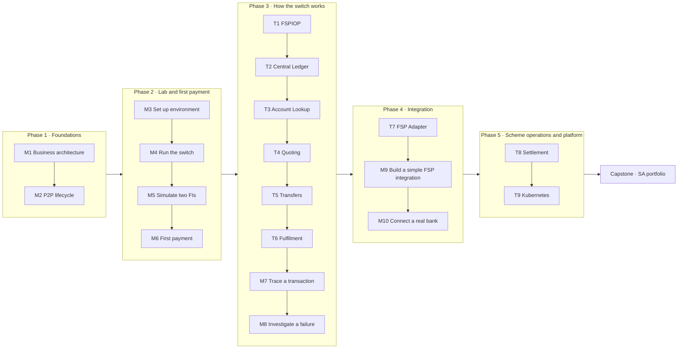

# Mojaloop Solution Architect Learning Project – Charter

> A structured, hands-on programme that takes you from "new to Mojaloop" to being able to **explain** a Mojaloop-based payment switch to a bank, **design** a bank's integration, and **lead** its implementation.
>
> It builds on the reference guide in [../](../00-README.md) (documents 01–17) and on the running harness in this repository. Where the reference guide explains *what*, this project makes you *do*, *observe*, *decide* and *produce* the artefacts a solution architect is expected to deliver.

---

## 1. Project goal and success criteria

**Goal:** by the end you can stand in front of a bank's executive and IT teams and:

| Capability | Evidence you will have produced |
| --- | --- |
| **Explain** Mojaloop's business and technical architecture in the bank's language | Bank briefing (capstone C1); business architecture one-pager (D1) |
| **Design** an integration between the bank's core banking system and a Mojaloop scheme | Integration Solution Design (capstone C2); adapter design (D12); working prototype (D13) |
| **Lead** an implementation: plan, workstreams, risks, certification, go-live | Implementation plan with RACI and risk register (capstone C3); incident RCA (D11) |

**You have succeeded when** you can complete the [capstone](18-capstone-portfolio.md) without opening the reference guide for basic facts.

---

## 2. How the two sequences you chose fit together

You defined two orders:

- **Knowledge areas (T1–T9):** FSPIOP → Central Ledger → Account Lookup → Quoting → Transfers → Fulfilment → FSP Adapter → Settlement → Kubernetes
- **Hands-on milestones (M1–M10):** Business architecture → P2P lifecycle → Set up environment → Run switch → Simulate two FIs → First payment → Trace through microservices → Investigate a failure → Build a simple FSP integration → Connect a real banking system

The programme **interleaves them without changing the order inside either list**. Milestones give you a running system and a first payment *before* the deep dives. That way each knowledge area is studied on a switch you have already seen working, and each deep dive feeds the tracing, failure and integration milestones that follow it.

---

## 3. Module map and suggested schedule

Plan on roughly **8–10 hours per week over 10 weeks**. Compress or stretch as you like; the order matters more than the pace.

| Week | Module | File | Deliverable |
| --- | --- | --- | --- |
| 1 | M1 – Business architecture | [01-milestone-01-business-architecture.md](01-milestone-01-business-architecture.md) | D1 Business architecture one-pager |
| 1 | M2 – P2P payment lifecycle | [02-milestone-02-p2p-lifecycle.md](02-milestone-02-p2p-lifecycle.md) | D2 Annotated P2P sequence |
| 2 | M3 + M4 – Set up environment, run the switch | [03-milestones-03-04-setup-and-run.md](03-milestones-03-04-setup-and-run.md) | D3 Environment baseline record |
| 2 | M5 + M6 – Simulate two FIs, first payment | [04-milestones-05-06-two-fis-first-payment.md](04-milestones-05-06-two-fis-first-payment.md) | D4 Onboarding sheet + payment evidence |
| 3 | T1 – FSPIOP protocol | [05-topic-01-fspiop.md](05-topic-01-fspiop.md) | D5 Message catalogue for Bank A |
| 3 | T2 – Central Ledger | [06-topic-02-central-ledger.md](06-topic-02-central-ledger.md) | D6 Ledger and position worksheet |
| 4 | T3 – Account Lookup | [07-topic-03-account-lookup.md](07-topic-03-account-lookup.md) | D7 Directory (alias) strategy note |
| 4 | T4 – Quoting | [08-topic-04-quoting.md](08-topic-04-quoting.md) | D8 Fee and quote policy note |
| 5 | T5 – Transfers | [09-topic-05-transfers.md](09-topic-05-transfers.md) | D9a Transfer risk-control note |
| 5 | T6 – Fulfilment | [10-topic-06-fulfilment.md](10-topic-06-fulfilment.md) | D9b Finality and timeout policy |
| 6 | M7 – Trace a transaction | [11-milestone-07-trace-transaction.md](11-milestone-07-trace-transaction.md) | D10 Trace report |
| 6 | M8 – Investigate a failed transaction | [12-milestone-08-investigate-failure.md](12-milestone-08-investigate-failure.md) | D11 Incident RCA |
| 7 | T7 – FSP Adapter | [13-topic-07-fsp-adapter.md](13-topic-07-fsp-adapter.md) | D12 Adapter design |
| 7–8 | M9 – Build a simple FSP integration | [14-milestone-09-build-fsp-integration.md](14-milestone-09-build-fsp-integration.md) | D13 Prototype + test evidence |
| 8 | M10 – Connect a real banking system | [15-milestone-10-connect-real-bank.md](15-milestone-10-connect-real-bank.md) | D14 Bank integration solution design |
| 9 | T8 – Settlement | [16-topic-08-settlement.md](16-topic-08-settlement.md) | D15 Settlement and reconciliation operating model |
| 9 | T9 – Kubernetes | [17-topic-09-kubernetes.md](17-topic-09-kubernetes.md) | D16 Deployment architecture |
| 10 | Capstone | [18-capstone-portfolio.md](18-capstone-portfolio.md) | C1 Bank briefing · C2 Solution design · C3 Implementation plan |

Templates for the deliverables are in [templates/](templates/).

---

## 4. How every module is built

Each module uses the same structure, so you always know what is expected:

| Section | Purpose |
| --- | --- |
| **Why this matters to a solution architect** | The business or delivery question the module answers |
| **Learning objectives** | What you must be able to do afterwards |
| **Core concepts** | Concise explanation, deeper than the reference guide where needed, with links to it |
| **Evidence** | Exact files in this repository, or upstream code at the pinned version, that prove the concepts |
| **Lab** | Commands to run and things to observe. Results go in your [lab journal](templates/lab-journal.md). |
| **Architect's lens** | How to explain it to a bank, the design decisions it creates, the questions to ask, the risks |
| **Checkpoint** | Self-test questions with hidden answers |
| **Deliverable** | The portfolio artefact you produce |

---

## 5. Ground rules

1. **Never modify the repository's files.** Put your own lab files (override compose files, copied TTK environments, notes) in a separate folder, for example `my-lab/` next to the repository, or anywhere outside it.
2. **Keep a lab journal.** Copy [templates/lab-journal.md](templates/lab-journal.md) and record commands, IDs, outputs and surprises. Your trace report, RCA and capstone come from it.
3. **Separate evidence from assumption.** Use the same tags as the reference guide: *[IMPLEMENTED]*, *[CONFIG]*, *[UPSTREAM-DOC]*, *[RECOMMENDATION]*. In front of a bank, being able to say "this I verified; this is my recommendation" is what makes you credible.
4. **Use test data only.** The repository's keys and passwords are public test material. Never reuse them, and never put real customer data in the harness.
5. **Check your pinned versions.** Facts about service internals in this project were checked against central-ledger **v19.4.4**, ml-api-adapter **v16.4.2**, account-lookup-service **v17.9.1**, quoting-service **v17.8.0**, central-settlement **v17.0.6** and sdk-scheme-adapter **v24.7.0** (from [.env](../../../.env)). Newer releases may differ.

---

## 6. Prerequisites

| Item | Status check |
| --- | --- |
| Docker Desktop **running** (Linux containers / WSL2), Compose v2 | `docker info` must answer. If Docker Desktop fails to start with `E_ACCESSDENIED` on its disk image, see the troubleshooting table in [SA 03](03-milestones-03-04-setup-and-run.md). |
| ≥ 8 GB RAM for Docker (12–16 GB preferred), ~20 GB disk | Docker Desktop → Settings → Resources. Measured: the standard stack uses about **4.5 GiB** when idle; the first image pull is about **11 GB**. |
| Git Bash or WSL for bash snippets (PowerShell variants are given where they differ) | In Git Bash, prefix `docker exec` commands that pass container paths with `MSYS_NO_PATHCONV=1`. In PowerShell, continue lines with a backtick, not `\`. |
| .NET 10 SDK (for M9) | `dotnet --version` |
| A Mermaid-capable Markdown viewer (VS Code + Mermaid extension, or GitHub) | – |
| Optional for T9: a local Kubernetes (Docker Desktop Kubernetes, kind or k3d) + Helm 3 + kubectl | `kubectl version`, `helm version` |

**Lab verification status (2026-11-04).** The hands-on labs were run end to end against a live stack on Windows 11 (Docker Desktop, Compose v5.6.1, .NET 10), and the documents were corrected with what actually happened. Each verified lab carries a "Verified" note with real results.

| Verified against the running switch | Not exercised |
| --- | --- |
| M3/M4 (standard and golden-path stacks), M5/M6 (onboarding and first payment, through the TTK command line), T1–T6, M7, M8, T7, M9 (the .NET connector, with three fixes now in the code), M10 Part B (slow-core spike), T8 (settlement cycle) | Clicking through the TTK web UI (the command-line equivalents were run instead), T9 Kubernetes (needs a cluster), and the paper exercises (M1, M2, M10 Parts A and C) |

---

## 7. Competency rubric

Rate yourself at the end of each phase.

| Competency | Aware (1) | Practitioner (2) | Lead (3) |
| --- | --- | --- | --- |
| Business architecture | Can name the actors | Can explain the value chain and money flows | Can tailor the story to a bank's strategy and risks |
| Protocol (FSPIOP) | Knows the three phases | Can read and write requests and callbacks | Can define the bank's message catalogue and error policy |
| Switch internals | Knows the service names | Can trace a payment through services, topics and tables | Can diagnose failures and explain NFR trade-offs |
| Integration | Knows the SDK exists | Has built a working connector | Can design a production integration with core banking |
| Settlement and liquidity | Knows positions and NDC | Can run and reconcile a settlement cycle | Can design the operating model with treasury |
| Platform | Knows it runs on Kubernetes | Can map services to deployments and scaling | Can define deployment, HA and DR requirements |
| Delivery leadership | – | Can plan an integration | Can lead workstreams, certification and go-live |

---

## 8. Relationship to the reference guide

| Programme module | Primary reference |
| --- | --- |
| M1 | [01](../01-mojaloop-fundamentals.md), [04](../04-business-use-cases.md) |
| M2 | [07](../07-payment-transaction-lifecycle.md) |
| M3–M6 | [10](../10-local-setup-and-execution.md), [14](../14-testing-and-troubleshooting.md) |
| T1 | [08](../08-fspiop-protocol-and-apis.md) |
| T2–T6 | [05](../05-system-architecture.md), [06](../06-microservices-deep-dive.md), [07](../07-payment-transaction-lifecycle.md) |
| M7–M8 | [14](../14-testing-and-troubleshooting.md) |
| T7, M9, M10 | [11](../11-fsp-integration-guide.md), [12](../12-adapter-development.md), [09](../09-security-and-controls.md) |
| T8 | [07 §7](../07-payment-transaction-lifecycle.md#7-settlement-and-reconciliation) |
| T9 | [15](../15-production-deployment.md) |

Start with [M1 – Business architecture](01-milestone-01-business-architecture.md).
