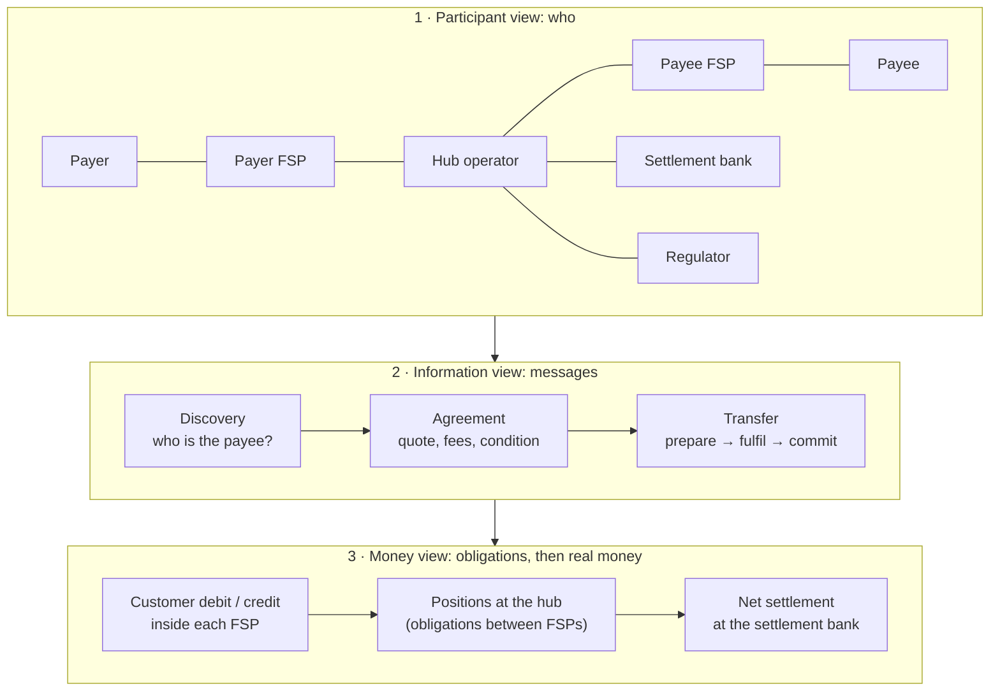

# M1 – Understand Mojaloop's Business Architecture

> **Phase 1 · Foundations** · Time box: 4–5 h · Prerequisite: none · Next: [M2](02-milestone-02-p2p-lifecycle.md)
> Reference reading: [01 – Fundamentals](../01-mojaloop-fundamentals.md), [04 – Business use cases](../04-business-use-cases.md)

---

## Why this matters to a solution architect

A bank does not buy "microservices". It joins a **payment scheme**. Your first conversation with a bank is about business: who the parties are, how money flows, what risks the bank takes, what it must build and operate, and what it gains. If you cannot explain that in business terms, the technical design will never be approved.

## Learning objectives

1. Describe a Mojaloop scheme as a **business system** with participants, rules, money flows and information flows.
2. Draw a **capability map** of the scheme and say which capabilities belong to the hub, the FSPs and the settlement bank.
3. Explain the **three views** (participants, money, information) and how they connect.
4. Map each business capability to the **software component** that supports it in this repository.
5. Answer the five questions every bank executive asks.

---

## Core concepts

### 1. The scheme is the product; Mojaloop is the hub software

A **payment scheme** has four ingredients: **rules** (the rulebook), **participants** (FSPs), **infrastructure** (the hub: Mojaloop) and **settlement** (a settlement bank). Mojaloop supplies only the third. The other three are business arrangements that the architect must still account for.

### 2. Three views of the same system

- **Participant view:** the hub operator runs the switch. FSPs connect once. The settlement bank holds FSP settlement accounts. The regulator supervises.
- **Information view:** every payment is three phases of asynchronous messages (FSPIOP).
- **Money view:** customers' money moves *inside* FSPs immediately. Between FSPs the hub records **obligations** (positions). **Real inter-bank money** moves later, as **net amounts**, at settlement.

### 3. Scheme capability map

| Capability domain | Business capability | Owner | Supporting component (this repo) |
| --- | --- | --- | --- |
| **Scheme governance** | Rulebook, pricing, participation criteria, dispute rules | Scheme operator | – (organisational) |
| **Participant management** | Onboard FSPs, accounts per currency, callback endpoints, activation | Hub operator | central-ledger admin API ([participant_sender.json](../../../docker/ml-testing-toolkit/test-cases/collections/provisioning/participant_sender.json)) |
| **Directory (aliases)** | Map phone/account/merchant IDs to FSPs | Hub + FSPs | account-lookup-service, als-msisdn-oracle-svc |
| **Pricing transparency** | Fees and amounts agreed before payment | FSPs (rules from scheme) | quoting-service |
| **Clearing** | Validate, route, record and finalise transfers | Hub | ml-api-adapter, central-ledger handlers |
| **Risk management** | Net Debit Cap, liquidity checks, participant suspension | Hub | central-ledger positions and limits |
| **Liquidity management** | Prefunding, funds-in and funds-out | Hub + FSP treasury | central-ledger admin (`recordFundsIn` …) |
| **Settlement** | Windows, net positions, settlement execution | Hub + settlement bank | central-settlement |
| **Customer-facing services** | Apps, USSD, agents, authentication, AML/KYC | FSPs | – (FSP systems) |
| **Integration** | Connecting FSP systems to the hub | FSPs | SDK Scheme Adapter (connector) |
| **Assurance** | Certification and regression testing of participants | Hub | Mojaloop Testing Toolkit (this harness) |
| **Operations and reporting** | Monitoring, back office, reports | Hub | Prometheus/Grafana, Finance Portal (`finance-portal` profile) |

### 4. Value for each party

| Party | Gains | Gives / risks |
| --- | --- | --- |
| Customer | Pay anyone, instantly, fee known up front, name check | – |
| Bank / wallet (FSP) | Reach every other FSP with one integration; new revenue (fees, float, merchant acceptance) | Integration build, prefunded liquidity, operational duties, scheme fees |
| Hub operator | Utility for the market; transaction fees | Run a critical system 24×7 |
| Regulator | Interoperability, inclusion, visibility | Supervision duty |

### 5. What makes Mojaloop distinctive (talking points)

1. **Push payments with pre-agreed terms**: no surprise fees, no chargebacks.
2. **Finality by cryptography**: the payee FSP's fulfilment proves acceptance, so both sides end in the same state.
3. **Risk bounded per FSP**: nobody can owe more than its Net Debit Cap.
4. **Alias-based**: designed for phone numbers and wallets, not only account numbers.
5. **Open source**: no licence fees, and the scheme controls the roadmap.

---

## Evidence in the repository

| Business concept | Where you can see it |
| --- | --- |
| Hub as a participant (`Hub`) with its own accounts | [configs/central-ledger.js](../../../docker/config-modifier/configs/central-ledger.js) (`HUB_PARTICIPANT`), [hub_setup.json](../../../docker/ml-testing-toolkit/test-cases/collections/provisioning/hub_setup.json) (`HUB_MULTILATERAL_SETTLEMENT`, `HUB_RECONCILIATION`) |
| Settlement model decided by the scheme | `hub_setup.json` → `POST /settlementModels` (`DEFERREDNET…`) |
| FSP onboarding = business onboarding | `participant_sender.json`: create participant, NDC, callbacks, notification emails, funds-in |
| Three phases | Compose profiles `discovery`, `agreement`, `transfer` ([README.md](../../../README.md)) |
| Operations tooling | `finance-portal` profile, [docker-compose-monitoring.yml](../../../docker-compose-monitoring.yml) |

---

## Lab M1 – Capability-to-component mapping (no Docker needed)

1. Open [docker-compose.yml](../../../docker-compose.yml) and list every service in the `all-services` profile.
2. For each service, write which **capability** from the map above it supports. Mark anything you can't place.
3. Open [participant_sender.json](../../../docker/ml-testing-toolkit/test-cases/collections/provisioning/participant_sender.json) and list the request descriptions (`"description":`). Group them into business steps: *register*, *set risk limit*, *register callbacks*, *register contacts*, *fund*.
4. Open [hub_setup.json](../../../docker/ml-testing-toolkit/test-cases/collections/provisioning/hub_setup.json) and identify which requests are **scheme-level decisions** (settlement model, hub accounts, oracle) and which are technical.
5. Record in your journal: *three things the software enforces*, and *three things that must be enforced by rules or contracts instead*.

**Expected observations:** settlement models, NDC and hub accounts are data configured by the operator. Fees, dispute handling and AML are not in the software at all.

---

## Architect's lens

**The 2-minute explanation for a bank CEO:**
> "Mojaloop is the shared hub of an instant-payments scheme. Your bank connects once and can then pay, and be paid by, every bank and wallet in the scheme, using just a phone number. Before any money moves, the customer sees the recipient's name and the exact fee. Between banks, the hub only records what each owes. You prefund a settlement account that sets your maximum exposure, and the net amounts are settled through the settlement bank on a schedule. Your customers' money never leaves your books during the payment."

**The five questions bank executives ask, and your answers:**

| Question | Answer outline |
| --- | --- |
| "What is our financial exposure?" | Bounded by our Net Debit Cap, which we prefund. Positions are net across all payments. |
| "Who carries the risk if something fails?" | The two-phase commit with condition and fulfilment means a payment is either committed for both sides or aborted for both. Disputes follow scheme rules. |
| "What do we have to build?" | A channel feature, an integration service, a connector, GL changes and operational processes. |
| "How much does it cost to run?" | Scheme fees, liquidity cost (opportunity cost of prefunding), connector hosting, and operations staff. |
| "What changes for operations?" | Real-time monitoring, liquidity top-ups, settlement windows, daily reconciliation. |

**Design decisions this milestone surfaces:** which use cases come first (P2P, merchant, cash-out); which identifiers to publish; prefunding level; fee policy.

---

## Checkpoint

1. Does the hub hold customer funds?

No. Customer balances stay at the FSPs. The hub holds positions (inter-FSP obligations) and, through the settlement bank arrangement, each FSP's settlement account balance is recorded as a ledger account.

2. Name two scheme capabilities that Mojaloop software does NOT provide.

For example: rulebook and dispute resolution; customer AML/KYC; fee policy; settlement bank funds movement; regulatory licensing.

3. Which component enforces the risk limit, and what is the limit called?

central-ledger (position handler) enforces the Net Debit Cap (NDC) per FSP and currency.

4. Why does the scheme need a settlement bank if the hub already has a ledger?

The hub ledger records obligations. Discharging them requires real money (central-bank or commercial-bank money) to move between the FSPs' settlement accounts.

---

## Deliverable D1 – Business architecture one-pager

One page (or one slide) with:
1. The three-view diagram adapted to a specific country or bank.
2. The capability map, with owners.
3. The money-flow summary (prefund → positions → net settlement).
4. Your answers to the five executive questions.

Next: [M2 – P2P payment lifecycle](02-milestone-02-p2p-lifecycle.md).
