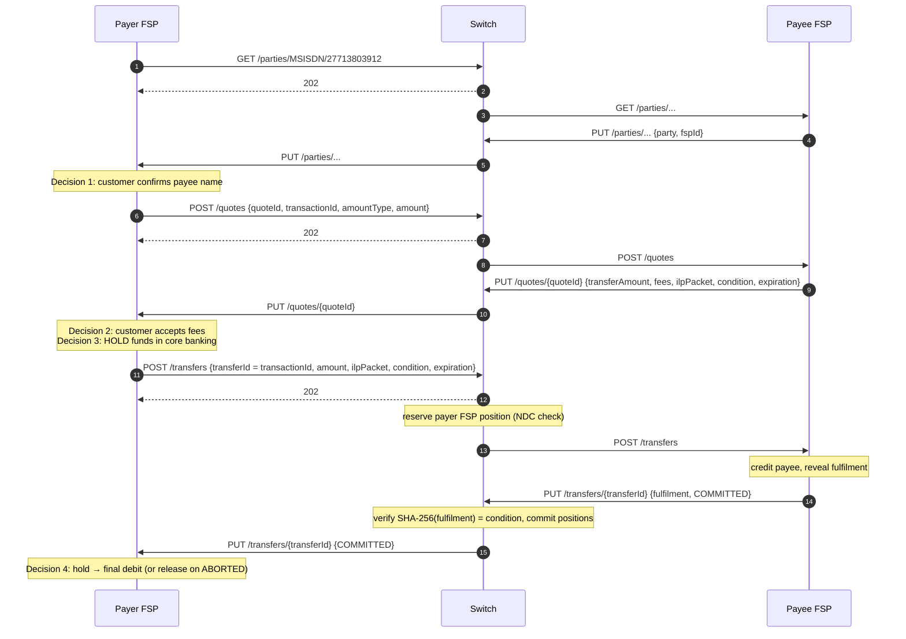

# M2 – Understand the P2P Payment Lifecycle

> **Phase 1 · Foundations** · Time box: 4–5 h · Prerequisite: [M1](01-milestone-01-business-architecture.md) · Next: [M3/M4](03-milestones-03-04-setup-and-run.md)
> Reference reading: [07 – Payment lifecycle](../07-payment-transaction-lifecycle.md) §1–§3, [08 – FSPIOP](../08-fspiop-protocol-and-apis.md) §2

---

## Why this matters to a solution architect

Every integration decision you will make (where to place the hold, how long to wait, what to show the customer, how to recover from a lost message) hangs off the P2P lifecycle. Learn it as a **customer journey**, as a **message sequence** and as a **state machine**, and be able to switch between the three.

## Learning objectives

1. Narrate a P2P payment from the customer's tap to the receipt, including what each FSP does internally.
2. Draw the message sequence (parties → quotes → transfers) with the immediate `202` and the asynchronous callback for each step.
3. Explain `amountType` `SEND` vs `RECEIVE` with numbers.
4. Explain why the condition and fulfilment make the outcome final and identical for both FSPs.
5. Identify the **decision points** where the payer FSP must act (confirm payee, accept quote, hold funds, finalise or release).

---

## Core concepts

### 1. The journey as the customer sees it

| Screen | What the customer does | What happens underneath |
| --- | --- | --- |
| 1 | Enters the payee's phone number and an amount | Payer FSP validates input and the customer's limits |
| 2 | Sees "Pay **Bilal K.**?" and confirms | **Discovery**: `GET /parties/MSISDN/…` → `PUT /parties/…` |
| 3 | Sees "Fee PKR 0 · Bilal receives PKR 5,000" and enters PIN | **Agreement**: `POST /quotes` → `PUT /quotes/{id}` |
| 4 | Waits about a second | Payer FSP **holds funds**, then **Transfer**: `POST /transfers` → reserve → payee credits → fulfil → commit |
| 5 | Sees "Sent ✔" | `PUT /transfers/{id}` `COMMITTED` → payer FSP converts the hold into a debit |
| (Payee) | Gets "You received PKR 5,000" | Payee FSP credited the account when it produced the fulfilment |

### 2. The message sequence (compact form)



This is exactly the four-request flow in the harness's own test [tests/p2p.json](../../../docker/ml-testing-toolkit/test-cases/collections/tests/p2p.json): register the payee in ALS, look up the party, quote, transfer.

### 3. SEND vs RECEIVE: the fee arithmetic

| `amountType` | Payer asks for | Payee FSP fee 50 | Payer is debited | Payee receives |
| --- | --- | --- | --- | --- |
| `SEND` | amount = 5,000 | deducted from what the payee gets | 5,000 | 4,950 |
| `RECEIVE` | amount = 5,000 | added to what the payer pays | 5,050 | 5,000 |

In the quote callback, `transferAmount` is what moves between FSPs, `payeeReceiveAmount` is what the payee gets, and `payeeFspFee` is the payee FSP's fee. The harness P2P test uses `RECEIVE`. Payer-side fees, which the payer FSP charges its own customer, are **outside** FSPIOP.

### 4. Why the outcome is final and identical for both sides

1. The payee FSP invents a secret **fulfilment** and publishes only `condition = SHA-256(fulfilment)` in the quote.
2. The payer FSP commits to pay against that condition (`POST /transfers`).
3. The payee FSP reveals the fulfilment only once it has accepted the payment.
4. The switch commits only if the hash matches, and tells both sides.

Nobody can claim "paid" without the payee's proof, and the payee cannot later deny having accepted. You can verify a real pair from this repository's test data in Lab step 4.

### 5. The four states every architect must know

`RECEIVED → RESERVED → COMMITTED` (success) or `→ ABORTED` (rejection, invalid fulfilment, NDC breach, expiry). The internal detail comes in [T5](09-topic-05-transfers.md) and [T6](10-topic-06-fulfilment.md).

---

## Evidence in the repository

| Concept | File |
| --- | --- |
| The four requests and 31 assertions | [tests/p2p.json](../../../docker/ml-testing-toolkit/test-cases/collections/tests/p2p.json) |
| `TransferState`, `AmountType` enums | [fspiop_2.0/api_spec.yaml](../../../docker/ml-testing-toolkit/spec_files/api_definitions/fspiop_2.0/api_spec.yaml) |
| Test condition/fulfilment pair | `validCondition`, `validFulfillment` in [default-env.json](../../../docker/ml-testing-toolkit/test-cases/environments/default-env.json) |
| How the simulated payee computes the quote | `post /quotes - Default` rule in [rules_callback/default.json](../../../docker/ml-testing-toolkit/spec_files/rules_callback/default.json) |

---

## Lab M2 – Read the lifecycle in the test definition (no Docker needed)

1. Open `tests/p2p.json`. For each of the 4 requests, record: method and path, the `FSPIOP-Source` header input, and which values come from the previous callback (look for `{$prev.N.callback.body…}`).
2. Find the assertions "Request transferId same as quote request transferId" and "Request transferAmount (amount & currency) to match quote request". Explain **why** the switch scheme requires these.
3. In `rules_callback/default.json`, find the rule `post /quotes - Default`. Read its `scripts.exec` to see how the simulated payee FSP sets `transferAmount`, `payeeFspFee` and `expiration`.
4. Verify the cryptographic link yourself (Node shown; any language works):

```bash
node -e "const c=require('crypto');const f='UNlJ98hZTY_dsw0cAqw4i_UN3v4utt7CZFB4yfLbVFA';console.log(c.createHash('sha256').update(Buffer.from(f,'base64url')).digest('base64url'))"
```

   Expected output: `GRzLaTP7DJ9t4P-a_BA0WA9wzzlsugf00-Tn6kESAfM` (the repo's `validCondition`).
5. Redraw the sequence above **from memory**, adding a swim-lane for the payer FSP's core banking system (hold, debit, release).

---

## Architect's lens

- **Where to hold funds:** after the customer accepts the quote and **before** `POST /transfers`. Holding earlier blocks money needlessly; holding later risks committing a transfer the bank cannot fund.
- **Customer experience:** the name check (discovery) is a fraud and misdirection control, so design the screen around it. Show `transferAmount` and fees exactly as quoted.
- **Waiting:** the transfer usually completes in about a second, but the UX needs a "pending" state and a recovery path (status query) for timeouts.
- **Questions to ask the scheme:** API version (1.1 vs 2.0), `SEND` vs `RECEIVE` support, fee rules, required expiry values, and whether payees must answer `RESERVED` or `COMMITTED`.

---

## Checkpoint

<details><summary>1. What does a 202 response to POST /transfers mean?</summary>
Only that the switch accepted the request for processing. The outcome arrives later as PUT /transfers/{ID} (or an error callback).
</details>

<details><summary>2. Which ID links the quote to the transfer?</summary>
The quote's transactionId becomes the transfer's transferId.
</details>

<details><summary>3. With amountType RECEIVE, amount 100 and payeeFspFee 2, what is transferAmount?</summary>
102: the payee must receive 100, so the payer side transfers 100 + 2.
</details>

<details><summary>4. At which moment can the payer FSP safely make the customer debit final?</summary>
When it receives PUT /transfers/{ID} with transferState COMMITTED (or confirms COMMITTED via GET /transfers/{ID}).
</details>

---

## Deliverable D2 – Annotated P2P sequence

A sequence diagram with five lanes (customer, payer FSP core, switch, payee FSP core, payee) showing the 4 decision points, the hold/debit/release actions, and the success path plus one failure branch (payee rejects).

Next: [M3/M4 – Set up the environment and run the switch](03-milestones-03-04-setup-and-run.md).
