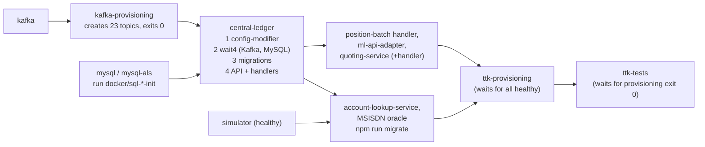

# M3 + M4 – Set Up the Local Environment and Run the Complete Switch

> **Phase 2 · Lab and first payment** · Time box: 4–6 h (first image pull can be slow) · Prerequisite: [M2](02-milestone-02-p2p-lifecycle.md) · Next: [M5/M6](04-milestones-05-06-two-fis-first-payment.md)
> Reference reading: [10 – Local setup](../10-local-setup-and-execution.md), [02 – Repository structure](../02-repository-structure.md)

---

## Why this matters to a solution architect

You will repeatedly be asked "what does it take to run this?". Standing the switch up yourself teaches you its dependencies, start-up order, configuration model and failure modes. That gives you first-hand answers for infrastructure, operations and sizing discussions, and a lab you can use to validate designs before you propose them.

## Learning objectives

1. Prepare a workstation and start the full switch with the official compose profiles.
2. Explain the start-up chain: Kafka topics → databases → config overrides → dependency waits → migrations → services → onboarding → tests.
3. Verify health of every service, including the ones whose ports are not published.
4. Know what "complete switch" means in this harness, and which Mojaloop services are not included.
5. Produce an environment baseline record you can compare against later.

---

## Core concepts

### 1. What gets started

`all-services` + `ttk-provisioning` + `ttk-tests` resolves to **31 services**: 8 switch containers, 5 infrastructure containers (Kafka and its topic provisioner, 2× MySQL, MongoDB, Redis), 6 SDK connectors plus their Redis instances, the legacy simulator, the Testing Toolkit (server, UI) and 2 test runners.

### 2. The start-up chain



The `depends_on` conditions (`service_healthy`, `service_completed_successfully`) in [docker-compose.yml](../../../docker-compose.yml) enforce this order. Health checks retry for up to about 15 minutes, which is why the first start feels slow.

### 3. The configuration model (no custom images)

Each switch container starts with `config-modifier/run.js`, which deep-merges a repo file such as `configs/central-ledger.js` into the image's own `config/default.json`. That is how the same public image is pointed at `mysql`, `kafka:29092` and `redis`. You will reuse this pattern when you customise ([reference 13 §10](../13-customization-and-extension.md#10-customise-deployment-configuration)).

### 4. "Complete switch" in this harness

| Included | Not included (exists in Mojaloop) |
| --- | --- |
| Discovery (ALS + MSISDN oracle), quoting, transfers, positions, settlement, FX | Transaction-requests service (request-to-pay), bulk API adapter, third-party (PISP) services, event processor / email notifier |

---

## Lab M3 – Prepare the workstation

| Step | Command (PowerShell unless noted) | Expected |
| --- | --- | --- |
| 1. Start Docker Desktop, then check | `docker info --format "{{.ServerVersion}} {{.NCPU}}cpu {{.MemTotal}}"` | A version, CPU count and memory in bytes (≥ 8 GB) |
| 2. Check Compose | `docker compose version` | v2.x or later |
| 3. Create your lab folder **outside** the repo | `New-Item -ItemType Directory -Force ..\my-lab` | Folder exists |
| 4. Copy the journal template | `Copy-Item docs\learning-guide\sa-learning-project\templates\lab-journal.md ..\my-lab\` | – |
| 5. Record the commit | `git log -1 --oneline` | Note it in the journal |
| 6. Validate the compose model | `docker compose --profile all-services --profile ttk-provisioning --profile ttk-tests config --services` | 31 service names (a warning about the obsolete `version` attribute is harmless) |
| 7. Pull images | `docker compose --profile all-services --profile ttk-provisioning --profile ttk-tests pull` | All `Pulled`. Measured: 15 images, **about 11.2 GB** on disk, **about 25 minutes** on the connection used for verification |

Run everything from the repository root (where `docker-compose.yml` is).

## Lab M4 – Run the complete switch

**Step 1 – Start everything in the background**

```bash
docker compose --profile all-services --profile ttk-provisioning --profile ttk-tests up -d
```

Even with `-d`, this command **does not return immediately**. Compose waits for each `depends_on` health condition, then for onboarding to exit, before starting the test container. Measured: about **5.5 minutes** from start to the test container starting (all images already pulled). The "MySQL fails on the first attempt" warning in the compose file did **not** occur in verification.

**Step 2 – Watch the start-up** (from a second terminal while step 1 waits)

```bash
docker ps --format "table {{.Names}}\t{{.Status}}"
```

Repeat every minute or two. Record roughly when each group becomes healthy.

**Step 3 – Watch onboarding and the first test**

```bash
docker compose logs -f ttk-provisioning
```

```bash
docker compose logs -f ttk-tests
```

Expected at the end of `ttk-tests`: a summary table with **31 assertions, 4 requests, 1 test case**. (The repository README still shows an older sample with 27 assertions.)

**What actually happened on the first run in verification:** onboarding (`ttk-provisioning`) exited **0**, but the first `ttk-tests` run reported **27/31 passed**. The 4 failures were all on the transfer step ("Callback … not 0", "transferState to be COMMITTED", …). The ledger showed the transfer **COMMITTED**, but the final callback reached the TTK 21 s after the prepare, which is longer than the TTK's 15 s wait. This is a **cold-start effect**: Kafka consumer groups are still settling right after start-up. Re-run the test once the stack is warm:

```bash
docker compose --profile all-services --profile ttk-provisioning --profile ttk-tests run --rm --no-deps ttk-tests
```

Result on the warm stack: **31/31 passed** (exit code 0, 17.8 s). Don't use the README's re-run command (`docker compose --project-name ttk-test-only --profile ttk-tests up --no-deps`). On Docker Compose v5.6.1 it fails with `service "ttk-tests" depends on undefined service "quoting-service": invalid compose project`, because the other profiles' services aren't defined.

Diagnosing the cold-start failure is a ready-made preview of [M8](12-milestone-08-investigate-failure.md): start from the ledger (`COMMITTED`), then follow the timestamps.

**Step 4 – Verify health inside the network** (switch ports are not published to your host)

| Service | Command | Expect |
| --- | --- | --- |
| central-ledger | `docker exec central-ledger wget -qO- http://127.0.0.1:3001/health` | `"status":"OK"` |
| ml-api-adapter | `docker exec ml-api-adapter wget -qO- http://127.0.0.1:3000/health` | OK |
| account-lookup-service | `docker exec account-lookup-service wget -qO- http://127.0.0.1:4001/health` | OK |
| quoting-service | `docker exec quoting-service wget -qO- http://127.0.0.1:3002/health` | OK |
| central-settlement | `docker exec central-settlement wget -qO- http://127.0.0.1:3007/v2/health` | OK (note the **`/v2`** prefix; `/health` returns 404. Its compose health check probes port 3001, which is refused, so `docker ps` shows *health: starting*, then *unhealthy*) |

**Step 5 – Look at the start-up mechanics in the logs**

```powershell
docker logs central-ledger 2>&1 | Select-String "config-modifier Success|wait4"
```

(Git Bash: replace `Select-String "…"` with `grep -E "…"`.) You should see the merged configuration being written, and the wait4 report showing that Kafka and MySQL were reachable.

**Step 6 – Inspect the infrastructure**

```bash
docker exec kafka /opt/bitnami/kafka/bin/kafka-topics.sh --bootstrap-server kafka:29092 --list
```

```bash
docker exec mysql mysql -uroot -e "SHOW DATABASES; SELECT COUNT(*) AS tables_in_central_ledger FROM information_schema.tables WHERE table_schema='central_ledger';"
```

```bash
docker exec mysql-als mysql -uroot -e "SHOW DATABASES;"
```

The compose file allows an empty MySQL root password inside the container (`MYSQL_ALLOW_EMPTY_PASSWORD=true`). If `-uroot` is refused, use the `central_ledger` / `account_lookup` user with the `DBPASS` default from `docker-compose.yml`.

Expected (verified): 23 `topic-*` topics; databases `central_ledger`, `account_lookup` and `oracle_msisdn`; **108 tables** in `central_ledger` created by migrations. `mysql -uroot` without a password worked in verification.

**Step 6b – Measure resource use**

```bash
docker stats --no-stream --format "table {{.Name}}\t{{.MemUsage}}\t{{.CPUPerc}}"
```

Measured at idle on the standard stack: **about 4.5 GiB** of container memory in total. The largest consumers were MySQL (~480 MiB), the account-lookup service (~410 MiB), Kafka (~400 MiB), the ALS MySQL (~400 MiB), and **6 SDK connectors at ~230 MiB each (~1.4 GiB together)**. Docker was given 8 CPUs and 11.5 GiB.

**Step 7 – Open the UIs**

- Testing Toolkit: <http://localhost:9660>
- Reports: `reports/ttk-provisioning-report.html`, `reports/ttk-func-tests-report.html`

**Step 8 – Stop and start without losing data, then reset**

```bash
docker compose --profile all-services --profile ttk-provisioning --profile ttk-tests stop
```

```bash
docker compose --profile all-services --profile ttk-provisioning --profile ttk-tests start
```

To reset to a clean state later (deletes this project's volumes only):

```bash
docker compose --profile all-services --profile ttk-provisioning --profile ttk-tests down -v
```

Never use `docker-clean-all.sh`: it deletes **every** container and volume on your machine.

### Common problems

| Problem | Fix |
| --- | --- |
| `failed to connect to the docker API` | Docker Desktop isn't running |
| `mysql` fails on the very first run | Possible per the compose comment at line 178 (not observed in verification); run `up -d` again |
| Docker Desktop: "unable to start", log shows `Wsl/Service/…/MountDisk/HCS/E_ACCESSDENIED` | Docker's disk image was moved to another drive (Settings → Resources → Advanced → *Disk image location*), and Windows' virtual-machine group can't open it. Move it back to the default location, or (elevated) grant `NT VIRTUAL MACHINE\Virtual Machines` (`*S-1-5-83-0`) access to that folder, then `wsl --shutdown` and restart Docker Desktop. This was encountered while verifying the labs. |
| First `ttk-tests` run fails 4 transfer assertions | Cold start (see step 3); re-run with `run --rm --no-deps ttk-tests` |
| Commands silently do nothing in Git Bash | Git Bash rewrites `/opt/...` and `/data` paths; run `export MSYS_NO_PATHCONV=1` (PowerShell is unaffected) |
| `docker compose down -v` leaves everything running | Every service here sits behind a profile. Without the same `--profile` flags, Compose sees an **empty project** and removes nothing (verified). Repeat the profiles used for `up`. |
| Exit code 137 / containers killed | Give Docker more memory |
| Provisioning never starts | One dependency isn't healthy; check `docker ps` and that container's logs |
| Port in use (9660, 27017, 6379…) | Stop the other program, or override the port in your own compose override file |

### Checking a "quick reference" card against reality

Lab instructions passed around between colleagues tend to drift from the code. A card handed to the author listed the commands below. Each one was run on 2026-11-04 (Windows 11, Docker Desktop, Compose v5.6.1). Checking a card like this is a skill you will use with every bank's runbook.

| Card says | Verified result | What to do instead |
| --- | --- | --- |
| Standard: `--profile all-services --profile ttk-provisioning --profile ttk-tests up` ("Minimum tier") | Works. 31 services, ~4.5 GiB at idle. The first test run after a cold start can show 27/31. | Re-run the tests with `docker compose --profile all-services --profile ttk-provisioning --profile ttk-tests run --rm --no-deps ttk-tests` |
| Golden path: `--profile all-services --profile ttk-provisioning-gp --profile ttk-tests-gp up` ("Minimum tier") | Works. Provisioning 460/460; full suite 124 test cases, 2,625 assertions, **0 failed** (453 skipped), ~7.5 min | – |
| Finance portal: `--profile all-services --profile fx --profile finance-portal --profile ttk-provisioning-fx --profile ttk-fx-tests --profile debug up -d` ("Comfortable tier") | Works. 37 containers, ~5.4 GiB; FX tests 0 failed. Portal on <http://localhost:9400>: Transfers and Financial Positions work; **Roles and Settlements fail to load** (their UIs aren't in compose). | Use the portal for transfers and positions; use the central-settlement API for settlement ([T8](16-topic-08-settlement.md)) |
| Monitoring: `docker compose --project-name monitoring -f docker-compose-monitoring.yml up -d` | **Fails on Docker Desktop for Windows** (`node-exporter`'s `rslave` mount), leaving Prometheus and Grafana not started. Alongside the `debug` profile, cAdvisor also clashes on port 8080. Only 3 of 73 Prometheus targets are reachable outside the perf stack. | Start a subset: `... up -d --no-deps prometheus grafana kafka-exporter kafka-mon-ui` ([10 §9.7](../10-local-setup-and-execution.md#97-monitoring-stack)) |
| "Stop everything and free the memory: `docker compose down -v`" | **Removes nothing** (verified twice): every service is behind a profile, so Compose sees an empty project. It also never touches the monitoring project. | Stop monitoring first: `docker compose --project-name monitoring -f docker-compose-monitoring.yml down -v`. Then repeat the exact `--profile` flags you started with, plus `down -v`. |
| Multi-line commands ending in `\` | Bash only | In PowerShell, use one line or end lines with a backtick |
| "Minimum" / "Comfortable" tiers | Not defined anywhere in the repository | Use the measured numbers above to size Docker's memory |
| `docker ps` / `docker stats` to check health and memory | Correct. Note that `central-settlement` always shows **unhealthy** (its health check uses the wrong port) even when it works. | Check it with `/v2/health` inside the network ([10 §6](../10-local-setup-and-execution.md#6-verification)) |

---

## Architect's lens

- **Dependencies to name in an infrastructure discussion:** Kafka, MySQL (system of record), MongoDB (object store), Redis (caches), plus the FSP-side connector and Redis.
- **Configuration management:** image tags pinned in one file (`.env`), overrides per service, env-var overrides with prefixes (`CLEDG_`, `MLAPI_`, `QUOTE_`, `ALS_`). In production the same idea becomes Helm values and ConfigMaps ([T9](17-topic-09-kubernetes.md)).
- **Operational lesson:** start-up order and health checks matter. In production, readiness probes and migration jobs play this role.
- **Version discipline:** the harness pins a tested combination of service versions. Your bank project must likewise freeze and certify a version set.

---

## Checkpoint

<details><summary>1. Why can't you curl http://localhost:3001/health from your browser?</summary>
The switch service ports are commented out in docker-compose.yml, so they are reachable only inside the mojaloop-net network (docker exec, or a container on that network).
</details>

<details><summary>2. Which container creates the Kafka topics, and how many?</summary>
kafka-provisioning runs docker/kafka/scripts/provision.sh, creating 23 topics with 1 partition each.
</details>

<details><summary>3. How does the harness point the stock central-ledger image at the mysql container?</summary>
config-modifier/run.js merges configs/central-ledger.js (DATABASE.HOST = "mysql") into the image's config/default.json before the service starts.
</details>

<details><summary>4. Name two Mojaloop capabilities you cannot exercise in this harness.</summary>
Request-to-pay (transaction-requests-service) and bulk transfers (bulk-api-adapter); also PISP and email notifications.
</details>

---

## Deliverable D3 – Environment baseline record

The "Environment baseline" section of your lab journal, completed: versions, resources, time to healthy, container status table, health-check outputs, topics and databases, and any deviations (e.g. central-settlement *unhealthy*).

Next: [M5/M6 – Simulate two financial institutions and execute your first payment](04-milestones-05-06-two-fis-first-payment.md).
