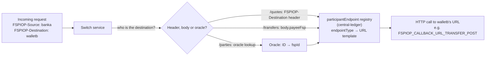

# T1 – FSPIOP Protocol: How Financial Institutions Communicate

> **Phase 3 · How the switch works** · Time box: 6–8 h · Prerequisite: [M5/M6](04-milestones-05-06-two-fis-first-payment.md) · Next: [T2 – Central Ledger](06-topic-02-central-ledger.md)
> Reference reading: [08 – FSPIOP protocol and APIs](../08-fspiop-protocol-and-apis.md) (full catalogue, headers, error codes, annotated examples)

---

## Why this matters to a solution architect

FSPIOP is the **contract** between the bank and the scheme. Every integration estimate, test plan, security control and error-handling policy you write is derived from it. You must be able to read it like a lawyer reads a contract: what is mandatory, who may send what, what happens when things go wrong.

## Learning objectives

1. Explain the FSPIOP **resource model** and its **asynchronous request/callback contract**.
2. Explain how the switch **routes** messages (headers and the participant endpoint registry).
3. Distinguish **synchronous rejections** (HTTP 4xx) from **asynchronous errors** (`PUT …/error`).
4. Explain **versioning** by content negotiation, and demonstrate a version rejection.
5. Send raw FSPIOP requests to the running switch and observe the callbacks.
6. Produce a message catalogue for a bank (D5).

---

## Core concepts

### 1. Resource model

| Phase | Resources | Served by |
| --- | --- | --- |
| Discovery | `/participants/{Type}/{ID}`, `/parties/{Type}/{ID}` | account-lookup-service |
| Agreement | `/quotes`, `/bulkQuotes`, `/fxQuotes` | quoting-service |
| Transfer | `/transfers`, `/bulkTransfers`, `/fxTransfers` | ml-api-adapter (+ central-ledger) |
| Payee-initiated | `/transactionRequests`, `/authorizations` | transaction-requests-service *(not in harness)* |
| FX discovery | `/services/FXP` | switch (v2.0) |

Every resource follows the same pattern: `POST` (create) or `GET` (ask) → `202`; answer arrives as `PUT /resource/{ID}`; failure arrives as `PUT /resource/{ID}/error`.

### 2. The contract in three rules

1. **The client generates the ID** (`quoteId`, `transferId`). That makes the request idempotent and lets the callback be correlated.
2. **`202` is an acknowledgement, not a result.** Results always arrive by callback.
3. **Callbacks go to URLs the receiver registered in advance.** They are *not* derived from the request.

### 3. Routing: how the switch knows where to send things



The registry is the `participantEndpoint` table, filled by onboarding calls such as `{"type":"FSPIOP_CALLBACK_URL_TRANSFER_PUT","value":"…/transfers/{{transferId}}"}`. The switch substitutes the template variables (`{{transferId}}`, `{{partyIdType}}` …) at send time.

### 4. Headers that carry meaning (not just transport)

| Header | Meaning for the architect |
| --- | --- |
| `FSPIOP-Source` | Claimed sender identity. Must be bound to the TLS certificate and JWS key in production. |
| `FSPIOP-Destination` | Intended receiver. Set by the payer for quotes; set by the switch on callbacks. |
| `FSPIOP-Signature` (+ `FSPIOP-URI`, `FSPIOP-HTTP-Method`) | Non-repudiation and integrity. The switch forwards FSP signatures and signs its own messages. |
| `Accept` / `Content-Type` `…;version=X.Y` | Version negotiation per resource |
| `Date` | Freshness; mandatory |

### 5. Two kinds of errors

| Kind | When | Shape | Example verified in this repo |
| --- | --- | --- | --- |
| **Synchronous** | Request malformed or unacceptable on arrival | HTTP 400 / 406 … + `errorInformation` body | Missing `FSPIOP-Source` → **400 / 3102**; invalid `Date` (even only the weekday) → **400 / 3101**; unsupported version → **406** + **3001** ([parties_negative.json](../../../docker/ml-testing-toolkit/test-cases/collections/tests/golden_path/negative_scenarios/parties_negative.json), [fspiop_protocol_validation.json](../../../docker/ml-testing-toolkit/test-cases/collections/tests/golden_path/feature_tests/backward_compatibility/fspiop_protocol_validation.json)) |
| **Asynchronous** | Business or processing failure after acceptance | `PUT /resource/{ID}/error` callback | Party not found **3204**; insufficient liquidity **4001**; transfer expired **3303** |

Error families: 1xxx communication, 2xxx server, 3xxx client (3000s generic, 31xx validation, 32xx not found, 33xx expired), 4xxx payer, 5xxx payee. See the reference's [code table](../08-fspiop-protocol-and-apis.md#5-error-handling).

### 6. Versions and the ISO 20022 variant

The harness ships FSPIOP 1.0, 1.1, 2.0 and a 2.0 **ISO 20022** variant. Same resources, ISO-shaped JSON bodies; the perf stack uses `API_TYPE=iso20022`. Ask the scheme which version and body style is mandatory: it changes your connector configuration (`API_TYPE`, `RESOURCE_VERSIONS`), not your business flow.

---

## Lab T1 – Talk FSPIOP to the running switch

You will send requests as `testingtoolkitdfsp` (onboarded with callbacks pointing at the TTK) from a throw-away container on the switch network. The TTK receives the callbacks, and you can watch them in the TTK UI's **monitoring/logs** page (<http://localhost:9660>).

**0 – Set the `Date` header value once per terminal.** The switch validates the HTTP date strictly, **including the weekday**. A hand-typed date such as `Tue, 04 Nov 2026` (a Wednesday) is rejected with `400 / 3101 "Malformed syntax - Invalid date header"`. Old dates are accepted: a date two days old passed in testing. Generate it instead:

```powershell
$D = [DateTime]::UtcNow.ToString('r')
```

```bash
D=$(date -u '+%a, %d %b %Y %H:%M:%S GMT')
```

The `docker run … -H "Date: $D"` commands below then work unchanged in both PowerShell and bash. In **Git Bash**, also run `export MSYS_NO_PATHCONV=1` once: otherwise Git Bash rewrites Linux paths such as `/opt/...` or `/data` inside `docker exec` / `docker run -v` arguments and the commands fail silently.

**1 – A valid lookup (expect `HTTP/1.1 202 Accepted`, then a `GET /parties` to the payee and a `PUT /parties` callback in the TTK monitor)**

```bash
docker run --rm --network mojaloop-net curlimages/curl:8.10.1 -s -i "http://account-lookup-service:4002/parties/MSISDN/27713803912" -H "Accept: application/vnd.interoperability.parties+json;version=1.1" -H "Content-Type: application/vnd.interoperability.parties+json;version=1.1" -H "Date: $D" -H "FSPIOP-Source: testingtoolkitdfsp"
```

**2 – Missing mandatory header (expect `400` with `errorCode 3102`, "Missing mandatory element - /header must have required property 'fspiop-source'")**

```bash
docker run --rm --network mojaloop-net curlimages/curl:8.10.1 -s -i "http://account-lookup-service:4002/parties/MSISDN/27713803912" -H "Accept: application/vnd.interoperability.parties+json;version=1.1" -H "Content-Type: application/vnd.interoperability.parties+json;version=1.1" -H "Date: $D"
```

**3 – Unsupported version (expect `406` and `errorCode 3001`)**

```bash
docker run --rm --network mojaloop-net curlimages/curl:8.10.1 -s -i "http://account-lookup-service:4002/parties/MSISDN/27713803912" -H "Accept: application/vnd.interoperability.parties+json;version=9.0" -H "Content-Type: application/vnd.interoperability.parties+json;version=1.1" -H "Date: $D" -H "FSPIOP-Source: testingtoolkitdfsp"
```

**4 – Unknown party (expect `202`, then an asynchronous `PUT /parties/MSISDN/22244803917/error` with `3204` in the TTK monitor)**

```bash
docker run --rm --network mojaloop-net curlimages/curl:8.10.1 -s -i "http://account-lookup-service:4002/parties/MSISDN/22244803917" -H "Accept: application/vnd.interoperability.parties+json;version=1.1" -H "Content-Type: application/vnd.interoperability.parties+json;version=1.1" -H "Date: $D" -H "FSPIOP-Source: testingtoolkitdfsp"
```

(`22244803917` is the repo's `settlementtestNonExistingMSISDN` input. If it happens to be registered in your environment, use any other unused number.) Verified result: an error callback from `fspiop-source: Hub` with **3204** "Party not found - No proxy found to start inter-scheme discovery flow".

**5 – Read the endpoint registry that made the callbacks possible**

```bash
docker exec mysql mysql -uroot -D central_ledger -e "SELECT p.name, et.name AS endpointType, pe.value FROM participantEndpoint pe JOIN participant p ON p.participantId=pe.participantId JOIN endpointType et ON et.endpointTypeId=pe.endpointTypeId WHERE p.name='testingtoolkitdfsp' AND pe.isActive=1 ORDER BY et.name;"
```

**6 – Compare headers on a forwarded vs a switch-originated callback.** In `reports/ttk-func-tests-report.html` (P2P), look at the transfer callback's `fspiop-source` (the payee). Then look at an error callback from step 4 (`fspiop-source` is the switch, and it carries the switch's own `fspiop-signature`).

**Record:** sync vs async error behaviour; which service answered; which endpoint type was used for each callback.

---

## Architect's lens

- **Message catalogue:** for a bank, list every message it must **send** and **receive**, with the version, mandatory headers, timeouts and error handling. This is deliverable D5 and becomes an appendix of the solution design.
- **Inbound is as big as outbound:** a bank that only wants to *send* payments must still serve inbound callbacks (`PUT /parties`, `/quotes`, `/transfers`, errors). Bank teams often underestimate this.
- **Security binding:** insist that `FSPIOP-Source` is bound to the mTLS certificate and JWS key. Without it, identity is just a header.
- **Questions to ask the scheme:** mandatory versions per resource; FSPIOP or ISO 20022 bodies; JWS signing and validation rules; callback timeout and retry policy; which error codes the scheme expects for typical bank failures.

---

## Checkpoint

<details><summary>1. A payer sends POST /quotes. Which header tells the switch where to forward it?</summary>
FSPIOP-Destination (the payee FSP id). The switch then looks up that participant's FSPIOP_CALLBACK_URL_QUOTES endpoint.
</details>

<details><summary>2. You receive HTTP 202 for GET /parties but never get a callback. List three possible causes.</summary>
No oracle registered for the ID type; the payee FSP never answers; your own callback endpoint is wrong or unreachable from the switch (or the error callback went to an error URL you don't handle).
</details>

<details><summary>3. What HTTP status and error code does the harness expect for Accept version=9.0?</summary>
406 Not Acceptable with errorCode 3001 (Unacceptable version).
</details>

<details><summary>4. Who signs a callback that reports "transfer expired"?</summary>
The switch: it originates the message (FSPIOP-Source = hub), so the ML API adapter signs it with the switch's JWS key.
</details>

---

## Deliverable D5 – FSPIOP message catalogue for Bank A

A table with one row per message Bank A sends or receives: resource and verb, direction, version, mandatory headers, key body fields, callback expected, timeout, error codes to handle, and the business action taken. Start from the reference's [API catalogue](../08-fspiop-protocol-and-apis.md#7-api-catalogue).

Next: [T2 – Central Ledger](06-topic-02-central-ledger.md).
