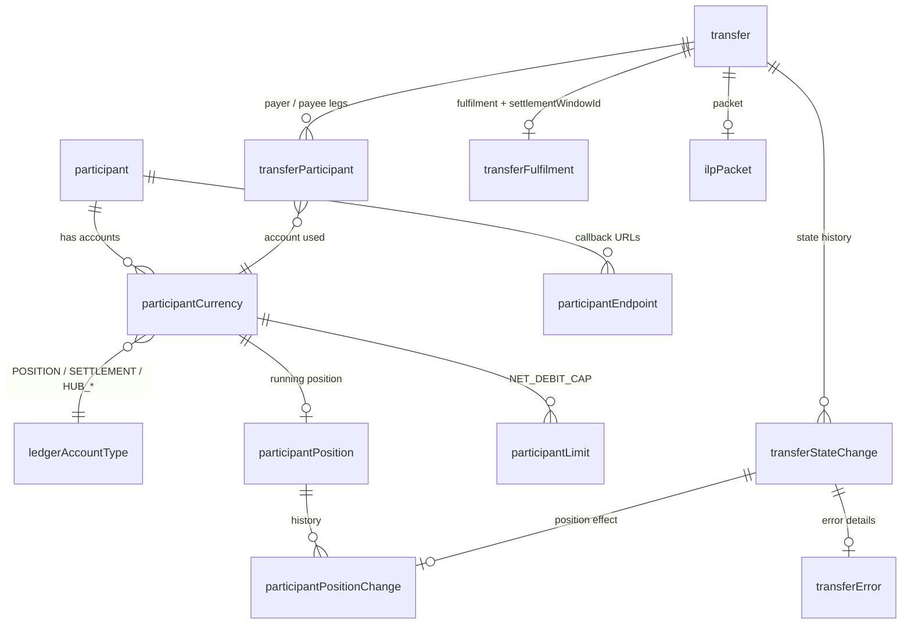

# T2 – Central Ledger: Transaction Accounting and State

> **Phase 3 · How the switch works** · Time box: 6–8 h · Prerequisite: [T1](05-topic-01-fspiop.md), a committed Bank A → Wallet B transfer from [M6](04-milestones-05-06-two-fis-first-payment.md) · Next: [T3 – Account Lookup](07-topic-03-account-lookup.md)
> Reference reading: [06 §1](../06-microservices-deep-dive.md#1-central-ledger-central-ledger), [07 §4–§6](../07-payment-transaction-lifecycle.md#4-transaction-state-management)
> Internals checked against **central-ledger v19.4.4** (migrations, `seeds/`, `src/domain/position/prepare.js`).

---

## Why this matters to a solution architect

The central ledger is where the scheme's **financial truth** lives: who is a participant, how much each FSP may owe, what each FSP owes right now, and the authoritative state of every transfer. Treasury, finance, risk and audit teams at the bank will ask you about it. You must be able to explain positions, limits and the audit trail precisely, and to say what the ledger is **not** (it is not the bank's general ledger).

## Learning objectives

1. Describe the ledger's data model: participants, currency accounts, limits, positions, transfers, state history.
2. Explain exactly how a prepare is accepted or rejected (liquidity cover and Net Debit Cap formula).
3. Follow one transfer through its rows: `transfer`, `transferParticipant`, `transferStateChange`, `participantPositionChange`, `transferFulfilment`.
4. Explain the sign conventions for positions and settlement balances.
5. Trigger and explain a limit rejection (4200) on purpose.

---

## Core concepts

### 1. Data model (main tables, central-ledger v19.4.4)



| Table | Key columns | Meaning |
| --- | --- | --- |
| `participant` | `participantId`, `name`, `isActive` | An FSP or the Hub |
| `participantCurrency` | `participantCurrencyId`, `participantId`, `currencyId`, `ledgerAccountTypeId`, `isActive` | One **account** per participant, currency and type (POSITION, SETTLEMENT, HUB_RECONCILIATION, HUB_MULTILATERAL_SETTLEMENT, INTERCHANGE_FEE …) |
| `participantLimit` | `participantCurrencyId`, `participantLimitTypeId`, `value`, `thresholdAlarmPercentage` | Limits; the only type is `NET_DEBIT_CAP` |
| `participantPosition` | `participantCurrencyId`, `value`, `reservedValue`, `changedDate` | Current position of an account |
| `participantPositionChange` | `participantPositionId`, `transferStateChangeId`, `value`, `reservedValue`, `change` | Audit of every position movement, linked to the state change that caused it |
| `transfer` | `transferId`, `amount`, `currencyId`, `ilpCondition`, `expirationDate` | The transfer header |
| `transferParticipant` | `transferId`, `participantCurrencyId`, `transferParticipantRoleTypeId`, `ledgerEntryTypeId`, `amount` | Transfer legs by role. **Observed in v19.4.4:** an ordinary P2P transfer stores only the **`PAYER_DFSP`** leg (on the payer's POSITION account); the payee's side shows up in `participantPositionChange` at commit. Funds-in/out transfers store `HUB` (on `HUB_RECONCILIATION`) and `DFSP_SETTLEMENT` (on `SETTLEMENT`) legs. |
| `transferStateChange` | `transferStateChangeId`, `transferId`, `transferStateId`, `reason`, `createdDate` | **Append-only** state history: the audit trail |
| `transferFulfilment` | `transferId`, `ilpFulfilment`, `isValid`, `settlementWindowId` | The fulfilment and the settlement window the transfer was assigned to |
| `transferError` | `transferStateChangeId`, `errorCode`, `errorDescription` | Errors attached to a state change |
| `expiringTransfer` | `transferId`, `expirationDate` | Work list for the timeout handler |
| `quote`, `quoteResponse`, … | | Quote data written by the quoting service (same database) |

### 2. The risk check at prepare (exact rule)

From `src/domain/position/prepare.js` at v19.4.4, for the payer's POSITION account in the transfer currency:

```text
effectivePosition = position.value + position.reservedValue
liquidityCover    = −(SETTLEMENT account position value)        # funds-in is stored as a negative number
availableByLiquidity = liquidityCover − effectivePosition
availableByLimit     = NET_DEBIT_CAP − effectivePosition

if availableByLiquidity < amount  → ABORTED_REJECTED, error 4001 "Payer FSP insufficient liquidity"
elif availableByLimit < amount    → ABORTED_REJECTED, error 4200 "Payer limit error"
else                              → RESERVED, position.value += amount
```

So **two** controls protect the scheme: the money actually prefunded (liquidity cover) and the operator-set ceiling (NDC). An FSP can send while both have headroom.

### 3. Position movements through a transfer's life

| Event | Payer FSP POSITION | Payee FSP POSITION | Transfer state |
| --- | --- | --- | --- |
| Prepare accepted | `+amount` | – | `RESERVED` |
| Commit | – | `−amount` | `COMMITTED` |
| Abort / reject / expiry after reservation | `−amount` (reversal) | – | `ABORTED_*` / `EXPIRED_RESERVED` |
| Settlement (deferred net, `autoPositionReset`) | reset by the net settled amount | reset | window `SETTLED` |

Positive position = the FSP owes the scheme. Negative = the scheme owes the FSP.

### 4. Ledger accounts of the Hub

`HUB_MULTILATERAL_SETTLEMENT` and `HUB_RECONCILIATION` exist per currency (created in [hub_setup.json](../../../docker/ml-testing-toolkit/test-cases/collections/provisioning/hub_setup.json)). They are the counter-accounts for settlement and for funds-in/out, so the hub's books always balance.

### 5. What the central ledger is not

- Not the bank's **general ledger**: it records inter-FSP obligations, not customer balances.
- Not a **settlement system**: it calculates and records. Money moves at the settlement bank.
- Not configurable business logic: limits and models are data; behaviour changes are code changes upstream.

---

## Lab T2 – Read the ledger

All queries use `docker exec mysql mysql -uroot -D central_ledger -e "<SQL>"`. Replace `<transferId>` with your M6 transfer.

**1 – Accounts, positions and limits for your institutions**

```bash
docker exec mysql mysql -uroot -D central_ledger -e "SELECT p.name, pc.currencyId, lat.name AS account, pp.value, pp.reservedValue, pl.value AS ndc FROM participant p JOIN participantCurrency pc ON pc.participantId=p.participantId JOIN ledgerAccountType lat ON lat.ledgerAccountTypeId=pc.ledgerAccountTypeId LEFT JOIN participantPosition pp ON pp.participantCurrencyId=pc.participantCurrencyId LEFT JOIN participantLimit pl ON pl.participantCurrencyId=pc.participantCurrencyId AND pl.isActive=1 WHERE p.name IN ('banka','walletb') ORDER BY p.name, pc.currencyId, lat.name;"
```

Observe: the SETTLEMENT account of `banka` holds a **negative** value after funds-in. Verified: **−5,000,000**, which is the provisioning's funds-in amount. The NDC is 1,000,000. Compute `liquidityCover`, `availableByLiquidity` and `availableByLimit` for `banka` in `XXX`. With these numbers, the NDC (not liquidity) is the binding control.

**The ledger always balances.** Run the same query without the `WHERE` clause, including `Hub`. In each currency, all account values sum to **zero**. In testing, XXX showed `Hub HUB_RECONCILIATION +10,000,000` (the counter-entry of two funds-ins of −5,000,000 each), payer positions +200 and payee positions −200. This double-entry property is what lets the scheme prove its books.

**2 – Anatomy of one transfer**

```bash
docker exec mysql mysql -uroot -D central_ledger -e "SELECT transferId, amount, currencyId, ilpCondition, expirationDate FROM transfer WHERE transferId='<transferId>';"
```

```bash
docker exec mysql mysql -uroot -D central_ledger -e "SELECT p.name, lat.name AS account, rt.name AS role, let.name AS entry, tp.amount FROM transferParticipant tp JOIN participantCurrency pc ON pc.participantCurrencyId=tp.participantCurrencyId JOIN participant p ON p.participantId=pc.participantId JOIN ledgerAccountType lat ON lat.ledgerAccountTypeId=pc.ledgerAccountTypeId JOIN transferParticipantRoleType rt ON rt.transferParticipantRoleTypeId=tp.transferParticipantRoleTypeId JOIN ledgerEntryType let ON let.ledgerEntryTypeId=tp.ledgerEntryTypeId WHERE tp.transferId='<transferId>';"
```

```bash
docker exec mysql mysql -uroot -D central_ledger -e "SELECT tsc.transferStateChangeId, tsc.transferStateId, ts.enumeration, tsc.reason, tsc.createdDate FROM transferStateChange tsc JOIN transferState ts ON ts.transferStateId=tsc.transferStateId WHERE tsc.transferId='<transferId>' ORDER BY tsc.transferStateChangeId;"
```

```bash
docker exec mysql mysql -uroot -D central_ledger -e "SELECT tsc.transferStateId, ppc.participantPositionId, ppc.change, ppc.value, ppc.reservedValue, ppc.createdDate FROM participantPositionChange ppc JOIN transferStateChange tsc ON tsc.transferStateChangeId=ppc.transferStateChangeId WHERE tsc.transferId='<transferId>' ORDER BY ppc.participantPositionChangeId;"
```

```bash
docker exec mysql mysql -uroot -D central_ledger -e "SELECT transferId, isValid, settlementWindowId, completedDate FROM transferFulfilment WHERE transferId='<transferId>';"
```

Explain each row: which handler wrote it, and which business event it represents. Expected (verified): one `transferParticipant` row (`banka`, POSITION, `PAYER_DFSP`, 100); four state changes `RECEIVED_PREPARE → RESERVED → RECEIVED_FULFIL → COMMITTED` with enumerations `RECEIVED, RESERVED, RESERVED, COMMITTED`; two position changes (`RESERVED: banka +100`, `COMMITTED: walletb −100`); a fulfilment row with `isValid = 1` and `settlementWindowId = 1`.

**3 – Trigger a limit rejection (4200) on purpose**

Lower Bank A's NDC below the next payment amount (current position + amount must exceed it):

```bash
docker run --rm --network mojaloop-net curlimages/curl:8.10.1 -s -i -X PUT "http://central-ledger:3001/participants/banka/limits" -H "Content-Type: application/json" -d "{\"currency\":\"XXX\",\"limit\":{\"type\":\"NET_DEBIT_CAP\",\"value\":50,\"alarmPercentage\":10}}"
```

(The body shape matches the repo's own [adjust-participants-limits.json](../../../docker/ml-testing-toolkit/test-cases/collections/provisioning/for_golden_path/CGS_Specific/adjust-participants-limits.json).)

(The command above was verified in bash. In PowerShell, write the JSON to `..\my-lab\limit.json` and send it with `-v "$((Resolve-Path ..\my-lab).Path):/data"` and `-d "@/data/limit.json"`, the same pattern as the T4 quote lab.) Re-run your Bank A → Wallet B test case with amount 100 (assuming Bank A's current XXX position is at or above zero). Expect the transfer callback to be an **error 4200** and the state `ABORTED_REJECTED`. Check that `banka`'s position did **not** change. Then restore the limit to `1000000` with the same command.

Verified result: the `PUT` returned `200`. The payment's state history was `RECEIVED_PREPARE → ABORTED_REJECTED` with **reason "Payer limit error"**, and Bank A received `errorCode 4200`. Bank A's position stayed at 200. Note that this rejection writes **no `transferError` row**: the reason is on the state change itself. (The test's "transferState COMMITTED" assertion fails here, which is expected.)

**4 – Admin API view**

```bash
docker exec central-ledger wget -qO- http://127.0.0.1:3001/participants/banka/limits
```

```bash
docker exec central-ledger wget -qO- http://127.0.0.1:3001/settlementModels
```

---

## Architect's lens

- **Talking to treasury:** "Your exposure is capped twice: by the cash you prefund and by the NDC the scheme sets. Each outgoing payment consumes headroom immediately when it is reserved. Incoming payments create headroom when they commit. Settlement resets the cycle."
- **NDC sizing (a design decision):** model peak outgoing volume between settlements, minus expected incoming flows, plus a buffer. Too low means rejected payments (4001/4200) at peak; too high means idle liquidity.
- **Audit and reconciliation:** `transferStateChange` and `participantPositionChange` give a complete, append-only history. That is your answer to "can you prove what happened to transfer X?".
- **Non-functional:** MySQL is the system of record and the main throughput bottleneck. Position batching (`central-handler-position-batch`) exists to raise throughput. That shapes production sizing ([T9](17-topic-09-kubernetes.md)).
- **Questions to ask:** NDC policy and review cycle; threshold alert percentage (`thresholdAlarmPercentage`); who approves funds-out; retention period for transfer history.

---

## Checkpoint

<details><summary>1. Bank A has funds-in 1,000,000, NDC 600,000, current position 590,000. Is a 20,000 payment accepted?</summary>
No. availableByLiquidity = 1,000,000 − 590,000 = 410,000 (OK), but availableByLimit = 600,000 − 590,000 = 10,000 < 20,000, so the transfer is rejected with 4200 and ends ABORTED_REJECTED.
</details>

<details><summary>2. Which table proves the time at which a transfer became COMMITTED?</summary>
transferStateChange (row with transferStateId COMMITTED and its createdDate).
</details>

<details><summary>3. When does the payee FSP's position change?</summary>
At commit (it decreases by the amount); nothing happens to it at prepare.
</details>

<details><summary>4. Where is the link between a transfer and its settlement window stored?</summary>
transferFulfilment.settlementWindowId.
</details>

---

## Deliverable D6 – Ledger and position worksheet

1. The ER sketch annotated with which handler writes each table.
2. Your transfer's rows (from step 2), each explained in one sentence.
3. A small spreadsheet that applies the prepare formula to ten payments for Bank A, showing when 4001 or 4200 would occur. Use it later when you advise a bank on NDC sizing.

Next: [T3 – Account Lookup](07-topic-03-account-lookup.md).
