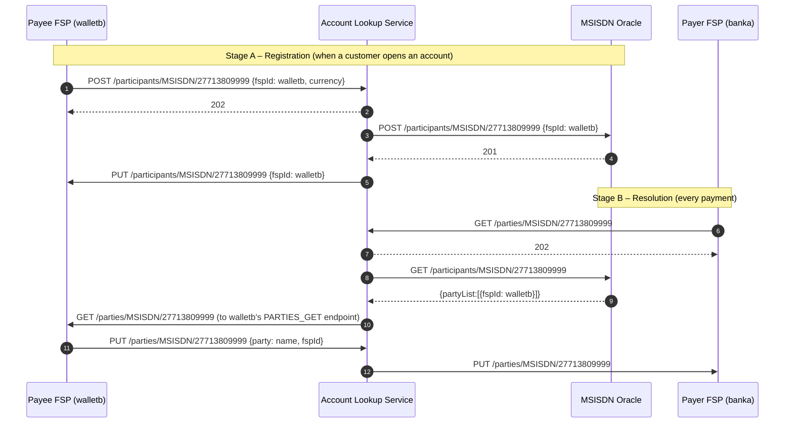

# T3 – Account Lookup: Beneficiary Resolution

> **Phase 3 · How the switch works** · Time box: 5–6 h · Prerequisite: [T2](06-topic-02-central-ledger.md) · Next: [T4 – Quoting](08-topic-04-quoting.md)
> Reference reading: [04 §3.4](../04-business-use-cases.md#34-account-lookup-and-payee-discovery), [06 §3–§4](../06-microservices-deep-dive.md#3-account-lookup-service-account-lookup-service), [13 §5](../13-customization-and-extension.md#5-add-an-oracle-for-a-new-identifier-type)
> Internals checked against **account-lookup-service v17.9.1** (migrations) and **als-msisdn-oracle-svc v0.0.18**.

---

## Why this matters to a solution architect

"Pay by phone number" is the feature customers notice, and misdirected payments are the complaint banks fear most. The directory decides **which institution receives the money** and **which name the payer sees before confirming**. Its design (identifiers, ownership, data quality, privacy) is a business decision that you must surface early.

## Learning objectives

1. Explain the two stages of discovery: **registration** (`/participants`) and **resolution** (`/parties`).
2. Explain the **oracle** model and how ALS picks an oracle.
3. Register, resolve and deregister an alias on the running switch.
4. Read the oracle registry and the MSISDN directory in the databases.
5. Write a directory strategy for a bank (D7).

---

## Core concepts

### 1. Two stages, two resources



- **`/participants`** answers "which FSP owns this identifier?". The oracle holds it.
- **`/parties`** answers "who is this person, according to their own FSP?". The payee FSP holds it, so the name always comes from the institution that knows the customer.

### 2. Oracle selection

ALS keeps an **oracle registry** (table `oracleEndpoint`: `partyIdTypeId`, `endpointTypeId`, `currencyId`, `value` (URL), `isDefault`, `isActive`). For a lookup of type `MSISDN`, ALS calls the oracle registered for `MSISDN` (optionally per currency), using the **Oracle API** (`/participants/{Type}/{ID}`).

The harness registers:

| ID type | Oracle URL | Source | Works? |
| --- | --- | --- | --- |
| `MSISDN` | `http://als-msisdn-oracle-svc:3000` | [hub_setup_prod.json](../../../docker/ml-testing-toolkit/test-cases/collections/provisioning/hub_setup_prod.json) | Yes |
| `ACCOUNT_ID` | `http://moja-simulator/oracle` | [hub_setup.json](../../../docker/ml-testing-toolkit/test-cases/collections/provisioning/hub_setup.json) | No (host not in compose) |

The MSISDN oracle stores entries in table `oracleMSISDN` (`id`, `subId`, `fspId`; primary key `id + subId`) in database `oracle_msisdn`. One identifier (plus optional sub-ID) maps to **exactly one** FSP.

### 3. Characteristics that drive design

| Characteristic | Consequence |
| --- | --- |
| HTTP only (no Kafka) in ALS | Latency-sensitive; scale ALS and oracles horizontally |
| Lookups ≫ payments (users check names, abandon, retry) | Size ALS and oracles for lookup volume, not payment volume |
| The name comes from the payee FSP | The payee FSP's `GET /parties` backend must be fast and available |
| Sub-IDs (`/{Type}/{ID}/{SubId}`) | Several accounts under one identifier (e.g. wallet and savings) |
| Proxy cache (Redis) | Inter-scheme lookups can be routed to proxy participants |

---

## Lab T3 – Register, resolve, deregister

Set `$D` first, as in [T1 step 0](05-topic-01-fspiop.md#lab-t1--talk-fspiop-to-the-running-switch) (PowerShell `$D = [DateTime]::UtcNow.ToString('r')`, bash `D=$(date -u '+%a, %d %b %Y %H:%M:%S GMT')`).

**1 – Read the oracle registry.** The ALS admin API, like the FSPIOP API, requires `Content-Type` and `Date` headers. A bare `wget` returns `400 / 3102 "… must have required property 'content-type'"`.

```bash
docker run --rm --network mojaloop-net curlimages/curl:8.10.1 -s "http://account-lookup-service:4001/oracles" -H "Content-Type: application/vnd.interoperability.participants+json;version=1.1" -H "Date: $D"
```

Verified output: two oracles, `ACCOUNT_ID → http://moja-simulator/oracle` and `MSISDN → http://als-msisdn-oracle-svc:3000`, both `isDefault: 1`.

```bash
docker exec mysql-als mysql -uroot -D account_lookup -e "SELECT o.oracleEndpointId, t.name AS idType, o.currencyId, o.value, o.isDefault, o.isActive FROM oracleEndpoint o JOIN partyIdType t ON t.partyIdTypeId=o.partyIdTypeId;"
```

**2 – Read the MSISDN directory**

```bash
docker exec mysql-als mysql -uroot -D oracle_msisdn -e "SELECT id, subId, fspId FROM oracleMSISDN ORDER BY fspId LIMIT 20;"
```

You should see `27713803912 → payeefsp` (from the P2P test) and your M6 number `27713809999 → walletb`, plus three demo rows seeded by the oracle service itself (`000000 → dfspa`, `111111 → dfspb`, `222222 → dfspc`).

**3 – Register a new alias as Wallet B (FSPIOP, async)**

```bash
docker run --rm --network mojaloop-net curlimages/curl:8.10.1 -s -i -X POST "http://account-lookup-service:4002/participants/MSISDN/27713801111" -H "Accept: application/vnd.interoperability.participants+json;version=1.1" -H "Content-Type: application/vnd.interoperability.participants+json;version=1.1" -H "Date: $D" -H "FSPIOP-Source: walletb" -d "{\"fspId\":\"walletb\",\"currency\":\"XXX\"}"
```

Expect `202`. The confirmation `PUT /participants/MSISDN/27713801111` goes to walletb's endpoint (the TTK monitor). Re-run query 2 to see the new row.

**4 – Resolve it as Bank A**

```bash
docker run --rm --network mojaloop-net curlimages/curl:8.10.1 -s -i "http://account-lookup-service:4002/parties/MSISDN/27713801111" -H "Accept: application/vnd.interoperability.parties+json;version=1.1" -H "Content-Type: application/vnd.interoperability.parties+json;version=1.1" -H "Date: $D" -H "FSPIOP-Source: banka"
```

In the TTK monitor: a `GET /parties` arriving *as walletb*, then a `PUT /parties` delivered *to banka*. Check the callback's `FSPIOP-Source` header against the body's `fspId` (remember the [M6 lesson](04-milestones-05-06-two-fis-first-payment.md#step-2--your-own-payment-and-an-important-lesson)).

**5 – Deregister and observe the failure**

```bash
docker run --rm --network mojaloop-net curlimages/curl:8.10.1 -s -i -X DELETE "http://account-lookup-service:4002/participants/MSISDN/27713801111" -H "Accept: application/vnd.interoperability.participants+json;version=1.1" -H "Content-Type: application/vnd.interoperability.participants+json;version=1.1" -H "Date: $D" -H "FSPIOP-Source: walletb"
```

Expect `202`, a `PUT /participants/…` confirmation to walletb, and the `oracleMSISDN` row gone. Repeat step 4: `202`, then an **error callback** to banka with **3204** "Party not found - No proxy found to start inter-scheme discovery flow". In testing, ALS v17.9.1 sent a second error callback for the same lookup a few seconds later, with **3300 "Generic expired error"**. Your integration must tolerate more than one error callback per request.

**6 – Follow it in the logs**

```bash
docker logs account-lookup-service 2>&1 | Select-String "27713801111"
```

(Git Bash: `| grep 27713801111`.)

---

## Architect's lens

**Directory strategy questions to settle with the bank and the scheme:**

| Question | Why it matters |
| --- | --- |
| Which identifiers will the bank publish (MSISDN, ACCOUNT_ID, IBAN, merchant IDs)? | Each needs an oracle; bank customers often expect account-number payments |
| Who owns each oracle (scheme central vs delegated)? | Governance, availability, cost |
| How is customer consent captured for publishing a phone number? | Data protection |
| What happens when a number moves to another FSP or is recycled by the telco? | Stale entries → misdirected payments |
| Is one identifier allowed at several FSPs? | The MSISDN oracle maps one ID (+ sub-ID) to one FSP; multi-FSP needs a scheme rule and a UX for the choice |
| What personal data does `PUT /parties` return? | Minimal data (display name) vs full name and DOB |
| Performance targets for lookup | Often 5–10× payment volume |

**Integration tasks for the bank:** bulk-load existing customers' aliases at go-live, register and deregister in the account lifecycle (open, close, number change), and serve `GET /parties` from a fast, cached customer view rather than the core banking system directly.

---

## Checkpoint

<details><summary>1. Which component returns the payee's name, and why is that design important?</summary>
The payee FSP (via PUT /parties). The institution that performed KYC on the customer is the authority on their name; the switch only routes.
</details>

<details><summary>2. A bank wants account-number payments. What must exist in the scheme?</summary>
An oracle registered in ALS for ACCOUNT_ID (or IBAN), and the bank must register its accounts in it (or the oracle must derive the FSP from the number format).
</details>

<details><summary>3. In which table does the MSISDN oracle store mappings, and what is its key?</summary>
oracleMSISDN in database oracle_msisdn; primary key (id, subId).
</details>

<details><summary>4. Does ALS use Kafka for party lookups?</summary>
No. Discovery is HTTP-based (ALS → oracle → payee FSP), so latency and availability of each hop matter.
</details>

---

## Deliverable D7 – Directory (alias) strategy note

One to two pages: identifiers to publish, oracle approach, registration lifecycle (bulk load, open/close, number change), consent and privacy, name-display policy, performance targets, and risks with mitigations.

Next: [T4 – Quoting](08-topic-04-quoting.md).
