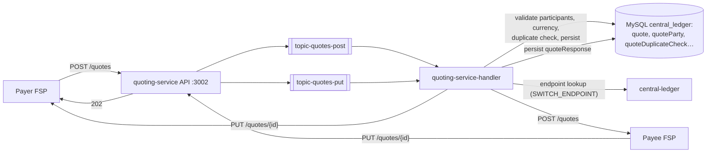

# T4 – Quoting: Payment Quotation

> **Phase 3 · How the switch works** · Time box: 5–6 h · Prerequisite: [T3](07-topic-03-account-lookup.md) · Next: [T5 – Transfers](09-topic-05-transfers.md)
> Reference reading: [04 §3.5](../04-business-use-cases.md#35-transaction-quotation), [06 §5](../06-microservices-deep-dive.md#5-quoting-service-quoting-service-quoting-service-handler), [08 §8.2](../08-fspiop-protocol-and-apis.md#82-quotation)

---

## Why this matters to a solution architect

The quote is where **commercial terms** meet the protocol: fees, what the payee receives, how long the offer is valid, and the cryptographic condition that later makes the payment final. Banks care about fee transparency (often a regulatory requirement), and the payee side needs a fast "can this account receive this?" decision. Both land in your design.

## Learning objectives

1. Explain what a quote fixes (amounts, fees, expiry, ILP packet, condition) and who decides each element.
2. Describe the quoting service's architecture: API → Kafka → handler → validation and persistence → forward.
3. Send a quote yourself and find it in Kafka and in the database.
4. Demonstrate duplicate-quote protection.
5. Write a fee and quote policy for a bank (D8).

---

## Core concepts

### 1. Who decides what

| Element | Decided by | Field |
| --- | --- | --- |
| Amount and its meaning | Payer (via payer FSP) | `amount`, `amountType` (`SEND` / `RECEIVE`) |
| Transaction purpose | Payer FSP | `transactionType.scenario/initiator/initiatorType` |
| Payee-side fee and commission | **Payee FSP** | `payeeFspFee`, `payeeFspCommission` |
| Amount moved between FSPs | Payee FSP (derived) | `transferAmount` |
| What the payee receives | Payee FSP | `payeeReceiveAmount` |
| Offer validity | Payee FSP | `expiration` |
| Cryptographic lock | Payee FSP | `ilpPacket`, `condition` |
| **Payer-side fee** | Payer FSP | **Not in FSPIOP**: the payer FSP adds it in its own channel |

### 2. Inside the quoting service



The harness sets `SIMPLE_ROUTING_MODE: false` ([configs/quoting-service.js](../../../docker/config-modifier/configs/quoting-service.js)), so the service **validates and persists** quotes instead of merely forwarding them (the upstream default is `true`). Persisted quote data lives in the same `central_ledger` database: tables `quote` (`quoteId`, `amount`, `currencyId`, `amountTypeId`, `transactionScenarioId`, `expirationDate` …) and `quoteResponse` (`transferAmount`, `payeeReceiveAmount`, `payeeFspFeeAmount`, `ilpCondition`, `responseExpirationDate` …), verified in central-ledger v19.4.4 migrations.

### 3. Rules that protect both sides

- **Duplicate protection:** the same `quoteId` with a different body → **3106 Modified request** (asserted in the golden-path file `Tests for Bugfix #990 and #1016 - Quotes.json`).
- **Expiry:** after `expiration`, the payer must not transfer on the quote. SDK connectors can enforce this (`REJECT_TRANSFERS_ON_EXPIRED_QUOTES`).
- **Consistency:** the transfer must use the quote's `transactionId` as `transferId` and its `transferAmount` as `amount`.
- **Rejection:** the payee FSP answers `PUT /quotes/{id}/error` (e.g. 5101 *Payee rejected quote*, 5106 *unsupported currency*).

### 4. FX quotes (preview)

For cross-currency payments there is a separate `POST /fxQuotes` to an FX provider before the normal quote. Same service, topics `topic-fx-quotes-*` (see [diagrams/fx-transfer-sequence.mmd](../diagrams/fx-transfer-sequence.mmd)).

---

## Lab T4 – Quote, observe, duplicate

Create a working folder **outside** the repository (e.g. `..\my-lab`), and save this as `..\my-lab\quote.json`:

```json
{
  "quoteId": "b51ec534-ee48-4575-b6a9-ead2955b8069",
  "transactionId": "a8323bc6-c228-4df2-ae82-e5a997baf899",
  "payer": { "partyIdInfo": { "partyIdType": "MSISDN", "partyIdentifier": "44123456789", "fspId": "banka" } },
  "payee": { "partyIdInfo": { "partyIdType": "MSISDN", "partyIdentifier": "27713809999", "fspId": "walletb" } },
  "amountType": "SEND",
  "amount": { "amount": "25", "currency": "XXX" },
  "transactionType": { "scenario": "TRANSFER", "initiator": "PAYER", "initiatorType": "CONSUMER" }
}
```

**1 – Send it as Bank A to Wallet B** (PowerShell, from the repository root; this exact command was verified):

```powershell
$D = [DateTime]::UtcNow.ToString('r')
docker run --rm --network mojaloop-net -v "$((Resolve-Path ..\my-lab).Path):/data" curlimages/curl:8.10.1 -s -i -X POST "http://quoting-service:3002/quotes" -H "Accept: application/vnd.interoperability.quotes+json;version=1.1" -H "Content-Type: application/vnd.interoperability.quotes+json;version=1.1" -H "Date: $D" -H "FSPIOP-Source: banka" -H "FSPIOP-Destination: walletb" -d "@/data/quote.json"
```

(Git Bash: use `-v "$(pwd)/../my-lab:/data"`, and prefix the command with `MSYS_NO_PATHCONV=1` so that `/data` is not rewritten.) Expect `202`. In the TTK monitor: `POST /quotes` arriving *as walletb*, then `PUT /quotes/b51ec534…` delivered *to banka*, with `transferAmount`, `condition` and `expiration`.

**2 – See it on Kafka**

```bash
docker exec kafka /opt/bitnami/kafka/bin/kafka-console-consumer.sh --bootstrap-server kafka:29092 --topic topic-quotes-post --from-beginning --max-messages 50 --timeout-ms 10000
```

Find your `quoteId` in the output (pipe through `Select-String <quoteId>` / `grep <quoteId>`). Verified envelope shape: top-level `from`, `to`, `id`, `type`, `content` (`headers`, `payload`, `uriParams`, `requestId`, …) and `metadata.event` = `{"type":"quote","action":"post","state":{"status":"success"}}`. On this topic the payload is plain JSON. (The ML API adapter's own audit lines show transfer payloads as base64 `dataUri` strings.) **Git Bash users:** without `export MSYS_NO_PATHCONV=1`, the path `/opt/bitnami/...` is rewritten and the command fails silently.

**3 – See it in the database**

```bash
docker exec mysql mysql -uroot -D central_ledger -e "SELECT quoteId, amount, currencyId, expirationDate, createdDate FROM quote WHERE quoteId='b51ec534-ee48-4575-b6a9-ead2955b8069';"
```

```bash
docker exec mysql mysql -uroot -D central_ledger -e "SELECT quoteId, transferAmount, payeeReceiveAmount, payeeFspFeeAmount, ilpCondition, responseExpirationDate FROM quoteResponse WHERE quoteId='b51ec534-ee48-4575-b6a9-ead2955b8069';"
```

Verified values: `amount 25.0000 XXX`, `transferAmount 25`, `payeeReceiveAmount 25`, `payeeFspFeeAmount 0`, an `ilpCondition`, and `responseExpirationDate` about 24 hours ahead (the TTK's simulated payee offers a long validity).

**4 – Duplicate protection.** Re-send the identical request: `202`, and the switch **re-sends the `PUT /quotes/{id}` callback**. Then change `"amount": "25"` to `"26"` in `quote.json`, keep the same `quoteId`, and send again: `202`, then an **error callback with 3106** "Modified request - Quote … is a duplicate but hashes don't match" to banka.

**5 – Synchronous validation.** Remove the `amount` object from a copy of the file and send it. Expect an immediate **400 / 3102** "Missing mandatory element - /requestBody must have required property 'amount'" (compare with [quotes_negative.json](../../../docker/ml-testing-toolkit/test-cases/collections/tests/golden_path/negative_scenarios/quotes_negative.json)).

**6 – How the simulated payee priced it.** Read the `post /quotes - Default` rule in [rules_callback/default.json](../../../docker/ml-testing-toolkit/spec_files/rules_callback/default.json): fee `0`, `transferAmount = amount`. A real payee FSP replaces this with its fee engine.

---

## Architect's lens

- **Fee policy is a business decision with a technical shape.** Payee FSP fees travel in the quote. Payer FSP fees stay in the payer's channel. Interchange between FSPs, if any, is handled through settlement rules. Make the bank decide each one explicitly and document it (D8).
- **Customer think-time vs quote expiry:** the customer may take 30 seconds to enter a PIN. Choose expiry values the scheme allows, and re-quote rather than transfer on an expired quote.
- **Payee-side backend:** as payee, the bank must answer `POST /quoterequests` (via the SDK) quickly: account status, limits, currency, fee. Treat it as a real-time API with a latency budget, not a batch job.
- **Volume:** quotes can outnumber transfers (abandoned payments). Size accordingly.
- **Questions for the scheme:** `SEND`/`RECEIVE` support; fee display rules; maximum quote validity; FX quote rules.

---

## Checkpoint

<details><summary>1. Which field tells the payer FSP how much to put in POST /transfers?</summary>
transferAmount from the quote callback.
</details>

<details><summary>2. Where do payer-side fees appear in FSPIOP?</summary>
Nowhere. The payer FSP charges them in its own channel; FSPIOP quotes carry payee-side fees and commission.
</details>

<details><summary>3. What does SIMPLE_ROUTING_MODE=false add?</summary>
Validation and persistence of quotes (participants, currency, duplicate checks) in the database, instead of pure forwarding.
</details>

<details><summary>4. Same quoteId, different amount. What happens?</summary>
The switch rejects it as a modified duplicate: error callback 3106.
</details>

---

## Deliverable D8 – Fee and quote policy note

For Bank A as payer and as payee: fee components and who charges them; display rules; `SEND`/`RECEIVE` usage; quote expiry and re-quote rules; reasons to reject a quote (mapped to error codes); latency budget for `POST /quoterequests`.

Next: [T5 – Transfers](09-topic-05-transfers.md).
