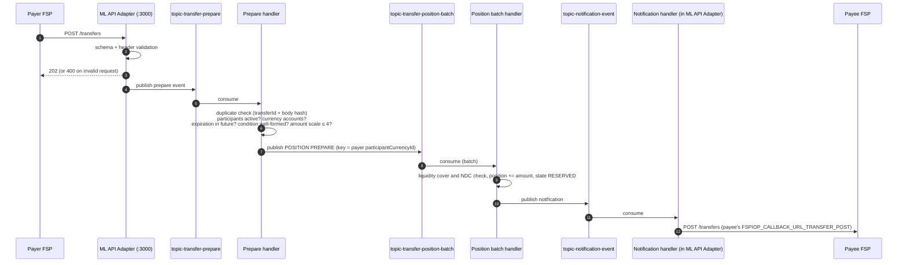

# T5 – Transfers: Payment Execution

> **Phase 3 · How the switch works** · Time box: 6–8 h · Prerequisite: [T4](08-topic-04-quoting.md) · Next: [T6 – Fulfilment](10-topic-06-fulfilment.md)
> Reference reading: [05 §5](../05-system-architecture.md#5-component-interaction-for-a-transfer-kafka-view), [06 §1–§2](../06-microservices-deep-dive.md#1-central-ledger-central-ledger), [07 §3](../07-payment-transaction-lifecycle.md#3-every-step-in-detail)
> Internals checked against **central-ledger v19.4.4** and **ml-api-adapter v16.4.2**.

---

## Why this matters to a solution architect

The transfer phase is where obligations are created. Its design determines **throughput, latency, ordering, failure behaviour and recovery**: the non-functional answers a bank's architecture board will demand. You must be able to explain how a transfer moves through the switch, where it can stall, and what the bank must do before and after sending it.

## Learning objectives

1. Describe the prepare path end to end: ML API adapter → Kafka → prepare handler → position (batch) handler → notification handler → payee FSP.
2. List the validations the switch performs at prepare, and the outcome of each failure.
3. Explain why Kafka is used here (decoupling, scaling, per-participant ordering) and how messages are keyed.
4. Observe a transfer on Kafka topics, in consumer groups and in the logs.
5. Query a transfer's status the way an FSP recovers from a lost callback.

---

## Core concepts

### 1. The prepare path



### 2. Validations and their outcomes

| Check | Where | On failure |
| --- | --- | --- |
| Headers, schema, version | ML API adapter (sync) | HTTP 400 / 406 with `errorInformation` |
| Duplicate `transferId` | Prepare handler | Same body: ignore while RECEIVED, otherwise resend the current state. Different body: **3106**. |
| Payer and payee exist, are active, hold accounts in the currency | Prepare handler | Error callback (e.g. **3100**, **3201** in the `Active_Inactive_participants` tests); state `INVALID` |
| Expiration valid, condition format, amount precision | Prepare handler | Validation error callback (31xx) |
| Liquidity cover | Position handler | **4001**, `ABORTED_REJECTED` |
| Net Debit Cap | Position handler | **4200**, `ABORTED_REJECTED` |

### 3. Why Kafka here (and not for discovery)

| Need | How Kafka provides it |
| --- | --- |
| Fast acknowledgement to FSPs | API only validates and publishes, then returns 202 |
| Independent scaling of steps | Prepare, position, fulfil and notification handlers scale separately (the perf compose and Helm charts run them as separate deployments) |
| **Correct positions under concurrency** | Position messages are **keyed by the POSITION account whose position changes** (`participantCurrencyId`): the **payer's** on prepare and abort, the **payee's** on commit (verified on the topic, see the lab). All changes to one account therefore land on one partition, in order, processed by one consumer. Hence the [partition calculator](../../../packages/kafaka-partitioner-calculator/). |
| Batching for throughput | `central-handler-position-batch` processes several position changes per DB transaction. The harness routes every position action to `topic-transfer-position-batch` ([configs/central-ledger.js](../../../docker/config-modifier/configs/central-ledger.js)). |
| Durable hand-off | A crash between steps doesn't lose the message |

### 4. Expiration is the payer's lever

The payer FSP sets `expiration` in `POST /transfers`. The central-ledger timeout handler (every 15 s by upstream default) expires transfers that are not fulfilled in time, and notifies both sides with **3303**. Choose expiration long enough for the payee's core banking, and short enough to release held customer funds quickly.

---

## Lab T5 – Watch a transfer move

Run your Bank A → Wallet B test case again in the TTK UI (from M6) and copy the new `transferId`.

**1 – Find it on each topic** (prints keys too):

```bash
docker exec kafka /opt/bitnami/kafka/bin/kafka-console-consumer.sh --bootstrap-server kafka:29092 --topic topic-transfer-prepare --from-beginning --property print.key=true --timeout-ms 10000 | Select-String "<transferId>"
```

Repeat for `topic-transfer-position-batch`, `topic-transfer-fulfil` and `topic-notification-event` (Git Bash: `| grep <transferId>`). For each match, note:
- the **message key** (on the position-batch topic, compare it with banka's POSITION `participantCurrencyId` from T2),
- the event **type and action** in the message metadata (e.g. prepare, position prepare, commit, notification).

Add `--property print.timestamp=true` to get the broker time of each message. **Git Bash:** run `export MSYS_NO_PATHCONV=1` first, or the `/opt/bitnami/...` path is rewritten and the command fails silently.

**What a verified run looks like** (Bank A → Wallet B, 100 XXX, warm stack; total ≈ 830 ms):

| Topic | Key | `metadata.event` type/action | Δ |
| --- | --- | --- | --- |
| `topic-transfer-prepare` | null | prepare / prepare | 0 ms |
| `topic-transfer-position-batch` | **17** (banka XXX POSITION) | position / prepare | +78 ms |
| `topic-notification-event` | null | notification / prepare (forward to payee) | +135 ms |
| `topic-transfer-fulfil` | null | fulfil / commit | +413 ms (includes the payee's turn-around) |
| `topic-transfer-position-batch` | **21** (walletb XXX POSITION) | position / commit | +56 ms |
| `topic-notification-event` | null | notification / commit (to payer) | +149 ms |

The envelope fields you will see: `id`, `from`, `to`, `type`, `content` (`headers`, `payload`, `uriParams`, …), `metadata.event` (`type`, `action`, `createdAt`, `state`).

**2 – Who consumes what**

```bash
docker exec kafka /opt/bitnami/kafka/bin/kafka-consumer-groups.sh --bootstrap-server kafka:29092 --describe --all-groups
```

Map each consumer group to a topic and a handler. Note the **LAG** column, which is a key production metric. Verified groups include `cl-group-transfer-prepare`, `cl-group-transfer-position-batch`, `cl-group-transfer-fulfil`, `cl-group-transfer-get`, `cl-group-transfer-admin` (central-ledger), `ml-group-notification-event` (ML API adapter), `group-quotes-handler-post/put/get` (quoting), and `cs-group-centralsettlement-handler-deferredsettlement-notification-event` (central-settlement **also** consumes `topic-notification-event`, to assign transfers to settlement windows). Groups showing `lag=-` have not consumed anything yet: bulk, FX and get topics are unused in a P2P run.

**3 – Timeline from the logs**

```bash
docker logs ml-api-adapter 2>&1 | Select-String "<transferId>"
```

```bash
docker logs central-ledger 2>&1 | Select-String "<transferId>"
```

```bash
docker logs central-handler-position-batch 2>&1 | Select-String "<transferId>"
```

Put the timestamps in order and compute the time spent in each component.

**4 – Status inquiry (recovery pattern)**, with `$D` set as in [T1 step 0](05-topic-01-fspiop.md#lab-t1--talk-fspiop-to-the-running-switch):

```bash
docker run --rm --network mojaloop-net curlimages/curl:8.10.1 -s -i "http://ml-api-adapter:3000/transfers/<transferId>" -H "Accept: application/vnd.interoperability.transfers+json;version=1.1" -H "Content-Type: application/vnd.interoperability.transfers+json;version=1.1" -H "Date: $D" -H "FSPIOP-Source: banka"
```

Expect `202`, then `PUT /transfers/<transferId>` to banka (TTK monitor) with `transferState: COMMITTED`. Repeat with a random UUID: expect an error callback with **3208 Transfer ID not found**.

**5 – Optional: watch it in a UI.** Restart with `--profile debug` added to your `up` command, open <http://localhost:8080> (Redpanda Console), and browse the same topics.

---

## Architect's lens

- **Bank-side contract around `POST /transfers`:** hold funds before sending; persist `transferId` before sending; never generate a new `transferId` for the same intent; on timeout, query status (`GET /transfers/{id}`) before deciding anything.
- **NFR conversation:** throughput scales with handler replicas **up to the partition count**. Per-FSP ordering on positions is deliberate and limits parallelism per FSP. MySQL is the backstop. Latency is the sum of Kafka hops, DB commits and the payee's own processing.
- **Expiration policy:** derive it from the payee's worst-case processing time plus network margin, and align it with the scheme rules. Record it in D9a.
- **Monitoring:** consumer lag per handler, prepare-to-commit latency, rate of 4001/4200 and 3303 errors per FSP.

---

## Checkpoint

<details><summary>1. Why are position messages keyed by a participantCurrencyId, and whose?</summary>
So that all position changes for one FSP account go to the same partition and are processed in order by one consumer, preventing race conditions. The key is the account whose position changes: the payer's on prepare and abort, the payee's on commit.
</details>

<details><summary>2. A POST /transfers gets 202 but the payee never receives anything. Name two places to look first.</summary>
The transfer's state history (was it rejected at prepare/position, e.g. 4001/4200 or validation?) and the notification handler logs in ml-api-adapter (was the payee's callback URL reachable?). Consumer lag on the topics is a third.
</details>

<details><summary>3. What error does the payer get when the switch expires a reserved transfer?</summary>
3303 Transfer expired (the payee is notified too).
</details>

<details><summary>4. Which component returns the 202 for POST /transfers, and what has it checked at that point?</summary>
ml-api-adapter, after header and schema validation only; business validation happens asynchronously in the handlers.
</details>

---

## Deliverable D9a – Transfer risk-control note

For Bank A: the pre-send controls (customer auth, AML, hold), expiration policy, idempotency rules, the switch-side controls it relies on (validation, NDC, liquidity, expiry), and the monitoring it will request from the scheme.

Next: [T6 – Fulfilment](10-topic-06-fulfilment.md).
