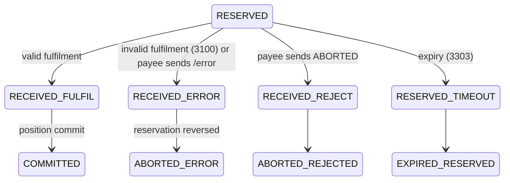

# T6 – Fulfilment: Successful Payment Completion

> **Phase 3 · How the switch works** · Time box: 5–6 h · Prerequisite: [T5](09-topic-05-transfers.md) · Next: [M7 – Trace a transaction](11-milestone-07-trace-transaction.md)
> Reference reading: [07 §3 steps 9–11](../07-payment-transaction-lifecycle.md#step-9--fulfil), [08 §8.4–§8.5](../08-fspiop-protocol-and-apis.md#84-transfer-fulfilment)
> Internals checked against **central-ledger v19.4.4** `src/handlers/transfers/handler.js` and `seeds/transferState.js`.

---

## Why this matters to a solution architect

Fulfilment is the moment of **finality**. After it, the payment cannot be undone through the switch. A bank's risk and legal teams will ask when the bank becomes liable, when it may release funds to the payee, and what happens if a message is lost or wrong at this exact moment. Your answers come from this module.

## Learning objectives

1. Explain what the payee FSP must do before sending the fulfilment.
2. Compare the two payee response modes, `COMMITTED` and `RESERVED` (+ `PATCH`), and when to use each.
3. List the fulfil handler's validations and the state path for each failure.
4. Trigger an invalid fulfilment and prove that positions are restored.
5. Write a finality and timeout policy (D9b).

---

## Core concepts

### 1. Payee FSP duties before fulfilling

1. Check that the `POST /transfers` matches the quote it issued: same `transactionId`/`transferId`, amount, `ilpPacket`, `condition`, and that the quote has not expired.
2. Check that the payee account can still receive (status, limits).
3. **Credit** the payee, or credit provisionally.
4. Reveal the fulfilment: `PUT /transfers/{id}` `{ fulfilment, completedTimestamp, transferState }`.

### 2. Two response modes

| Mode | Payee sends | Payee releases funds to customer | Switch then sends to payee | Use when |
| --- | --- | --- | --- | --- |
| **COMMITTED** | `transferState: COMMITTED` | Immediately (already credited) | A `PUT` confirmation if `SEND_TRANSFER_CONFIRMATION_TO_PAYEE` (upstream default `true`) | Real-time ledgers that can reverse a credit if the switch aborts |
| **RESERVED** | `transferState: RESERVED` | Only after the switch's **`PATCH /transfers/{id}`** with the final state | `PATCH` with `COMMITTED` or `ABORTED` | Banks that must not release funds until the scheme confirms |

### 3. What the fulfil handler checks, and what happens

| Check | Failure path (internal states) | Who is told |
| --- | --- | --- |
| `FSPIOP-Source` = transfer's payee FSP and `FSPIOP-Destination` = payer FSP | `ABORT_VALIDATION` → payer's reservation reversed | Payer: error callback. Payee: `PATCH … ABORTED` if it sent `RESERVED`. |
| `SHA-256(fulfilment) == condition` | **Verified in the lab:** `RESERVED → RECEIVED_ERROR` (error **3100** "Generic validation error - invalid fulfilment", stored in `transferError`) `→ ABORTED_ERROR`; payer's reservation reversed | Payer: error callback 3100. Payee: `PATCH ABORTED` if it sent `RESERVED`. |
| Transfer not expired | Expired → **3303** | Payee gets an error; payer was or will be notified by the timeout handler |
| Transfer state is still reservable (not already final) | Duplicate fulfil → **re-sent** final state (`FULFIL_DUPLICATE`), no double commit | Requester |
| Payee rejects: `transferState: ABORTED` | `RECEIVED_REJECT` → `ABORTED_REJECTED` | Payer: callback with ABORTED |
| Payee error: `PUT /transfers/{id}/error` | `RECEIVED_ERROR` → `ABORTED_ERROR` | Payer: error callback |
| All valid | `RECEIVED_FULFIL` → position commit (payee −amount) → `COMMITTED`; assigned to the open settlement window (`transferFulfilment.settlementWindowId`) | Payer: `PUT … COMMITTED`. Payee: `PATCH` (if `RESERVED`) or a `PUT` confirmation. |

The header check is visible in the upstream code: *"FSPIOP-Source does not match payee fsp on the Fulfil callback response"* → `ABORT_VALIDATION` → a position-handler message keyed by the payer's account, plus a `RESERVED_ABORTED` notification to the payee if it asked for one.



The invalid-fulfilment, success and expiry paths above were observed in the harness (central-ledger v19.4.4). The header-mismatch and payee-`ABORTED` paths come from the upstream code and tests.

### 4. Finality, in one sentence for a bank

> "A transfer is final when the switch commits it after verifying the payee's fulfilment. From then on it can only be compensated by a new payment (a refund), never reversed through the switch."

---

## Lab T6 – Success, invalid fulfilment, status

**1 – Read a successful fulfilment.** For your M6 transfer:

```bash
docker exec mysql mysql -uroot -D central_ledger -e "SELECT transferId, ilpFulfilment, isValid, settlementWindowId, completedDate FROM transferFulfilment WHERE transferId='<transferId>';"
```

Verify that `SHA-256(ilpFulfilment)` equals the transfer's `ilpCondition` (from the `transfer` table), with the same Node one-liner as in M2. (Verified: they match. The fulfilment row also shows `isValid = 1` and `settlementWindowId = 1`.)

**2 – Trigger an invalid fulfilment.** The TTK's simulated payee has a rule: for `POST /transfers` with amount **15** it answers with a fulfilment that does **not** match the condition ([rules_callback/default.json](../../../docker/ml-testing-toolkit/spec_files/rules_callback/default.json), rule "Post /transfers - invalid fulfilment").
- Record Bank A's and Wallet B's positions.
- In the TTK UI, duplicate your Bank A → Wallet B test case. Change the quote amount to `15` (with `amountType RECEIVE` and fee 0, the transfer amount is also 15) and run it.
- Expected (consistent with the golden-path test [payee_invalid_fulfillment.json](../../../docker/ml-testing-toolkit/test-cases/collections/tests/golden_path/feature_tests/transfer_negative_scenarios/payee_invalid_fulfillment.json)): the payer gets an **error callback with 3100** ("invalid fulfilment"); `GET /transfers/{id}` reports **ABORTED**; both positions equal the values you recorded.

```bash
docker exec mysql mysql -uroot -D central_ledger -e "SELECT tsc.transferStateId, tsc.reason, te.errorCode, te.errorDescription, tsc.createdDate FROM transferStateChange tsc LEFT JOIN transferError te ON te.transferStateChangeId=tsc.transferStateChangeId WHERE tsc.transferId='<invalid-transferId>' ORDER BY tsc.transferStateChangeId;"
```

Verified result (Bank A → Wallet B, amount 15):

```text
transferStateId   reason                                          errorCode
RECEIVED_PREPARE  NULL                                            NULL
RESERVED          NULL                                            NULL
RECEIVED_ERROR    Generic validation error - invalid fulfilment   3100
ABORTED_ERROR     NULL                                            NULL
```

Bank A's position went up by 15 at `RESERVED` and was back to its earlier value after `ABORTED_ERROR`. Wallet B's never moved.

**3 – PATCH notifications (reading lab).** Open [patch_notification.json](../../../docker/ml-testing-toolkit/test-cases/collections/tests/golden_path/feature_tests/patch_notifications/patch_notification.json) and the TTK rules for amounts `101`–`104` with payee `ttkpayeefsp`. Explain the two test cases: "payee receives PATCH with COMMITTED after sending RESERVED" and "payee receives PATCH with ABORTED after sending invalid fulfilment". (Running them requires the golden-path provisioning, `--profile ttk-provisioning-gp`, on a fresh stack.)

**4 – Duplicate fulfil (reading lab).** Open [fulfill_commit.json](../../../docker/ml-testing-toolkit/test-cases/collections/tests/golden_path/feature_tests/duplicate_handling/transfers/fulfill_commit.json) and explain why a duplicate identical fulfil returns `COMMITTED` again, while a modified one is rejected.

---

## Architect's lens

- **ADR to write: incoming credit timing** (`COMMITTED` vs `RESERVED` + `PATCH`). Inputs: the CBS's ability to reverse, the customer experience, scheme rules, regulator expectations. Most banks with batch-oriented cores choose `RESERVED`.
- **Liability moment:** the payer bank owes the scheme from commit; the payee bank owes its customer from when it credits. Align the credit moment with the response mode.
- **Lost fulfil response:** if the payee's `PUT` times out on its side, it must not assume failure. Query `GET /transfers/{id}`, and re-send the same fulfil if needed (duplicates are safe).
- **Monitoring:** invalid-fulfilment rate (an integration defect), `PATCH` delivery failures, payees that frequently time out.

---

## Checkpoint

<details><summary>1. A payee answers RESERVED. When may it release funds to the customer?</summary>
After it receives PATCH /transfers/{id} with transferState COMMITTED from the switch.
</details>

<details><summary>2. What happens to the payer's position when the fulfilment is invalid?</summary>
The reservation is reversed (states RECEIVED_ERROR → ABORTED_ERROR, error 3100); the position returns to its pre-transfer value.
</details>

<details><summary>3. Which error code does the harness expect for an invalid fulfilment?</summary>
3100 (Generic validation error – invalid fulfilment).
</details>

<details><summary>4. The payee sends the same valid fulfilment twice. What happens?</summary>
No second commit; the switch recognises the duplicate and re-sends the final state (COMMITTED).
</details>

---

## Deliverable D9b – Finality and timeout policy

For Bank A as payee and as payer: response mode (ADR-002), credit and release rules, expiration values, behaviour on lost messages, reversal policy (refund as a new payment), and the monitoring and alerts required.

Next: [M7 – Trace the transaction through the microservices](11-milestone-07-trace-transaction.md).
