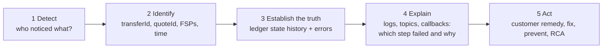

# M8 – Investigate a Failed Transaction

> **Phase 3 · How the switch works (operations)** · Time box: 5–6 h · Prerequisite: [M7](11-milestone-07-trace-transaction.md) · Next: [T7 – FSP Adapter](13-topic-07-fsp-adapter.md)
> Reference reading: [14 §5–§6](../14-testing-and-troubleshooting.md#5-practical-test-scenarios), [templates/adr-and-rca-templates.md](templates/adr-and-rca-templates.md)

---

## Why this matters to a solution architect

When a payment fails in production, the architect is called first. A customer says "money left my account but never arrived", or treasury sees an unexpected position. You need a repeatable method, the right evidence sources, and the judgement to separate **switch behaviour that worked as designed** from **integration defects** and **operational causes**.

## Learning objectives

1. Apply a five-step investigation method to a failed transfer.
2. Reproduce a "destination FSP unavailable" incident and prove that the scheme protected both banks.
3. Classify failures by origin: payer side, switch control, payee side, infrastructure.
4. Write a root-cause analysis (RCA) with corrective and preventive actions.

---

## The investigation method



**Rule:** always start from the **ledger** (`transferStateChange` + `transferError`). It tells you the final truth: COMMITTED means money obligations exist; any ABORTED or EXPIRED state means none remain. Only then explain *why* from logs and messages.

## Failure classification cheat-sheet

| Symptom / code | Origin | Typical cause | Money effect at hub |
| --- | --- | --- | --- |
| HTTP 400 / 406 on send | Payer integration | Missing header, schema, version | None |
| **3204** party not found | Directory | Alias not registered or deregistered | None |
| **3106** modified request | Payer integration | ID reused with a different body | None |
| **4001 / 4200** | Switch control (liquidity / NDC) | Payer FSP out of headroom | None (rejected) |
| **3100** invalid fulfilment | Payee integration | Wrong fulfilment or condition handling | Reservation reversed |
| **3303** transfer expired | Payee slow or unavailable, or expiry too short | Timeout | Reservation reversed |
| **5xxx** payee rejection | Payee business decision | Account closed, limit, currency | None / reversed |
| No callback, no error | Infrastructure or callback URL | Unreachable endpoint, consumer lag | Check the ledger state first |

---

## Lab M8 – Incident: "Payment to Wallet B never completed"

### Scenario

At 10:02, Bank A's customer reports a payment that is stuck "pending" and then failed. Wallet B says it never received anything. You will **reproduce** it with the TTK rule "Post /transfers No callback" (amount **16**: the simulated payee never answers), using a short expiration like the golden-path test [payer_transfer_timeout.json](../../../docker/ml-testing-toolkit/test-cases/collections/tests/golden_path/feature_tests/transfer_negative_scenarios/payer_transfer_timeout.json).

### Reproduce

1. Record Bank A's and Wallet B's positions:

```bash
docker exec central-ledger wget -qO- http://127.0.0.1:3001/participants/banka/positions
```

2. In the TTK UI, create a test case with a single `POST /transfers` (FSPIOP 1.1) **as Bank A to Wallet B**, modelled on `payer_transfer_timeout.json`:
   - Headers: `FSPIOP-Source: banka`, `FSPIOP-Destination: walletb`, versioned `Accept` / `Content-Type`, `Date`.
   - Body: `transferId` = `{$function.generic.generateID}`, `payerFsp: banka`, `payeeFsp: walletb`, `amount: {"amount":"16","currency":"XXX"}`, `ilpPacket: {$inputs.ilpPacket}`, `condition: {$inputs.validCondition}`, `expiration: {$requestVariables.transferExpiration}`.
   - Pre-request script, **exactly as in the golden-path test (2 seconds)**. The test listens for the 3303 callbacks for only about 15 s (TTK `CALLBACK_TIMEOUT: 15000`), so a longer expiry makes the assertions fail even though the switch behaves correctly:

```javascript
requestVariables.transferExpiration = new Date(new Date().getTime() + 2000).toISOString()
```

   The switch does not require a prior quote; it only validates the condition format. The amount **must be `16`**, though. With any other amount the TTK's simulated Wallet B answers **3208** "Transfer ID not found", because it only fulfils transfers it has quoted (`TRANSFERS_VALIDATION_WITH_PREVIOUS_QUOTES: true` in [user_config.json](../../../docker/ml-testing-toolkit/spec_files/user_config.json)). That gives a different failure: `RECEIVED_ERROR → ABORTED_ERROR`.

   **Shortcut that was verified:** instead of building the request by hand, copy `payer_transfer_timeout.json` to your lab folder, change the transfer body's amount from `"105"` to `"16"`, and run it with an environment whose inputs are `fromFspId=banka` and `NORESPONSE_SIMPAYEE_NAME=walletb` (see the CLI method in [M5/M6](04-milestones-05-06-two-fis-first-payment.md)). All 9 assertions passed in testing.
3. Run it. The immediate response is `202`. The switch expires the transfer shortly after the 2-second expiry. In testing, the 3303 callbacks arrived within about 2 seconds.

### Investigate (fill the RCA timeline as you go)

**Step 3 – Establish the truth (ledger):**

```bash
docker exec mysql mysql -uroot -D central_ledger -e "SELECT tsc.transferStateId, tsc.reason, te.errorCode, te.errorDescription, tsc.createdDate FROM transferStateChange tsc LEFT JOIN transferError te ON te.transferStateChangeId=tsc.transferStateChangeId WHERE tsc.transferId='<transferId>' ORDER BY tsc.transferStateChangeId;"
```

Verified result:

```text
transferStateId    reason                                    errorCode
RECEIVED_PREPARE   NULL                                      NULL
RESERVED           NULL                                      NULL
RESERVED_TIMEOUT   Marked for expiration by Timeout Handler  3303
EXPIRED_RESERVED   Transfer expired                          NULL
```

(In testing, `RESERVED` carried a `createdDate` one second *earlier* than `RECEIVED_PREPARE`. Rows are written by different handlers, so never rely on second-level timestamps for ordering: use `transferStateChangeId`.)

**Step 4 – Explain (logs, topics, callbacks):**
- TTK monitor: Bank A received `PUT /transfers/<id>/error` with **3303**, and Wallet B (the TTK) also received a **3303** error (the golden-path test asserts both).
- `docker logs ml-api-adapter 2>&1 | Select-String <transferId>`: the prepare was delivered to Wallet B's endpoint. The payee simply never answered.
- `docker logs central-ledger 2>&1 | Select-String <transferId>`: timeout handler activity.
- Positions: Bank A's position equals the value recorded before → **no financial impact**.

**Step 5 – Act:** customer remedy (Bank A releases the hold and informs the customer); a question to Wallet B (why no response?); scheme monitoring (payee timeout rate per FSP).

### Variations (optional, each 20–30 min)

| Variation | How | Expected evidence |
| --- | --- | --- |
| NDC breach | Repeat [T2 lab step 3](06-topic-02-central-ledger.md#lab-t2--read-the-ledger) | **Verified:** `RECEIVED_PREPARE → ABORTED_REJECTED` (reason "Payer limit error", no `transferError` row), payer callback **4200**, no position change |
| Invalid fulfilment | Amount **15** ([T6 lab](10-topic-06-fulfilment.md#lab-t6--success-invalid-fulfilment-status)) | **Verified:** `RECEIVED_ERROR` (3100) `→ ABORTED_ERROR`, positions restored |
| Unknown beneficiary | Look up a deregistered MSISDN ([T3 lab step 5](07-topic-03-account-lookup.md#lab-t3--register-resolve-deregister)) | **Verified:** **3204** (then a 3300 "Generic expired error"), no quote or transfer |
| Duplicate with changed body | Re-send a request with the same ID and another amount | **Verified for quotes:** **3106** "duplicate but hashes don't match" ([T4](08-topic-04-quoting.md)) |
| Infrastructure | `docker stop quoting-service-handler`, send a quote, observe (no callback, growing lag in `kafka-consumer-groups.sh --describe --group group-quotes-handler-post`), then `docker start quoting-service-handler` and watch the backlog drain | **Verified:** `POST /quotes` still returned 202; lag rose to 1; after restart the callback reached Bank A about 13 s later and lag returned to 0 |

---

## Architect's lens

- **"Money left my account but never arrived"** is almost always a payer-side hold that was never released after an abort, or a payee that credited late. The switch's state history settles the dispute. Design the bank's reconciliation to compare against it daily.
- **Controls worked as designed** in every variation above: no failure created an unbalanced obligation. That is the core trust message for a bank's risk committee.
- **Operational requirements that come from M8:** alerting on 3303 rates per payee FSP, on 4001/4200 per payer (liquidity), and on consumer lag; runbooks for each failure class; and a customer-communication script.
- **Design feedback:** expiry values, retry and status-query rules, idempotency enforcement, and payee latency budgets all go back into D9a/D9b and the solution design.

---

## Checkpoint

<details><summary>1. A transfer shows EXPIRED_RESERVED. Does the payer bank owe anything?</summary>
No. The reservation was reversed; the payer's position returned to its previous value. The payer bank must release the customer's hold.
</details>

<details><summary>2. Where do you look first in any failure investigation, and why?</summary>
The ledger's transferStateChange (and transferError), because it is the authoritative record of the outcome; logs explain why but do not decide what happened.
</details>

<details><summary>3. Which two parties receive a 3303 when a reserved transfer expires?</summary>
The payer FSP and the payee FSP.
</details>

---

## Deliverable D11 – Incident RCA

Complete the RCA template in [templates/adr-and-rca-templates.md](templates/adr-and-rca-templates.md) for the "never completed" incident: timeline with evidence, root cause (payee unavailable), why the controls worked, customer remedy, corrective and preventive actions, and lessons for the integration design.

Next: [T7 – FSP Adapter](13-topic-07-fsp-adapter.md).
