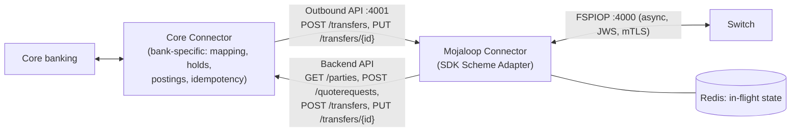
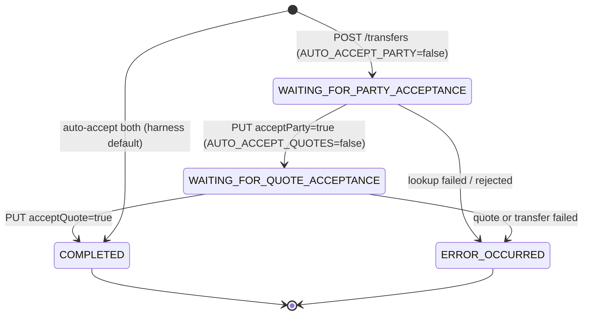

# T7 – FSP Adapter: Integration with Core Banking Systems

> **Phase 4 · Integration** · Time box: 6–8 h · Prerequisite: [M8](12-milestone-08-investigate-failure.md) · Next: [M9 – Build a simple FSP integration](14-milestone-09-build-fsp-integration.md)
> Reference reading: [12 – Adapter development](../12-adapter-development.md), [11 §1–§5](../11-fsp-integration-guide.md)
> Adapter used: **sdk-scheme-adapter v24.7.0** (Mojaloop Connector), configured by [envs/*-sdk.env](../../../envs/).

---

## Why this matters to a solution architect

The adapter is where **you** will spend most of a bank project. The switch is shared and already works; the bank's connection to it is new, bank-specific, and owned by your team. Choosing the adapter approach and drawing its boundaries correctly is the single most consequential integration decision (ADR-001).

## Learning objectives

1. Explain why an adapter is needed and what it must handle (async ↔ sync, correlation, ILP, JWS/mTLS, mapping, idempotency, recovery).
2. Describe the SDK Scheme Adapter's three interfaces and its outbound transfer state machine.
3. Classify the SDK's configuration into connectivity, security, behaviour and timeouts.
4. Run a **zero-code integration**: drive real FSP-to-FSP payments through two SDK connectors with nothing but HTTP calls.
5. Decide between the SDK, direct FSPIOP and a packaged product (ADR-001).

---

## Core concepts

### 1. The two-connector pattern



- The **Mojaloop Connector** (SDK) is generic: protocol, crypto, correlation, retries.
- The **Core Connector** is the bank's code: business rules and core-banking calls. M9 has you build a simple one.

### 2. SDK interfaces (ports from the harness env files)

| Port | Interface | Direction | Purpose |
| --- | --- | --- | --- |
| 4000 | Inbound FSPIOP server | Switch → SDK | Receives `GET /parties`, `POST /quotes`, `POST /transfers`, all callbacks |
| 4001 | **Outbound API** | Bank → SDK | One synchronous call per payment; the SDK runs discovery → quote → transfer |
| 4002 | Test API | Test tools → SDK | Cached requests and callbacks for testing (`ENABLE_TEST_FEATURES=true`) |
| (bank) | **Backend API** | SDK → Bank | The bank answers parties, quotes and transfers synchronously |

### 3. Outbound transfer state machine (SDK v2.1 outbound spec)



(`WAITING_FOR_CONVERSION_ACCEPTANCE` is an additional stop for FX.)

### 4. Configuration, classified ([envs/payerfsp-sdk.env](../../../envs/payerfsp-sdk.env))

| Class | Settings | Harness value → production recommendation |
| --- | --- | --- |
| Identity | `DFSP_ID` | FSP id as registered at the hub |
| Switch connectivity | `ALS_ENDPOINT`, `QUOTES_ENDPOINT`, `TRANSFERS_ENDPOINT`, `FX_*`, `PEER_ENDPOINT` | Container names → scheme gateway URLs |
| Bank connectivity | `BACKEND_ENDPOINT` | TTK `/backend` → your Core Connector |
| State | `CACHE_URL` | Dedicated Redis → HA Redis |
| Security | `INBOUND/OUTBOUND_MUTUAL_TLS_ENABLED`, `*_CERT_PATH`, `JWS_SIGN`, `VALIDATE_INBOUND_JWS`, `JWS_SIGNING_KEY_PATH`, `ILP_SECRET` | Off / sample values → **on**, bank-owned keys, secrets from a vault |
| Behaviour | `AUTO_ACCEPT_PARTY`, `AUTO_ACCEPT_QUOTES`, `ALLOW_TRANSFER_WITHOUT_QUOTE`, `CHECK_ILP`, `RESERVE_NOTIFICATION`, `RESOURCE_VERSIONS`, `API_TYPE` | `true` for automation → `false` for customer consent; versions per scheme |
| Timeouts and expiry | `EXPIRY_SECONDS=60`, `REQUEST_PROCESSING_TIMEOUT_SECONDS=30`, `REJECT_EXPIRED_*` | Align with the scheme and your CBS latency |
| Test-only | `ENABLE_TEST_FEATURES`, `ENABLE_OAUTH_TOKEN_ENDPOINT`, `WSO2_BEARER_TOKEN` | Disable or replace |

---

## Lab T7 – A zero-code integration through two connectors

You need the **golden-path onboarding**, where `testfsp1`–`testfsp4` are real participants whose callbacks go to their SDK connectors. Start a fresh stack (this deletes this project's volumes only):

```bash
docker compose --profile all-services --profile ttk-provisioning --profile ttk-tests down -v
```

```bash
docker compose --profile all-services --profile ttk-provisioning-gp up -d
```

Wait for `ttk-provisioning-gp` to exit with code 0 (`docker compose logs -f ttk-provisioning-gp`). It onboards `testfsp1` (MSISDN `17039811903`) and `testfsp2` (MSISDN `17039811904`), funds them, and registers their numbers. Both SDKs use the TTK as their backend. Verified: **460/460 assertions** (455 requests, 49 test cases) in about 4 minutes, after about 4.5 minutes of start-up. Note that golden-path FSPs get a much smaller XXX NDC (**10,000**) and funds-in (**5,000**) than the standard onboarding.

**1 – Is the connector up?**

```bash
docker run --rm --network mojaloop-net curlimages/curl:8.10.1 -s -i "http://testfsp1-sdk:4001/"
```

**2 – Party lookup through the connector (one synchronous call)**

```bash
docker run --rm --network mojaloop-net curlimages/curl:8.10.1 -s "http://testfsp1-sdk:4001/parties/MSISDN/17039811904"
```

Expected: JSON with the party (from testfsp2's backend, the TTK) and `currentState`. Behind that one call, the SDK sent FSPIOP `GET /parties`, waited for the `PUT /parties` callback and correlated it in Redis. Verified response shape: `{"party": {"body": {partyIdInfo: {fspId: "testfsp2", …}, name, personalInfo, …}, "headers": {…}}, "currentState": …}`. The SDK hands you the FSPIOP callback's body **and headers**. Those echoed headers include the connector's `Authorization` bearer token (the sample value from `envs/*-sdk.env`): a reminder to never log raw connector responses in production and to keep tokens out of env files.

**3 – A complete payment testfsp1 → testfsp2 (one synchronous call).** Save as `..\my-lab\sdk-transfer.json`:

```json
{
  "homeTransactionId": "LAB-T7-0001",
  "from": { "type": "CONSUMER", "idType": "MSISDN", "idValue": "17039811903", "displayName": "Lab Payer", "fspId": "testfsp1" },
  "to":   { "type": "CONSUMER", "idType": "MSISDN", "idValue": "17039811904" },
  "amountType": "SEND",
  "currency": "XXX",
  "amount": "10",
  "transactionType": "TRANSFER",
  "note": "T7 zero-code integration"
}
```

```powershell
docker run --rm --network mojaloop-net -v "$((Resolve-Path ..\my-lab).Path):/data" curlimages/curl:8.10.1 -s -X POST "http://testfsp1-sdk:4001/transfers" -H "Content-Type: application/json" -d "@/data/sdk-transfer.json"
```

Expected: `currentState: "COMPLETED"` with `getPartiesResponse`, `quoteResponse` and `fulfil` (`transferState: COMMITTED`), because the harness sets `AUTO_ACCEPT_PARTY=true` and `AUTO_ACCEPT_QUOTES=true`. If you get `ERROR_OCCURRED`, read `lastError` and the logs of `testfsp1-sdk` and `testfsp2-sdk`. Verified: `COMPLETED` in about 10 s, with a ULID `transferId`, quote `10 XXX` and fulfil `COMMITTED`. Response keys include `getPartiesRequest/Response`, `quoteRequest/Response`, `prepare` and `fulfil`. The end-to-end time through two SDKs (~9 s) is far above the TTK-only path (~0.8 s, see [T5](09-topic-05-transfers.md)): expect connector latency in your NFRs.

**4 – See what the connectors did**

```bash
docker logs testfsp1-sdk 2>&1 | Select-String "LAB-T7-0001|transferId"
```

```bash
docker logs testfsp2-sdk 2>&1 | Select-String "quoterequests|/transfers"
```

In the TTK monitor you will see testfsp2's **backend** calls (`/backend/parties/…`, `/backend/quoterequests`, `/backend/transfers`): that is the "core banking" side of the integration. Verified sequence: `GET /backend/parties/MSISDN/17039811904`, `POST /backend/quoterequests`, `POST /backend/transfers`.

**5 – Ledger check:** query `transferStateChange` for the `transferId` returned in step 3 (as in T2). It ends in `COMMITTED`.

---

## Architect's lens

**ADR-001: integration option**

| Criterion | SDK Scheme Adapter | Direct FSPIOP | Packaged product (e.g. PM4ML) |
| --- | --- | --- | --- |
| Build effort | Low–medium (Core Connector only) | High | Low (configuration) |
| Protocol risk | Low (maintained by Mojaloop) | High (async, ILP, JWS) | Low |
| Control and flexibility | Medium | High | Lower |
| Operational footprint | SDK + Redis | Own services | Product stack |
| Best for | Most banks and wallets | Large FSPs with strong engineering and special needs | FSPs wanting a managed path |

**Boundary rule:** keep scheme protocol concerns in the Mojaloop Connector and business and core-banking concerns in the Core Connector. Don't put fee logic in the SDK, and don't put ILP or JWS in the core.

**Questions to settle early:** where the connector is hosted (DMZ), who operates its Redis, how keys reach it, how the bank's API gateway exposes inbound callbacks, and the latency budget for backend calls.

---

## Checkpoint

<details><summary>1. In the zero-code payment, which component generated the ILP condition?</summary>
testfsp2's SDK (payee side), when answering the quote; testfsp2's backend (TTK) only supplied amounts and fees via POST /quoterequests.
</details>

<details><summary>2. What makes the outbound POST /transfers return COMPLETED in one call?</summary>
AUTO_ACCEPT_PARTY=true and AUTO_ACCEPT_QUOTES=true: the SDK doesn't stop for party or quote confirmation.
</details>

<details><summary>3. Name four settings you must change before production.</summary>
For example: enable mTLS (INBOUND/OUTBOUND_MUTUAL_TLS_ENABLED), JWS signing and validation, replace ILP_SECRET with a bank secret from a vault, point BACKEND_ENDPOINT at the Core Connector, disable ENABLE_TEST_FEATURES, set auto-accept to false.
</details>

---

## Deliverable D12 – Adapter design

Using [templates/solution-design-template.md](templates/solution-design-template.md) sections 2–4: the component diagram (Core Connector + SDK), interface list, configuration table with production values, the ADR-001 decision, and the boundary rules.

Next: [M9 – Build a simple FSP integration](14-milestone-09-build-fsp-integration.md).
