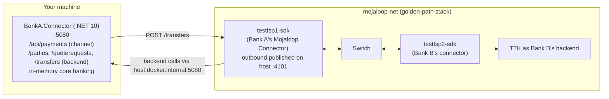

# M9 – Build a Simple FSP Integration

> **Phase 4 · Integration** · Time box: 10–14 h · Prerequisite: [T7](13-topic-07-fsp-adapter.md) (golden-path stack running) · Next: [M10 – Connect a real banking system](15-milestone-10-connect-real-bank.md)
> Reference reading: [11 §4–§8](../11-fsp-integration-guide.md#4-bank-a-as-payer-outgoing-payment)
> **Status of the code below: verified.** Built with the .NET SDK 10.0.403 (0 warnings, 0 errors) and run against the golden-path stack on 2026-11-04. All steps and failure tests F1–F6 below passed. Verification led to three fixes, already included here, and each is a design lesson:
> 1. On errors the SDK returns **HTTP 500 with the state nested** in `transferState` (`{"message": …, "transferState": {"currentState": "ERROR_OCCURRED", …}}`), not at the top level.
> 2. Release the hold only if nothing was sent (`prepare` absent) **or** an FSPIOP error callback was received (`lastError.mojaloopError`). Otherwise the outcome is **UNKNOWN**: an NDC breach (4200) arrives *after* the transfer is sent, yet is final.
> 3. Backend errors must carry an **FSPIOP-mappable body** `{"statusCode":"3204","message":…}`. A bare `404` is turned into `2001 Internal server error` for the other bank.

---

## Why this matters to a solution architect

Building the smallest possible working connector yourself is what turns your designs from plausible into proven. It forces every abstract decision (holds, idempotency, unknown outcomes, payee crediting) into code you can test against a real switch, and it gives you credibility with the bank's engineers.

## Learning objectives

1. Build a **Core Connector** for "Bank A" (played by participant `testfsp1`) in .NET 10, with:
   - a channel API for sending money (outbound, via the SDK Outbound API),
   - the SDK Backend API for receiving money (inbound),
   - an in-memory core-banking simulator with balances and holds.
2. Plug it into the running switch **without modifying the repository**, using a compose override file.
3. Prove the success paths and five failure paths with evidence.

---

## Target setup



| Party | Participant | MSISDN | Backend |
| --- | --- | --- | --- |
| Bank A (you) | `testfsp1` | `17039811903` | **Your app** |
| Bank B | `testfsp2` | `17039811904` | TTK |

---

## Step 1 – Wire the connector to your app (override file, outside the repo)

Create `..\my-lab\docker-compose.banka.yml`:

```yaml
services:
  testfsp1-sdk:
    ports:
      - "4101:4001"                                    # SDK Outbound API reachable from your host
    environment:
      - BACKEND_ENDPOINT=host.docker.internal:5080     # SDK calls your app as Bank A's backend
    extra_hosts:
      - "host.docker.internal:host-gateway"
```

Apply it (the golden-path stack from T7 must be running; only `testfsp1-sdk` is recreated):

```powershell
docker compose -f docker-compose.yml -f ..\my-lab\docker-compose.banka.yml --profile all-services --profile ttk-provisioning-gp up -d testfsp1-sdk
```

`environment:` overrides the same keys from the service's `env_file`, so the repository's `envs/testfsp1-sdk.env` is untouched.

## Step 2 – Create the project (outside the repo)

```powershell
dotnet new web -n BankA.Connector -o ..\my-lab\BankA.Connector --framework net10.0
```

Add to `appsettings.json`:

```json
{
  "Urls": "http://0.0.0.0:5080",
  "Mojaloop": { "FspId": "testfsp1", "SdkOutboundBaseUrl": "http://localhost:4101/" },
  "Logging": { "LogLevel": { "Default": "Information" } }
}
```

## Step 3 – Replace `Program.cs`

```csharp
// BankA.Connector – a minimal Core Connector for learning purposes (not production code).
using System.Collections.Concurrent;
using System.Globalization;
using System.Text.Json;
using System.Text.Json.Nodes;

var builder = WebApplication.CreateBuilder(args);
builder.Services.AddHttpClient("sdk", c =>
{
    c.BaseAddress = new Uri(builder.Configuration["Mojaloop:SdkOutboundBaseUrl"]!);
    c.Timeout = TimeSpan.FromSeconds(45);   // a little above the SDK's REQUEST_PROCESSING_TIMEOUT_SECONDS (30)
});
var app = builder.Build();

var fspId = app.Configuration["Mojaloop:FspId"]!;
var bank = new CoreBankingSimulator();
bank.Open("17039811903", "Ayesha", "Rahman", 1_000m);                 // Bank A's customer
var outbound = new ConcurrentDictionary<string, OutboundPayment>();   // key = channel Idempotency-Key

// ───────────── Channel API: a Bank A customer sends money ─────────────
app.MapPost("/api/payments", async (PaymentRequest req, HttpRequest http, IHttpClientFactory factory, ILogger<Program> log) =>
{
    var key = http.Headers["Idempotency-Key"].FirstOrDefault();
    if (string.IsNullOrWhiteSpace(key)) return Results.BadRequest(new { error = "Idempotency-Key header is required" });
    if (outbound.TryGetValue(key, out var existing)) return Results.Ok(existing);           // replay → same answer

    var homeTxId = $"BANKA-OUT-{Guid.NewGuid():N}";
    if (!bank.TryHold(req.FromMsisdn, req.Amount, homeTxId))
        return Results.UnprocessableEntity(new { error = "Insufficient funds or unknown account" });

    var payment = new OutboundPayment(key, homeTxId, req, "SENT", null, null);
    outbound[key] = payment;                                                                // persist BEFORE calling out

    var body = new
    {
        homeTransactionId = homeTxId,
        from = new { type = "CONSUMER", idType = "MSISDN", idValue = req.FromMsisdn, displayName = bank.NameOf(req.FromMsisdn), fspId },
        to = new { type = "CONSUMER", idType = "MSISDN", idValue = req.ToMsisdn },
        amountType = "SEND",
        currency = req.Currency,
        amount = req.Amount.ToString("0.####", CultureInfo.InvariantCulture),               // ≤ 4 decimals
        transactionType = "TRANSFER",
        note = req.Note
    };

    try
    {
        using var resp = await factory.CreateClient("sdk").PostAsJsonAsync("transfers", body);
        var json = JsonNode.Parse(await resp.Content.ReadAsStringAsync());
        // Success: HTTP 200 with the transfer state at the top level.
        // Error:   HTTP 500 with { "message": "...", "transferState": { "currentState": "ERROR_OCCURRED", ... } }.
        var ts = json?["transferState"] ?? json;
        var state = ts?["currentState"]?.GetValue<string>();
        var transferId = ts?["transferId"]?.GetValue<string>();
        var sentToSwitch = ts?["prepare"] is not null;                     // was POST /transfers already sent?
        var definitiveError = ts?["lastError"]?["mojaloopError"] is not null; // an FSPIOP error callback was received
        var error = json?["message"]?.GetValue<string>() ?? ts?["lastError"]?.ToJsonString();
        log.LogInformation("SDK {Status} state={State} transferId={TransferId} sent={Sent} fspiopError={Err} home={Home}",
            (int)resp.StatusCode, state, transferId, sentToSwitch, definitiveError, homeTxId);

        if (state == "COMPLETED")
        {
            bank.CaptureHold(homeTxId);
            payment = payment with { Status = "COMPLETED", TransferId = transferId };
        }
        else if (state == "ERROR_OCCURRED" && (!sentToSwitch || definitiveError))
        {
            // Nothing was sent, or the switch/payee answered with an FSPIOP error: the transfer cannot commit.
            bank.ReleaseHold(homeTxId);
            payment = payment with { Status = "FAILED", TransferId = transferId, Error = error };
        }
        else
        {
            // Sent but no definitive answer (e.g. timeout), or unreadable: the switch may still commit it.
            // Keep the hold and resolve via GET /transfers/{transferId} or reconciliation.
            payment = payment with { Status = "UNKNOWN", TransferId = transferId, Error = error };
        }
    }
    catch (Exception ex) when (ex is HttpRequestException or TaskCanceledException or JsonException)
    {
        // Unknown outcome (no answer or unreadable answer): keep the hold, do NOT retry with a new id;
        // reconcile via GET /transfers/{id}.
        log.LogWarning(ex, "Unknown outcome for {Home}", homeTxId);
        payment = payment with { Status = "UNKNOWN" };
    }

    outbound[key] = payment;
    return Results.Ok(payment);
});

app.MapGet("/api/accounts/{msisdn}", (string msisdn) =>
    bank.Find(msisdn) is { } a ? Results.Ok(a) : Results.NotFound());

// ───────────── SDK Backend API: Bank A receives money ─────────────
app.MapGet("/parties/{idType}/{idValue}", (string idType, string idValue) =>
    idType == "MSISDN" && bank.Find(idValue) is { } a
        ? Results.Ok(new { type = "CONSUMER", idType, idValue, displayName = $"{a.FirstName} {a.LastName[0]}.", firstName = a.FirstName, lastName = a.LastName, fspId })
        : Results.NotFound(new { statusCode = "3204", message = "Party not found" }));   // SDK maps statusCode to the FSPIOP error

app.MapPost("/quoterequests", (JsonElement q, ILogger<Program> log) =>
{
    var to = q.GetProperty("to").GetProperty("idValue").GetString()!;
    var currency = q.GetProperty("currency").GetString()!;
    var amount = q.GetProperty("amount").GetString()!;
    if (bank.Find(to) is null) return Results.NotFound(new { statusCode = "3204", message = "Payee account not found" });
    log.LogInformation("Quote {QuoteId} for {Amount} {Currency} to {To}", q.GetProperty("quoteId").GetString(), amount, currency, to);
    return Results.Ok(new
    {
        quoteId = q.GetProperty("quoteId").GetString(),
        transactionId = q.GetProperty("transactionId").GetString(),
        transferAmount = amount, transferAmountCurrency = currency,
        payeeReceiveAmount = amount, payeeReceiveAmountCurrency = currency,
        payeeFspFeeAmount = "0", payeeFspFeeAmountCurrency = currency,
        expiration = DateTime.UtcNow.AddSeconds(60).ToString("yyyy-MM-ddTHH:mm:ss.fffZ", CultureInfo.InvariantCulture)
    });
});

app.MapPost("/transfers", (JsonElement t, ILogger<Program> log) =>
{
    var transferId = t.GetProperty("transferId").GetString()!;
    var to = t.GetProperty("to").GetProperty("idValue").GetString()!;
    var amount = decimal.Parse(t.GetProperty("amount").GetString()!, CultureInfo.InvariantCulture);
    var homeTxId = bank.CreditOnce(transferId, to, amount);          // idempotent on transferId
    log.LogInformation("Credited {Amount} to {To} for transfer {TransferId} → {Home}", amount, to, transferId, homeTxId);
    return Results.Ok(new { homeTransactionId = homeTxId, transferState = "COMMITTED" });
});

app.MapPut("/transfers/{transferId}", (string transferId, JsonElement notification, ILogger<Program> log) =>
{
    log.LogInformation("Notification for {TransferId}: {Body}", transferId, notification.GetRawText());
    return Results.Ok();
});

app.Run();

record PaymentRequest(string FromMsisdn, string ToMsisdn, decimal Amount, string Currency, string? Note);
record OutboundPayment(string IdempotencyKey, string HomeTransactionId, PaymentRequest Request, string Status, string? TransferId, string? Error);
record Account(string Msisdn, string FirstName, string LastName, decimal Balance, decimal Held);

sealed class CoreBankingSimulator
{
    private readonly ConcurrentDictionary<string, Account> _accounts = new();
    private readonly ConcurrentDictionary<string, (string Msisdn, decimal Amount)> _holds = new();
    private readonly ConcurrentDictionary<string, string> _credits = new();     // transferId → homeTransactionId
    private readonly object _gate = new();

    public void Open(string msisdn, string first, string last, decimal balance) => _accounts[msisdn] = new(msisdn, first, last, balance, 0m);
    public Account? Find(string msisdn) => _accounts.TryGetValue(msisdn, out var a) ? a : null;
    public string NameOf(string msisdn) => Find(msisdn) is { } a ? $"{a.FirstName} {a.LastName}" : msisdn;

    public bool TryHold(string msisdn, decimal amount, string reference)
    {
        lock (_gate)
        {
            if (Find(msisdn) is not { } a || a.Balance - a.Held < amount) return false;
            _accounts[msisdn] = a with { Held = a.Held + amount };
            _holds[reference] = (msisdn, amount);
            return true;
        }
    }

    public void CaptureHold(string reference)
    {
        lock (_gate)
        {
            if (!_holds.TryRemove(reference, out var h)) return;
            var a = _accounts[h.Msisdn];
            _accounts[h.Msisdn] = a with { Balance = a.Balance - h.Amount, Held = a.Held - h.Amount };
        }
    }

    public void ReleaseHold(string reference)
    {
        lock (_gate)
        {
            if (!_holds.TryRemove(reference, out var h)) return;
            var a = _accounts[h.Msisdn];
            _accounts[h.Msisdn] = a with { Held = a.Held - h.Amount };
        }
    }

    public string CreditOnce(string transferId, string msisdn, decimal amount)
    {
        lock (_gate)
        {
            if (_credits.TryGetValue(transferId, out var existing)) return existing;
            var a = _accounts[msisdn];
            _accounts[msisdn] = a with { Balance = a.Balance + amount };
            var home = $"BANKA-IN-{Guid.NewGuid():N}";
            _credits[transferId] = home;
            return home;
        }
    }
}
```

Run it:

```powershell
dotnet run --project ..\my-lab\BankA.Connector
```

If the SDK cannot reach your app, allow inbound TCP 5080 in the Windows firewall for Docker/WSL, and check `docker logs testfsp1-sdk`.

## Step 4 – Test the outbound path (Bank A pays Bank B)

```powershell
Invoke-RestMethod -Method Post http://localhost:5080/api/payments -Headers @{ "Idempotency-Key" = "pay-0001" } -ContentType "application/json" -Body '{"fromMsisdn":"17039811903","toMsisdn":"17039811904","amount":10,"currency":"XXX","note":"M9 outbound"}'
```

Expected (verified): `status: COMPLETED` with a ULID `transferId` in about 7–8 s. `GET http://localhost:5080/api/accounts/17039811903` shows a balance of 990 and `held` 0. Re-send with the same `Idempotency-Key`: the same answer and `transferId`, and **no second debit**.

## Step 5 – Test the inbound path (Bank B pays Bank A)

Save as `..\my-lab\inbound.json`:

```json
{
  "homeTransactionId": "BANKB-M9-0001",
  "from": { "type": "CONSUMER", "idType": "MSISDN", "idValue": "17039811904", "displayName": "Bank B customer", "fspId": "testfsp2" },
  "to":   { "type": "CONSUMER", "idType": "MSISDN", "idValue": "17039811903" },
  "amountType": "SEND", "currency": "XXX", "amount": "25", "transactionType": "TRANSFER", "note": "M9 inbound"
}
```

```powershell
docker run --rm --network mojaloop-net -v "$((Resolve-Path ..\my-lab).Path):/data" curlimages/curl:8.10.1 -s -X POST "http://testfsp2-sdk:4001/transfers" -H "Content-Type: application/json" -d "@/data/inbound.json"
```

Expected (verified): your app serves `GET /parties/MSISDN/17039811903`, then logs `Quote … for 25 XXX` and `Credited 25 … → BANKA-IN-…`. Bank B's SDK returns `COMPLETED` (fulfil `COMMITTED`), and Ayesha's balance rises by 25. No `PUT /transfers/{id}` notification arrived in testing, because the app answered `COMMITTED` directly.

## Step 6 – Failure tests (the important part)

| # | Test | How | Expected result | Evidence to record |
| --- | --- | --- | --- | --- |
| F1 | Customer has insufficient funds | Pay 5,000 | 422 from your app; nothing sent to the switch | App response |
| F2 | Unknown payee | Pay to `17039819999` | **Verified:** `FAILED`; hold released; error "Got an error response resolving party: … 3204 Party not found" | App response, SDK logs |
| F3 | Payer NDC breach | Lower `testfsp1`'s NDC (T2 lab step 3 with `testfsp1` instead of `banka`) and pay; restore it afterwards | **Verified:** `FAILED`, error "…preparing transfer: … 4200 Payer limit error"; hold released (this is the case that needs fix 2). Golden-path FSPs have an XXX NDC of **10,000**; restore to that. | App response, ledger state `ABORTED_REJECTED` |
| F4 | Connector down | `docker stop testfsp1-sdk`, pay, then `docker start testfsp1-sdk` | **Verified:** `UNKNOWN` after about 6 s; hold **kept** (`held` = amount). Decide how you would reconcile. | App logs |
| F5 | Inbound to an unknown account | First register `17039811999` to `testfsp1` in the directory (FSPIOP `POST /participants/MSISDN/17039811999` as `testfsp1`, see T3); otherwise ALS stops the lookup before your app is asked. Then send the inbound test to that number. | **Verified:** your app answers `GET /parties` with 404 + `statusCode 3204`; Bank B's SDK reports `ERROR_OCCURRED` with **3204 Party not found** (with a bare 404 it was **2001**); no credit | Both SDK logs |
| F6 | Duplicate inbound credit | Call your `POST /transfers` twice with the same `transferId` (e.g. with curl) | **Verified:** both calls return the same `homeTransactionId`; balance credited once | App logs |

## Stretch goals

1. Set `AUTO_ACCEPT_PARTY=false` and `AUTO_ACCEPT_QUOTES=false` in your override. Add `POST /api/payments/{key}/confirm-payee` and `/accept-quote` endpoints that call `PUT /transfers/{transferId}` with `{"acceptParty": true}` and `{"acceptQuote": true}` (the pattern used in [sdkSendE2E.js](../../../packages/k6-tests/scripts/sdkSendE2E.js)).
2. Replace the in-memory stores with SQLite or PostgreSQL, with unique indexes on the idempotency key and `transferId`.
3. Implement the `UNKNOWN` resolver: poll `GET http://localhost:4101/transfers/{transferId}` until it's final, then capture or release the hold.
4. Answer inbound with `transferState: "RESERVED"` and credit only on the final notification ([T6](10-topic-06-fulfilment.md) response modes).

## Clean-up

To return `testfsp1-sdk` to its original configuration:

```powershell
docker compose --profile all-services --profile ttk-provisioning-gp up -d --force-recreate testfsp1-sdk
```

---

## Architect's lens

- **The four rules you just coded:** persist before calling out; hold before sending; idempotency on both directions; never guess an unknown outcome. These rules go into every bank design.
- **What the prototype deliberately ignores:** customer authentication, AML screening, durable storage, GL postings, notifications, security (mTLS/JWS), scaling. List them as the gap between M9 and M10.
- **Estimation insight:** the integration logic is small. The effort in real projects is core-banking integration, security, testing, certification and operations.

---

## Checkpoint

<details><summary>1. Why does the app keep the hold when the outcome is UNKNOWN?</summary>
Because the switch may have committed the transfer; releasing the hold could let the customer spend money the bank already owes the scheme. Resolve via status query or reconciliation first.
</details>

<details><summary>2. What makes inbound crediting idempotent in the prototype?</summary>
CreditOnce keys credits by transferId and returns the original homeTransactionId for duplicates.
</details>

<details><summary>3. Which configuration change made testfsp1's connector call your app?</summary>
BACKEND_ENDPOINT=host.docker.internal:5080 in the compose override (overriding the env_file value).
</details>

---

## Deliverable D13 – Prototype and test evidence

Your source code (outside the repository), a README on running it, and a test-evidence table for the success paths and F1–F6: request, expected, actual, `transferId`, ledger state and balances.

Next: [M10 – Explore how to connect a real banking system](15-milestone-10-connect-real-bank.md).
