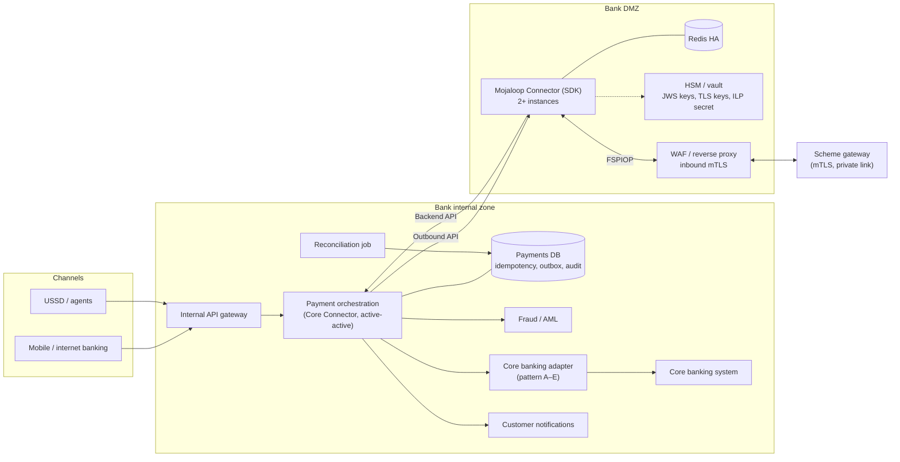
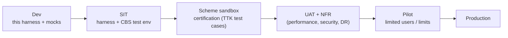

# M10 – Explore How to Connect a Real Banking System

> **Phase 4 · Integration** · Time box: 8–10 h · Prerequisite: [M9](14-milestone-09-build-fsp-integration.md) · Next: [T8 – Settlement](16-topic-08-settlement.md)
> Reference reading: [11](../11-fsp-integration-guide.md), [09 §3](../09-security-and-controls.md#3-how-a-bank-securely-connects-to-mojaloop), [15](../15-production-deployment.md)
> Most content here is **[RECOMMENDATION]**: architecture practice applied to Mojaloop's verified contracts.

---

## Why this matters to a solution architect

This is the job itself: take a real bank, with a real core banking system, its constraints, security rules and operating hours, and design a connection to the scheme that is safe, operable and certifiable. M9 proved the mechanics. M10 is about the constraints that turn a prototype into a production integration.

## Learning objectives

1. Run a discovery workshop with a bank, using a structured question set.
2. Choose a core-banking integration pattern, and understand its effect on payer and payee behaviour.
3. Design the production architecture: components, zones, HA, security, observability.
4. Experience, in the lab, how slow core banking creates reconciliation breaks, and design it out.
5. Produce the bank's Integration Solution Design (D14).

---

## Core concepts

### 1. From prototype to production: the gap

| Concern | M9 prototype | Production |
| --- | --- | --- |
| Customer authentication | None | Channel login, PIN/OTP, device binding (bank IAM) |
| Financial crime | None | AML/sanctions screening and fraud scoring, before the hold (payer) and before the credit (payee) |
| Storage | In memory | Durable DB with unique keys, an outbox, audit tables |
| Core banking | Simulator | Real holds and postings API, with timeouts and reversals |
| Accounting | Balance numbers | GL postings: customer ↔ clearing accounts ↔ settlement nostro |
| Unknown outcomes | Status `UNKNOWN` | Automatic resolver (status polling) plus daily reconciliation |
| Security | HTTP, no keys | mTLS, JWS, HSM-held keys, secrets vault, WAF, network zones |
| Availability | One process | Active-active Core Connector, HA Mojaloop Connector + Redis, DR |
| Observability | Console logs | Structured logs, metrics, traces, alerts, dashboards |
| Operations | You | L1–L3 support, runbooks, on-call, liquidity desk |

### 2. Core-banking integration patterns

| Pattern | Payer side (outgoing) | Payee side (incoming) | Risk |
| --- | --- | --- | --- |
| **A. Real-time API with holds** (preferred) | Hold → send → capture or release | Validate → credit → `COMMITTED` | Low |
| **B. Real-time API without holds** | Debit before send; **reverse** on abort | Credit → `COMMITTED`; reverse if the switch aborts | Reversal handling |
| **C. Message queue / ESB** | As A or B, with async correlation | As A or B | Correlation and timeouts |
| **D. Batch-oriented core** | Debit an intraday suspense GL; post to the core later | Answer `RESERVED`; credit provisionally (shadow ledger); post in batch | Shadow-ledger reconciliation |
| **E. ISO 8583 host** | Map to authorisation and financial messages | Same | Code mapping, field limits |

### 3. Production reference architecture

### 4. Environments and the certification path

Your harness work (M3–M9) is the **Dev** stage of a real project. The golden-path collections are the model for what a scheme certifies.

---

## Lab M10

### Part A – Discovery workshop (paper exercise, 2 h)

Use this **fictional fact sheet** for Bank A and answer each workshop question, marking what is known and what must be asked:

| Fact | Value |
| --- | --- |
| Core banking | Commercial core; SOAP posting API; REST "amount block" (hold) API with 200–800 ms latency |
| Batch window | 23:00–01:00 daily; postings queued, holds still allowed |
| Channels | Mobile app, internet banking, USSD |
| Volumes | 2 million customers; expected peak 50 payments per second |
| Identifiers wanted | MSISDN and account number |
| Hosting | On-premises DC + DR site; HSM available; mTLS mandatory; WAF in DMZ |
| Operations | 24×7 L1; L2 business hours |

**Workshop question set** (copy into your journal):

1. Can the core **hold** funds and later capture or release them by reference? Is it idempotent by reference?
2. Can the core **reverse** a credit automatically? Within what time?
3. What is the p95 / p99 latency of holds and postings, at peak and during batch?
4. Are the core and its posting APIs available 24×7? What happens during batch and maintenance?
5. Which GL accounts exist or are needed for clearing, suspense and settlement?
6. Who screens payments (AML, sanctions, fraud), at which step, and with what latency?
7. Which identifiers can be published? How is customer consent recorded?
8. What are the security standards for keys (HSM), TLS, network zones and logging of personal data?
9. What is the liquidity source for prefunding? Who approves top-ups? What are the treasury hours?
10. What monitoring and support model exists? Who owns incidents at 02:00?
11. What are the release and change processes, and the lead times for firewall and certificate changes?
12. What are the regulatory reporting duties for these payments?

### Part B – Failure-mode spike: slow core banking (2–3 h)

Using your M9 app, simulate a slow core on **incoming** payments:

1. In `MapPost("/transfers", …)`, add `await Task.Delay(TimeSpan.FromSeconds(75));` before crediting, and make the lambda `async`.
2. Send an inbound payment from Bank B (M9 step 5). The paying SDK's `EXPIRY_SECONDS` is `60` ([envs/testfsp2-sdk.env](../../../envs/testfsp2-sdk.env)).
3. Observe and record:
   - What Bank B's SDK returns, and the error code.
   - The ledger state history of the transfer (expected: expiry, **3303**).
   - Whether your app credited Ayesha anyway (it will, after 75 s).
   **Verified result (2026-11-04):** the transfer expiration was about 60 s after prepare. Bank B's SDK gave up after **~44 s** with an error. Each layer has its own timeout, and the paying connector's request timeout fired before the switch expiry. The switch moved the transfer `RESERVED → RESERVED_TIMEOUT` (**3303**, "Marked for expiration by Timeout Handler") `→ EXPIRED_RESERVED` at ~62 s. **75 s after the request, the app credited Ayesha 25 anyway**, for a payment the scheme had aborted, and no other bank owes Bank A that money.
4. You have produced a **reconciliation break**: the bank credited a payment that the scheme aborted. Design the fix, and record it as ADR-002:
   - answer `RESERVED` and credit only after the final notification, **or**
   - credit provisionally and auto-reverse on an abort or expiry notification, **and**
   - put a timeout on core calls well below the transfer expiration.
5. Remove the delay. Optionally, implement one of the fixes and repeat the test.

### Part C – Write the solution design (4–5 h)

Fill [templates/solution-design-template.md](templates/solution-design-template.md) for Bank A, using the fact sheet, your M9 learnings and the Part B ADR. Include: architecture diagram, the payer and payee flows with failure branches, mapping tables, GL posting rules, NFR targets, security design, liquidity and reconciliation, operations, and the test and certification plan.

---

## Architect's lens

- **Lead with constraints, not technology:** the core's hold and reversal capabilities and its latency decide the design. Ask about them in the first meeting.
- **Design for the unknown outcome:** network timeouts will happen. A design without a resolver and daily reconciliation is incomplete.
- **Keep the connector in the DMZ and the logic inside:** the Mojaloop Connector faces the scheme. The Core Connector and payments DB stay in the internal zone.
- **Plan certification early:** schemes certify with test-case suites like the golden path. Make your SIT environment able to run them.
- **Make the hard decisions explicit:** ADR-001 (integration option), ADR-002 (credit timing), ADR-003 (identifiers), ADR-004 (idempotency and recovery), ADR-005 (key management), ADR-006 (connector hosting).

---

## Checkpoint

1. Bank A's core can't reverse credits automatically. Which payee response mode do you recommend?

RESERVED, crediting only on the switch's final PATCH (COMMITTED), or provisional crediting into a controlled shadow balance that is finalised on confirmation.

2. Name three components that must be highly available on the bank side.

The Core Connector (payment orchestration), the Mojaloop Connector with its Redis, and the core-banking adapter path (plus the payments DB).

3. Why should core-banking timeouts be shorter than the transfer expiration?

So the bank can answer (credit or reject) before the switch expires the transfer; otherwise the bank may act on a transfer the scheme has already aborted.

---

## Deliverable D14 – Bank integration solution design

The completed solution design for Bank A (template sections 1–11), the answered workshop questions, the slow-core spike results, and ADR-001 to ADR-006 (at least ADR-001 and ADR-002 complete).

Next: [T8 – Settlement](16-topic-08-settlement.md).
