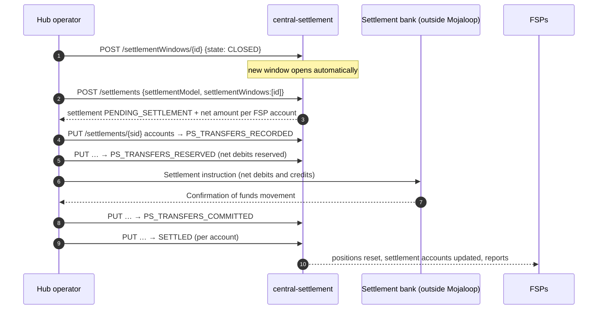

# T8 – Settlement: Inter-Institution Financial Settlement

> **Phase 5 · Scheme operations and platform** · Time box: 6–8 h · Prerequisite: [M10](15-milestone-10-connect-real-bank.md), and a stack with committed `XXX` transfers (the golden-path stack from T7/M9 is ideal) · Next: [T9 – Kubernetes](17-topic-09-kubernetes.md)
> Reference reading: [07 §6–§7](../07-payment-transaction-lifecycle.md#6-worked-financial-example-pkr-5000-from-bank-a-to-wallet-b), [06 §6](../06-microservices-deep-dive.md#6-central-settlement-central-settlement)
> Checked against **central-ledger v19.4.4** seeds (settlement and window states) and the golden-path settlement collections.

---

## Why this matters to a solution architect

Treasury and finance teams judge a scheme by its settlement: how much liquidity it ties up, when real money moves, and how they reconcile. As the architect, you design the bank's settlement and reconciliation process, and you must explain clearly that **clearing (the switch) and settlement (the settlement bank) are different things**.

## Learning objectives

1. Explain settlement models (granularity, interchange, delay) and the models configured in this harness.
2. Explain the settlement-window and settlement lifecycles, and who triggers each step.
3. Run a complete deferred-net settlement cycle against the running switch.
4. Prove the effect on positions and settlement accounts.
5. Design a bank's settlement and reconciliation operating model (D15).

---

## Core concepts

### 1. Settlement models

| Dimension | Options | Meaning |
| --- | --- | --- |
| Granularity | `NET` / `GROSS` | Settle the net of many transfers, or each transfer |
| Interchange | `MULTILATERAL` / `BILATERAL` | Net across all FSPs together, or per pair of FSPs |
| Delay | `DEFERRED` / `IMMEDIATE` | Settle later in windows, or immediately per transfer |
| Ledger account | `POSITION`, `INTERCHANGE_FEE` … | Which hub account type the model settles |
| `autoPositionReset` | true / false | Reset positions when settlement completes |
| `requireLiquidityCheck` | true / false | Enforce liquidity cover at prepare |

Models created by this repository's onboarding:

| Model | Created by | Definition |
| --- | --- | --- |
| `DEFERREDNETXXX` | `hub_setup.json` and golden-path `hub.json` | NET · MULTILATERAL · DEFERRED · POSITION · currency XXX |
| `DEFAULTDEFERREDNET` | both | Same, for any currency without a specific model |
| `CGS` | golden-path `hub.json` | **GROSS · BILATERAL · IMMEDIATE** (continuous gross settlement), for the `cgscurrency` input (INR) |
| `INTERCHANGEFEE` | golden-path `hub.json` | NET · MULTILATERAL · DEFERRED on the `INTERCHANGE_FEE` account type |

### 2. Lifecycles

| Window states (seed) | Settlement states (seed) |
| --- | --- |
| `OPEN` → `PROCESSING` → `CLOSED` → `PENDING_SETTLEMENT` → `SETTLED` (or `ABORTED`; `FAILED` if closing fails) | `PENDING_SETTLEMENT` → `PS_TRANSFERS_RECORDED` → `PS_TRANSFERS_RESERVED` → `PS_TRANSFERS_COMMITTED` → `SETTLING` → `SETTLED` (or `ABORTED`) |



The **instruction to the settlement bank and its confirmation happen outside Mojaloop** (an RTGS file, an API or a manual process). Mojaloop records each step.

### 3. Effect on the ledger (deferred net, `autoPositionReset`)

**Verified in the lab** (central-settlement v17.0.6 / central-ledger v19.4.4, model `DEFERREDNETXXX`, net +5 / −5):

| Account | Before settlement | After `SETTLED` | Posted at |
| --- | --- | --- | --- |
| Net receiver's POSITION (`testfsp2`) | −5 (is owed) | **0** (+5) | `PS_TRANSFERS_RESERVED` |
| Net sender's POSITION (`testfsp1`) | +5 (owes) | **0** (−5) | `PS_TRANSFERS_COMMITTED` |
| Hub `HUB_MULTILATERAL_SETTLEMENT` | 0 | **0** (−5, then +5) | both steps |
| Each FSP's SETTLEMENT account | −5,000 | **−5,000: unchanged** | – |

Settlement posts two **multilateral net settlement (MLNS) transfers**, each between one FSP's POSITION account (role `DFSP_POSITION`) and the Hub's `HUB_MULTILATERAL_SETTLEMENT` account (role `HUB`). That resets positions and restores each FSP's NDC headroom. **It does not move the FSPs' SETTLEMENT accounts.** Those record liquidity (prefunding) and change only through **funds-in / funds-out** (`recordFundsIn`, `recordFundsOutPrepareReserve/Commit`). In an operating scheme, the hub operator must therefore mirror the real settlement-bank movements, for example a funds-out for a net sender whose prefunded collateral was used, as part of the settlement procedure. Design that step explicitly in D15. *[Verified behaviour + RECOMMENDATION for the operating step]*

Sign convention reminder ([T2](06-topic-02-central-ledger.md#2-the-risk-check-at-prepare-exact-rule)): a funded SETTLEMENT account is stored as a **negative** value.

---

## Lab T8 – Run a settlement cycle

All calls go to `central-settlement` on port **3007**, base path `/v2` (`HOST_CENTRAL_SETTLEMENT` in the TTK environment).

**1 – Snapshot the balances** of the FSPs you used (e.g. `testfsp1`, `testfsp2`):

```bash
docker exec central-ledger wget -qO- http://127.0.0.1:3001/participants/testfsp1/accounts
```

```bash
docker exec central-ledger wget -qO- http://127.0.0.1:3001/participants/testfsp2/accounts
```

**2 – Find the open window**

```bash
docker exec central-settlement wget -qO- "http://127.0.0.1:3007/v2/settlementWindows?state=OPEN"
```

**3 – Close it** (replace `<windowId>`; PowerShell shown):

```powershell
Set-Content ..\my-lab\close.json '{"state":"CLOSED","reason":"T8 lab close"}' -Encoding ascii
docker run --rm --network mojaloop-net -v "$((Resolve-Path ..\my-lab).Path):/data" curlimages/curl:8.10.1 -s -X POST "http://central-settlement:3007/v2/settlementWindows/<windowId>" -H "Content-Type: application/json" -d "@/data/close.json"
```

The response body is the **newly opened** window (verified: `settlementWindowId: 2`, `OPEN`), not the one you closed. Closing is asynchronous (`PROCESSING` → `CLOSED`, a few seconds in testing). Re-check with `GET /v2/settlementWindows/<windowId>` until it shows `CLOSED`.

**4 – Create the settlement**

```powershell
Set-Content ..\my-lab\settlement.json '{"settlementModel":"DEFERREDNETXXX","reason":"T8 lab","settlementWindows":[{"id":<windowId>}]}' -Encoding ascii
docker run --rm --network mojaloop-net -v "$((Resolve-Path ..\my-lab).Path):/data" curlimages/curl:8.10.1 -s -X POST "http://central-settlement:3007/v2/settlements" -H "Content-Type: application/json" -d "@/data/settlement.json"
```

Note the settlement `id`, its state `PENDING_SETTLEMENT`, and each participant account's `netSettlementAmount`. Do they sum to zero?

**5 – Walk the states** (same body shape as the golden-path scripts: `participants[].accounts[]` with `id`, `reason`, `state`):

```powershell
$sid = <settlementId>
$s = docker exec central-settlement wget -qO- "http://127.0.0.1:3007/v2/settlements/$sid" | ConvertFrom-Json
function Set-SettlementState([string]$state) {
  $body = @{ participants = @($s.participants | ForEach-Object {
      @{ id = $_.id; accounts = @($_.accounts | ForEach-Object { @{ id = $_.id; reason = "T8 lab"; state = $state } }) } }) } |
      ConvertTo-Json -Depth 6 -Compress
  Set-Content ..\my-lab\settle.json $body -Encoding ascii
  docker run --rm --network mojaloop-net -v "$((Resolve-Path ..\my-lab).Path):/data" curlimages/curl:8.10.1 -s -X PUT "http://central-settlement:3007/v2/settlements/$sid" -H "Content-Type: application/json" -d "@/data/settle.json"
}
Set-SettlementState "PS_TRANSFERS_RECORDED"
Set-SettlementState "PS_TRANSFERS_RESERVED"
Set-SettlementState "PS_TRANSFERS_COMMITTED"
Set-SettlementState "SETTLED"
```

After each call, read the response state. In a real scheme, the step between `RESERVED` and `COMMITTED` waits for the settlement bank's confirmation.

**6 – Prove the effect.** Repeat step 1 and compare POSITION and SETTLEMENT balances with your snapshot (expected, verified: POSITIONs back to 0, SETTLEMENT unchanged; see §3). Then inspect the history. Verified window history: `OPEN → PROCESSING → CLOSED → PENDING_SETTLEMENT → SETTLED`, with a new window `OPEN` created at close time. Settlement history reasons read "All settlement accounts are PS_TRANSFERS_RECORDED" and so on.

```bash
docker exec mysql mysql -uroot -D central_ledger -e "SELECT settlementId, settlementStateId, reason, createdDate FROM settlementStateChange ORDER BY settlementStateChangeId DESC LIMIT 10;"
```

```bash
docker exec mysql mysql -uroot -D central_ledger -e "SELECT spc.settlementId, p.name, pc.currencyId, spc.netAmount FROM settlementParticipantCurrency spc JOIN participantCurrency pc ON pc.participantCurrencyId=spc.participantCurrencyId JOIN participant p ON p.participantId=pc.participantId ORDER BY spc.settlementParticipantCurrencyId DESC LIMIT 10;"
```

```bash
docker exec mysql mysql -uroot -D central_ledger -e "SELECT settlementWindowId, settlementWindowStateId, reason, createdDate FROM settlementWindowStateChange ORDER BY settlementWindowStateChangeId DESC LIMIT 10;"
```

**7 – Liquidity operations (reading lab).** Read [funds_out_commit.json](../../../docker/ml-testing-toolkit/test-cases/collections/tests/golden_path/feature_tests/funds_out/Reserve&Commit/funds_out_commit.json) and [funds_out_abort.json](../../../docker/ml-testing-toolkit/test-cases/collections/tests/golden_path/feature_tests/funds_out/Reserve&Abort/funds_out_abort.json). Explain the two-step funds-out (`recordFundsOutPrepareReserve` → `recordFundsOutCommit` or `recordFundsOutAbort`), and why funds-out must be reserved first.

---

## Architect's lens

**Settlement operating model questions for the scheme and the bank:**

| Topic | Decision |
| --- | --- |
| Window schedule | How many windows per day, cut-off times, weekends and holidays |
| Trigger and approvals | Who closes windows and moves settlement states; maker-checker |
| Settlement bank interface | RTGS file, API or manual; confirmation evidence; timing |
| Failure handling | What happens if an FSP cannot pay its net debit (settlement `ABORTED`, window reusable) |
| Prefunding and NDC | Amount, top-up process, intraday liquidity sources |
| Reconciliation | Hub settlement report vs RTGS statement vs bank GL; break handling SLA |
| Fees | Interchange (`INTERCHANGEFEE` model) and scheme fees: settled how and when |
| Multi-currency | One model per currency; FX provider liquidity in both currencies |

**Talking point for treasury:** "Clearing is continuous and instant. Settlement is periodic and net. Your liquidity need is your peak net outflow between settlements, not your gross volume."

---

## Checkpoint

<details><summary>1. Which model in the harness settles each transfer individually and immediately?</summary>
CGS (GROSS, BILATERAL, IMMEDIATE), created by the golden-path onboarding.
</details>

<details><summary>2. At which settlement state are net debits reserved?</summary>
PS_TRANSFERS_RESERVED.
</details>

<details><summary>3. Where does the money actually move?</summary>
At the settlement bank (e.g. via RTGS), outside Mojaloop. Mojaloop records the settlement steps (MLNS transfers between POSITION and HUB_MULTILATERAL_SETTLEMENT accounts, which reset positions). Changes to FSP SETTLEMENT balances are recorded separately as funds-in / funds-out.
</details>

<details><summary>4. What should the sum of netSettlementAmount across all participant accounts in one settlement be?</summary>
Zero (multilateral net settlement is a closed system).
</details>

---

## Deliverable D15 – Settlement and reconciliation operating model

For Bank A: the settlement calendar, roles and approvals, the settlement-bank interface, the liquidity plan (prefunding, NDC, top-ups), GL postings at settlement, the daily reconciliation procedure with break categories, and the failure scenarios with responses.

Next: [T9 – Kubernetes](17-topic-09-kubernetes.md).
