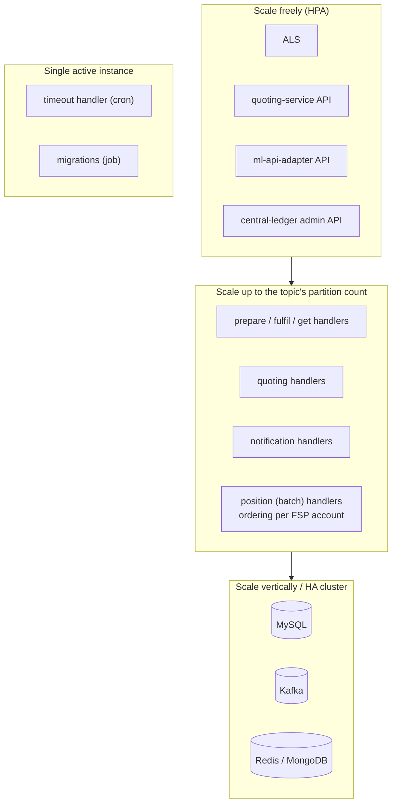

# T9 – Kubernetes: Deployment and Scalability

> **Phase 5 · Scheme operations and platform** · Time box: 6–10 h (more if you install a cluster) · Prerequisite: [T8](16-topic-08-settlement.md) · Next: [Capstone](18-capstone-portfolio.md)
> Reference reading: [15 – Production deployment](../15-production-deployment.md)
> **Evidence note:** this repository has **no Helm charts**. Kubernetes facts come from (a) this repo's `k8s-mojaloop-perf-tuning/`, `docker-compose-perf.yml` and `Dockerfile` **[REPO]**, and (b) the upstream `mojaloop/helm` repository, `main` branch, checked when this project was written **[EXTERNAL]**.

---

## Why this matters to a solution architect

Banks and scheme operators will ask how the switch is deployed, scaled, secured and recovered, and how the bank's own connector should be deployed. You don't need to be a Kubernetes administrator, but you must map Mojaloop's components to deployment units, explain the scaling model and its limits, and define requirements for the platform team.

## Learning objectives

1. Map every compose service in this harness to its Kubernetes equivalent (Helm chart and deployment).
2. Explain how Mojaloop is installed with Helm, and the role of backend dependencies.
3. Explain the scaling model: stateless APIs, partition-bound handlers, per-FSP position ordering, the database.
4. Describe production platform requirements: probes, migrations, config, secrets, ingress, HA, observability.
5. Produce a deployment architecture for a scheme or a bank (D16).

---

## Core concepts

### 1. Compose → Kubernetes mapping

| Harness (compose) | Upstream Helm sub-chart | Kubernetes deployments (names as used by `k8s-mojaloop-perf-tuning/patch.sh`, release `moja`, namespace `mojaloop`) |
| --- | --- | --- |
| `central-ledger` (API + all handlers in one container) | `centralledger` | `moja-centralledger-service` (API) + one deployment **per handler**: `moja-centralledger-handler-transfer-prepare`, `-transfer-fulfil`, `-transfer-get`, `-admin-transfer`, `-timeout` |
| `central-handler-position-batch` | `centralledger` | `moja-handler-pos-batch` |
| `ml-api-adapter` (API + notification handler) | `ml-api-adapter` | `moja-ml-api-adapter-service` + `moja-ml-api-adapter-handler-notification` |
| `quoting-service`, `quoting-service-handler` | `quoting-service` | `moja-quoting-service`, `moja-quoting-service-handler` |
| `account-lookup-service` | `account-lookup-service` | `moja-account-lookup-service` |
| `als-msisdn-oracle-svc` | `als-msisdn-oracle` | – |
| `central-settlement` | `centralsettlement` | – |
| TTK, TTK UI, TTK CLI | `ml-testing-toolkit`, `ml-testing-toolkit-cli` (test hooks such as `ml-ttk-test-setup`, `ml-ttk-test-val-gp`) | – |
| Kafka, MySQL, MongoDB, Redis | **Not** in the `mojaloop` chart; `example-mojaloop-backend` is provided "purely for convenience … PoC environments" | Separate releases or managed services |
| `sim-perffsp-*`, k6 | `perf-test-harness` chart; k6 via k6-operator (this repo's [Dockerfile](../../../Dockerfile)) | – |
| config-modifier overrides | Helm values → ConfigMaps (the perf patches mount `.CLEDGrc` and `.EVENT_SDKrc` from a ConfigMap `config-override`) | – |

Backend dependencies per chart (upstream Helm README): ALS → MySQL; quoting-service → MySQL; ml-api-adapter → Kafka; central-ledger → Kafka, MySQL, MongoDB; central-settlement → MySQL; SDK scheme adapter → Redis, Kafka; TTK → MongoDB.

### 2. Installing with Helm (upstream, summarised)

1. Add dependency repositories and the Mojaloop repo: `helm repo add mojaloop https://mojaloop.io/helm/repo/` then `helm repo update`.
2. Deploy backend dependencies, each operationally isolated (recommended), or `example-mojaloop-backend` for a PoC.
3. Deploy the wrapper chart: `helm --namespace <namespace> install <release> mojaloop/mojaloop`. Options exist to enable bulk, the TTK test jobs and simulators.
4. Alternatively use `local-deployment-methods/helmfile` (values files exist for minimal, ISO 20022, bulk, perf-harness and DB-TLS variants).

**Version alignment warning:** the upstream `mojaloop` chart on `main` (chart **17.2.0**) pins central-ledger **v19.12.7**, ml-api-adapter **v16.9.2**, account-lookup-service **v17.15.2**, quoting-service **v17.14.3**, central-settlement **v17.3.3** and sdk-scheme-adapter **v24.19.5**. This harness pins **older** versions (central-ledger v19.4.4 …). Before a real project, choose **one** release set and test it in the harness (change `.env` in a copy) **and** in Kubernetes.

### 3. Scaling model



| Lever | Evidence in this repo |
| --- | --- |
| Replicas per component | `.env`: `ALS_REPLICAS`, `QS_REPLICAS`, `CENTRAL_LEDGER_*_REPLICAS`, `ML_*_REPLICAS` (perf compose) |
| Partitions | `perf.env`: `KAFKA_POSITION_PARTITIONS_NUM=25`, others 4 |
| Even FSP spread across partitions | `packages/kafaka-partitioner-calculator` (murmur2 on `participantCurrencyId`) |
| Position batching | `CENTRAL_LEDGER_POSITION_BATCH_REPLICAS`, position-batch topic mapping |
| Event overhead | `patch.sh audit/direct/disabled` (event sidecar and Event SDK modes) |
| Measurement | `docker-compose-perf.yml` + k6 + Grafana dashboards; `perf-test.sh` |

The harness itself uses **1 partition and replication factor 1** per topic: fine for learning, and never for production.

### 4. Platform requirements checklist

| Area | Requirement |
| --- | --- |
| Probes | Readiness and liveness on each service's `/health` (as compose health checks do) |
| Migrations | Run once per release as a Job before services start (compare `central-ledger-migrator` in the perf compose) |
| Config | Helm values per environment in Git (GitOps); no ad-hoc edits |
| Secrets | DB, Kafka and JWS/TLS keys from a secrets manager; never baked into images or values in Git |
| Networking | Ingress only through the API gateway (mTLS); NetworkPolicies; egress control for callbacks |
| Resilience | ≥2 replicas for stateless and admin services; PodDisruptionBudgets; anti-affinity across zones |
| Data | HA MySQL with PITR; Kafka with ≥3 brokers, RF=3, `min.insync.replicas=2`; Redis/MongoDB HA |
| Observability | Prometheus scraping `/metrics`; Grafana dashboards (port the repo's `docker/grafana` dashboards); log shipping; tracing |
| Release | Version-pinned charts and images; regression with TTK test jobs after each deploy |

---

## Lab T9

### Option A – Design lab (no cluster needed, 3–4 h)

1. Read [k8s-mojaloop-perf-tuning/patch.sh](../../../k8s-mojaloop-perf-tuning/patch.sh) and one deployment patch (e.g. `transfer-prepare.yaml`). Explain what `patch.sh direct` changes, and why event handling affects throughput.
2. Read [docker-compose-perf.yml](../../../docker-compose-perf.yml) and list each container with its `command:` handler flag and its replica variable.
3. Fill the mapping table above for **your** target: which deployments, how many replicas, which topics, how many partitions, and what scales each one.
4. For a target of X TPS (choose one), write down what you would measure with the perf harness to size it. Do not guess numbers; define the experiment (k6 scenario, dashboards, metrics such as consumer lag, DB CPU, p95 latency).

### Option B – Run the perf harness locally (2–3 h, more resources)

Follow [reference 10 §9.8](../10-local-setup-and-execution.md#98-performance-and-load) (create `perf.override.env` first; make sure `mojaloop-net` exists). Run `fspiopTransfers.json` with `CENTRAL_LEDGER_POSITION_BATCH_REPLICAS=1`, then 2 (in a copy of `.env`). Compare the Grafana dashboards on <http://localhost:9999>.

### Option C – Install on a local Kubernetes (optional, advanced)

Use Docker Desktop Kubernetes, kind or k3d, and follow the **upstream** `mojaloop/helm` README or `local-deployment-methods/helmfile`. Expect a full install to need considerably more CPU and memory than the compose stack; check the upstream prerequisites first. Then:

```bash
kubectl get deployments -n <namespace>
```

```bash
kubectl scale deployment <release>-centralledger-handler-transfer-prepare --replicas=2 -n <namespace>
```

Map each deployment back to the compose service you know, and run the TTK test job (`ml-ttk-test-val-gp`) as described upstream.

---

## Architect's lens

- **For the scheme operator:** managed vs self-hosted Kafka and MySQL (operational maturity vs control); multi-AZ in one region plus a DR region; GitOps; version freeze and certification per release; capacity planning by measurement, not by rule of thumb.
- **For a bank (the connector side):** the Mojaloop Connector and its Redis can run on the bank's Kubernetes or VMs. What matters is HA (2+ instances), DMZ placement, HSM access and egress to the scheme gateway.
- **Requirements to hand the platform team:** the checklist in §4, plus the NFR targets from your solution design.
- **Common mis-expectation:** "just add pods". Throughput per FSP is bounded by partitioning and ordering, and the database is the system-wide limit. Explain this before anyone signs an SLA.

---

## Checkpoint

<details><summary>1. In Kubernetes, why is central-ledger split into several deployments?</summary>
So each handler (prepare, position, fulfil, get, admin, timeout) can be scaled, resourced and restarted independently according to its own load.
</details>

<details><summary>2. You have 4 partitions on topic-transfer-prepare. What happens if you run 8 prepare-handler pods in one consumer group?</summary>
Only 4 consume; the other 4 are idle standbys. Throughput won't increase beyond the partition count.
</details>

<details><summary>3. Is example-mojaloop-backend suitable for production?</summary>
No. Upstream states it is for convenience, PoC and testing; production dependencies should be deployed and operated separately (or as managed services).
</details>

<details><summary>4. Why must the harness and the Helm deployment use the same service versions in a project?</summary>
Because certification and behaviour testing in the harness only prove the versions tested; the upstream chart on main pins newer versions than this harness.
</details>

---

## Deliverable D16 – Deployment architecture

A deployment diagram (zones, clusters, namespaces, data tier, DR), the component mapping table with replicas and partitions, the platform requirements checklist completed, the version set to be certified, and the performance-measurement plan.

Next: [Capstone – Solution Architect portfolio](18-capstone-portfolio.md).
